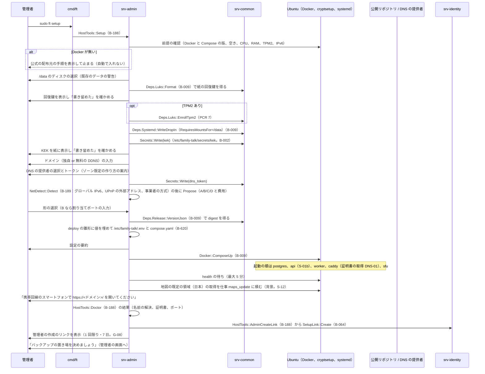
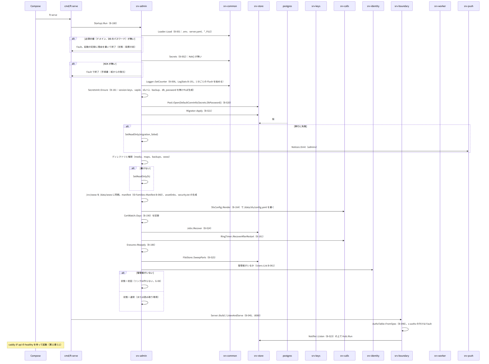
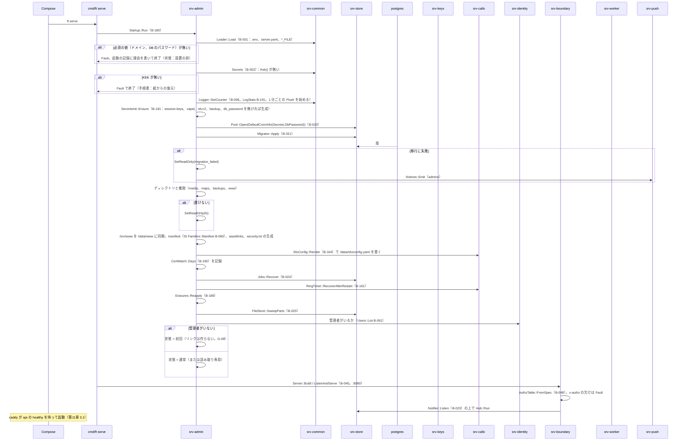
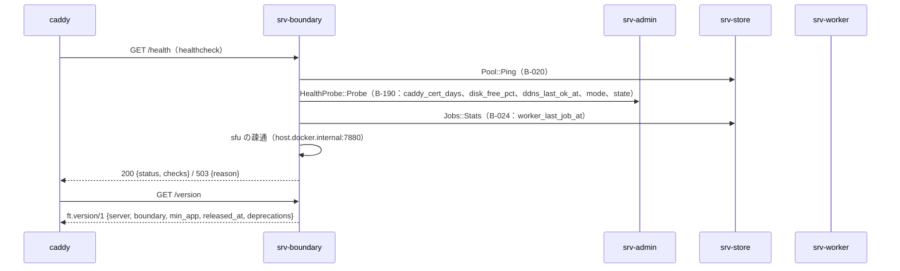
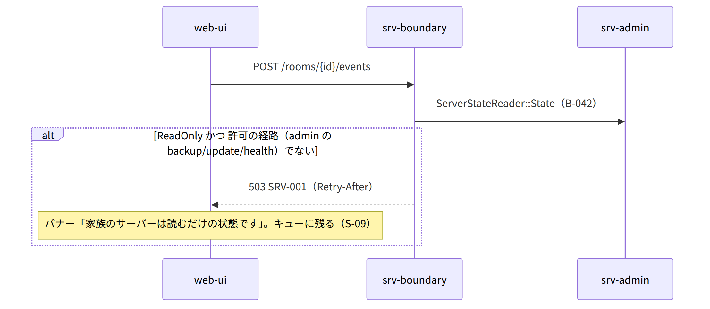
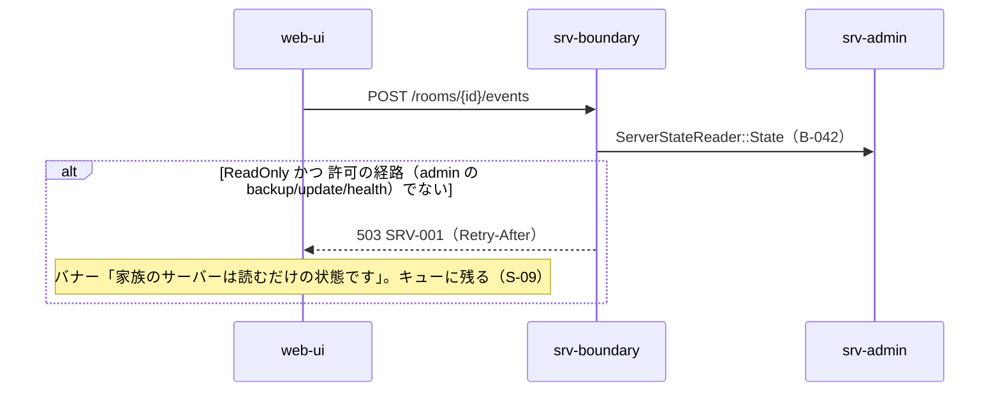

# S-01 家族のサーバーの起動と初回

由来は次のとおり。

- 第1章 7.1（起動の 8 段）、7.10（異常終了の後）、DD-1-15（5 つの状態）
- 第11章 4（設置の流れ）、第11章 3.1（Compose の起動の順）、第12章 10（秘密の生成）、第3章 3.1 の 1
- 全体実装設計書 2.1、3.1
- srv-admin.md（`Startup`、`HostTools`）、srv-store.md、srv-boundary.md

## S-01a `ft setup`（設置。第11章 4 の 0〜11）

図の元の文（mermaid）

- 失敗：Docker が無い（表示して止まる）、TPM の登録に失敗（パスフレーズで続ける。第11章 14）、DNS-01 が失敗（caddy が再試行。知らせ。第11章 14）。

## S-01b api の起動（第1章 7.1 の 8 段）

図の元の文（mermaid）

- 並行して `ft work`：WK `Runner::OnStart`（B-195：`Jobs::Recover`、`Cron::EnsureAll`）の後に `Runner::Run`。worker も `Logger::SetCounter`（LogStats）を同じく行う。
- 失敗の分岐は仕様のとおり：読み取り専用への遷移（第1章 7.1 の 3・4、DD-1-15）は `SetReadOnly` だけが行う。

## S-01c 異常終了の後の起動（第1章 7.10）

- S-01b の 7（後始動）に含まれる。
  - `Jobs::Recover`（locked_until が過ぎた running を queued へ）
  - `RingTimer::RecoverAfterRestart`：ringing のまま 60 秒を過ぎた通話を missed にする。CL が RM `Timeline::CallEvent` B-103 と PS `CallRinger::Stop` B-143 を呼ぶ
  - `FileStore::SweepParts`（期限切れの .part）、`Erasures::Reapply`
- バックアップの一時のファイルは restic が原子のため無い（srv-worker.md）。

## S-01d `/health` と `/version`（無認証。起動の後）

図の元の文（mermaid）

## S-01e 読み取り専用の間の要求（DD-1-15、I-9）

図の元の文（mermaid）

## 抜け

- なし。管理者の作成のリンクが 2 本有効になる抜けは G-08 で直した。api の起動（S-01b の 8）はリンクを作らず「初回」の状態だけを置く。リンクは `ft setup` の最後（S-01a）と `ft admin create-link` だけが作る。正は第1章 7.1 の 8、第3章 3.1 の 1、srv-admin.md の `Startup`。
