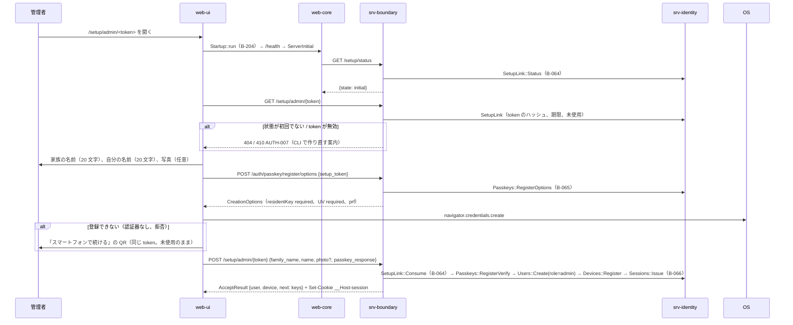
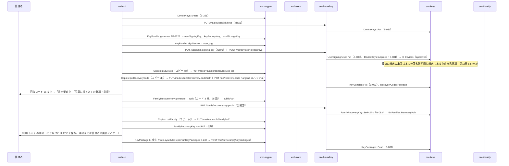
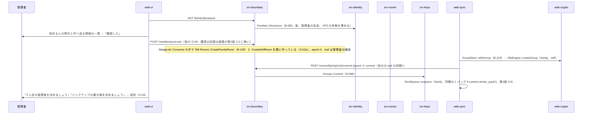

# S-02 最初の管理者

由来：第3章 3.1（1〜9）、第1章 7.2、第2章 5.1（`/setup/*`）、第12章 5.3・5.4（鍵バンドルとコピー）、DD-12-5（カード）、第12章 7・8（明示）、第2章 DD-2-15（家族全員のトーク）、srv-identity.md（`SetupLink`、`Passkeys`、`Devices`、`Sessions`）、srv-keys.md、srv-rooms.md、web-ui.md（`SetupAdmin`）、web-crypto.md。

## S-02a リンクを開いてからパスキーの登録まで（第3章 3.1 の 1〜4）

図の元の文（mermaid）

## S-02b 端末の鍵、鍵バンドル、回復コード、カード（第3章 3.1 の 5〜6）

図の元の文（mermaid）

- 失敗：印刷できない端末（PDF を保存して後で印刷。バナー）、(c) の秘密分散の断片は構成員が 2 人以下では成立しないため (b)(d) が必須（既にこの順）。

## S-02c 明示と家族全員のトーク（第3章 3.1 の 7〜9）

図の元の文（mermaid）

## 抜け
- G-09：「読める人の明示」と「データの取扱いについて」の「確認した」を記録する経路が第2章 5.3 に無い（第3章 3.1 の 7「確認した」を記録、第3章 3.3 の 6）。`POST /me/disclosure-ack {version}` を足し、`users` に `disclosure_ack_version` を持たせる（srv-identity.md の `Users` に `AckDisclosure` を足す）。
- G-10：本人の署名鍵の公開部（`fusr/1`）を置く経路が第2章 5.4 に無い（srv-keys.md の `UserSigningKeys::Put` は経路を仮に `PUT /users/{id}/signing-key` とした）。第2章 5.4 に `PUT /me/signing-key` を足す（本人、承認済みの端末。初回は未承認でも可）。
- G-11：回復コードの Argon2id のハッシュを置く経路が第2章 5.4 に無い（`/me/keybundle/recovery-code/verify` は照合だけ）。`PUT /me/recovery-code {argon2_hash, params}` を足す（再発行も同じ）。
- 家族全員のトークの最初の Commit（グループの作成）は「作成者の端末が行う」が第2章 5.5 の `/rooms` POST の備考にあるが、設置で作られる家族全員のトークと自分用メモについては明示がない。srv-rooms.md `CreateFamilyRoom`／`CreateSelfRoom` は epoch 0 を置き、端末が最初の Commit を送る形に揃えた（srv-keys `Groups::Create` の注記と一致）。仕様の改訂は不要（第4章 4.1 の「設置の時に自動」の範囲）。
