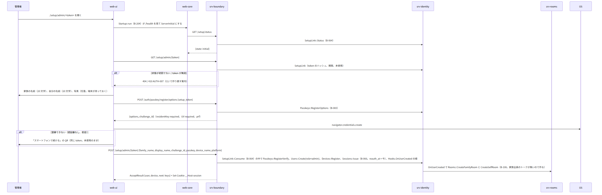
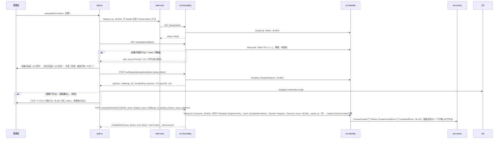
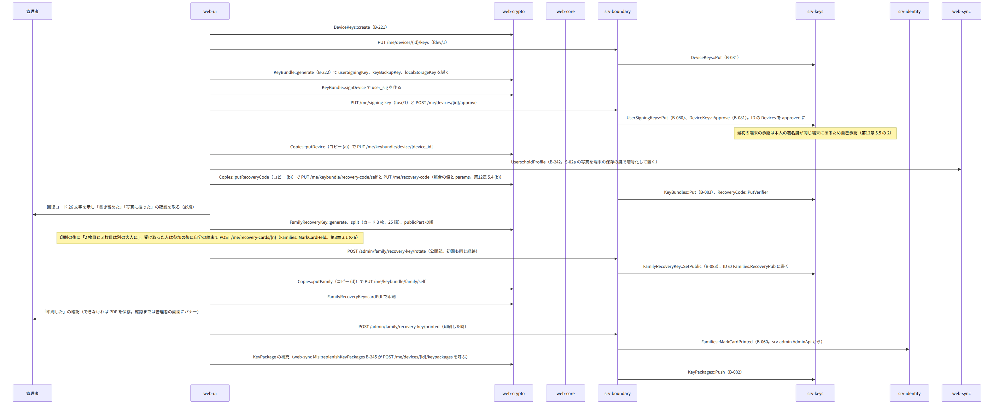
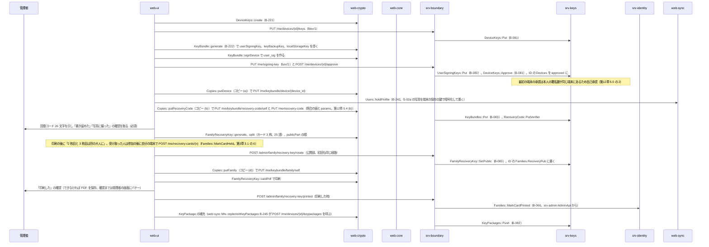
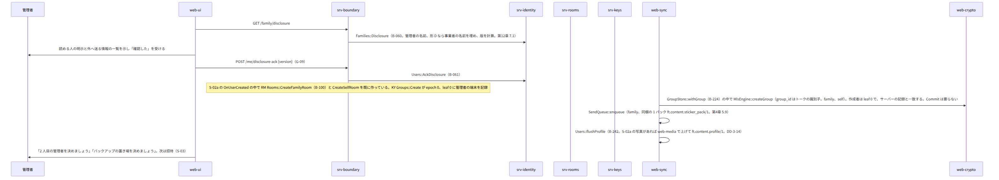
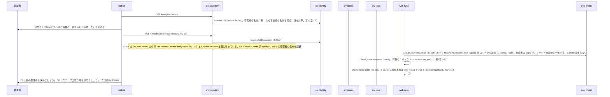

# S-02 最初の管理者

由来は次のとおり。

- 第3章 3.1（1〜9）、第1章 7.2、第2章 5.1（`/setup/*`）、第2章 DD-2-15（家族全員のトーク）
- 第12章 5.3・5.4（鍵バンドルとコピー）、DD-12-5（カード）、第12章 7・8（明示）
- srv-identity.md（`SetupLink`、`Passkeys`、`Devices`、`Sessions`）、srv-keys.md、srv-rooms.md
- web-ui.md（`SetupAdmin`）、web-crypto.md

## S-02a リンクを開いてからパスキーの登録まで（第3章 3.1 の 1〜4）

図の元の文（mermaid）

## S-02b 端末の鍵、鍵バンドル、回復コード、カード（第3章 3.1 の 5〜6）

図の元の文（mermaid）

- 失敗：印刷できない端末（PDF を保存して後で印刷。バナー）、(c) の秘密分散の断片は構成員が 2 人以下では成立しないため (b)(d) が必須（既にこの順）。

## S-02c 明示と家族全員のトーク（第3章 3.1 の 7〜9）

図の元の文（mermaid）

## 抜け

- なし。この入口で見つけた 3 つは直した（全体実装設計書 11.1）。
  - G-09：`POST /me/disclosure-ack {version}`（srv-identity `Users::AckDisclosure`）
  - G-10：`PUT /me/signing-key`（第2章 5.4。規則 first_or_approved）
  - G-11：`PUT /me/recovery-code {argon2_hash, params}`（第2章 5.4。再発行も同じ）
- 家族全員のトークと自分用メモの最初の状態：srv-rooms.md の 2 つの作成は epoch 0 と leaf 0（作成者の端末）を置き、端末は同じ group_id でグループを作る。最初の Commit は 2 人目を Add する時（S-03d）。第4章 4.1 の「設置の時に自動」の範囲で、仕様の改訂は要らない。
- 家族回復鍵の公開部の初回は、作り直しと同じ `POST /admin/family/recovery-key/rotate` を使う。設置の直後はパスキーの登録（UV）から 5 分以内のため、再認証は満たす（第3章 4.5）。
