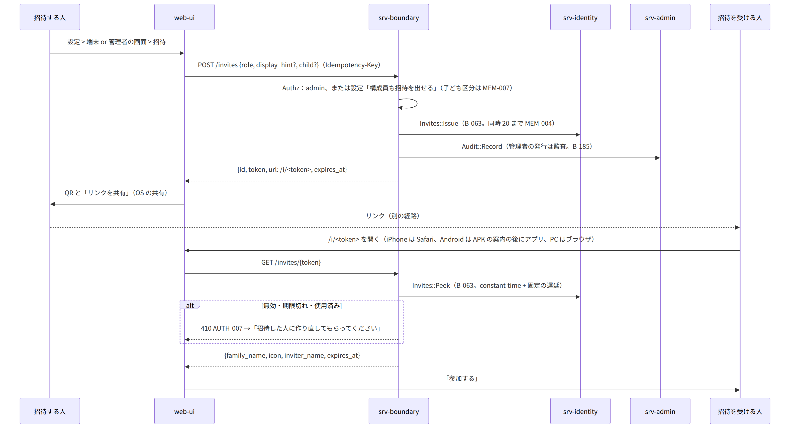
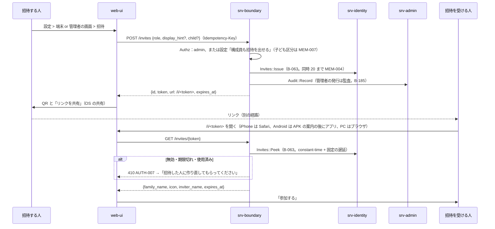
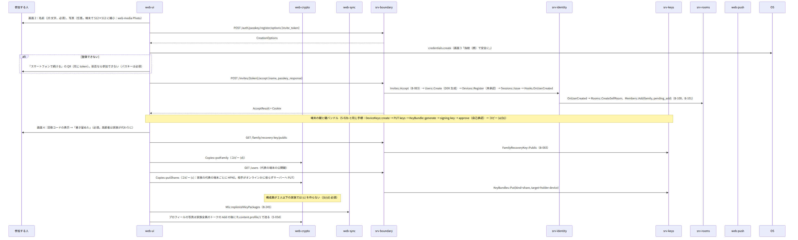
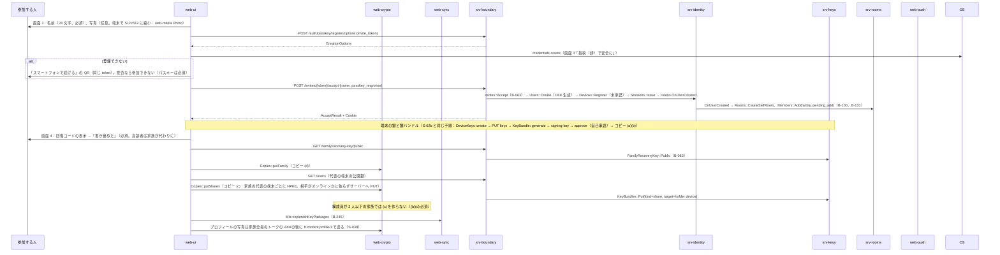
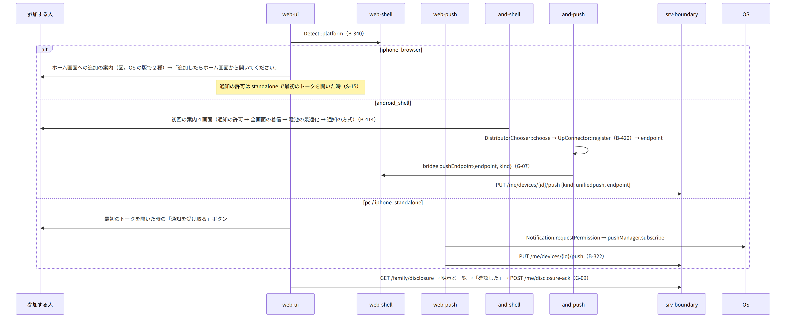
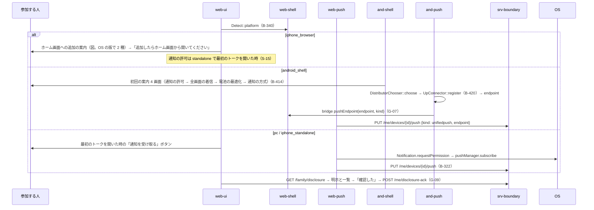
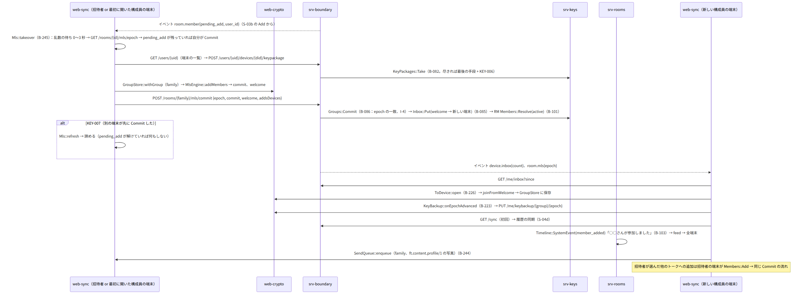
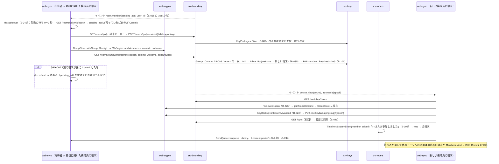

# S-03 招待と参加

由来：第3章 3.2（招待）、3.3（参加の 7 画面）、第1章 7.3、第2章 5.1、第12章 5.4（コピー (a)(b)(c)(d)）、5.5（新しい端末の参加 4〜5）、第4章 4.1（追加待ちの引き継ぎ）、第7章 10（初回の案内）、第8章 3.3（iPhone の追加の案内）、第3章 9（子ども区分）、srv-identity.md、srv-keys.md、srv-rooms.md、web-ui.md、web-sync.md、web-push.md。

## S-03a 招待の発行と受け取り（第3章 3.2）

図の元の文（mermaid）

## S-03b 参加の 3 画面（第3章 3.3 の 2〜4）

図の元の文（mermaid）

## S-03c 通知の許可と明示（第3章 3.3 の 5〜6、第7章 10、第8章 3.3）

図の元の文（mermaid）

## S-03d 家族全員のトークへの Add（第3章 3.3 の 7、第4章 4.1、第12章 5.5 の 4〜5）

図の元の文（mermaid）

- 失敗：Add を行う端末が途中で切れた → 次にオンラインになった構成員の端末が `takeover`（第4章 8）。KeyPackage が尽き最後の手段も使えない → 端末がオンラインになるまで Add を保留（第12章 13）。pending_add が 7 日残る → srv-worker の監視が知らせ（srv-worker.md MonitorHandler）。

## S-03e 子ども区分（第3章 9）
- S-03b の画面 2 の後に「保護者：○○、○○」を示す（`GET /invites/{token}` の応答に `child.guardians` の表示名を含める：第2章 5.1 の備考に無い → G-12 として第2章 5.1 の `GET /invites/{token}` の応答に `child: {guardian_names[]}` を足す）。画面 6 の明示は子にも分かる文言（P-8 の別の鍵）。

## 抜け
- G-12：招待の受け取りの応答（`GET /invites/{token}`）に子ども区分と保護者の表示名が無い（第3章 9.1 の「子の画面に常に表示」の初回の分）。
- G-07（既出）：シェル → ウェブアプリの `pushEndpoint` のイベント。
- G-09（既出）：`POST /me/disclosure-ack`。
- 写真の縮小（512×512）は web-media `Photo::prepare` の `quality=avatar` として扱う。web-media.md の `Photo` に `avatar` の経路を足した（本シーケンスで足す：512×512 の JPEG、サムネイル 128）。
