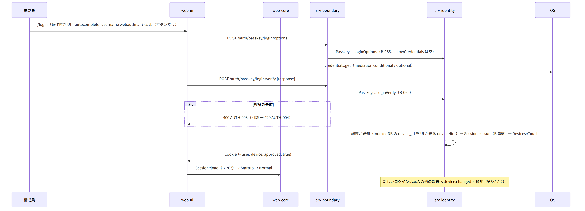
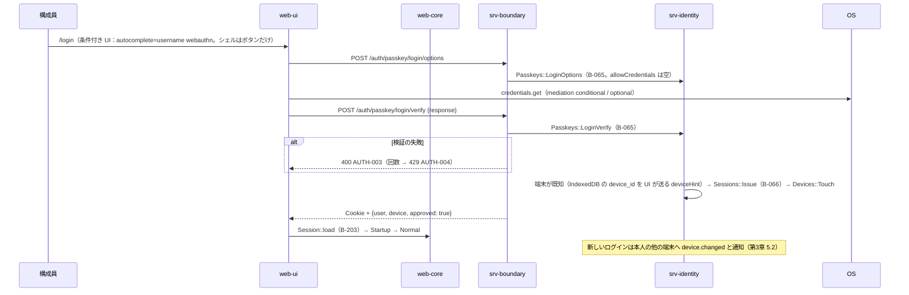
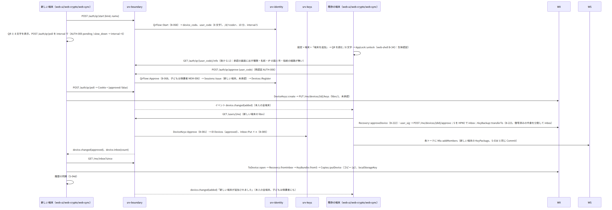
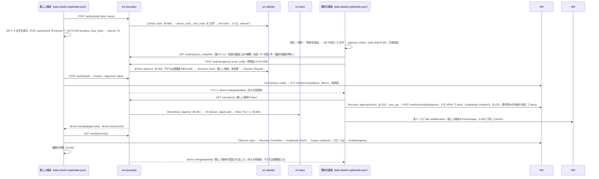
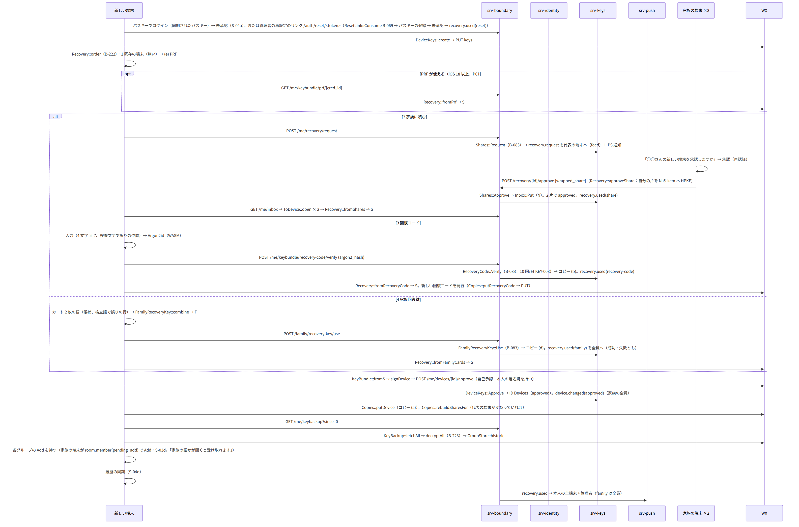
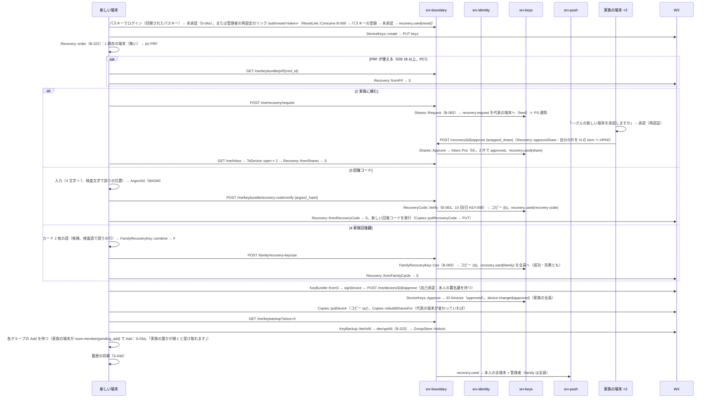
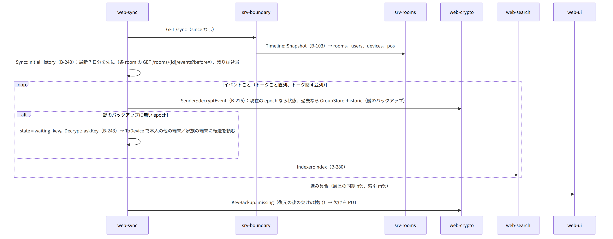
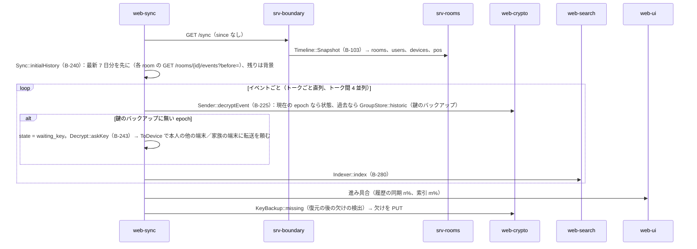

# S-04 ログインと新しい端末

由来：第3章 4.1〜4.6（パスキー、ログイン、セッション、新しい端末の追加、再認証、回復）、5.1（端末の状態）、第1章 7.7、第2章 5.2・5.4、第12章 5.4（回復の 4 段と PRF）、5.5（参加の 1〜5）、5.6（鍵のバックアップの転送と取得）、第4章 5.7（索引の作成）、第1章 7.11（履歴の順）、srv-identity.md（`Passkeys`、`QrFlow`、`Sessions`、`ResetLink`）、srv-keys.md（`Recovery`、`Shares`、`KeyBackup`、`Inbox`）、web-crypto.md（`Recovery`、`KeyBackup`）、web-sync.md（`Sync::initialHistory`）、web-search.md。

## S-04a パスキーでログイン（既知の端末）（第3章 4.2、4.3）

図の元の文（mermaid）

- セッションの静かな作り直し（第3章 4.3）：`X-Session-Expires` の 7 日前に WC `Session.state = expiring` → 次に開いた時に UI が `credentials.get`（UV）→ `POST /auth/passkey/login/verify` → ID `Sessions::Rotate`（古いものは失効）。後回しにし続ければ期限で `session.revoked` → ログインの画面。

## S-04b 新しい端末の追加：QR の承認（第3章 4.4）

図の元の文（mermaid）

- 失敗：10 分で承認が来ない → AUTH-005 expired。新しい端末は作り直し、既存の承認の画面は閉じる。承認の後に鍵バンドルが届かない（転送の途中で切れた）→ N は「鍵を待っています」。E は次にオンラインの時に `inbox` の未送信を再開（web-crypto `Recovery.approveDevice` は冪等。inbox の未送信は E の IndexedDB `queue` に積む：抜け G-14）。10 分経てば N に回復の 4 段を案内。

## S-04c 回復の 4 段（既存の端末が無い。第3章 4.6、第12章 5.4）

図の元の文（mermaid）

- 失敗（第12章 13）：どの段も使えない → 未承認のまま 7 日（`Devices::ExpireUnapproved`）。画面に 4 段の案内。

## S-04d 履歴の同期と索引（第12章 5.5 の 5、第1章 7.11、第4章 5.7）

図の元の文（mermaid）

## S-04e アプリのロック（第3章 4.7）
- web-shell `AppLock`（B-343）：画面の表示の前。生体認証はシェル `biometricUnlock`（and-keystore B-402）または WebAuthn `get()`（UV）。暗証番号は `AppLockHash::verify`。失敗 5 回で 1 分、以後倍、10 回で `Db::wipe` + `DELETE /me/devices/{me}`（自分の端末の取り消し。本人の他の端末に `device.changed(revoked)` と通知「○○（端末名）がロックの失敗で初期化されました」）。通知の表示と着信の応答はロックの外。

## 抜け
- G-13：承認の画面に出す「新しい端末の種類・名前・IP の国と市・鍵の指紋」を既存の端末が取る経路が第2章 5.2 に無い。`GET /auth/qr/{user_code}` （本人。承認の前の情報）を足す。IP の国と市は端末の中の地理のデータで求めるため、応答は生の IP（エンベロープから開いた値）。
- G-14：承認の時の鍵バンドルと鍵のバックアップの転送（inbox への PUT の列）が途中で切れた時の再開のため、既存の端末は未送信を IndexedDB `queue` に「inbox の項目」として積む（web-sync.md `queue` の `kind` に `inbox` を足す）。
- 回復コードの再発行の経路は G-11（`PUT /me/recovery-code`）。
