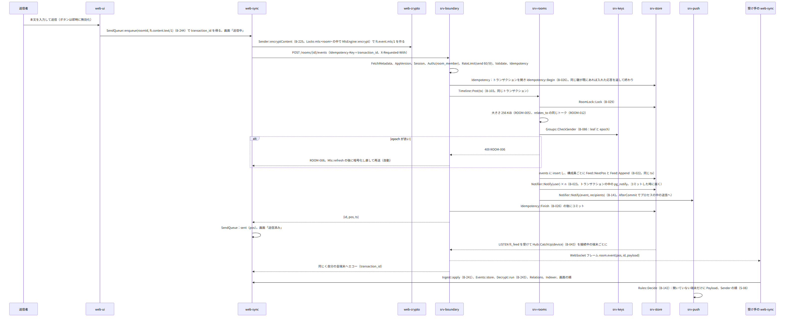
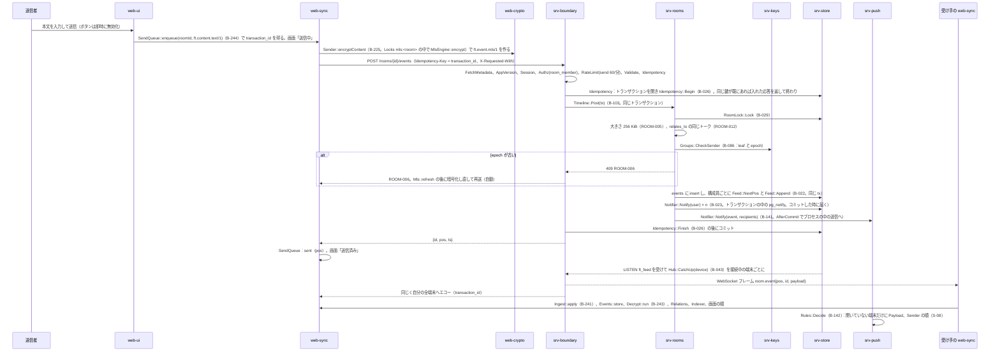
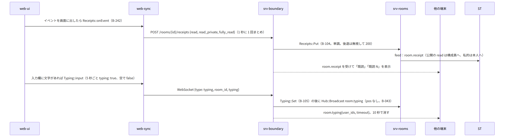
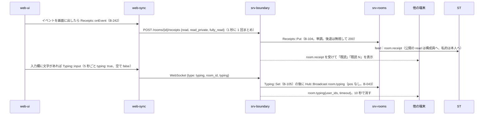
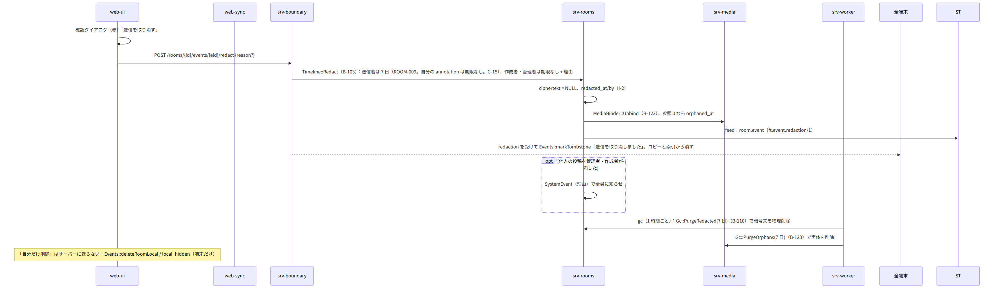
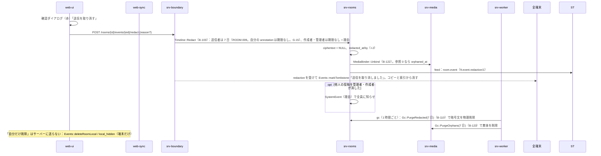
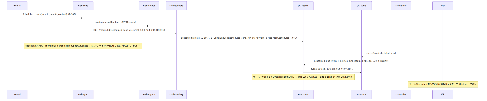
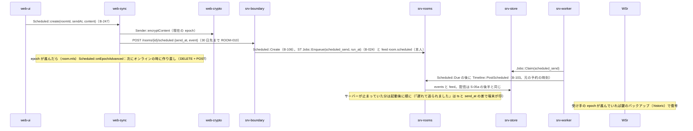

# S-05 送信と配信

由来は次のとおり。

- 第4章 5.1（送信）、5.2（受信と表示）、3.2（関係）、5.4（既読、入力中）、5.5（メンション、通知なし）、5.8（予約送信）
- 第1章 7.4、第2章 5.5、6、11（競合）、第12章 5.2（DS）、5.7、9（取消）
- 全体実装設計書 2.4（feed + NOTIFY）
- srv-rooms.md、srv-store.md、srv-boundary.md（`Hub`）、srv-push.md、web-sync.md、web-crypto.md

## S-05a テキストの送信と配信（第1章 7.4）

図の元の文（mermaid）

- 失敗：
  - 回線が切れている：キューに残る（S-09）。7 日で expired「送れませんでした」（再送か破棄）
  - 同じ Idempotency-Key で本文が違う：NET-008（端末の不具合。記録）
  - レート制限：NET-004 と Retry-After（1 回だけ再試行）

## S-05b 既読と入力中（第4章 5.4）

図の元の文（mermaid）

## S-05c 関係：返信、編集、リアクション、投票・出欠、転送（第4章 3.2）

- 送信は S-05a と同じ。違いは中身と平文の欄：
  - 返信：`relates_to{rel_type: reply, event_id}` と中身の `inReplyTo`。受け手は `Relations::resolve`（元の冒頭。元が削除済みの印なら「取り消されたメッセージ」）。
  - 編集：`relates_to{replace, event_id}`。送信者だけ、15 分（期限の外は UI がメニューに出さない。競合は ROOM-009）。受け手は最新の本文 +「編集済み」。
  - リアクション：`relates_to{annotation, event_id, key: 絵文字}`。同じ絵文字を再度送ると取り消し（S-05d の取消を自分のリアクションに）。
  - 投票・出欠：`annotation`（key = 元の event_id）。本人の最新が有効。締切は端末が判定（遅れて届いた票は有効）。
  - 転送：`ft.content.forward/1`。添付は同じ `id`、`key`、`hash` を参照（srv-media `Refs::Bind` が別のトークのイベントに結び付ける。GC は全部の結び付きが外れてから）。
  - 関係の対象が別のトークなら RM が ROOM-012。

## S-05d 取消と削除（第4章 3.2、第12章 9）

図の元の文（mermaid）

## S-05e 予約送信（第4章 5.8、第12章 5.7）

図の元の文（mermaid）

## S-05f メンションと通知なし送信（第4章 5.5）

- `@` の候補（表示名と別名）を選ぶと、本文に表示名、平文の欄に `mentions.user_ids` と `mentions.room`。`silent: true` は送信ボタンの長押し。PS `Rules::Decide` が `mentions` でミュートを越え、`silent` でバッジだけ（S-08）。

## 抜け

- `Idempotency-Key` の衝突（NET-008）は端末の不具合として記録するだけ。web-sync `SendQueue` は該当の項目を `failed` にし「送信に失敗」と示す。仕様どおり（第2章 13）。
- リアクションの取り消しの期限（G-15）は直した。第4章 3.2 は「自分のリアクション（annotation）の取り消しは期限なし」、srv-rooms.md `Timeline::Redact` も同じ（平文の relates_to で判定）。
