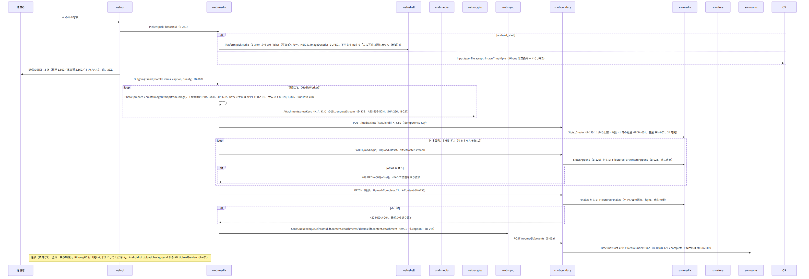
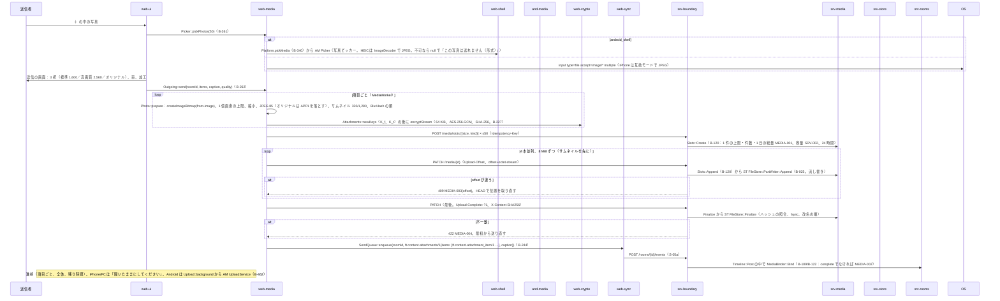
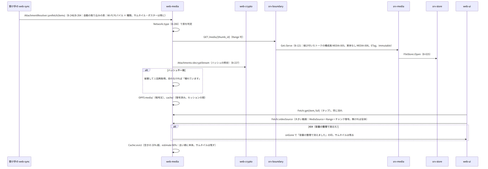
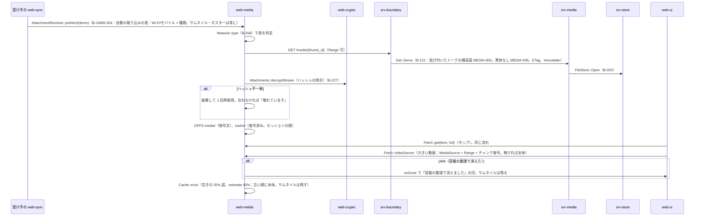
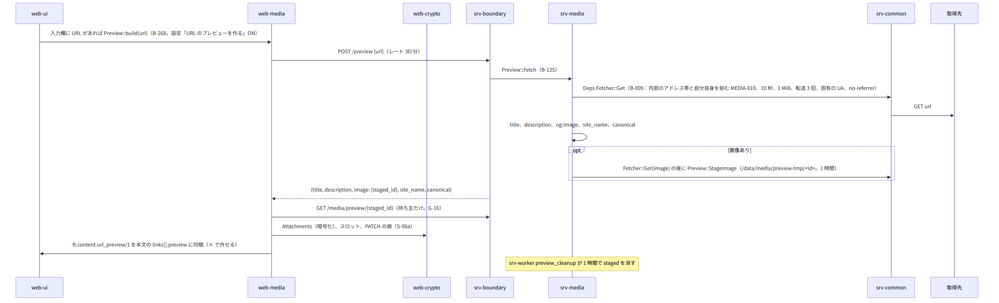
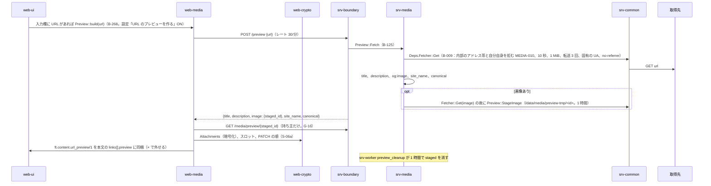
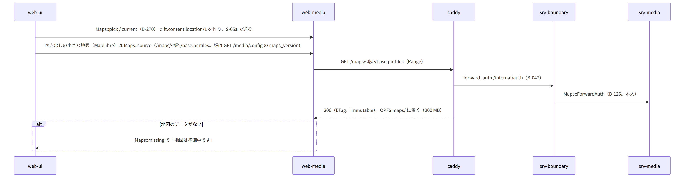
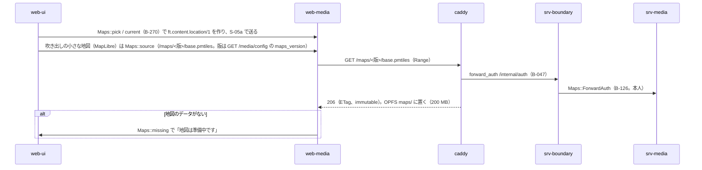

# S-06 添付

由来は次のとおり。

- 第5章 3（項目）、4（端末の処理）、5.1（アップロード）、5.2（取得）、5.3、6（アルバム）、7（容量）、8（地図）
- 第1章 7.5、第2章 5.6、11、第4章 5.6（プレビュー）、5.9（スタンプ）、第9章 9（シェル）
- 第12章 5.7（暗号化）、5.10（プレビュー）、9（GC）
- web-media.md、web-crypto.md、srv-media.md、srv-rooms.md、srv-worker.md、and-media.md

## S-06a 写真の送信（第5章 4.1、5.1、第12章 5.7、第1章 7.5）

図の元の文（mermaid）

- 失敗（第5章 10）：
  - 再開でスロットの期限切れ（24 時間）：最初から（キューに残る）
  - 回線が切れた：`HEAD` で位置を取り直して続きから
  - 電池 20% 未満の動画の変換は確認する
  - 容量 100%：SRV-002（キューに残り、管理者が対処すれば送られる）

## S-06b 動画・音声・ファイル（第5章 4.2〜4.4）

- 動画：`Video::probe`（mediabunny）で判定する。
  - 範囲内は無変換（faststart の並べ替え）
  - 範囲外で `VideoEncoder` があれば 1080p H.264 へ変換（進捗、電池の確認）。無ければ原本と `playable_hint: original`
  - ポスター 1,280 と BlurHash、長さ。以後は S-06a と同じ（本体の前にポスター）
- 音声：`Audio::record`（MediaRecorder。`audio/mp4`、`audio/webm;codecs=opus` の順に試す。30 分で停止。波形 64 点）。送る前に聞ける。送信は S-06a。
- ファイル：`Files::sniff`（魔法数）、`safeName`（NFC）。1 GB。S-06a。受け手は PDF・画像・動画・音声だけ画面で開き、他は保存のみ。
- 5 分・1 GB 超の動画は「ファイルとして送る」を案内。

## S-06c 取得と表示（第5章 5.2、第12章 5.7）

図の元の文（mermaid）

## S-06d URL のプレビュー（第4章 5.6、第12章 5.10）

図の元の文（mermaid）

- 受け手は取得しない（同梱）。失敗はプレビューなしで送る（第1章 4.2）。

## S-06e アルバムとスタンプ（第5章 6、第4章 5.9）

- アルバム：`ft.content.album/1`（title、items ≤1,000、removed_ids）。一括 300 件まで（画質はアルバムの設定）。S-06a の繰り返しの後に 1 つのイベント。追加・削除は `replace`（最新が有効。`Relations::albumItems` が和集合を解く）。
- スタンプの作成：
  - 順は `Stickers::cutout`（手動の切り抜き、消しゴム）、文字と落書き、名前、`Stickers::pack`（512×512 WebP、アニメーション 2 秒・1 MB）
  - 絵柄は添付として S-06a で送り、`ft.content.sticker_pack/1` を家族全員のトークへ（更新は replace）。タグされた本人には通知
- 「削除を求める」：`ToDevice::seal(sticker_remove_request)` で作成者と管理者の端末へ `POST /devices/{did}/inbox`。
  - サーバーの側は RM `StickerRemoveRequest::Send`（B-108）
  - 7 日ごとの再通知は srv-worker

## S-06f 地図（第5章 8）

図の元の文（mermaid）

## S-06g GC（第12章 9、srv-worker gc）

- 1 時間ごと：`Slots::SweepExpired`（24 時間の未完）、`Gc::PurgeOrphans`（参照 0 から 7 日で実体の削除）、`FileStore::SweepParts`。
- 保持の規則（管理者の N 年）は日次 `RetentionHandler`：30 日前に家族全員のトークへ知らせ、期日に `Gc::ApplyRetention`（暗号文だけ。サムネイルとポスターは残す）。

## 抜け

- プレビューの staged な画像を取る経路は G-16 で直した（第2章 5.6 の `GET /media/preview/{staged_id}`。本人。1 時間）。
- 端末が地図の今の版を知る経路は直した（第2章 5.6 の `GET /media/config` の `maps_version`）。
- シェルでの HEIC 以外の `onShowFileChooser` の `capture`（カメラ）は and-media `Picker` が OS のカメラへ渡す（第9章 9 の「カメラ（直接の撮影）」）。本シーケンスでは S-06a の alt に含める。
