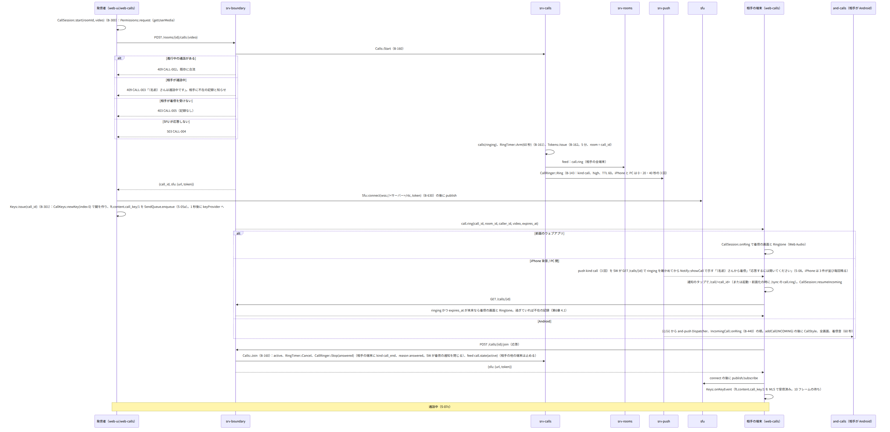
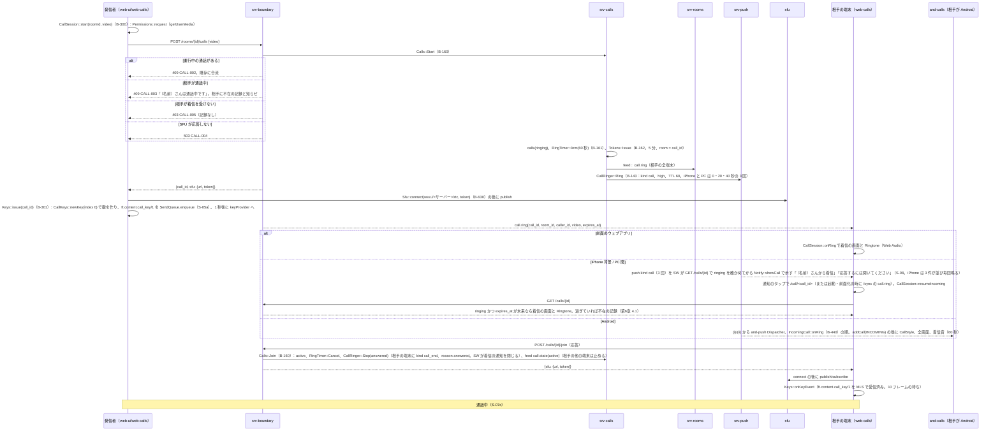
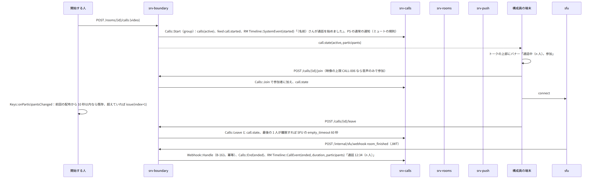
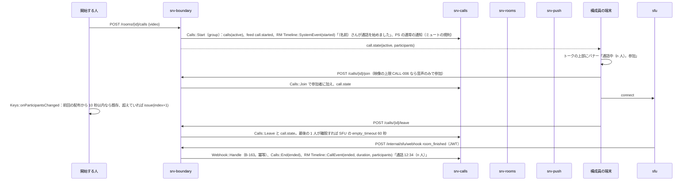
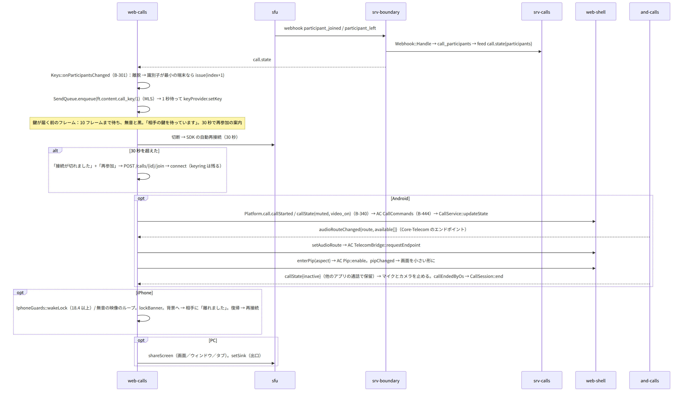
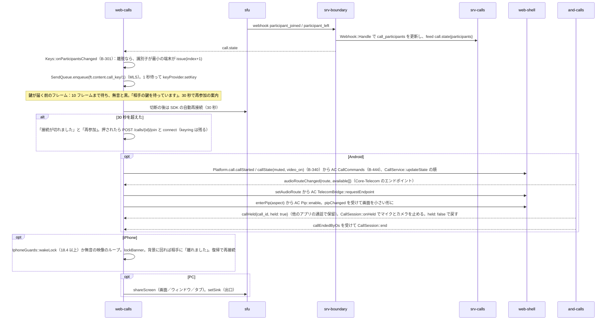
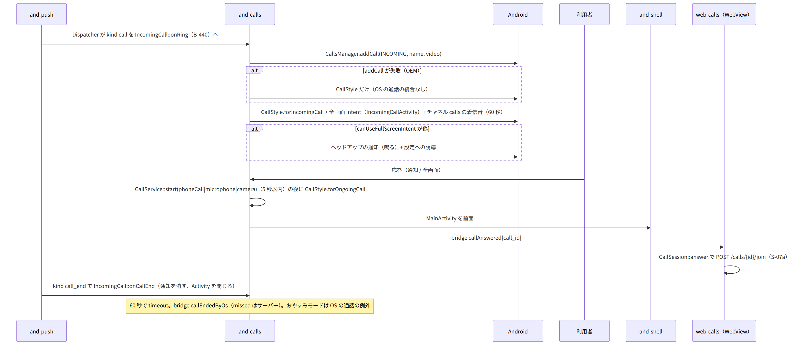
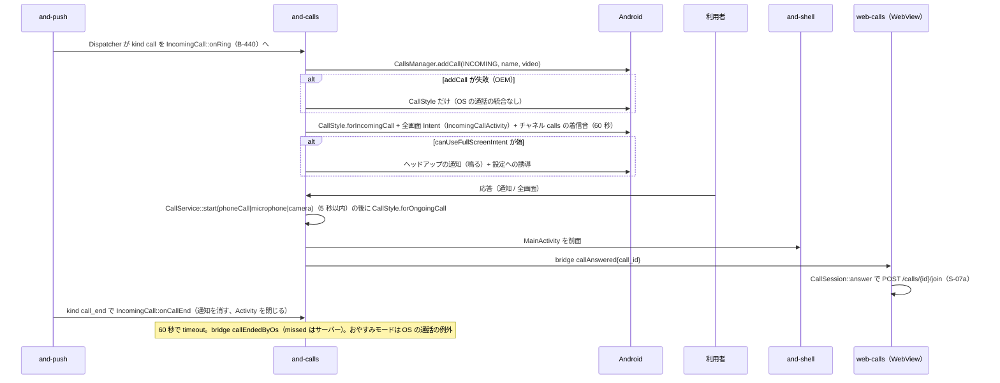

# S-07 通話

由来は次のとおり。

- 第6章 3〜7（基盤、開始と着信、通話中、記録、暗号化の運用）、9（失敗）、第1章 7.6
- 第2章 5.7、6.2（`call.ring`、`call.state`）、11（同時の開始）、第12章 5.11（鍵）、第7章 7（着信の通知）、第9章 6（シェル）
- 全体実装設計書 2.1（Webhook）、3.1（`RingTimer`）
- srv-calls.md、srv-push.md、web-calls.md、web-crypto.md、and-calls.md、and-push.md

## S-07a 1 対 1：発信から応答まで（第6章 4.1）

図の元の文（mermaid）

- 拒否：B の `decline` が `POST /calls/{id}/decline` を呼び、CL `Decline` が call.state{declined}、`Timeline::CallEvent(declined)`、`CallRinger::Stop(declined)`（相手の他の端末に `call_end`）を行う。
- 取消：A の `cancel` が `POST /calls/{id}/end`（ringing のまま）を呼び、cancelled になる。`CallRinger::Stop(cancelled)` で相手の全端末に `call_end`。
- 不在：`RingTimer::Fire`（60 秒）で missed。call.state{missed}、`CallEvent(missed)` を双方、相手に `kind: call_end`（reason missed）の通知「不在着信」。
- `call_end` を受けた SW は着信の通知を閉じる（表示から 30 秒は閉じられないので待つ）。missed 以外は音なしの「終わりました」（第7章 7、S-08）。
- Android の応答：AC `answer`、`CallService::start`（5 秒以内）、CallStyle 通話中、`MainActivity` を前面、bridge `callAnswered{call_id}`、web-calls `answer` の順。
- Android の拒否：bridge `callDeclined`、`/decline`、`disconnect` の順。

## S-07b グループ（第6章 4.2）

図の元の文（mermaid）

## S-07c 通話中：鍵の配り直し、再接続、音声の経路、PiP（第6章 5、第12章 5.11、第9章 6）

図の元の文（mermaid）

- 終了：`POST /calls/{id}/end` または最後の離脱で S-07b の `room_finished`。dm の `End(ended)` は発信者・参加者の `end` で即時（CL が `SfuAdmin::DeleteRoom` B-009）。

## S-07d 通話中の別の着信、着信を受けない、同時の発信（第6章 4.1、第2章 11）

- 別の着信：CL `Calls::Start` が `IsBusy(callee)` なら発信者に CALL-003。
  - 相手には不在の記録と「通話中に {name}さんから着信」の知らせ（RM `Timeline::CallEvent`：`ft.event.call/1` の `missed`、`reason: busy`）
  - シェルには届かない
- 着信を受けない：`Users::Settings` の `receive_calls = false` なら CALL-005（記録なし）。
- 同時の発信：同じトークに進行中があれば CALL-002 で既存に合流（RoomLock の中で `InProgressOf`）。

## S-07e シェルの着信（Android。第9章 6）

図の元の文（mermaid）

## 抜け

- 1 対 1 の `End` の即時の終了：srv-calls.md `Calls::End` の注記に足した。dm は SfuAdmin.DeleteRoom（B-009）でルームを閉じ、Webhook の room_finished を待たずに CallEvent(ended)。
- 通話の鍵のイベント（`ft.content.call_key/1`）は、通話の参加者でない構成員の端末にも MLS で届く（トークのグループ）。受け手は通話に参加していなければ keyring に入れるだけ（web-calls `Keys::onKeyEvent` は `CallSession.state` が idle なら保持だけ）。仕様どおり（第12章 5.11）。
- Android で他のアプリの通話（電話）による保留を伝えるイベントが無かった。第9章 4.2 にイベント `callHeld` を足した。
  - 送る側：and-calls `TelecomBridge::onSetInactive`／`onSetActive`
  - 受ける側：web-calls `CallSession::onHeld`
- iPhone の `call_end` の通知の置き換えと「不在着信」の通知は S-08。
