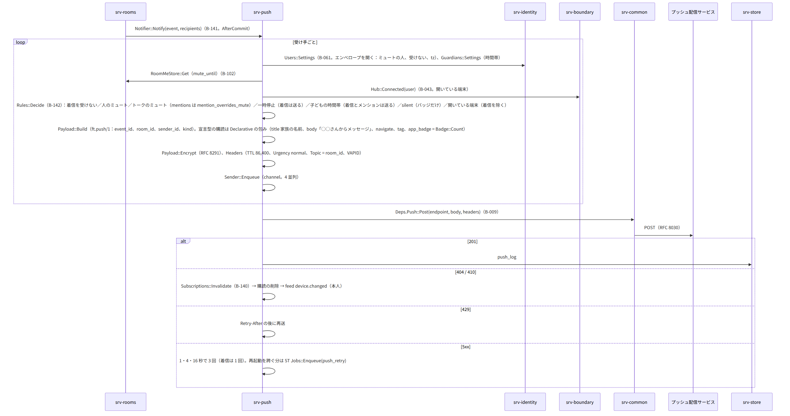
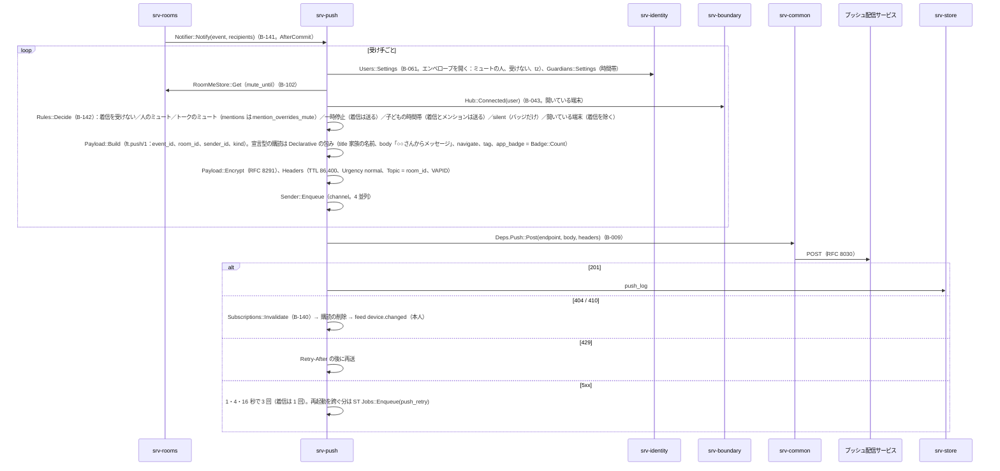
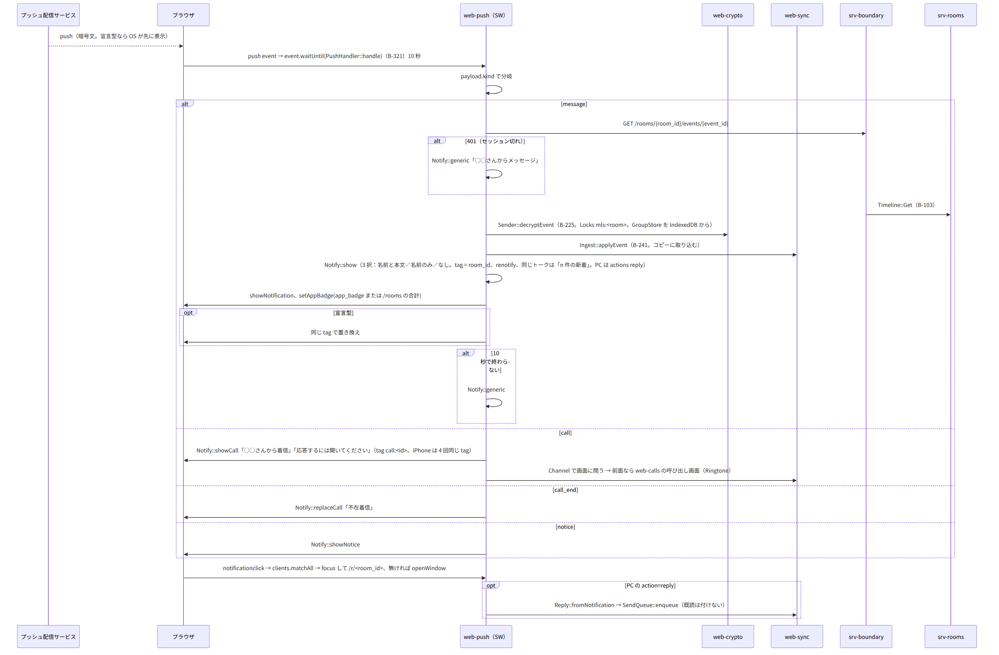
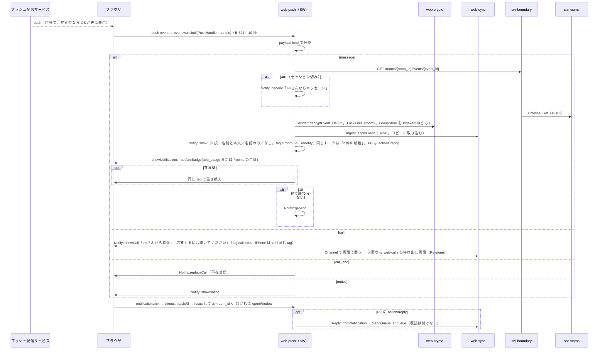
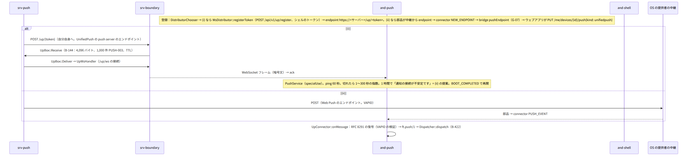
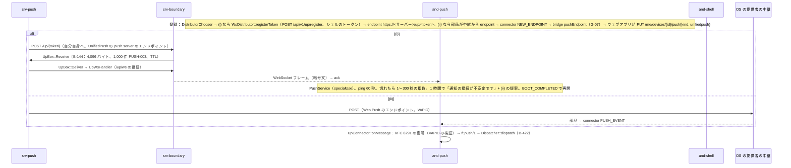
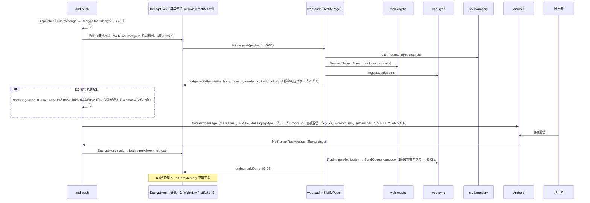
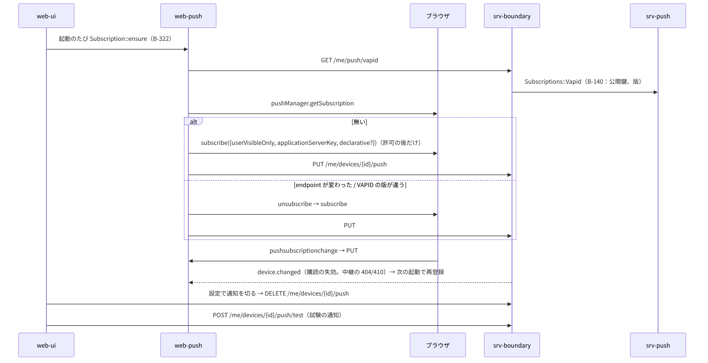
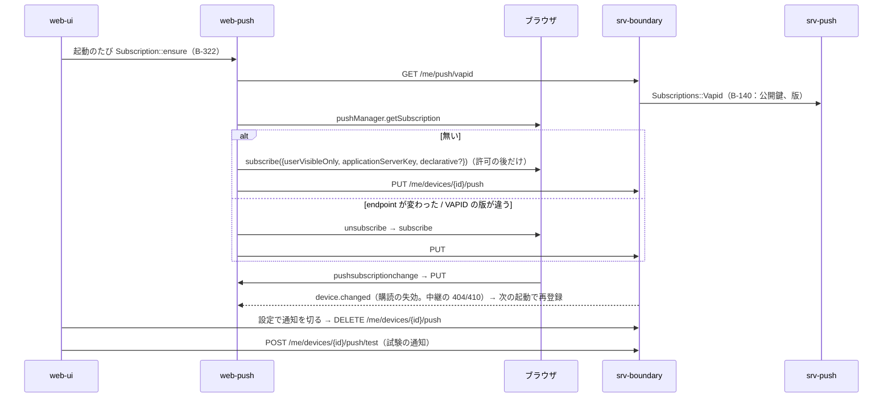

# S-08 通知

由来：第7章 3〜11、第2章 5.8、7、第12章 5.8、第8章 3.2（SW）、第9章 5（シェル）、第1章 4.2（中継の失敗）、全体実装設計書 2.2（`/notify.html`）、2.3（送信の channel）、2.5（錠と 10 秒）、srv-push.md、web-push.md、and-push.md、and-shell.md。

## S-08a 送信の判定と中継への POST（第7章 3.2、6、第2章 7）

図の元の文（mermaid）

## S-08b iPhone と PC：Service Worker の受信（第7章 5.1、第12章 5.8、第8章 3.2）

図の元の文（mermaid）

- 必ず 1 回 `showNotification`（iOS の規則）。SW の寿命は短い前提。

## S-08c Android：(i) 常時接続と (ii) OS の提供者のエンドポイント（第7章 3.1、第9章 5）

図の元の文（mermaid）

## S-08d Android：`DecryptHost` の復号と表示、直接返信（第9章 5、第7章 5.4）

図の元の文（mermaid）

## S-08e 購読の登録・確認・更新・失効（第7章 4）

図の元の文（mermaid）

## S-08f 知らせ（`notice`。第7章 9）
- 発行：PS `Notices::Emit(kind, level, text_key, params, audience)`（B-147）→ `notices` 表（重複の抑止 (kind, key, day)）→ feed `notice`（self／all／admins／guardians）→ 管理者の端末へ `kind: notice` の通知（本文は汎用）。トークに残るものは RM `FamilyRoom::Flow` → `ft.event.system/1`。
- 受け：web-sync `Notices::onNotice` → IndexedDB `notices` → web-ui の知らせの一覧とバナー。シェルは `Notifier::notice`。

## 抜け
- G-06（既出）：`DecryptHost` と `/notify.html` の JS ブリッジの 4 つ（`push`、`notifyResult`、`reply`、`replyDone`）。
- G-07（既出）：`pushEndpoint`。
- バッジの値：iPhone は宣言型の `app_badge`（サーバーが `Badge::Count`）、Android は `notifyResult.badge`（ウェブアプリが `/rooms` から計算）→ and-push `Notifier::badge(setNumber)`。第7章 5.3 と一致。
