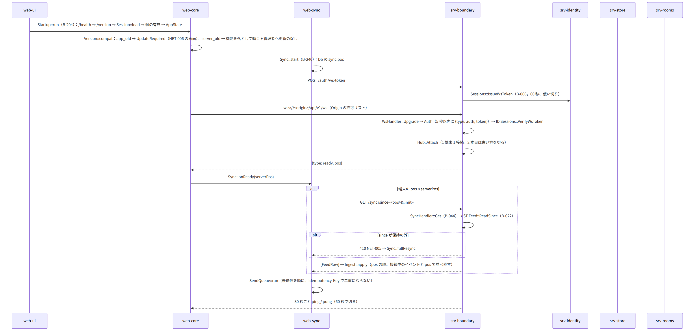
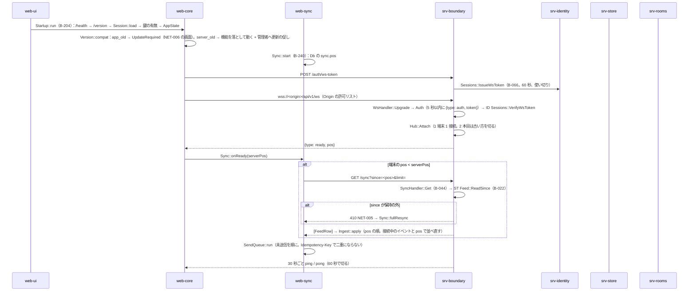
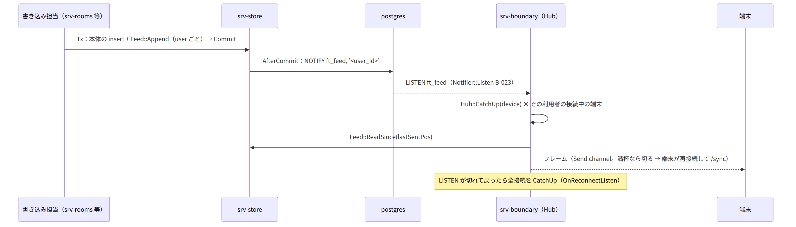
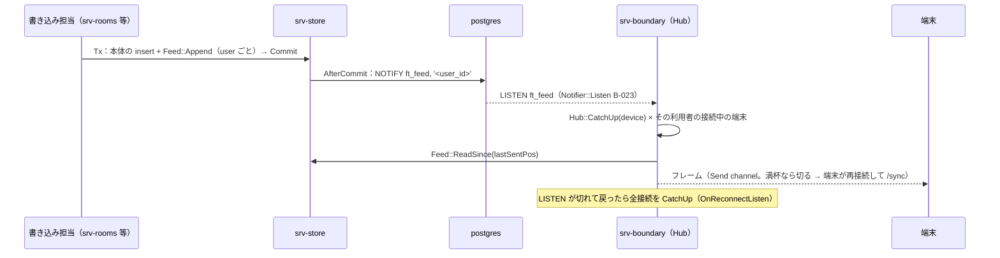
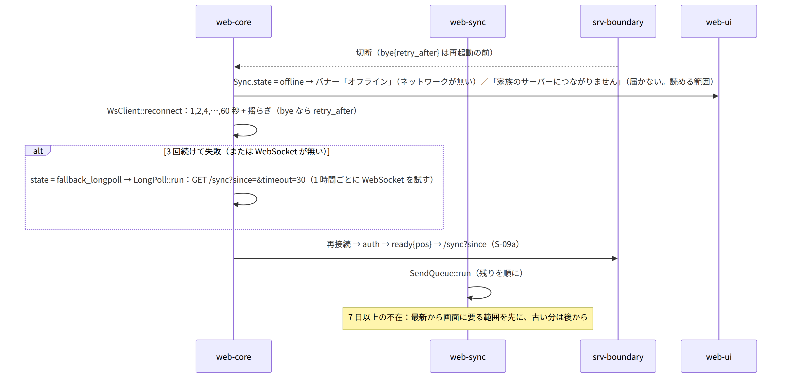
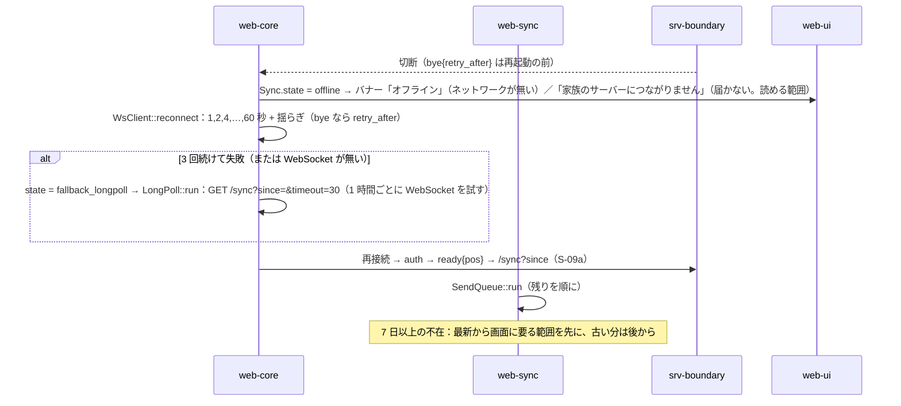
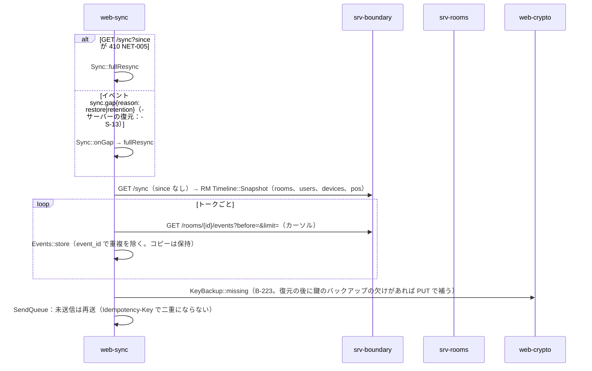
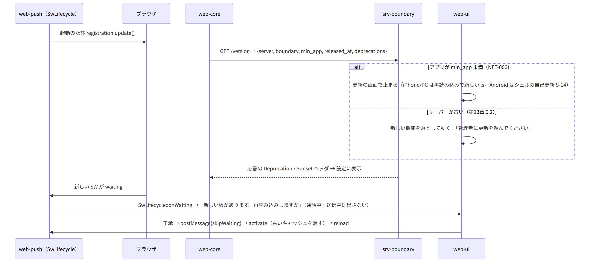
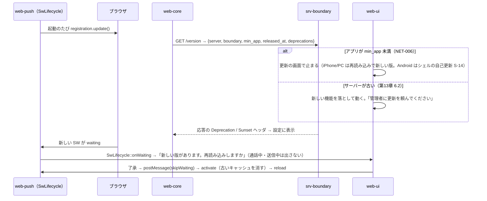

# S-09 同期と再接続

由来：第2章 4.4（ws-token）、5.9（`/sync`）、6.1〜6.3（イベント、接続の規則）、11（復元の後の pos）、13（WebSocket が使えない時、410、版）、第1章 7.11、7.12、10.9（版の互換）、第8章 5（更新とオフライン）、第13章 6.2（互換の期間）、全体実装設計書 2.4（feed + NOTIFY、キャッチアップ）、srv-boundary.md（`Hub`、`WsHandler`、`SyncHandler`）、srv-store.md（`Feed`、`Notifier`）、web-core.md（`WsClient`、`LongPoll`、`Startup`、`Version`）、web-sync.md（`Sync`、`SendQueue`）、web-push.md（`SwLifecycle`）。

## S-09a 起動時の接続と差分（第2章 6.3、第1章 7.11）

図の元の文（mermaid）

## S-09b 配信のキャッチアップ（サーバー側。全体実装設計書 2.4）

図の元の文（mermaid）

## S-09c 切断と再接続、ロングポール（第2章 6.3、13、第1章 7.11）

図の元の文（mermaid）

## S-09d 全差分の取り直し（410、`sync.gap`。第2章 13、11）

図の元の文（mermaid）

## S-09e 版の互換と SW の更新（第1章 10.9、第8章 5、第13章 6.2）

図の元の文（mermaid）

## S-09f サーバーの停止中・読み取り専用（第1章 7.12、DD-1-15）
- 停止中：`/health` に届かない → `Startup` が Unreachable → 読める範囲（コピー）とバナー。キューに保持。通話は不可。管理者に知らせる経路は無い（既知の制約）。
- 読み取り専用：書き込みが SRV-001 → バナー「家族のサーバーは今は読むだけ」。キューは残り、`Retry-After` の後に再送。

## 抜け
- `ready` と `bye` の形は第2章 6.2 に足した（全体実装設計書 15 の改訂で反映済み）。
- `/sync?timeout=` のロングポールで `since` が最新の時、サーバーは hub の通知を `timeout` 秒まで待つ（srv-boundary `SyncHandler`）。待ちの間に `bye` 相当（再起動）が来たら 200 と空の配列を返し、端末は再接続する：srv-boundary.md `SyncHandler` の注記に足す（本シーケンスで足す）。
