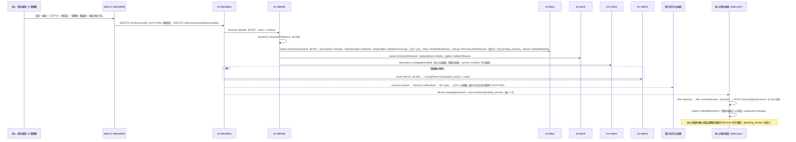
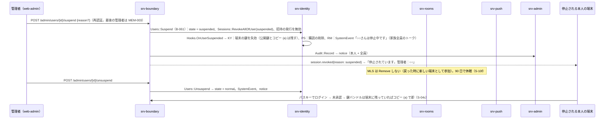
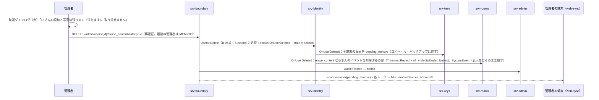
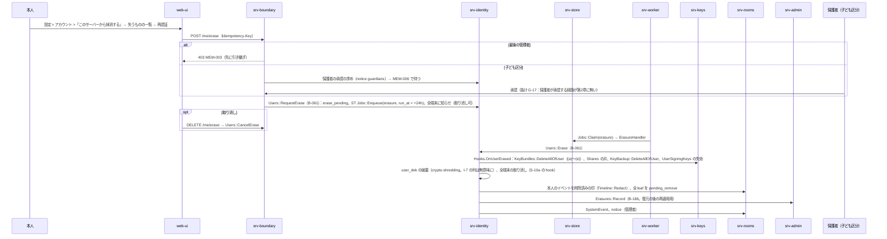
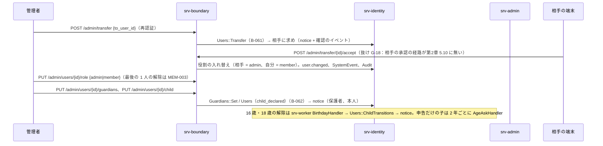
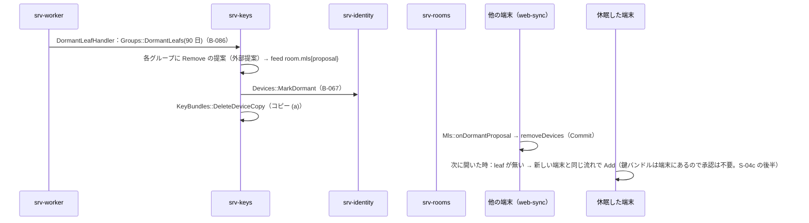

# S-10 端末と構成員の変化

由来：第3章 5.1〜5.2（端末の状態、取り消し）、8（停止・再開、削除、抹消、引き継ぎ）、9（保護者と子ども）、第12章 9（消すこと：各行）、5.2（休眠の leaf）、5.4（`S` の交代、家族回復鍵の作り直し）、第2章 5.3（`/me/erase`）、5.4（取り消し）、5.10（管理者の経路）、第1章 7.7 の 5、13、全体実装設計書 I-8、srv-identity.md（`Hooks`、`Users`、`Devices`）、srv-keys.md（`Hooks`）、srv-rooms.md、srv-push.md、srv-worker.md（`ErasureHandler`、`DormantLeafHandler`）、web-sync.md、web-crypto.md。

## S-10a 端末の取り消し（本人・管理者。第3章 5.2、第12章 9、I-8）

図の元の文（mermaid）

## S-10b 停止と再開（第3章 8.1、第12章 9）

図の元の文（mermaid）

## S-10c 削除（管理者。第3章 8.2）

図の元の文（mermaid）

## S-10d 抹消（本人の求め。第3章 8.3、第12章 9）

図の元の文（mermaid）

## S-10e 管理者の引き継ぎ、役割、保護者と子ども（第3章 8.4、9、7）

図の元の文（mermaid）

## S-10f 休眠の leaf（第12章 5.2、第3章 5.1）

図の元の文（mermaid）

## S-10g 鍵バンドルの作り直しと家族回復鍵の作り直し（第12章 5.4、10）
- 「鍵を作り直す」（本人。再認証）：web-crypto `KeyBundle::rotate` → `S'`。`Copies::rebuildAll`（(a) 全端末へ inbox で転送、(b) 新しい回復コード、(c) 片の作り直し、(d)、(e)）、鍵のバックアップを `S'` で暗号化し直して PUT（既存の行は上書きしないため、抜け G-19：`PUT /me/keybackup/{group}/{epoch}` は「既にあれば 204」で `S'` への置き換えができない → `PUT ... ?rewrap=true`（本人。全行の置き換え）を足す）。古いコピーは DELETE。`recovery.used` ではなく `keybundle.changed`。
- 「カードを作り直す」（管理者。再認証）：web-crypto `FamilyRecoveryKey::generate` → 新しい公開部 → `POST /admin/family/recovery-key/rotate` → KY `FamilyRecoveryKey::SetPublic` → 全端末に `keybundle.changed{kinds: [family]}` → 各端末が `Copies::putFamily` でコピー (d) を作り直す。古いカードは無効（古いコピー (d) は KY が消す）。印刷は管理者の端末。

## 抜け
- G-17：子ども区分の抹消を保護者が承認する経路（`POST /admin/users/{child}/erase-approve` 相当。保護者は管理者でなくてよい → `/me/guardian/approvals/{id}`）。第2章 5.3 と第3章 9.2 の改訂。
- G-18：管理者の引き継ぎの相手の承認の経路（`POST /me/transfer/{id}/accept`）。第2章 5.10 の `/admin/transfer` の備考「相手の承認を要する」の相手側。
- G-19：鍵のバックアップの `S'` への置き換え（`rewrap`）。
- 停止中の構成員の端末が持つコピー (a) は残す（第3章 8.1）が、休眠（90 日）で消える（S-10f）。両者の順は仕様どおり。
