# S-10 端末と構成員の変化

由来は次のとおり。

- 第3章 5.1〜5.2（端末の状態、取り消し）、8（停止・再開、削除、抹消、引き継ぎ）、9（保護者と子ども）
- 第12章 9（消すこと：各行）、5.2（休眠の leaf）、5.4（`S` の交代、家族回復鍵の作り直し）
- 第2章 5.3（`/me/erase`）、5.4（取り消し）、5.10（管理者の経路）、第1章 7.7 の 5、13、全体実装設計書 I-8
- srv-identity.md（`Hooks`、`Users`、`Devices`）、srv-keys.md（`Hooks`）、srv-rooms.md、srv-push.md
- srv-worker.md（`ErasureHandler`、`DormantLeafHandler`）、web-sync.md、web-crypto.md

## S-10a 端末の取り消し（本人・管理者。第3章 5.2、第12章 9、I-8）

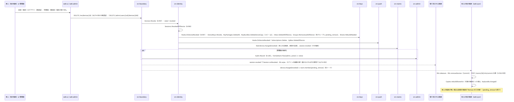

図の元の文（mermaid）

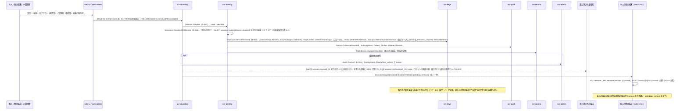

## S-10b 停止と再開（第3章 8.1、第12章 9）

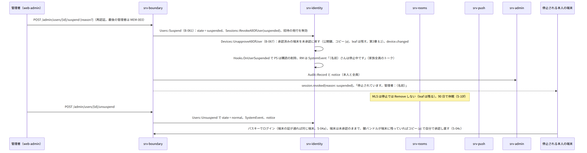

図の元の文（mermaid）

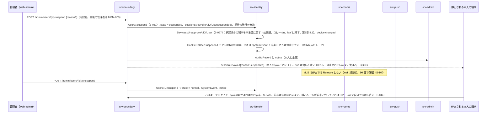

## S-10c 削除（管理者。第3章 8.2）

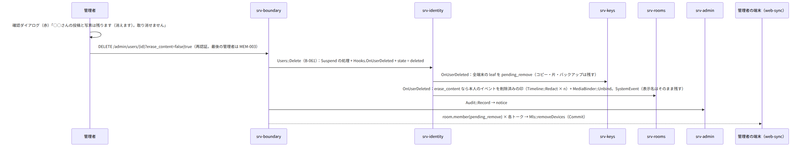

図の元の文（mermaid）

## S-10d 抹消（本人の求め。第3章 8.3、第12章 9）

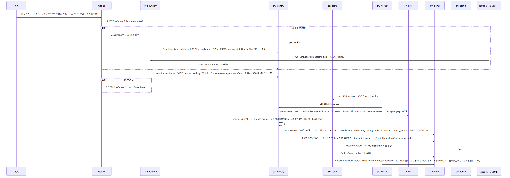

図の元の文（mermaid）

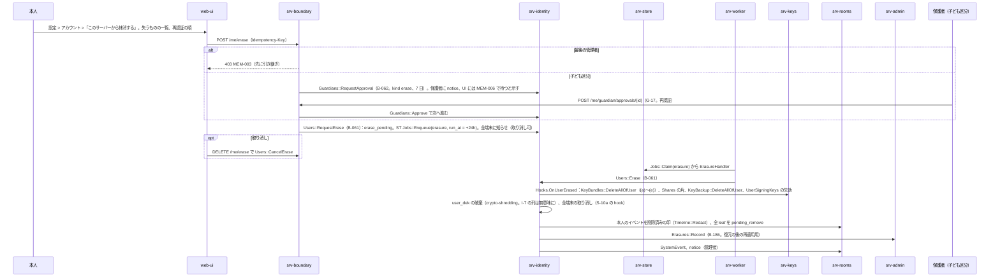

## S-10e 管理者の引き継ぎ、役割、保護者と子ども（第3章 8.4、9、7）

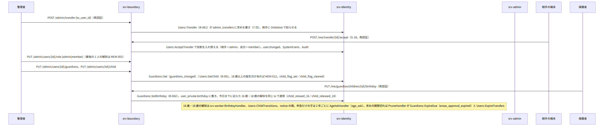

図の元の文（mermaid）

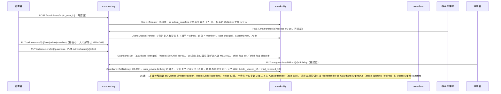

## S-10f 休眠の leaf（第12章 5.2、第3章 5.1）

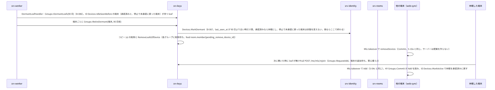

図の元の文（mermaid）

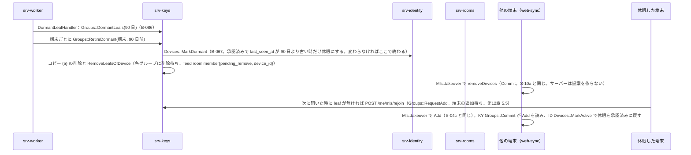

## S-10g 鍵バンドルの作り直しと家族回復鍵の作り直し（第12章 5.4、10）

- 「鍵を作り直す」（本人。再認証）：web-crypto `KeyBundle::rotate` が第12章 5.4 の順で行う。
  1. `S'` を作り、承認済みと休眠の全端末の `user_sig` を新しい鍵で作って `PUT /me/signing-key {user_sig_pub, device_sigs}`。KY `UserSigningKeys::Put` が全部を確かめて置き換え、版を 1 増やし、古い版のコピーを消す。家族に `user.changed{signing_key}`（TOFU の警告）、本人の全端末に `keybundle.changed`
  2. 本人の他の端末へ inbox（kind keybundle。`S'` と版）
  3. `Copies::rebuildAll`：(a)、(b) 新しい回復コード、(c) 片の作り直し、(d)、(e)。新しい版で PUT
  4. `KeyBackup::rewrapAll`：鍵のバックアップを `S'` で暗号化し直す。置き換えは `?rewrap=true` の PUT（G-19）
  - 途中で切れても次に開いた時に続きから。古い `S` の端末の書き込みは KEY-011 で拒まれ、2 の受け取りで追いつく。知らせは `recovery.used` ではなく `keybundle.changed`
- 「カードを作り直す」（管理者。再認証）：
  - web-crypto `FamilyRecoveryKey::generate` で新しい公開部を作り、`POST /admin/family/recovery-key/rotate`
  - KY `FamilyRecoveryKey::SetPublic` が全端末に `keybundle.changed{kinds: [family]}` を送る
  - 各端末が `Copies::putFamily` でコピー (d) を作り直す
  - 古いカードは無効（古いコピー (d) は KY が消す）。印刷は管理者の端末

## S-10h 拒まれた Commit からの復旧（第12章 5.2、第2章 5.5）

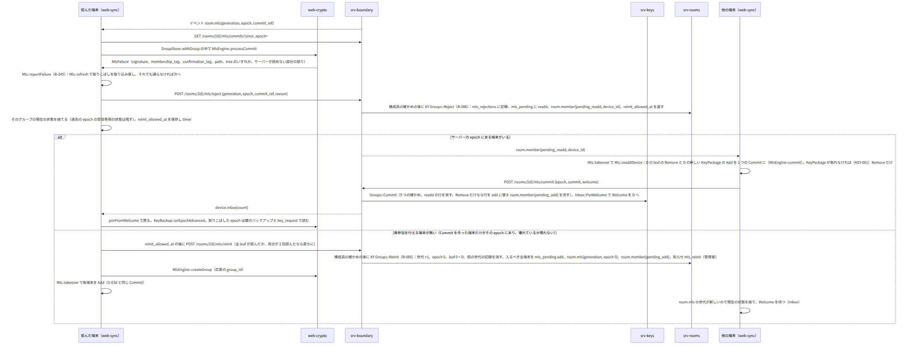

図の元の文（mermaid）

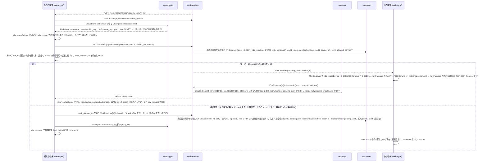

- 上限：同じ端末が同じトークで 24 時間に 3 回目の reinit を求めると `KEY-013`（limit）。D はそのトークを「この端末では読めない」として止め、アプリの更新を待つ。管理者へ `mls_reinit_limit`（第12章 H-12-20）。
- Welcome の処理に失敗した時も同じ経路（reason welcome）。
- 失敗（第12章 13）：D の時計のずれで KeyPackage の有効期間が外れる時は、E が捨てて取り直す。

## 抜け

- なし。この入口で見つけた物は直した（全体実装設計書 11.1）。
  - G-17：保護者の承認は `POST /me/guardian/approvals/{id}`（保護者は管理者でなくてよい）。srv-identity `Guardians::RequestApproval`／`Approve`、表 `guardian_approvals`、第3章 8.3・9.2 の期限
  - G-18：引き継ぎの相手の承認は `POST /me/transfer/{id}/accept`。srv-identity `Users::AcceptTransfer`、表 `admin_transfers`、第3章 8.4 の期限
  - G-19：鍵のバックアップの `S'` への置き換えは `PUT /me/keybackup/{group_id}/{epoch}?rewrap=true`。web-crypto `KeyBackup::rewrapAll`、srv-keys `KeyBackup::Replace`
  - 抹消の取り消しは `DELETE /me/erase`（第2章 5.3、srv-identity `Users::CancelErase`）
- 停止中の構成員の端末が持つコピー (a) は残す（第3章 8.1）が、休眠（90 日）で消える（S-10f）。両者の順は仕様どおり。
