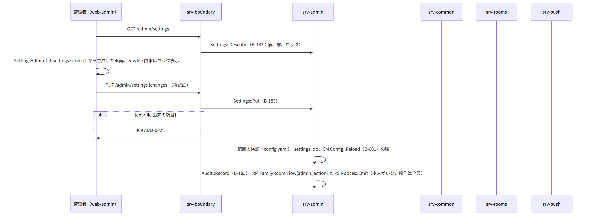
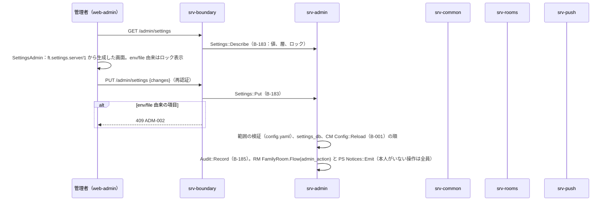
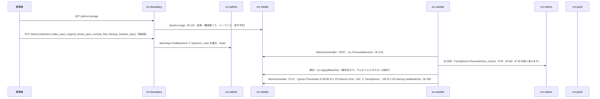
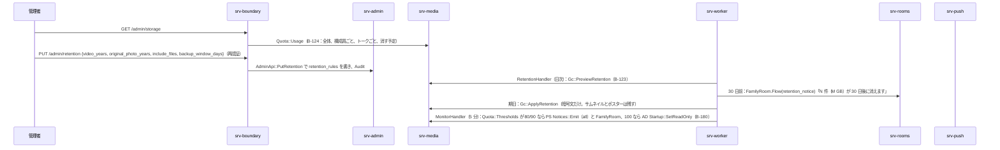
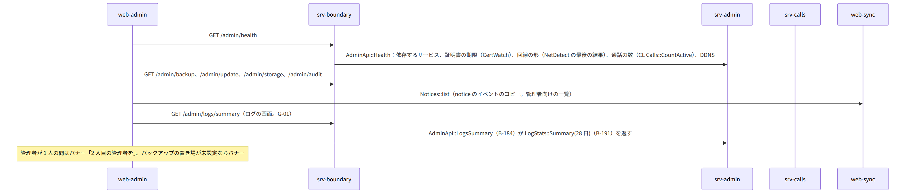
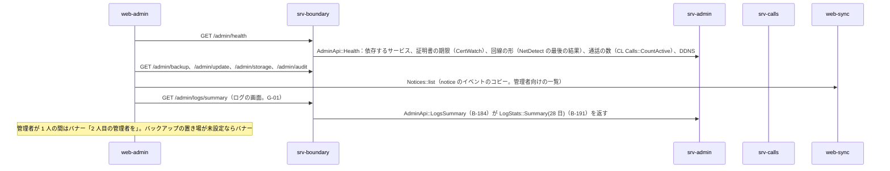

# S-11 管理者の操作と知らせ

由来は次のとおり。

- 第11章 7（設定の 3 層）、8（管理者の画面）、11（監視と知らせ）、12（ログ）、第2章 5.10
- 第5章 7（容量と保持）、第7章 9（知らせ）、第12章 DD-12-16（操作の記録と知らせ）、7.2（データの取扱い）
- 第3章 3.2（招待の記録）、第4章 5.9（スタンプの登録）
- srv-admin.md（`Settings`、`AdminApi`、`Audit`、`LogStats`）、srv-media.md（`Quota`、`Gc`）、srv-push.md（`Notices`）
- web-admin.md、srv-worker.md（`MonitorHandler`）

## S-11a 設定の変更（3 層。第11章 7）

図の元の文（mermaid）

## S-11b 構成員・招待の記録・トーク（第11章 8）

- 構成員の一覧 `GET /admin/users`（AD `AdminApi::Users`：状態、端末の数、最終の利用。容量は MD `Quota::Usage.by_user`）。
- 操作（停止・再開・削除・端末の取り消し・再設定のリンク・役割・保護者・子ども）は S-10 の各流れ。
- 再設定のリンク：`POST /admin/users/{id}/reset-link` で ID `ResetLink::Create`（B-069）。画面に表示し、本人へ別の経路で渡す。
- 招待の記録 `GET /admin/invites`（ID `Invites::ListAll`）、無効化 `DELETE /invites/{id}`。
- トーク `GET /admin/rooms`（識別子、種類、人数、容量。名前は見えない）、空のグループの削除 `DELETE /admin/rooms/{id}`（RM `Rooms::Delete`）。

## S-11c 容量と保持の規則（第5章 7、第11章 8）

図の元の文（mermaid）

## S-11d ダッシュボードと知らせ（第11章 8、11、第7章 9）

図の元の文（mermaid）

- 知らせの種類と宛先は第7章 9 の表。発行者は次のとおり。
  - srv-worker：容量（srv-media の値で）、証明書（`CertWatchHandler`）、バックアップ（`BackupHandler` 等）、更新（`UpdateCheckHandler`）
  - srv-worker：紙の確認（`PaperReminderHandler`）、地図、誕生日・16/18 歳（`BirthdayHandler`）、DDNS の失敗（`DdnsHandler`）
  - srv-worker `MonitorHandler`：回線の変化、時刻のずれ、ディスクの警告
  - srv-admin `Audit`：管理者の操作。srv-keys `Recovery::NotifyUsed`：回復の使用
  - srv-identity `Reports`：端末の更新の失敗（`POST /me/report`）

## S-11e 地図、家族、廃棄の案内、スタンプ（第11章 8）

- 地図：`GET /admin/maps` は MD `Maps::Current`。
  - `POST /admin/maps {region}`：AD が仕事 maps_update を積み、srv-worker `MapsUpdateHandler` が行う（S-12）
- 家族：`PATCH /admin/family {name, icon}` で ID `Families::Update`（B-060）と RM `SystemEvent`。
  - `ft.content.room_settings/1` は管理者の端末が家族全員のトークへ送る（S-05a）
  - カードの作り直しは S-10g、引き継ぎは S-10e
- 廃棄：`GET /admin/disk/dispose` で AD `AdminApi::DisposeGuide`（手順の文。実行は `ft disk dispose`：S-13）。
- スタンプの登録：管理者も構成員と同じ流れ（S-06e）。
- データの取扱い（第12章 7.2）：管理者の名前は ID `Families::Disclosure` が `users` の admin から埋める。管理者が変われば自動で変わる。

## 抜け

- なし。ログの要約の経路（G-01）は直した。第2章 5.10 の `GET /admin/logs/summary`、中身は第11章 12、srv-admin `AdminApi::LogsSummary` と `LogStats`。
- 管理者の操作の知らせは「本人 + 全員」（DD-12-16）。本人がいない操作（設定の変更）は全員だけで、srv-admin.md `Audit::Record` の注記に「対象の構成員がいない操作は audience = all」を足した。
