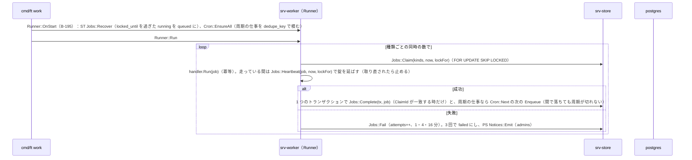
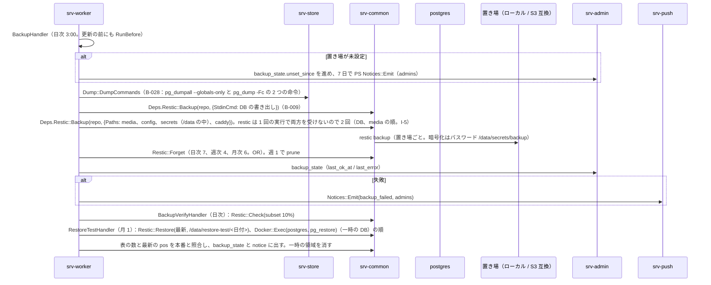
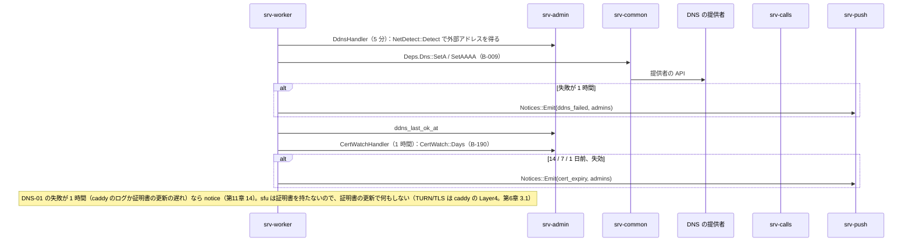

# S-12 裏の処理（worker の各仕事）

由来は次のとおり。

- srv-worker.md（`Runner`、`Cron`、各 handler）、srv-store.md（`Jobs`）
- 第11章 6（DDNS、証明書）、9（バックアップ）、10（更新の確認）、11（監視）
- 第12章 6.2（KEK）、6.3（バックアップ）、9（抹消）、5.2（休眠）
- 第4章 5.8（予約送信）、6（誕生日）、第5章 7（保持）、8.1（地図）、第7章 9（知らせの時期）、第1章 8.4（保持と削除）
- 全体実装設計書 2.3、I-5、I-10

## S-12a 実行器（全体実装設計書 2.3）

図の元の文（mermaid）

## S-12b バックアップ、検証、復元の試験（第11章 9.1、第12章 6.3、I-5）

図の元の文（mermaid）

- KEK は /data の外のためバックアップに入らない（第12章 6.3）。

## S-12c 監視（第11章 11、srv-worker `MonitorHandler`、5 分）

- 容量：MD `Quota::Thresholds` が 80/90 なら `Notices::Emit(all)` と `FamilyRoom.Flow`。100 なら AD `Startup::SetReadOnly(quota)`。
  - 削除で 100% 未満に戻れば `ClearReadOnly`
- 置き場の空きが 10% 未満なら notice。
- media の実体の照合：`media` の complete の行と `FileStore::Exists` を比べ、欠けは notice（バックアップから戻す案内）。
- `Members::PendingAdds` が 7 日なら notice（「家族の誰かが開くと」の案内）。
- 時刻のずれ（DNS の提供者の応答の Date との差 5 分）と SMART の警告（読めれば）は notice。
- 回線の形の変化：AD `NetDetect::Detect` で前回と種別が違えば notice。
- sfu の疎通、`Jobs` の failed の件数。

## S-12d DDNS と証明書（第11章 6）

図の元の文（mermaid）

## S-12e 更新の確認（第11章 10、第13章 3）

- `UpdateCheckHandler`（日次）：AD `Updater::Check`（B-187）が CM `Deps.Release::VersionJson` を読む。
  - 新しい版なら notice（内容の要約、`notes_url`）
  - `revoked_digests` に今の digest が含まれれば notice（赤）
  - 設定「自動で更新」が ON で `AutoDue` なら `Jobs::Enqueue(update_apply)`。`UpdateApplyHandler` は通話中なら延期（最大 7 日、次の時間帯に再び積む）。通話が無ければ AD `HostRequests::Put(update_apply)`（B-192）。適用はホストの `ft host run`（S-13b）
  - `MonitorHandler`（5 分）：AD `HostRequests::Sweep`（B-192）が結果を update_state と知らせに反映する。要求から 2 時間で結果が無ければ知らせ

## S-12f GC、予約送信、再送、抹消、誕生日、休眠、掃除、紙の確認、年齢の問い、スタンプの再通知

- `GcHandler`（1 時間）：S-06g。
- `ScheduledSendHandler`：S-05e。
- `PushRetryHandler`：S-08a の 5xx の再送（再起動を跨ぐ分）。
- `ErasureHandler`：S-10d。
- `BirthdayHandler`（家族の tz の 0:00）：ID `Users::BirthdayToday`（エンベロープを開く）で当日の人を得る。
  - 各人に RM `FamilyRoom.Flow(birthday)`「今日は{name}さんの誕生日です」
  - `Users::ChildTransitions`（16 歳・18 歳）は notice（本人と保護者）
- `DormantLeafHandler`（日次）：S-10f。
- `PruneHandler`（日次）：
  - ST `Retention::DeleteOlder`：sessions 90 日、invites 1 年、push_log 30 日、ip_log 28 日、idempotency 30 日
  - ST `Retention::DeleteOlder`：device_inbox 30 日、log_counts 28 日
  - ST `Retention::DeleteOlder`：short_tokens、device_codes、login_challenges（それぞれの期限）
  - ID `Devices::ExpireUnapproved`（7 日）、KY `KeyPackages::PruneExpired`、PS `UpBox::Expire`、ST `Feed::Prune`（90 日）
  - KY `Shares::Expire`、CL の `sfu_webhook_seen`（7 日）
  - ID の `admin_transfers` と `guardian_approvals` の期限切れを expired に。erase の求めの失効では抹消の求めを取り消し、子と保護者に知らせる（第3章 8.3）
- `PaperReminderHandler`（参加の日の年ごと）：notice（各自）「回復コードとカードの所在を確かめてください」。管理者には引き継ぎの一覧の所在の共有。
- `AgeAskHandler`：ID `Guardians::AskAgeEveryTwoYears` の各子について notice（保護者）。
- `StickerRenotifyHandler`（7 日ごと）：RM `StickerRemoveRequest::Renotify`。
- `KekRewrapHandler`、`KeyRotationCheckHandler`：S-13c。
- `MapsUpdateHandler`：地図の供給元（EXT）から領域を切り出す（`pmtiles extract` 相当を Go で）。CM `Deps.Release` は使わない。
  - MD `Maps::Install`（一時の名前で置いてから改名）、`maps_state`、notice の順
  - 失敗しても手元の地図で続く（第5章 10）
- `preview_cleanup`（1 時間）：MD `Preview::SweepStaged`。

## 抜け

- PMTiles の切り出しの部品（G-20）は直した。
  - 第14章 5.2 に「PMTiles の切り出し（Go の部品。無ければ `ft setup` と worker が別プロセスの道具を呼ぶ）」を足した
  - 設置の時の取得も worker の仕事 `maps_update` にした（第5章 8.1、第11章 4 の 8、srv-admin.md `HostTools.Setup`）
- 時刻のずれの検出は、コンテナの中では DNS の提供者の応答の Date との差で代える（srv-worker.md のアルゴリズムの表、第7章 9）。外へ出る要求は既存の DDNS の経路の再利用で、新しい送信先は無い。
