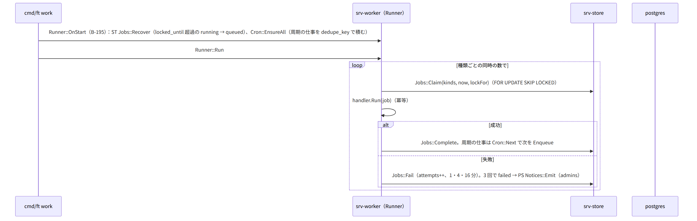
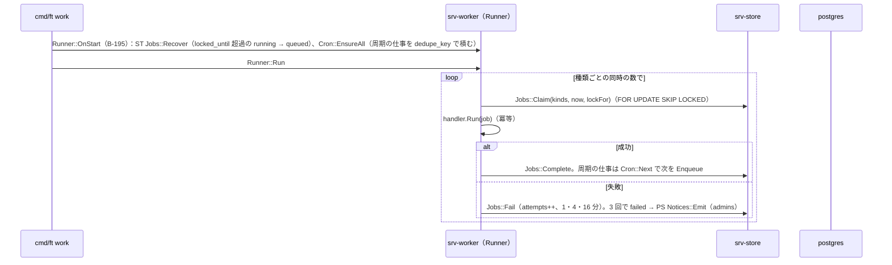
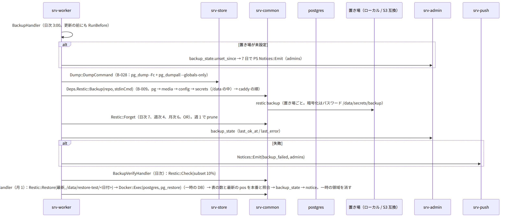
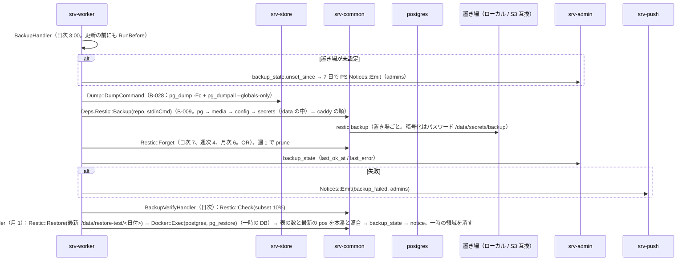
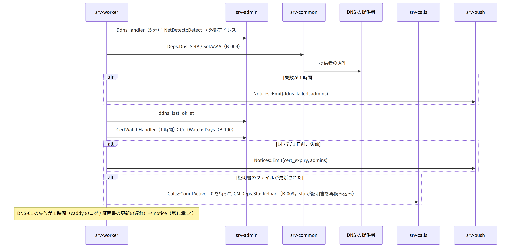
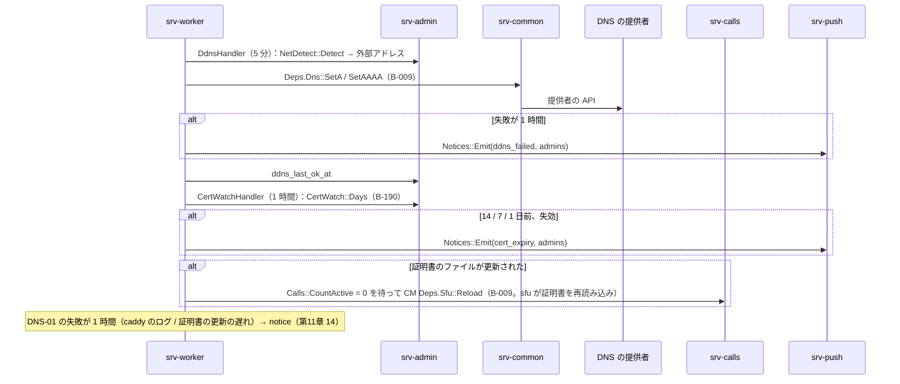

# S-12 裏の処理（worker の各仕事）

由来：srv-worker.md（`Runner`、`Cron`、各 handler）、srv-store.md（`Jobs`）、第11章 6（DDNS、証明書）、9（バックアップ）、10（更新の確認）、11（監視）、第12章 6.2（KEK）、6.3（バックアップ）、9（抹消）、5.2（休眠）、第4章 5.8（予約送信）、6（誕生日）、第5章 7（保持）、8.1（地図）、第7章 9（知らせの時期）、第1章 8.4（保持と削除）、全体実装設計書 2.3、I-5、I-10。

## S-12a 実行器（全体実装設計書 2.3）

図の元の文（mermaid）

## S-12b バックアップ、検証、復元の試験（第11章 9.1、第12章 6.3、I-5）

図の元の文（mermaid）

- KEK は /data の外のためバックアップに入らない（第12章 6.3）。

## S-12c 監視（第11章 11、srv-worker `MonitorHandler`、5 分）
- 容量：MD `Quota::Thresholds` → 80/90 → `Notices::Emit(all)` + `FamilyRoom.Flow`、100 → AD `Startup::SetReadOnly(quota)`。戻り（削除で 100% 未満）→ `ClearReadOnly`。
- 置き場の空き 10% 未満 → notice。
- media の実体の照合：`media` の complete の行と `FileStore::Exists` → 欠けは notice（バックアップから戻す案内）。
- `Members::PendingAdds` が 7 日 → notice（「家族の誰かが開くと」の案内）。
- 時刻のずれ（応答の Date との差 5 分）→ notice。SMART（読めれば）→ notice。
- 回線の形の変化：AD `NetDetect::Detect` → 前回と種別が違えば notice。
- sfu の疎通、`Jobs` の failed の件数。

## S-12d DDNS と証明書（第11章 6）

図の元の文（mermaid）

## S-12e 更新の確認（第11章 10、第13章 3）
- `UpdateCheckHandler`（日次）：AD `Updater::Check`（B-187）→ CM `Deps.Release::VersionJson` → 新しい版なら notice（内容の要約、`notes_url`）。`revoked_digests` に今の digest が含まれれば notice（赤）。設定「自動で更新」が ON で `AutoDue` なら `Jobs::Enqueue(update_apply)` → `UpdateApplyHandler` → `Updater::Apply`（S-13b。通話中は延期：最大 7 日、次の時間帯に再び積む）。

## S-12f GC、予約送信、再送、抹消、誕生日、休眠、掃除、紙の確認、年齢の問い、スタンプの再通知
- `GcHandler`（1 時間）：S-06g。
- `ScheduledSendHandler`：S-05e。
- `PushRetryHandler`：S-08a の 5xx の再送（再起動を跨ぐ分）。
- `ErasureHandler`：S-10d。
- `BirthdayHandler`（家族の tz の 0:00）：ID `Users::BirthdayToday`（エンベロープを開く）→ RM `FamilyRoom.Flow(birthday)`「今日は○○さんの誕生日です」。`Users::ChildTransitions`（16 歳・18 歳）→ notice（本人 + 保護者）。
- `DormantLeafHandler`（日次）：S-10f。
- `PruneHandler`（日次）：ST `Retention::DeleteOlder`（sessions 90 日、invites 1 年、push_log 30 日、ip_log 28 日、idempotency 30 日、device_inbox 30 日、short_tokens、device_codes、login_challenges）、ID `Devices::ExpireUnapproved`（7 日）、KY `KeyPackages::PruneExpired`、PS `UpBox::Expire`、ST `Feed::Prune`（90 日）、KY `Shares::Expire`、CL の `sfu_webhook_seen`（7 日）。
- `PaperReminderHandler`（参加の日の年ごと）：notice（各自）「回復コードとカードの所在を確かめてください」。管理者には引き継ぎの一覧の所在の共有。
- `AgeAskHandler`：ID `Guardians::AskAgeEveryTwoYears` → notice（保護者）。
- `StickerRenotifyHandler`（7 日ごと）：RM `StickerRemoveRequest::Renotify`。
- `KekRewrapHandler`、`KeyRotationCheckHandler`：S-13c。
- `MapsUpdateHandler`：CM `Deps.Release` ではなく地図の供給元（EXT）から領域の切り出し（`pmtiles extract` 相当を Go で）→ MD `Maps::Install`（一時の名前 → 改名）→ `maps_state` → notice。失敗は手元の地図で続く（第5章 10）。
- `preview_cleanup`（1 時間）：MD `Preview::SweepStaged`。

## 抜け
- `MapsUpdateHandler` の「pmtiles extract 相当を Go で」は第14章 5.2 の部品の表に無い（第14章 6.1 に地図の道具があるのはウェブの側）。→ G-20：第14章 5.2 に「PMTiles の切り出し（Go の部品。無ければ `ft setup` が別プロセスの道具を呼ぶ）」を足し、srv-worker.md の `MapsUpdateHandler` と srv-admin.md `HostTools.Setup` の注記を揃える。
- 時刻のずれの検出を「DNS の提供者の応答の Date」で代えるのは srv-worker.md のアルゴリズムの表のとおり。外へ出る要求は既存の DDNS の経路の再利用（新しい送信先は無い）。
