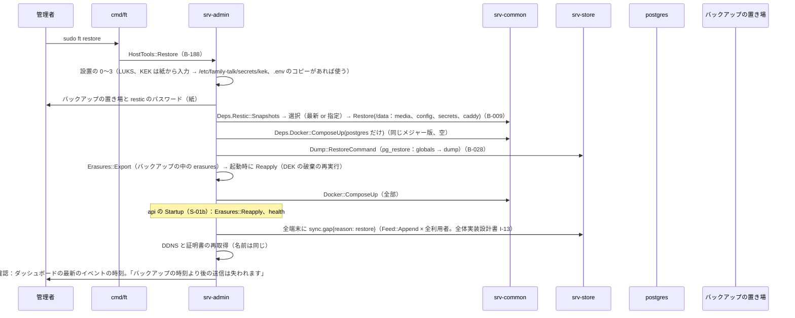
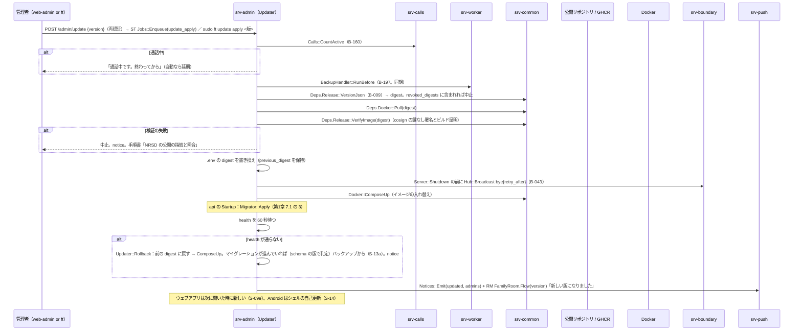
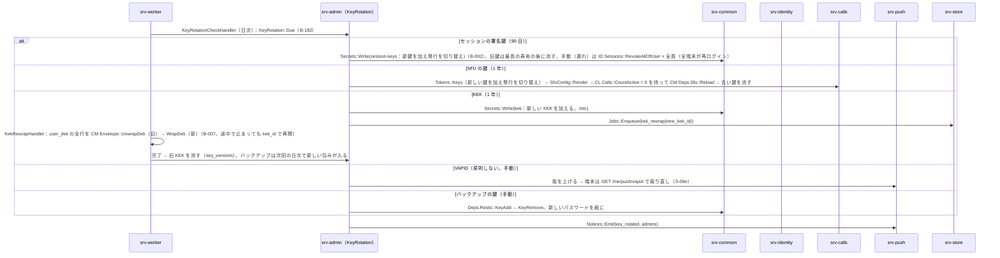

# S-13 保守（`ft restore`、更新と復元、鍵の交代、廃棄、中継、`doctor`、`logs`）

由来：第11章 9.2（復元）、10（更新）、13.2（廃棄）、13.3（引き継ぎ）、5（C の形の中継）、4（`ft doctor`）、12（`ft logs`）、14（失敗）、第12章 10（秘密の交代）、6.2（KEK）、9（復元の後の抹消）、第13章 3（`revoked_digests`）、第1章 7.9、18.3、srv-admin.md（`HostTools`、`Updater`、`KeyRotation`、`Erasures`）、srv-worker.md（`KekRewrapHandler`、`KeyRotationCheckHandler`、`BackupHandler::RunBefore`）。

## S-13a `ft restore`（新しい機械。第11章 9.2）

図の元の文（mermaid）

- 版の違い：バックアップの版とイメージの版が違えば、バックアップの版のイメージで起動してから更新（ダウングレード非対応）。バックアップより後の抹消は失われる（H-11-2。手順書「抹消は復元の後に再度」）。

## S-13b 更新の適用と復元（第11章 10、第1章 7.9、第13章 3）

図の元の文（mermaid）

## S-13c 鍵の交代（第12章 10、6.2、I-7）

図の元の文（mermaid）

## S-13d 廃棄、引き継ぎ、中継、`doctor`、`logs`（第11章 13、5、4、12）
- `ft disk dispose`：AD `HostTools::DiskDispose`（B-188）：最新のバックアップと復元の試験（30 日以内）の確認 → `Docker::ComposeDown` → CM `Deps.Luks::Erase`（cryptsetup erase + ヘッダの上書き）→ ATA Secure Erase の案内 → KEK と紙の扱いの案内。
- 引き継ぎ（機械）：手順書の「引き継ぎの一覧」（OS のアカウント、`ft` の所在、/etc/family-talk の権限、紙の所在）。アプリ内は S-10e。
- C の形の中継：VPS で `ft relay setup` → coturn（TURN だけ）と逆プロキシ（TCP の転送）の compose（deploy `compose.relay.yaml`）。自宅の機械は `family-talk-tunnel.service`（WireGuard または SSH）。
- `ft doctor`：AD `HostTools::Doctor` → `DoctorReport`（回線の種別、ポート、DNS の A/AAAA、証明書の期限、health、ディスク、TPM、Compose の版、digest の一致、NTP）。秘密なし。TPM の状態が変わって解錠できない時は再登録を案内（第11章 14）。
- `ft logs [サービス] [--since]`：要約と直近（本文と秘密なし）。`ft` 自身の記録は /var/log/family-talk/ft.log。

## 抜け
- `sync.gap` を全端末へ送るのは「api の起動の後」。`ft restore` は api に `POST /internal/sync-gap`（内部の経路）を打つか、`server_state` に `restored_at` を置き、api の Startup が全利用者の feed に `sync.gap` を積む形にする。→ 決定：後者（内部の経路を増やさない）。srv-admin.md `Startup::Run` の 7 に「`server_state.restored_at` が前回より新しければ全利用者に `sync.gap`」を足す（本シーケンスで足す。経路の追加は不要）。
- 更新の前の `bye` は AD（host モードの `ft update`）から api の hub に直接は呼べない（別プロセス）。→ 決定：`ft update apply` は `docker compose stop api` の前に api に SIGTERM を送り、api の `Server::Shutdown`（srv-boundary B-040）が `bye{retry_after}` を送ってから止まる。Compose の `stop_grace_period` を 15 秒に（deploy の compose.yaml に足す：本シーケンスで足す）。
