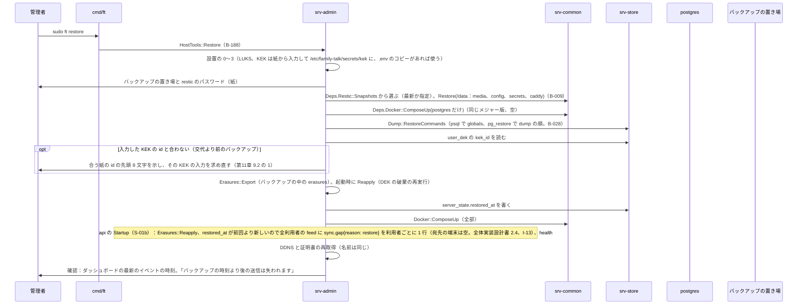
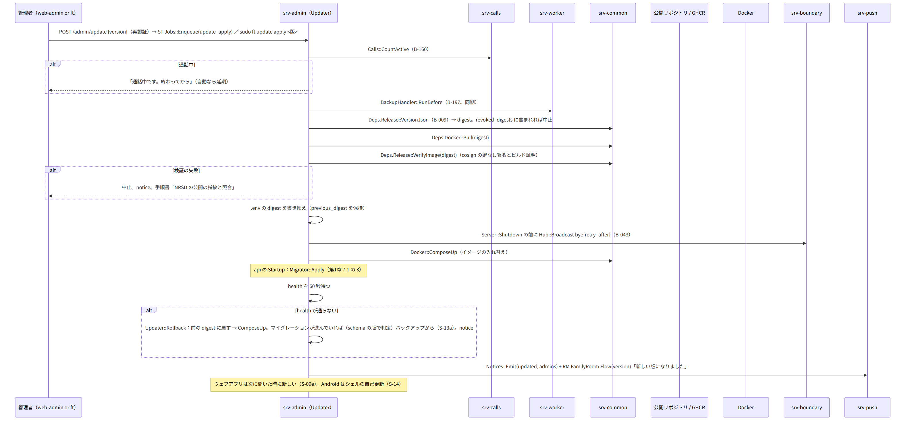
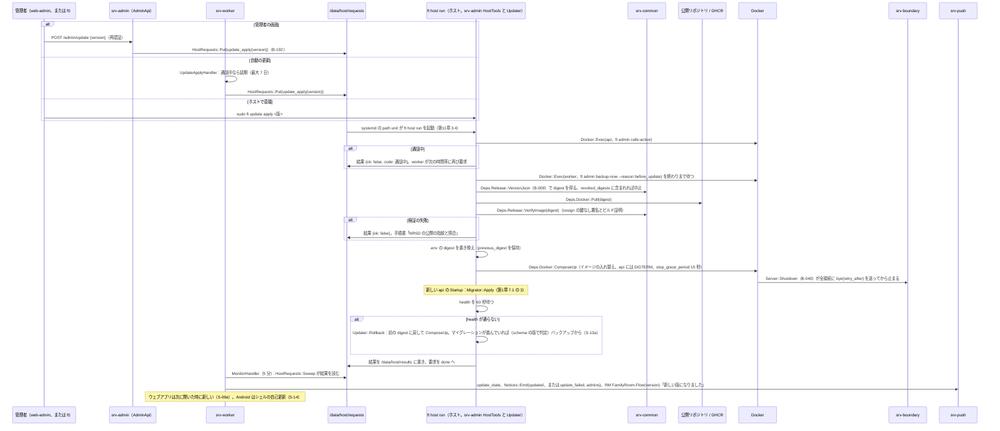
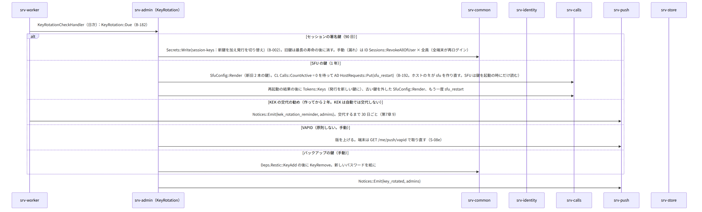
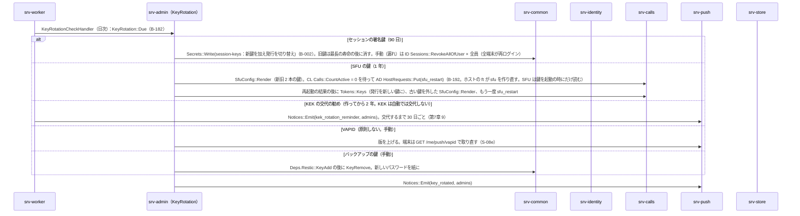
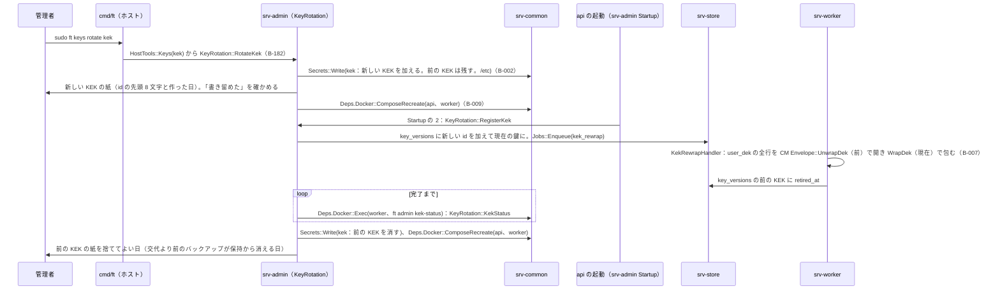

# S-13 保守（`ft restore`、更新と復元、鍵の交代、廃棄、中継、`doctor`、`logs`）

由来は次のとおり。

- 第11章 9.2（復元）、10（更新）、13.2（廃棄）、13.3（引き継ぎ）、5（C の形の中継）、4（`ft doctor`）、12（`ft logs`）、14（失敗）
- 第12章 10（秘密の交代）、6.2（KEK）、9（復元の後の抹消）、第13章 3（`revoked_digests`）、第1章 7.9、18.3
- srv-admin.md（`HostTools`、`Updater`、`KeyRotation`、`Erasures`）
- srv-worker.md（`KekRewrapHandler`、`KeyRotationCheckHandler`、`BackupHandler::RunBefore`）

## S-13a `ft restore`（新しい機械。第11章 9.2）

図の元の文（mermaid）

- 版の違い：バックアップの版とイメージの版が違えば、バックアップの版のイメージで起動してから更新（ダウングレード非対応）。バックアップより後の抹消は失われる（H-11-2。手順書「抹消は復元の後に再度」）。

## S-13b 更新の適用と復元（第11章 10、第1章 7.9、第13章 3）

図の元の文（mermaid）

## S-13c 鍵の交代（第12章 10、6.2、I-7）

図の元の文（mermaid）

### KEK の交代（`ft keys rotate kek`。第12章 6.2）

図の元の文（mermaid）

- 途中で止まった時は、同じ命令をもう一度行う。KEK のファイルの鍵の数と `KekStatus` から続きを決める。
- 漏れの疑いで交代する時は、交代の後に前のバックアップを置き換える（第12章 10）。

## S-13d 廃棄、引き継ぎ、中継、`doctor`、`logs`（第11章 13、5、4、12）

- `ft disk dispose`：AD `HostTools::DiskDispose`（B-188）が次の順に行う。
  - 最新のバックアップと復元の試験（30 日以内）の確認、`Docker::ComposeDown`
  - CM `Deps.Luks::Erase`（cryptsetup erase とヘッダの上書き）
  - ATA Secure Erase の案内、KEK と紙の扱いの案内
- 引き継ぎ（機械）：手順書の「引き継ぎの一覧」（OS のアカウント、`ft` の所在、/etc/family-talk の権限、紙の所在）。アプリ内は S-10e。
- C の形の中継：
  - VPS で `ft relay setup` を実行する。WireGuard の受け口と nftables の転送を置く（deploy `RelayFiles`。コンテナは無い）。転送するのは 443、5349、7881/tcp と、3478、50000〜60000/udp
  - 自宅の機械は `ft relay setup --home` で `family-talk-tunnel.service`（WireGuard）を置く。`.env` に `FT_RELAY_VPS_HOST` と `FT_EXTERNAL_IPV4` を書く。SFU の内蔵の TURN をそのまま使う（第11章 5）
- `ft doctor`：AD `HostTools::Doctor` が `DoctorReport` を返す。秘密なし。
  - 回線の種別、ポート、DNS の A/AAAA、証明書の期限、health
  - ディスク、TPM、Compose の版、digest の一致、NTP
  - TPM の状態が変わって解錠できない時は再登録を案内（第11章 14）
- `ft logs [サービス] [--since]`：要約と直近（本文と秘密なし）。`ft` 自身の記録は /var/log/family-talk/ft.log。

## 抜け

- 復元の後の `sync.gap`：内部の経路は足さない。S-13a の図はこの形。
  - `ft restore` が `server_state.restored_at` を書く
  - api の起動（srv-admin.md `Startup::Run` の 7）が全利用者の feed に `sync.gap` を積む
- 更新の前の `bye`：host モードの `ft update` から api の hub は呼べない（別プロセス）。S-13b の図は次の形。
  - `ft update apply` が api に SIGTERM を送る（`docker compose stop`）
  - api の `Server::Shutdown`（srv-boundary B-040）が `bye{retry_after}` を送ってから止まる
  - Compose の `stop_grace_period` は 15 秒（deploy.md）
