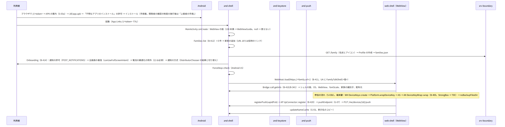
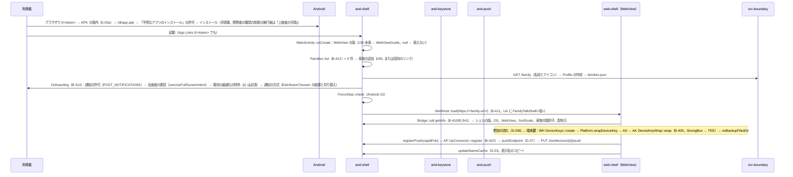
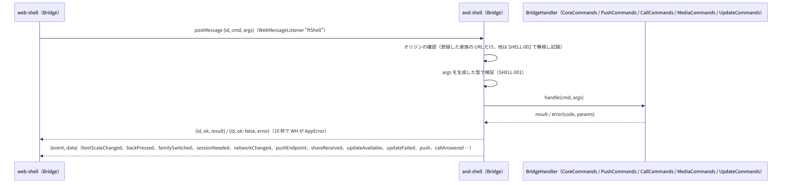
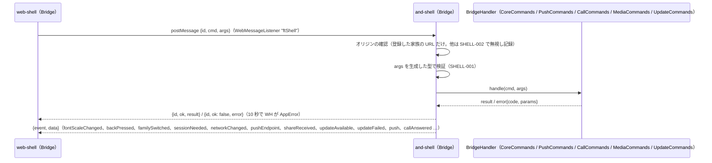
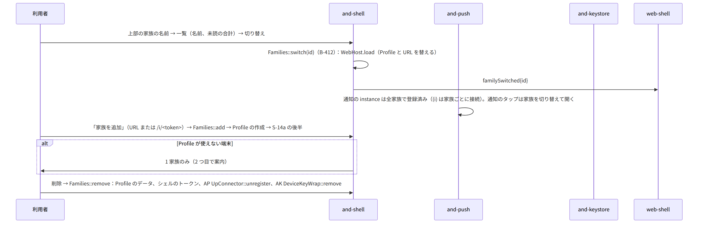
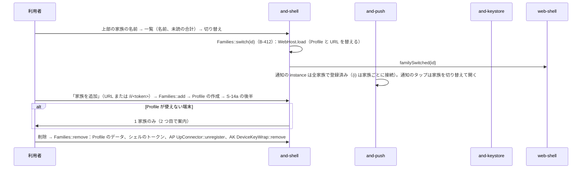
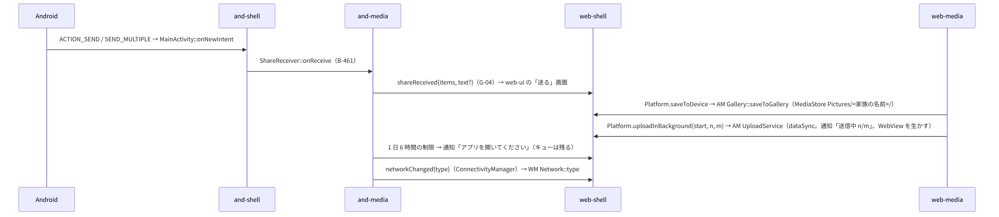
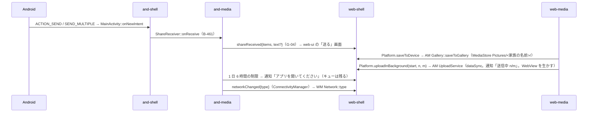
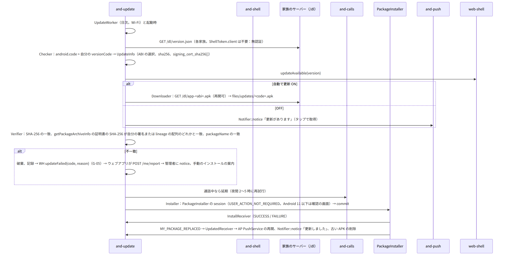
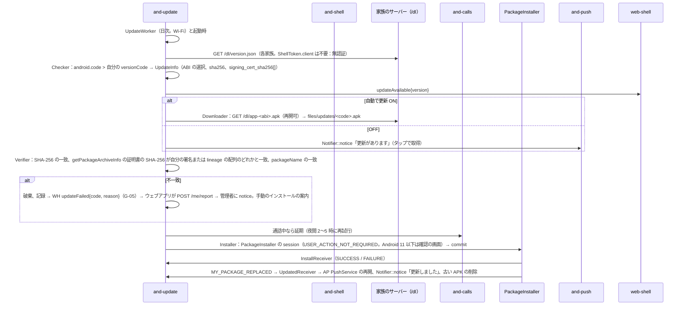

# S-14 Android のシェル

由来：第9章 3（構成）、4（WebView と JS ブリッジ）、7（権限）、8（鍵保管庫）、9（メディア）、10（自己更新）、11（複数の家族）、12（OS の制限）、14（失敗）、第13章 4.1（lineage）、5（初回のインストール）、第10章 11（シェルの画面）、第2章 4.2・4.4（シェルのトークン）、第12章 5.3（端末鍵）、and-shell.md、and-keystore.md、and-push.md、and-media.md、and-update.md、web-shell.md。通知と着信のシェルの流れは S-08c〜d、S-07e。

## S-14a 初回のインストールと起動（第13章 5、第9章 4.1、7、第10章 11）

図の元の文（mermaid）

- 起動のたび：`unwrapDeviceKey`（AK。鍵が失われていれば SHELL-004 → 新しい端末の流れ S-04c）、`ShellToken::get`（期限が近ければ `sessionNeeded` → WebView が `POST /auth/shell-token` → `setShellToken`（G-02））。

## S-14b JS ブリッジの往復（第9章 4.2、I-15）

図の元の文（mermaid）

## S-14c 家族の追加と切り替え（第9章 11）

図の元の文（mermaid）

## S-14d 共有の受け口、保存、アップロードの継続、回線（第9章 9）

図の元の文（mermaid）

## S-14e 自己更新（第9章 10、第13章 4.1）

図の元の文（mermaid）

## S-14f OS の制限（第9章 12、14）
- バックアップの除外（`allowBackup=false`、`dataExtractionRules`）は AK `BackupExclusion`。`BOOT_COMPLETED` で起こすのは `PushService` だけ。強制停止の検知は AS `ForceStop`。文字の拡大率は `fontScaleChanged`。描画プロセスの死は AS `WebHost::onRenderProcessGone`（作り直し。通話中なら AC に通知して通話は切れる → 再参加の案内）。`ACCESS_LOCAL_NETWORK` の拒否 → 案内。鍵保管庫が使えない → ソフトウェアの鍵（AK `strength` を設定に表示）。

## 抜け
- G-02、G-03、G-04、G-05、G-07（既出）。
- 自己更新の `GET /dl/version.json` は無認証（第2章 5.11）のためシェルのトークンは不要。and-update.md の `Downloader` の注記を「無認証。同じ OkHttp の client を使うが Authorization は付けない」に直す（本シーケンスで直す）。
