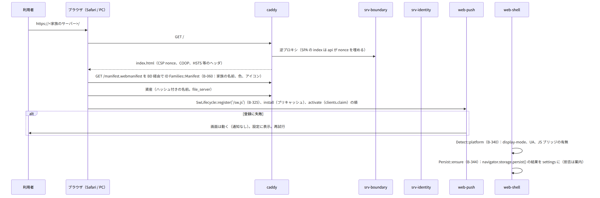
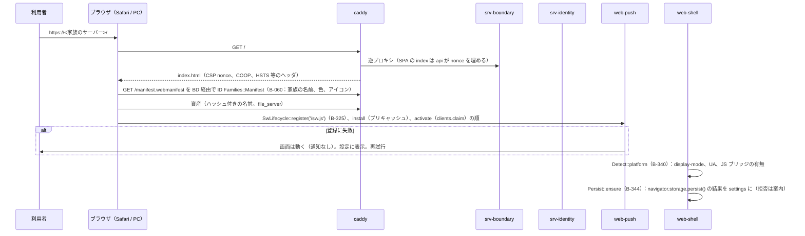
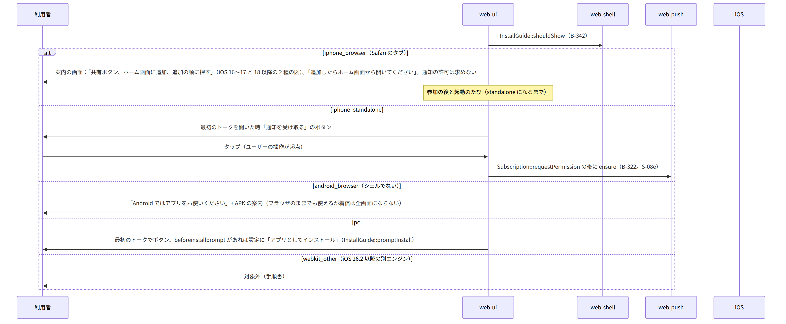
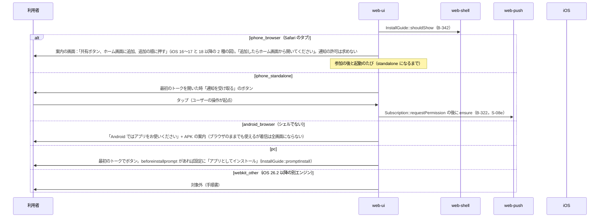

# S-15 iPhone と PC のシェル

由来は次のとおり。

- 第8章 3.1（manifest）、3.2（SW）、3.3（追加の検出と案内）、3.4（persist、容量）、3.5（権限）
- 第8章 4（iPhone の制約の補い方）、5（更新とオフライン）、6（CSP）、7（PC の差）、8（失敗）
- 第7章 10（初回の案内）、第3章 10（別のオリジン）、第10章 7（案内の置き場）
- web-shell.md、web-push.md、web-core.md、srv-identity.md（manifest）、deploy.md（Caddyfile の CSP）

## S-15a 初回の読み込みと manifest、SW の登録（第8章 3.1、3.2、6）

図の元の文（mermaid）

## S-15b iPhone：ホーム画面への追加の案内と通知の許可（第8章 3.3、第7章 10）

図の元の文（mermaid）

## S-15c iPhone の制約の補い方（第8章 4、第10章 7）

- 鳴り続けない着信：15 秒 × 4 回の通知（S-08b）、開いたら呼び出し画面、不在のかけ直しは 1 操作（web-calls `CallLog`）。
- ロック中の通話が切れ得る：web-calls `IphoneGuards`（S-07c）。バナー「画面をロックするかアプリを閉じると通話が切れます」（開始時 5 秒）。
- 通知の音・ボタンが無い：本文で区別。タップでトークへ。
- HEIC：写真の選択は JPEG（互換モード）。「ファイルを選択」の HEIC は端末が復号（iOS 17 以上）。
- 背景の処理が無い：開いた時に全差分（S-09a）。予約送信はサーバー。アップロード中は「開いたままにしてください」。
- Share Target が無い：アプリ内の「写真を選ぶ」。PiP はアプリ内の小窓。画面共有は見る側だけ。
- 保存領域が消え得る：`Persist`、サーバーが正本、鍵バンドルのコピーで補う。
  - 消えた時（`sync.pos` と `keys` のどちらも無い）は `Persist::onStorageLost` が新しい端末として承認に進める（S-04c）
- 設定 > ヘルプ >「iPhone でできないこと」（`Limitations::list`）。

## S-15d PC のブラウザの差（第8章 7）

- `Platform.capabilities`（WH `PcPlatform`）が判定する項目：
  - Web Push（開いている）、閉じている時の通知（Chromium は背景モード、Firefox 不可、Safari 可）
  - インストール、画面共有（音声の可否）、ぼかし（canvas 経由）、通知のボタン（Chromium だけ）
  - `setSinkId`（Safari 不可）、hybrid、OPFS の同期、バッジ
- できないことは設定 > ヘルプ >「このブラウザでできないこと」に判定の結果を表示。
- 共有の PC：設定「このブラウザを信頼しない」でセッションの終了の時に保存を消す（第12章 6.4）。
  - web-core `Db::wipe` を、`beforeunload` ではなく `visibilitychange` の hidden とセッションの終了で行う

## S-15e 更新の促しとオフライン（第8章 5）

- S-09e（SW の waiting、`/version`、`NET-006`）。オフライン：SW のキャッシュで画面が開き、IndexedDB のコピーを表示、送信はキュー、バナー「オフライン」（WH `OfflineBanner`）。復帰で S-09c。

## S-15f 権限（第8章 3.5）

- 通知：standalone で最初のトーク（上）。
- カメラ・マイク：通話の開始・応答のたび（web-calls `Permissions`）。拒否なら音声のみか受けるだけで、OS の設定への案内。
- 位置：位置の送信の時（web-media `Maps::current`）。拒否なら地図で地点を選ぶ。
- 画面共有：PC の共有の開始の時。

## 抜け

- 「このブラウザを信頼しない」（第3章 4.7、第12章 6.4）：web-shell.md の `Persist` に `untrustedBrowser` を足した。セッションの終了で `Db::wipe`（鍵バンドルも消す）、次回は新しい端末。
- SPA の index（CSP の nonce を埋める）：srv-boundary.md に `SpaIndex` を足した。
  - 経路は srv-boundary.md の `SpaIndex` の注記の一覧（`/`、`/r/*`、`/settings/*` など）
  - 認証なし。画面の入口で API ではないため openapi.yaml には載せない（deploy.md の Caddyfile の routes と srv-boundary.md の注記が正）
