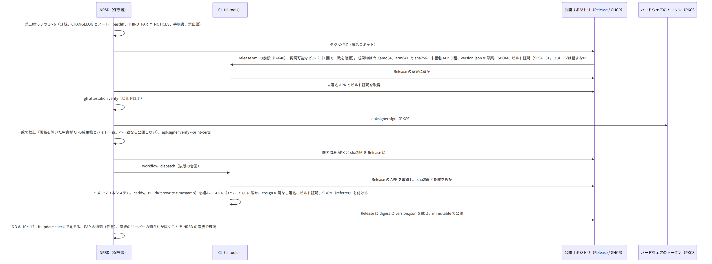
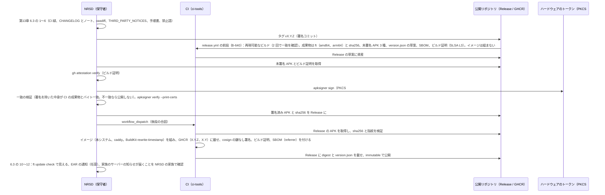
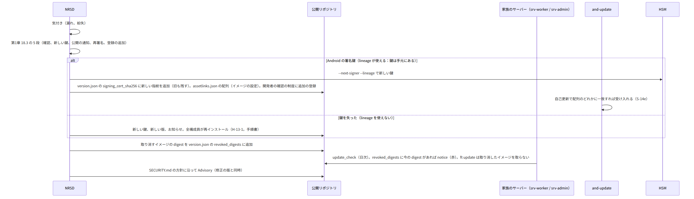
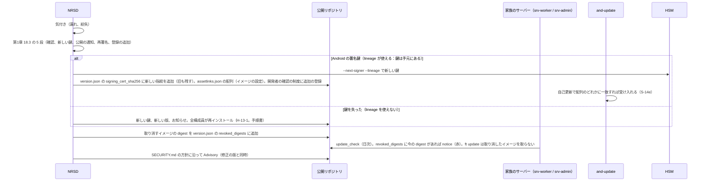

# S-16 運営（リリースの 2 段、鍵の事故、脆弱性の報告、version.json）

由来は次のとおり。入口は NRSD（保守者）の操作と CI。家族のサーバーは取得の要求だけを送る（第1章 4.2）。

- 第13章 3（配布物）、4（Android の署名）、6（版とリリース、確認の一覧）、7（公開リポジトリの文書）、8（失敗）
- 第14章 11（CI）、11.5（署名鍵）、第1章 18.3（NRSD の鍵の事故）
- 全体実装設計書 7、8、ci-tools.md、deploy.md

## S-16a リリース（2 段。第13章 4.2、6.3、第14章 11.2）

図の元の文（mermaid）

- 失敗：
  - 署名のトークンが使えない：バックアップから復元。できなければ鍵の事故（S-16b）
  - 一致の検証の失敗：公開しない。差分を調べて CI を直す
  - Release の資産を間違えた：immutable のため消せない。新しい patch の版を出す

## S-16b 鍵の事故（第1章 18.3、第13章 DD-13-5、8）

図の元の文（mermaid）

## S-16c 脆弱性の報告と受け口（第13章 7、第14章 13.2）

- 受け口：
  - Private vulnerability reporting、security.txt（`Contact`、`Expires` 1 年未満。CI が 30 日前に警告）
  - Issues（不具合と要望。家族の情報を書かない案内）、配慮の申出（メール）
- 応答 14 日以内。修正の版と同時に公開。
- 確かめ：
  - 変更ごと：govulncheck、pnpm audit、Gradle の依存検証、osv-scanner
  - 週 1：Trivy と Scorecard。Dependabot（security update は即日）

## S-16d version.json と家族のサーバーの更新の知らせ（第13章 3、第11章 10）

- CI が version.json を Release とイメージに入れる。家族のサーバーの `/dl/version.json` はイメージと同じ版（S-14e の自己更新の元）。管理者の画面は Release の version.json を見て「新しい版」を知る（srv-worker `UpdateCheckHandler`。S-12e）。

## 抜け

- 鍵の事故の「取り消したイメージで動いている家族のサーバーへの知らせ」は `revoked_digests` で届く（第13章 3 への改訂は反映済み）。
- CI の前段で「試験の鍵で署名した APK」も出す（L4・L5 用。全体実装設計書 7.2）。
  - version.json の草案の `signing_cert_sha256` は、試験の鍵と NRSD の鍵の両方を持てない
  - 草案は NRSD の鍵の指紋（README の値）だけを持つ
  - 試験用の version.json は CI が別に作る（`dev/generated/version.test.json`。ci-tools.md）
