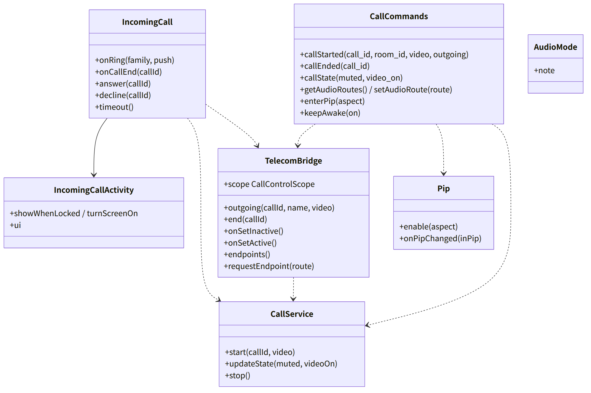
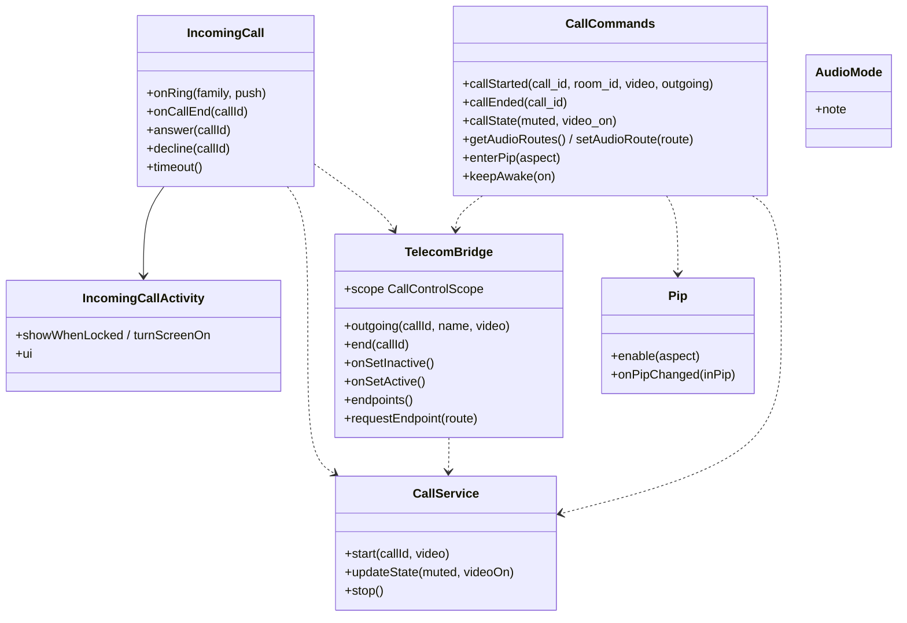

# and-calls（Android のシェル。着信と通話：Core-Telecom、`CallService`、`IncomingCallActivity`、CallStyle、音声の経路、PiP）

## 受ける節

- [第9章 3 構成（DD-9-1）](../../../../docs/jp/design/09_基本設計書_Androidのシェル.md#3-構成dd-9-1) のうち `IncomingCallActivity`、`CallService`
- [第9章 6 着信と通話（DD-9-6）](../../../../docs/jp/design/09_基本設計書_Androidのシェル.md#6-着信と通話dd-9-6) の着信と通話の段 1〜9 と注記
  - `addCall`、CallStyle、全画面、応答、拒否
  - 通話中のエンドポイント、発信、終了、PiP、Wake Lock、音声モード
  - おやすみモード、別の着信、他のアプリの通話での保留
- [第9章 7 権限（DD-9-7）](../../../../docs/jp/design/09_基本設計書_Androidのシェル.md#7-権限dd-9-7) の次の権限
  - `RECORD_AUDIO`、`CAMERA`、`USE_FULL_SCREEN_INTENT`
  - `MANAGE_OWN_CALLS`、`FOREGROUND_SERVICE_*`、`WAKE_LOCK`
- [第9章 4.2 JS ブリッジの命令](../../../../docs/jp/design/09_基本設計書_Androidのシェル.md#42-js-ブリッジの命令) のうち通話のもの
  - 命令：`callStarted`、`callEnded`、`callState`、`getAudioRoutes`／`setAudioRoute`、`enterPip`、`keepAwake`
  - イベント：`callAnswered`、`callDeclined`、`callEndedByOs`、`callHeld`、`audioRouteChanged`、`pipChanged`
- [第9章 14 失敗の扱い](../../../../docs/jp/design/09_基本設計書_Androidのシェル.md#14-失敗の扱い) の `addCall` の失敗・全画面の許可・描画プロセスの死・前面サービスの行
- [第9章 1 設計上の決定の一覧](../../../../docs/jp/design/09_基本設計書_Androidのシェル.md#1-設計上の決定の一覧) の DD-9-13（ネイティブの通話に切り替える基準。実測の結果で判断）
- [第6章 4.1 1 対 1](../../../../docs/jp/design/06_基本設計書_通話.md#41-1-対-1) の Android の行
- [第6章 4.3 着信音](../../../../docs/jp/design/06_基本設計書_通話.md#43-着信音) の Android の着信音（チャネル）
- [第6章 5.1 操作](../../../../docs/jp/design/06_基本設計書_通話.md#51-操作) の Android の列（出口はシェル、最小化は PiP）
- [第7章 7 着信の通知（DD-7-7）](../../../../docs/jp/design/07_基本設計書_通知.md#7-着信の通知dd-7-7) の Android の行（CallStyle、60 秒で自動停止、`call_end` で消す）
- [第10章 11 シェルの画面（DD-10-10）](../../../../docs/jp/design/10_基本設計書_画面.md#11-シェルの画面dd-10-10) の着信の画面（名前、写真、応答、拒否。本システムの配色）
- 全体実装設計書 3.3（通話のシェルの状態）

## 依存

- 下：
  - [and-shell](and-shell.md)（`Bridge`、`WebHost`、`ShellUi.theme`、`CoreCommands.requestPermission`）
  - [and-push](and-push.md)（`Notifier.channels` の `calls`、`Dispatcher` からの `onRing`）
  - [api](api.md)（`ft.push/1` の call の中身、`ft.bridge/1`）
- 部品：
  - androidx.core.telecom（Core-Telecom）
  - `NotificationCompat.CallStyle`、`PictureInPictureParams`、`PowerManager`
- 依存の逆転：and-shell の `BridgeHandler` に通話の命令を登録。

## クラス図

図の元の文（mermaid）

クラス図の注記（図の各メンバーの説明。仕様の節と番号を含む）

|クラス|メンバー|注記|
|---|---|---|
|IncomingCall|`+onRing(family, push)`|kind: call を受けたら CallsManager.addCall(INCOMING, 相手の名前（NameCache）, video) で登録する（API 33 以下は内部の ConnectionService、34 以上はトランザクション）。成功なら CallStyle.forIncomingCall の通知を出す（全画面 Intent は IncomingCallActivity、CATEGORY_CALL、setOngoing、チャネル calls の着信音の繰り返し、60 秒の自動停止）。canUseFullScreenIntent() が偽ならヘッドアップ（鳴る）。addCall が失敗（OEM）したら CallStyle だけ|
|IncomingCall|`+onCallEnd(callId)`|kind: call_end で通知を消し、Activity を閉じる|
|IncomingCall|`+answer(callId)`|通知の操作または全画面の画面から呼ばれる。CallService.start を前面サービスの型 phoneCall、microphone、camera で 5 秒以内に行う。続けて CallStyle.forOngoingCall を出し、MainActivity を前面にして bridge callAnswered{call_id} を送る。ウェブアプリが /calls/{id}/join を呼ぶ|
|IncomingCall|`+decline(callId)`|bridge callDeclined を送り、ウェブアプリが /decline を呼び、シェルが disconnect する|
|IncomingCall|`+timeout()`|60 秒で bridge callEndedByOs を送る（missed はサーバーが記録）|
|IncomingCallActivity|`+ui`|名前、写真、応答（primary）、拒否（accent）、「音声だけで応答」。本システムの配色（Compose）|
|CallService|`+start(callId, video)`|前面サービス（phoneCall、microphone、camera）。CallStyle の通話中の通知。Wake Lock：keepScreenOn（ビデオ）、PARTIAL_WAKE_LOCK（音声）|
|CallService|`+updateState(muted, videoOn)`|通知の更新（bridge callState）|
|TelecomBridge|`+scope CallControlScope`|Core-Telecom|
|TelecomBridge|`+outgoing(callId, name, video)`|bridge callStarted(outgoing) で addCall(OUTGOING) を呼び、CallService.start を行う|
|TelecomBridge|`+end(callId)`|bridge callEnded で disconnect し、CallService.stop を行う。OS 側の終了（onDisconnect）では bridge callEndedByOs を送る|
|TelecomBridge|`+onSetInactive()`|他のアプリの通話（電話）で保留になる。bridge callHeld{call_id, held: true} を送り、ウェブアプリがマイクとカメラを止める（第9章 6）|
|TelecomBridge|`+onSetActive()`|保留からの復帰。bridge callHeld{call_id, held: false} を送り、ウェブアプリが再開する|
|TelecomBridge|`+endpoints()`|availableEndpoints と currentCallEndpoint を bridge audioRouteChanged{route, available[]} で送る|
|TelecomBridge|`+requestEndpoint(route)`|setAudioRoute から requestEndpointChange を呼ぶ。OS の通話の UI（Bluetooth のボタン等）も同じ経路で WebView に反映|
|Pip|`+enable(aspect)`|enterPip：setAutoEnterEnabled(true)、setSourceRectHint（WebView の映像の領域）。PiP 中も WebView を描画|
|Pip|`+onPipChanged(inPip)`|bridge pipChanged を送り、ウェブアプリが画面を小さい形にする|
|AudioMode|`+note`|WebView がマイクを開くと OS の通話モードに自動で入る。Core-Telecom のエンドポイントの制御との相互作用は［要実測］（T-M-03）。通話の部品の Android 版（ネイティブ）に切り替える基準は DD-9-13|

## 公開操作（このブロックが所有する操作。番号は B-440〜）

|番号|操作（上の図）|使う側|由来|
|---|---|---|---|
|B-440|`IncomingCall`（`onRing`、`onCallEnd`、`answer`、`decline`、`timeout`）|and-push `Dispatcher`（`kind: call`／`call_end`）、OS（通知の操作、全画面の画面）|[第9章 6 着信と通話（DD-9-6）](../../../../docs/jp/design/09_基本設計書_Androidのシェル.md#6-着信と通話dd-9-6)、[第7章 7 着信の通知（DD-7-7）](../../../../docs/jp/design/07_基本設計書_通知.md#7-着信の通知dd-7-7)|
|B-441|`CallService`（`start`、`updateState`、`stop`）|本ブロック|[第9章 6 着信と通話（DD-9-6）](../../../../docs/jp/design/09_基本設計書_Androidのシェル.md#6-着信と通話dd-9-6)|
|B-442|`TelecomBridge`（`outgoing`、`end`、`endpoints`、`requestEndpoint`、`onSetInactive`／`onSetActive`。イベント `callHeld` の送出）|本ブロック、`CallCommands`|[第9章 6 着信と通話（DD-9-6）](../../../../docs/jp/design/09_基本設計書_Androidのシェル.md#6-着信と通話dd-9-6)|
|B-443|`Pip`|`CallCommands`、and-shell `MainActivity`（`onPictureInPictureModeChanged`）|[第9章 6 着信と通話（DD-9-6）](../../../../docs/jp/design/09_基本設計書_Androidのシェル.md#6-着信と通話dd-9-6)|
|B-444|`CallCommands`（通話の 7 命令）。and-shell の `BridgeHandler` の実装。イベント `callAnswered`、`callDeclined`、`callEndedByOs`、`audioRouteChanged`、`pipChanged` の送出|web-shell `Platform.call`、web-calls|[第9章 4.2 JS ブリッジの命令](../../../../docs/jp/design/09_基本設計書_Androidのシェル.md#42-js-ブリッジの命令)|

## アルゴリズム（差し替え点）

|事項|実装|切り替え|由来|
|---|---|---|---|
|OS の通話の統合|Core-Telecom（API 33 以下は内部の ConnectionService、34 以上はトランザクション）。`addCall` が失敗すれば CallStyle だけ|端末で自動|[第9章 6 着信と通話（DD-9-6）](../../../../docs/jp/design/09_基本設計書_Androidのシェル.md#6-着信と通話dd-9-6)、[第9章 14 失敗の扱い](../../../../docs/jp/design/09_基本設計書_Androidのシェル.md#14-失敗の扱い)|
|全画面|`canUseFullScreenIntent()`。偽ならヘッドアップ + 設定への誘導|端末で自動|[第9章 6 着信と通話（DD-9-6）](../../../../docs/jp/design/09_基本設計書_Androidのシェル.md#6-着信と通話dd-9-6)、[第9章 7 権限（DD-9-7）](../../../../docs/jp/design/09_基本設計書_Androidのシェル.md#7-権限dd-9-7)|
|音声の経路|WebView の自動の通話モードと Core-Telecom のエンドポイントの相互作用。実測で基準（DD-9-13）に当たればネイティブの通話の部品に切り替える|実測（T-M-03）|[第9章 6 着信と通話（DD-9-6）](../../../../docs/jp/design/09_基本設計書_Androidのシェル.md#6-着信と通話dd-9-6)|
|60 秒|シェルの timer。`call_end` が先に来れば止める|固定|[第7章 7 着信の通知（DD-7-7）](../../../../docs/jp/design/07_基本設計書_通知.md#7-着信の通知dd-7-7)|

## データ設計（このブロックが形を持つ記録）

- 記録を持たない（通話の状態は記憶の上。通話の記録はサーバー）。
- 通知のチャネル `calls`：着信音は OS の選択（既定は OS の着信音）。設定は OS の画面へ（第6章 4.3）。
- `IncomingCallActivity` の表示の値は `{call_id, room_id, caller_name, caller_avatar?, video}`。
  - 出どころは `ft.push/1` の `call_id` と、`sender_id` から `NameCache` で引いた名前
  - 写真はシェルが持たないため、家族のアイコンを出す
