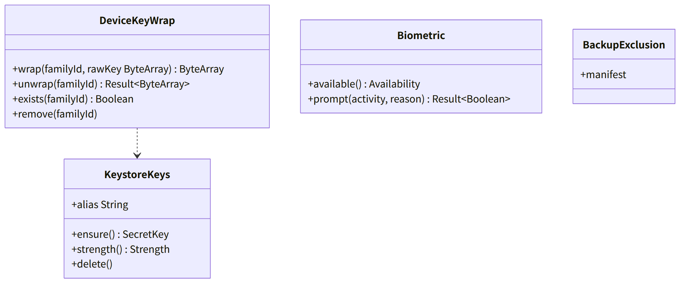
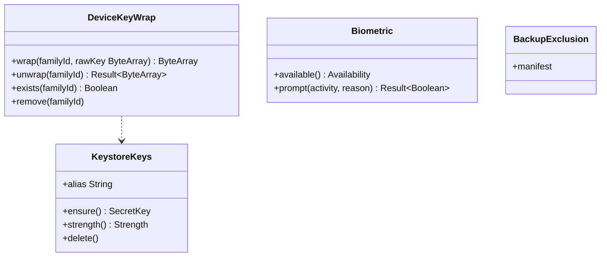

# and-keystore（Android のシェル・基盤。鍵保管庫と生体認証）

## 受ける節
- [第9章 8 鍵保管庫と生体認証（DD-9-8）](../../../../docs/jp/design/09_基本設計書_Androidのシェル.md#8-鍵保管庫と生体認証dd-9-8)（鍵保管庫：AES/GCM 256、StrongBox → TEE、`setUserAuthenticationRequired(false)`、端末鍵の包みと解き、`getNoBackupFilesDir()`、BiometricPrompt、鍵保管庫の鍵が失われた時）、[第9章 12 OS の制限と見やすさ（DD-9-12）](../../../../docs/jp/design/09_基本設計書_Androidのシェル.md#12-os-の制限と見やすさdd-9-12) のバックアップの除外（`allowBackup=false`、`dataExtractionRules`）、[第9章 14 失敗の扱い](../../../../docs/jp/design/09_基本設計書_Androidのシェル.md#14-失敗の扱い) の鍵保管庫が使えない行
- [第12章 5.3 端末の鍵（DD-12-3）](../../../../docs/jp/design/12_基本設計書_データと暗号化.md#53-端末の鍵dd-12-3) の端末鍵の行（Android はシェルが包んだ物を JS ブリッジから渡す）、[第3章 4.7 アプリのロック（DD-3-8）](../../../../docs/jp/design/03_基本設計書_認証_構成員_端末.md#47-アプリのロックdd-3-8) の Android の行（OS の認証の画面。結果だけを渡す）
- 全体実装設計書 3.3、I-14

## 依存
- 下：なし。部品：androidx.security は使わない（非推奨）。`KeyStore`（AndroidKeyStore）、`KeyGenParameterSpec`、androidx.biometric。
- 上：and-shell（JS ブリッジの `wrapDeviceKey`／`unwrapDeviceKey`／`biometricUnlock`）、and-push（`DecryptHost` の WebView は同じ Profile のため鍵は WebView の側：本ブロックは関与しない）。

## クラス図

図の元の文（mermaid）

クラス図の注記（図の各メンバーの説明。仕様の節と番号を含む）

|クラス|メンバー|注記|
|---|---|---|
|KeystoreKeys|`+alias String`|"ft-device-wrap-<family_id>"|
|KeystoreKeys|`+ensure() SecretKey`|KeyGenParameterSpec(AES/GCM/NoPadding, 256, setIsStrongBoxBacked(true) → StrongBoxUnavailableException で TEE, setUserAuthenticationRequired(false))。無ければ生成|
|KeystoreKeys|`+strength() Strength`|STRONGBOX \| TEE \| SOFTWARE（ソフトウェアなら設定に表示。第9章 14）|
|KeystoreKeys|`+delete()`|家族の削除|
|DeviceKeyWrap|`+wrap(familyId, rawKey ByteArray) ByteArray`|AES-GCM（12 バイトの nonce を先頭に）→ getNoBackupFilesDir()/families/<family_id>/device_key.bin|
|DeviceKeyWrap|`+unwrap(familyId) Result~ByteArray~`|ファイル → 復号。無い・鍵が失われた（KeyPermanentlyInvalidatedException、ファイルなし）→ SHELL-004（WebView は新しい端末の流れ）|
|Biometric|`+available() Availability`|BIOMETRIC_STRONG or DEVICE_CREDENTIAL|
|Biometric|`+prompt(activity, reason) Result~Boolean~`|BiometricPrompt。結果（成否）だけを返す。鍵とは結び付けない（第3章 DD-3-8）|
|BackupExclusion|`+manifest`|allowBackup=false、dataExtractionRules（cloud-backup と device-transfer を除外）、fullBackupContent（API 30 以下）|

## 公開操作（このブロックが所有する操作。番号は B-400〜）
|番号|操作（上の図）|使う側|由来|
|---|---|---|---|
|B-400|`DeviceKeyWrap`（`wrap`、`unwrap`、`exists`、`remove`）|and-shell（JS ブリッジの `wrapDeviceKey`／`unwrapDeviceKey`。家族の削除）|[第9章 8 鍵保管庫と生体認証（DD-9-8）](../../../../docs/jp/design/09_基本設計書_Androidのシェル.md#8-鍵保管庫と生体認証dd-9-8)、[第12章 5.3 端末の鍵（DD-12-3）](../../../../docs/jp/design/12_基本設計書_データと暗号化.md#53-端末の鍵dd-12-3)|
|B-401|`KeystoreKeys::strength`|and-shell（設定の表示）|[第9章 14 失敗の扱い](../../../../docs/jp/design/09_基本設計書_Androidのシェル.md#14-失敗の扱い)|
|B-402|`Biometric::prompt`、`available`|and-shell（JS ブリッジの `biometricUnlock`）、and-calls（着信の応答はロックの外：使わない）|[第3章 4.7 アプリのロック（DD-3-8）](../../../../docs/jp/design/03_基本設計書_認証_構成員_端末.md#47-アプリのロックdd-3-8)、[第9章 8 鍵保管庫と生体認証（DD-9-8）](../../../../docs/jp/design/09_基本設計書_Androidのシェル.md#8-鍵保管庫と生体認証dd-9-8)|

## アルゴリズム（差し替え点）
|事項|実装|切り替え|由来|
|---|---|---|---|
|鍵の置き場|StrongBox → TEE → ソフトウェア（OS の既定）|端末で自動|[第9章 8 鍵保管庫と生体認証（DD-9-8）](../../../../docs/jp/design/09_基本設計書_Androidのシェル.md#8-鍵保管庫と生体認証dd-9-8)、[第9章 14 失敗の扱い](../../../../docs/jp/design/09_基本設計書_Androidのシェル.md#14-失敗の扱い)|
|包み|AES-256-GCM、nonce 96 ビット|固定|[第9章 8 鍵保管庫と生体認証（DD-9-8）](../../../../docs/jp/design/09_基本設計書_Androidのシェル.md#8-鍵保管庫と生体認証dd-9-8)|

## データ設計（このブロックが形を持つ記録）
|記録|形|欄|由来|
|---|---|---|---|
|`<noBackupFilesDir>/families/<family_id>/device_key.bin`|ファイル|版 1 バイト + nonce 12 バイト + 暗号文（端末鍵 32 バイト + タグ）|[第9章 8 鍵保管庫と生体認証（DD-9-8）](../../../../docs/jp/design/09_基本設計書_Androidのシェル.md#8-鍵保管庫と生体認証dd-9-8)|
|AndroidKeyStore の鍵 `ft-device-wrap-<family_id>`|鍵保管庫|AES-256。エクスポート不可|[第9章 8 鍵保管庫と生体認証（DD-9-8）](../../../../docs/jp/design/09_基本設計書_Androidのシェル.md#8-鍵保管庫と生体認証dd-9-8)|
