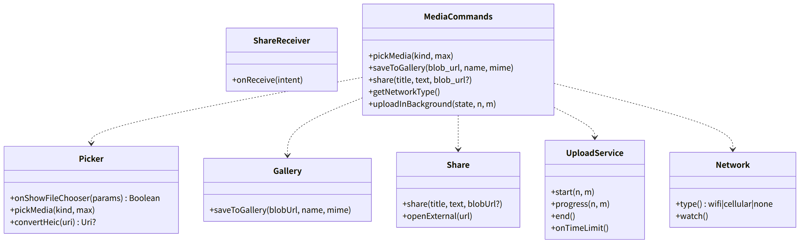
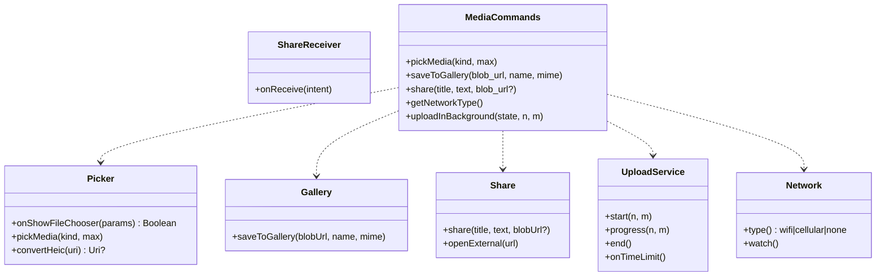

# and-media（Android のシェル。写真ピッカー、共有の受け口、端末への保存、背景のアップロード、回線）

## 受ける節

- [第9章 9 メディア（DD-9-9）](../../../../docs/jp/design/09_基本設計書_Androidのシェル.md#9-メディアdd-9-9) のメディアの表（写真ピッカーと HEIC、共有の受け口、MediaStore、`UploadService`、回線、カメラ）
- [第9章 3 構成（DD-9-1）](../../../../docs/jp/design/09_基本設計書_Androidのシェル.md#3-構成dd-9-1) のうち `UploadService`
- [第9章 4.1 設定](../../../../docs/jp/design/09_基本設計書_Androidのシェル.md#41-設定) の `onShowFileChooser`
- [第9章 4.2 JS ブリッジの命令](../../../../docs/jp/design/09_基本設計書_Androidのシェル.md#42-js-ブリッジの命令) のうちメディアのもの
  - 命令：`pickMedia`、`saveToGallery`、`share`、`getNetworkType`、`uploadInBackground`
  - イベント：`networkChanged`、`shareReceived`
- [第9章 7 権限（DD-9-7）](../../../../docs/jp/design/09_基本設計書_Androidのシェル.md#7-権限dd-9-7)（写真と動画の読み取りは権限不要）
- [第9章 14 失敗の扱い](../../../../docs/jp/design/09_基本設計書_Androidのシェル.md#14-失敗の扱い) の前面サービスの 6 時間の行
- [第5章 4.1 写真（DD-5-2）](../../../../docs/jp/design/05_基本設計書_メディア.md#41-写真dd-5-2) の Android の行（写真ピッカー、HEIC の復号の可否）
- [第5章 5.1 アップロード（DD-5-6）](../../../../docs/jp/design/05_基本設計書_メディア.md#51-アップロードdd-5-6) の 7（Android はシェルが前面サービスで続ける）
- [第5章 5.2 取得（DD-5-7）](../../../../docs/jp/design/05_基本設計書_メディア.md#52-取得dd-5-7) の回線の判定と端末への保存の Android の行
- [第8章 4 iPhone の制約の補い方（DD-8-6）](../../../../docs/jp/design/08_基本設計書_iPhoneとPCのシェル.md#4-iphone-の制約の補い方dd-8-6) の Share Target の行（Android はシェルの受け口）
- 全体実装設計書 2.3（アップロードの継続）

## 依存

- 下：[and-shell](and-shell.md)（`Bridge`、`WebHost`、`MainActivity.onNewIntent`）。
- 部品：
  - androidx.activity（`PickMultipleVisualMedia`、`OpenDocument`）
  - `ImageDecoder`、MediaStore、`ConnectivityManager`
  - WorkManager は使わない（アップロードの継続は前面サービス）
- 依存の逆転：and-shell の `BridgeHandler` に本ブロックの命令を登録。`WebHost.onShowFileChooser` の実装を渡す。

## クラス図

図の元の文（mermaid）

クラス図の注記（図の各メンバーの説明。仕様の節と番号を含む）

|クラス|メンバー|注記|
|---|---|---|
|Picker|`+onShowFileChooser(params) Boolean`|accept が画像・動画なら PickMultipleVisualMedia(50)。それ以外は OPEN_DOCUMENT。capture なら OS のカメラ|
|Picker|`+pickMedia(kind, max)`|JS ブリッジの命令（結果は onShowFileChooser の経路で返る）|
|Picker|`+convertHeic(uri) Uri?`|ImageDecoder.isMimeTypeSupported("image/heic") なら JPEG に変換して渡す。できなければ null（ウェブアプリが「この写真は送れません（形式）」）|
|ShareReceiver|`+onReceive(intent)`|ACTION_SEND / SEND_MULTIPLE（画像、動画、テキスト、ファイル）を MainActivity が受け、bridge `shareReceived{items: [{blob_url, name, mime}], text?}` を送る。ウェブアプリが「送る」画面を開く|
|Gallery|`+saveToGallery(blobUrl, name, mime)`|MediaStore：Pictures/<家族の名前>/、Movies/…、Download/…。WebView の blob は WebMessage で bytes を受ける（大きい物は chunk）|
|Share|`+share(title, text, blobUrl?)`|OS の共有シート|
|Share|`+openExternal(url)`|and-shell CoreCommands と重複しない：本ブロックは共有だけ|
|UploadService|`+start(n, m)`|前面サービス（dataSync）。通知「送信中 n/m」。WebView を背景で生かす|
|UploadService|`+onTimeLimit()`|1 日 6 時間の制限（onTimeout）に当たれば通知「アプリを開いてください」を出す。キューはウェブアプリに残る|
|Network|`+type() wifi\|cellular\|none`|ConnectivityManager の NetworkCapabilities。値は wifi、cellular、none のいずれか|
|Network|`+watch()`|registerDefaultNetworkCallback で変化を受け、bridge networkChanged{type} を送る|
|MediaCommands|`+uploadInBackground(state, n, m)`|state（start、progress、end のいずれか）を UploadService に渡す|

## 公開操作（このブロックが所有する操作。番号は B-460〜）

|番号|操作（上の図）|使う側|由来|
|---|---|---|---|
|B-460|`Picker`（`onShowFileChooser` の実装、`convertHeic`）|and-shell `WebHost`|[第9章 9 メディア（DD-9-9）](../../../../docs/jp/design/09_基本設計書_Androidのシェル.md#9-メディアdd-9-9)、[第5章 4.1 写真（DD-5-2）](../../../../docs/jp/design/05_基本設計書_メディア.md#41-写真dd-5-2)|
|B-461|`ShareReceiver::onReceive`|and-shell `MainActivity.onNewIntent`|[第9章 9 メディア（DD-9-9）](../../../../docs/jp/design/09_基本設計書_Androidのシェル.md#9-メディアdd-9-9)|
|B-462|`UploadService`（`start`、`progress`、`end`、`onTimeLimit`）|`MediaCommands`|[第9章 9 メディア（DD-9-9）](../../../../docs/jp/design/09_基本設計書_Androidのシェル.md#9-メディアdd-9-9)、[第5章 5.1 アップロード（DD-5-6）](../../../../docs/jp/design/05_基本設計書_メディア.md#51-アップロードdd-5-6)|
|B-463|`Network`（`type`、`watch`）|`MediaCommands`、and-push（再接続の契機）|[第9章 9 メディア（DD-9-9）](../../../../docs/jp/design/09_基本設計書_Androidのシェル.md#9-メディアdd-9-9)|
|B-464|`MediaCommands`（5 命令）。and-shell の `BridgeHandler` の実装。イベント `networkChanged`、`shareReceived` の送出|web-shell `Platform`、web-media|[第9章 4.2 JS ブリッジの命令](../../../../docs/jp/design/09_基本設計書_Androidのシェル.md#42-js-ブリッジの命令)|

## アルゴリズム（差し替え点）

|事項|実装|切り替え|由来|
|---|---|---|---|
|HEIC|`ImageDecoder`（API 28 以上）で復号できれば JPEG。Android 8.x は不可で、ウェブアプリが案内を出す|端末で自動|[第9章 9 メディア（DD-9-9）](../../../../docs/jp/design/09_基本設計書_Androidのシェル.md#9-メディアdd-9-9)、[第5章 10 失敗の扱い](../../../../docs/jp/design/05_基本設計書_メディア.md#10-失敗の扱い)|
|blob の受け渡し|WebMessage で bytes（chunk 1 MiB）。大きい動画は WebView の `shouldInterceptRequest` ではなく、ウェブアプリが OPFS の復号済みを Blob にして渡す|固定|[第9章 9 メディア（DD-9-9）](../../../../docs/jp/design/09_基本設計書_Androidのシェル.md#9-メディアdd-9-9)|

## データ設計（このブロックが形を持つ記録）

- 記録を持たない。保存先は MediaStore（`Pictures/<家族の名前>/`、`Movies/<家族の名前>/`、`Download/<家族の名前>/`）。

## 抜け

- なし。共有の受け口の結果を渡すイベント `shareReceived` は第9章 4.2 の表に足した（全体実装設計書 11.1 の G-04）。
