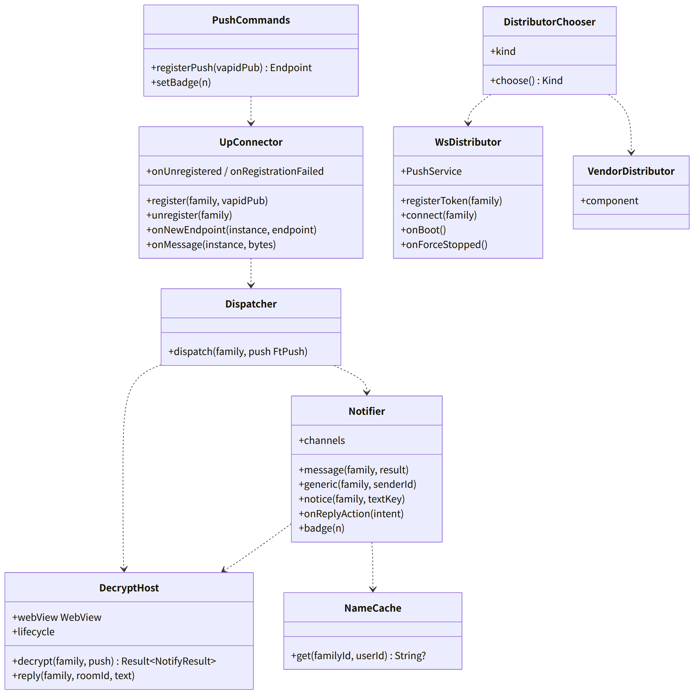
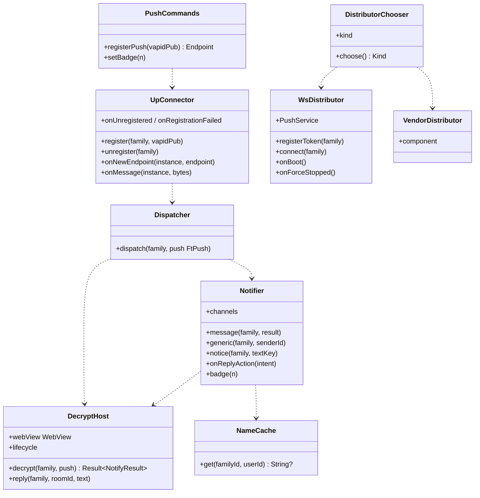

# and-push（Android のシェル。UnifiedPush の connector と配布元 2 系統、`DecryptHost`、通知の表示、直接返信、バッジ）

## 受ける節
- [第9章 3 構成（DD-9-1）](../../../../docs/jp/design/09_基本設計書_Androidのシェル.md#3-構成dd-9-1) のうち `PushService`、`DecryptHost`、`BootReceiver`、`UpReceiver`、配布元の Receiver、[第9章 5 通知（DD-9-5）](../../../../docs/jp/design/09_基本設計書_Androidのシェル.md#5-通知dd-9-5)（通知の段の表：配布元の選択、(ii)、(i)、connector、分岐、`DecryptHost`、直接返信、バッジ、設定の反映、内容の表示なし）、[第9章 7 権限（DD-9-7）](../../../../docs/jp/design/09_基本設計書_Androidのシェル.md#7-権限dd-9-7) の通知・全画面・電池の権限、[第9章 12 OS の制限と見やすさ（DD-9-12）](../../../../docs/jp/design/09_基本設計書_Androidのシェル.md#12-os-の制限と見やすさdd-9-12) の起動時と強制停止、[第9章 14 失敗の扱い](../../../../docs/jp/design/09_基本設計書_Androidのシェル.md#14-失敗の扱い) の `DecryptHost`・常駐・省電力の行
- [第7章 3 経路（DD-7-1、DD-7-2）](../../../../docs/jp/design/07_基本設計書_通知.md#3-経路dd-7-1dd-7-2) の Android の 2 行、[第7章 3.1 家族のサーバーの受け口（(i)）](../../../../docs/jp/design/07_基本設計書_通知.md#31-家族のサーバーの受け口i)（受け口 (i) のシェルの側：`/up/register`、`/up/ws`、ack、ping 60 秒、再接続）、[第7章 4 購読](../../../../docs/jp/design/07_基本設計書_通知.md#4-購読) の Android の行、[第7章 5.1 表示の流れ](../../../../docs/jp/design/07_基本設計書_通知.md#51-表示の流れ) の Android の行、[第7章 5.2 内容の表示（設定）](../../../../docs/jp/design/07_基本設計書_通知.md#52-内容の表示設定)（3 択は `DecryptHost` の結果で）、[第7章 5.3 バッジ](../../../../docs/jp/design/07_基本設計書_通知.md#53-バッジ)（バッジ：`/rooms` の合計）、[第7章 5.4 通知からの返信](../../../../docs/jp/design/07_基本設計書_通知.md#54-通知からの返信)（直接返信。既読は付けない）、[第7章 7 着信の通知（DD-7-7）](../../../../docs/jp/design/07_基本設計書_通知.md#7-着信の通知dd-7-7) の Android の行（着信は and-calls へ）、[第7章 8 届かない時（DD-7-8）](../../../../docs/jp/design/07_基本設計書_通知.md#8-届かない時dd-7-8) の常時接続、[第7章 10 初回の案内（DD-7-10）](../../../../docs/jp/design/07_基本設計書_通知.md#10-初回の案内dd-7-10) の Android の初回の順、[第7章 11 数値の一覧（config.yaml の「通知」）](../../../../docs/jp/design/07_基本設計書_通知.md#11-数値の一覧configyaml-の通知)
- [第2章 5.8 通知（第7章）](../../../../docs/jp/design/02_基本設計書_境界.md#58-通知第7章)（`/up/register`、`/up/{token}`、`/up/ws`）、[第2章 7 通知の中身（第7章）](../../../../docs/jp/design/02_基本設計書_境界.md#7-通知の中身第7章)（UnifiedPush の中身は RFC 8291 の暗号文。シェルが受けて WebView に渡す）、[第12章 5.8 通知（DD-12-10。第7章・第9章と往復）](../../../../docs/jp/design/12_基本設計書_データと暗号化.md#58-通知dd-12-10第7章第9章と往復) の Android の行、[第14章 7.1 ツールチェーン](../../../../docs/jp/design/14_基本設計書_開発基盤.md#71-ツールチェーン) の connector と配布元の部品（(ii) のライセンスの確認が条件）
- 全体実装設計書 2.2（`DecryptHost` は `/notify.html`）、2.3（常時接続）、3.3（配布元、`DecryptHost`）

## 依存
- 下：[and-shell](and-shell.md)（`Bridge`、`WebHost.configure`、`Families`、`ShellToken`、`ShellUi.Onboarding`）、[api](api.md)（`ft.push/1`、`ft.bridge/1` の `push`／`notifyResult`／`reply`）。部品：UnifiedPush の connector（3.3.5）、distributor-base + OkHttp（(i) の自前の配布元）、(ii) の OS の提供者の中継の Web Push のエンドポイントの部品（ライセンスの確認が条件。確認できなければ自前：第14章 7.1）、androidx.core（`NotificationCompat`、`MessagingStyle`、`RemoteInput`）、WorkManager。
- 依存の逆転：and-shell の `BridgeHandler` に `registerPush` と `setBadge` を登録。and-calls の `IncomingCall.onRing(payload)` を呼ぶ（`kind: call`）。

## クラス図

図の元の文（mermaid）

クラス図の注記（図の各メンバーの説明。仕様の節と番号を含む）

|クラス|メンバー|注記|
|---|---|---|
|DistributorChooser|`+choose() Kind`|初回：OS の提供者のサービスがあれば (ii)、なければ (i)。設定で切り替え → 再登録|
|DistributorChooser|`+kind`|WS_INTERNAL (i) \| VENDOR_ENDPOINT (ii)|
|UpConnector|`+register(family, vapidPub)`|UnifiedPush の connector：instance = family.id、配布元の選択 → endpoint|
|UpConnector|`+onNewEndpoint(instance, endpoint)`|bridge emit pushEndpoint → ウェブアプリが PUT /me/devices/{id}/push（kind: unifiedpush）|
|UpConnector|`+onMessage(instance, bytes)`|RFC 8291 の復号（VAPID の検証）→ 平文 ft.push/1 → Dispatcher|
|UpConnector|`+onUnregistered / onRegistrationFailed`|設定に表示。再登録|
|WsDistributor|`+PushService`|前面サービス（specialUse。PROPERTY_SPECIAL_USE_FGS_SUBTYPE）。家族ごとに 1 接続|
|WsDistributor|`+registerToken(family)`|POST /api/v1/up/register（シェルのトークン）→ token → endpoint https://<サーバー>/up/<token> → connector へ NEW_ENDPOINT|
|WsDistributor|`+connect(family)`|wss://<サーバー>/api/v1/up/ws（シェルのトークン）。接続時に未配信を順に受け ack。ping 60 秒。切れたら指数（1〜300 秒）。1 時間つながらなければ通知「通知の接続が不安定です」と (ii) への切り替えの提案|
|WsDistributor|`+onBoot()`|BootReceiver：BOOT_COMPLETED / LOCKED_BOOT_COMPLETED → 起動（(i) の時）|
|WsDistributor|`+onForceStopped()`|Android 15 の検知 → 案内|
|VendorDistributor|`+component`|(ii)：OS の提供者の中継の Web Push のエンドポイントの部品（公開の値だけで動く。NRSD の秘密を配らない）。ライセンスの確認が条件（第14章 7.1）|
|Dispatcher|`+dispatch(family, push FtPush)`|kind: call → and-calls IncomingCall.onRing。call_end → 着信の通知を消す。notice → Notifier.notice（本文は汎用）。それ以外 → DecryptHost.decrypt → Notifier.message / generic|
|DecryptHost|`+webView WebView`|非表示。家族のサーバーの /notify.html。同じ Profile。WebHost.configure を再利用|
|DecryptHost|`+decrypt(family, push) Result~NotifyResult~`|bridge push{payload} → 10 秒で notifyResult{title, body, room_id, sender_id, kind, badge}。無ければ generic。失敗が続けば WebView を作り直す|
|DecryptHost|`+reply(family, roomId, text)`|直接返信：bridge reply{room_id, text} → ウェブアプリが暗号化して送信（既読は付けない）|
|DecryptHost|`+lifecycle`|必要な時に起動、60 秒で停止。onTrimMemory で捨てる|
|Notifier|`+channels`|messages（MessagingStyle、グループ = room_id、直接返信、タップで MainActivity の /r/<room_id>）、calls（and-calls）、notices、service（常駐の静かなチャネル）|
|Notifier|`+message(family, result)`|3 択の結果をそのまま表示。setNumber（バッジ）。VISIBILITY_PRIVATE（内容の表示なしの時）|
|Notifier|`+generic(family, senderId)`|「○○さんからメッセージ」（表示名のコピー。なければ家族の名前）|
|Notifier|`+onReplyAction(intent)`|RemoteInput → DecryptHost.reply|
|Notifier|`+badge(n)`|setNumber + setShowBadge。ランチャーの表示は保証されない（H-9-2）|
|NameCache|`+get(familyId, userId) String?`|表示名のコピー（ウェブアプリが bridge で渡す：命令 updateNameCache。第9章 4.2 の表に無い → 抜け）|
|PushCommands|`+registerPush(vapidPub) Endpoint`|UpConnector.register|
|PushCommands|`+setBadge(n)`|Notifier.badge|

## 公開操作（このブロックが所有する操作。番号は B-420〜）
|番号|操作（上の図）|使う側|由来|
|---|---|---|---|
|B-420|`UpConnector`（`register`、`unregister`、`onMessage`）、`DistributorChooser`|and-shell（家族の追加と削除、設定）、`PushCommands`|[第9章 5 通知（DD-9-5）](../../../../docs/jp/design/09_基本設計書_Androidのシェル.md#5-通知dd-9-5)、[第7章 3 経路（DD-7-1、DD-7-2）](../../../../docs/jp/design/07_基本設計書_通知.md#3-経路dd-7-1dd-7-2)|
|B-421|`WsDistributor`（`PushService`、`onBoot`、`onForceStopped`）|OS（Receiver）、and-shell `MainActivity`（起動時の再開）|[第9章 5 通知（DD-9-5）](../../../../docs/jp/design/09_基本設計書_Androidのシェル.md#5-通知dd-9-5)、[第7章 3.1 家族のサーバーの受け口（(i)）](../../../../docs/jp/design/07_基本設計書_通知.md#31-家族のサーバーの受け口i)、[第9章 12 OS の制限と見やすさ（DD-9-12）](../../../../docs/jp/design/09_基本設計書_Androidのシェル.md#12-os-の制限と見やすさdd-9-12)|
|B-422|`Dispatcher::dispatch`|本ブロック（connector から）|[第9章 5 通知（DD-9-5）](../../../../docs/jp/design/09_基本設計書_Androidのシェル.md#5-通知dd-9-5)|
|B-423|`DecryptHost`（`decrypt`、`reply`）|本ブロック、and-shell（`onTrimMemory`）|[第9章 5 通知（DD-9-5）](../../../../docs/jp/design/09_基本設計書_Androidのシェル.md#5-通知dd-9-5)、[第12章 5.8 通知（DD-12-10。第7章・第9章と往復）](../../../../docs/jp/design/12_基本設計書_データと暗号化.md#58-通知dd-12-10第7章第9章と往復)|
|B-424|`Notifier`（`message`、`generic`、`notice`、`badge`、`channels`）|本ブロック、and-calls（`calls` チャネルは and-calls が持つが、チャネルの登録は本ブロックの `channels` で一括）、and-update（「更新があります」「更新しました」は `notices`）|[第9章 5 通知（DD-9-5）](../../../../docs/jp/design/09_基本設計書_Androidのシェル.md#5-通知dd-9-5)、[第7章 5 中身と見せ方（DD-7-3、DD-7-4）](../../../../docs/jp/design/07_基本設計書_通知.md#5-中身と見せ方dd-7-3dd-7-4)|
|B-425|`PushCommands`（`registerPush`、`setBadge`）。and-shell の `BridgeHandler` の実装|web-shell `Platform`|[第9章 4.2 JS ブリッジの命令](../../../../docs/jp/design/09_基本設計書_Androidのシェル.md#42-js-ブリッジの命令)|

## アルゴリズム（差し替え点）
|事項|実装|切り替え|由来|
|---|---|---|---|
|配布元|(ii) の部品があれば (ii)、なければ (i)。設定で切り替え|端末と設定|[第9章 5 通知（DD-9-5）](../../../../docs/jp/design/09_基本設計書_Androidのシェル.md#5-通知dd-9-5)|
|再接続|指数 1〜300 秒。1 時間で案内|固定|[第9章 5 通知（DD-9-5）](../../../../docs/jp/design/09_基本設計書_Androidのシェル.md#5-通知dd-9-5)、[第9章 14 失敗の扱い](../../../../docs/jp/design/09_基本設計書_Androidのシェル.md#14-失敗の扱い)|
|復号の期限|10 秒（サーバーの設定の値を `getInfo` 経由で受けるのではなく、シェルの定数。第7章 11 の範囲 5〜30 の既定）|固定|[第7章 11 数値の一覧（config.yaml の「通知」）](../../../../docs/jp/design/07_基本設計書_通知.md#11-数値の一覧configyaml-の通知)|
|(ii) の部品|ライセンスの確認が条件。確認できなければ自前（UnifiedPush の仕様 AND_3.1.0 に従う配布元）|【未確認】|[第14章 7.1 ツールチェーン](../../../../docs/jp/design/14_基本設計書_開発基盤.md#71-ツールチェーン)|

## データ設計（このブロックが形を持つ記録）
|記録|形|欄|由来|
|---|---|---|---|
|`<noBackupFilesDir>/push/<family_id>.json`|JSON|`{kind, endpoint, up_token?, vapid_pub, registered_at, last_connected_at}`|[第9章 5 通知（DD-9-5）](../../../../docs/jp/design/09_基本設計書_Androidのシェル.md#5-通知dd-9-5)|
|`<noBackupFilesDir>/names/<family_id>.json`|JSON|`{user_id → display_name}`（表示名だけ。本文なし）|[第9章 5 通知（DD-9-5）](../../../../docs/jp/design/09_基本設計書_Androidのシェル.md#5-通知dd-9-5)|
|通知のチャネル|OS|`messages`（IMPORTANCE_HIGH）、`calls`（着信音。and-calls）、`notices`（DEFAULT）、`service`（LOW。常駐）|[第9章 5 通知（DD-9-5）](../../../../docs/jp/design/09_基本設計書_Androidのシェル.md#5-通知dd-9-5)|
|`NotifyResult`|`ft.bridge/1`|`{title, body, room_id, sender_id, kind, badge}`|[第9章 5 通知（DD-9-5）](../../../../docs/jp/design/09_基本設計書_Androidのシェル.md#5-通知dd-9-5)|

## 抜け
- 表示名のコピー（`NameCache`）をウェブアプリからシェルへ渡す命令が第9章 4.2 の表に無い（`updateNameCache({user_id: name})`）。層9 の抜けの一覧に載せる。
