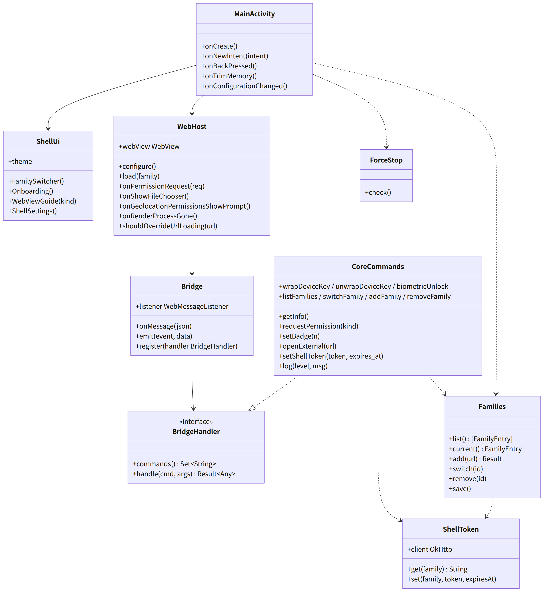
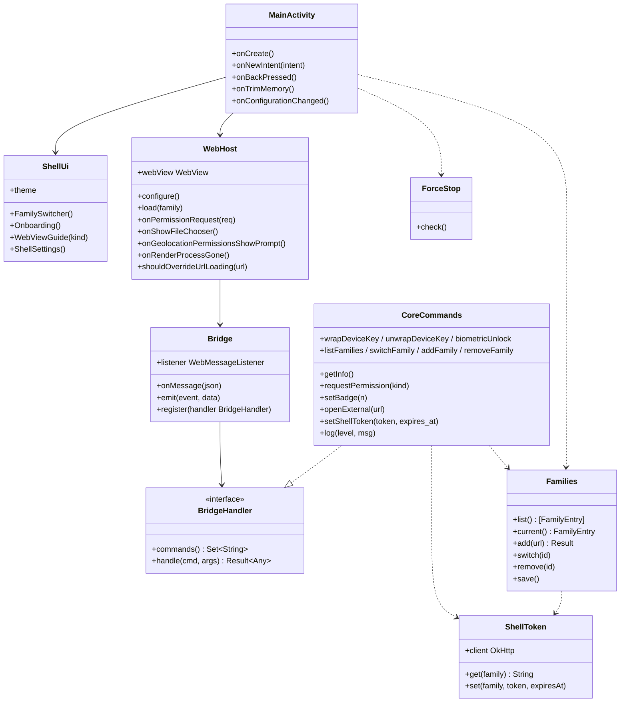

# and-shell（Android のシェル。`MainActivity`、WebView、JS ブリッジの host、家族の一覧、シェルのトークン）

## 受ける節

- [第9章 3 構成（DD-9-1）](../../../../docs/jp/design/09_基本設計書_Androidのシェル.md#3-構成dd-9-1)（構成の表のうち `MainActivity`。単一プロセス、WebView は 1 つ、`onTrimMemory`）
- [第9章 4.1 設定](../../../../docs/jp/design/09_基本設計書_Androidのシェル.md#41-設定)（WebView の設定の表の全部）
- [第9章 4.2 JS ブリッジの命令](../../../../docs/jp/design/09_基本設計書_Androidのシェル.md#42-js-ブリッジの命令) の host の側
  - 形式、`getInfo`、`requestPermission`、`setBadge`、`openExternal`、`log`
  - `getNetworkType`（and-media）
  - `wrapDeviceKey`／`unwrapDeviceKey`／`biometricUnlock`（and-keystore）
  - `listFamilies`／`switchFamily`／`addFamily`／`removeFamily`、`setShellToken`
  - イベント：`fontScaleChanged`、`backPressed`、`familySwitched`、`sessionNeeded`
- [第9章 7 権限（DD-9-7）](../../../../docs/jp/design/09_基本設計書_Androidのシェル.md#7-権限dd-9-7)（権限の表：初回の案内の順、`ACCESS_LOCAL_NETWORK`）
- [第9章 11 複数の家族（DD-9-11）](../../../../docs/jp/design/09_基本設計書_Androidのシェル.md#11-複数の家族dd-9-11)（複数の家族）
- [第9章 12 OS の制限と見やすさ（DD-9-12）](../../../../docs/jp/design/09_基本設計書_Androidのシェル.md#12-os-の制限と見やすさdd-9-12) の全行（バックアップの除外、強制停止の検知、文字の拡大率、TalkBack、ダーク、日本語）
- [第9章 14 失敗の扱い](../../../../docs/jp/design/09_基本設計書_Androidのシェル.md#14-失敗の扱い)（失敗のシェルの行）
- [第2章 4.2 CSRF と cross-site](../../../../docs/jp/design/02_基本設計書_境界.md#42-csrf-と-cross-site)（シェルのネイティブの要求は `X-Requested-With` とシェルのトークン。Cookie は WebView と共有しない）
- [第2章 4.4 WebSocket と通知と SFU](../../../../docs/jp/design/02_基本設計書_境界.md#44-websocket-と通知と-sfu) のシェルのトークン
- [第8章 6 配信の完全性（DD-8-8）](../../../../docs/jp/design/08_基本設計書_iPhoneとPCのシェル.md#6-配信の完全性dd-8-8) の CSP は WebView でも同じ（ページの側）
- [第10章 11 シェルの画面（DD-10-10）](../../../../docs/jp/design/10_基本設計書_画面.md#11-シェルの画面dd-10-10) のシェルの画面（家族の切り替え、初回の案内 4 画面、WebView の案内、更新。着信は and-calls）
- [第10章 3 見た目（DD-10-1）](../../../../docs/jp/design/10_基本設計書_画面.md#3-見た目dd-10-1) の見た目の規則のシェルへの適用
- [第13章 5 開発者の確認の制度（DD-13-6）](../../../../docs/jp/design/13_基本設計書_配布と更新.md#5-開発者の確認の制度dd-13-6)（初回のインストール：「不明なアプリのインストール」の案内は and-update）
- [第1章 10.10 URL と QR の形](../../../../docs/jp/design/01_基本設計書_全体構成.md#1010-url-と-qr-の形) の App Links（`/i/*`）
- 全体実装設計書 2.2（シェルの単一プロセス）、3.3（家族、WebView）、I-15

- [第1章 9.2 端末](../../../../docs/jp/design/01_基本設計書_全体構成.md#92-端末) の Android の行（WebView の保存とシェルの保存）
- [第14章 4 対応する OS とブラウザの最低要件](../../../../docs/jp/design/14_基本設計書_開発基盤.md#4-対応する-os-とブラウザの最低要件) の Android の最低要件（WebView 138、minSdk 26）
- [第14章 7.2 シェルが担うもの（部品の選定に関わる範囲）](../../../../docs/jp/design/14_基本設計書_開発基盤.md#72-シェルが担うもの部品の選定に関わる範囲)（シェルが担うもの）

## 依存

- 下：
  - [and-keystore](and-keystore.md)
  - [api](api.md)（fabrikt の生成ファイル：`ft.bridge/1`、`ft.release/1`、`ft.push/1`、シェルが使う経路）
- 部品：
  - Compose、androidx.activity
  - androidx.webkit（`WebViewCompat`、`WebMessageListener`、`ProfileStore`）
  - OkHttp（シェルのネイティブの要求）
- 依存の逆転：`BridgeHandler`（命令の名前と処理の対応）を本ブロックが定義し、and-push、and-calls、and-media、and-update が自分の命令を登録する。`ShellEvent` の送出も本ブロックの `Bridge.emit` を通す。
- 上：and-push、and-calls、and-media、and-update。

## クラス図

図の元の文（mermaid）

クラス図の注記（図の各メンバーの説明。仕様の節と番号を含む）

|クラス|メンバー|注記|
|---|---|---|
|MainActivity|`+onCreate()`|次の順に行う。1. WebView の版の確認（138 未満なら案内、null なら使えない）。2. Families（0 件なら追加の画面）。3. 初回の案内（未了なら）。4. WebHost.load(current)|
|MainActivity|`+onNewIntent(intent)`|App Links /i/&lt;token&gt;（家族の追加）、通知のタップ（/r/&lt;room_id&gt;。家族の切り替え）、共有の受け口（and-media）|
|MainActivity|`+onBackPressed()`|canGoBack なら goBack、なければ bridge backPressed、それでも消費されなければ既定|
|MainActivity|`+onTrimMemory()`|DecryptHost の WebView を捨てる（and-push）|
|MainActivity|`+onConfigurationChanged()`|fontScale の変化を bridge fontScaleChanged で送る|
|ShellUi|`+FamilySwitcher()`|上部の家族の名前を押すと一覧（名前、未読の合計）が開き、選んで切り替える。「家族を追加」（URL か招待のリンク）|
|ShellUi|`+Onboarding()`|通知の許可、全画面の着信、電池の最適化、通知の方式（自動の結果と切り替え）の順。各 1 画面、図と 1 文（第10章 11）|
|ShellUi|`+WebViewGuide(kind)`|138 未満：更新の案内（OS の更新の経路）。なし：「この端末では使えません」|
|ShellUi|`+ShellSettings()`|通知の方式、自動で更新、鍵保管庫の強度、版、ライセンス|
|ShellUi|`+theme`|第10章 3 のトークンを Compose に。sp。contentDescription|
|WebHost|`+webView WebView`|1 つ。家族の切り替えで Profile と URL を替える|
|WebHost|`+configure()`|第9章 4.1 の表：JS と DOM storage 有効、ファイルの読み込み無効、MIXED_CONTENT_NEVER_ALLOW、algorithmic darkening、setTextZoom を呼ばない、edge-to-edge、Profile（MULTI_PROFILE。使えなければ 1 家族）、WebAuthn（WEB_AUTHENTICATION_SUPPORT_FOR_APP）、UA に FamilyTalkShell/<版>|
|WebHost|`+load(family)`|https://<family.url>/|
|WebHost|`+onPermissionRequest(req)`|オリジンが家族のサーバーで RECORD_AUDIO/CAMERA の実行時権限があれば grant、なければ要求してから|
|WebHost|`+onShowFileChooser()`|and-media Picker|
|WebHost|`+onGeolocationPermissionsShowPrompt()`|実行時権限を求め、許されたら許可|
|WebHost|`+onRenderProcessGone()`|破棄して作り直し、同じ URL。通話中なら and-calls に通知（通話は切れる）|
|WebHost|`+shouldOverrideUrlLoading(url)`|家族のオリジン以外は外部のブラウザ|
|Bridge|`+listener WebMessageListener`|オブジェクト名 "ftShell"。許可するオリジンは登録した家族の URL だけ（I-15）。他のオリジンからの呼び出しは SHELL-002 で無視し記録|
|Bridge|`+onMessage(json)`|{id, cmd, args} を BridgeHandler の表で処理し、{id, ok, result} または {id, ok: false, error: {code, params}} を返す。未知は SHELL-001。args は生成した型で検証|
|Bridge|`+emit(event, data)`|{event, data} を postMessage で送る（ウェブアプリの Platform.on が受ける）|
|CoreCommands|`+getInfo()`|シェルの版、OS、WebView の版、fontScale、家族の識別子、配布元の種類|
|CoreCommands|`+requestPermission(kind)`|kind は notifications、camera、microphone、fullScreenIntent、batteryOptimization、localNetwork のいずれか（第9章 7）|
|CoreCommands|`+setBadge(n)`|ShortcutBadger は使わない：通知の setNumber（and-push）に委ねる|
|CoreCommands|`+wrapDeviceKey / unwrapDeviceKey / biometricUnlock`|and-keystore|
|CoreCommands|`+listFamilies / switchFamily / addFamily / removeFamily`|Families|
|CoreCommands|`+setShellToken(token, expires_at)`|WebView が取り直したシェルのトークンを ShellToken.set に渡す（第9章 4.2。G-02）|
|CoreCommands|`+log(level, msg)`|シェルのログ（本文を含めない）|
|Families|`+list() [FamilyEntry]`|families.json：id、url、name、profile、shell_token、distributor_instance|
|Families|`+add(url) Result`|URL を正規化し、GET /family（名前とアイコン）を取り、Profile を作って登録する。招待のリンク /i/&lt;token&gt; は追加の後に WebView で開く|
|Families|`+switch(id)`|WebHost.load + bridge familySwitched + 通知の instance の切り替え|
|Families|`+remove(id)`|Profile のデータ、シェルのトークン、購読（and-push の unregister）、端末鍵の包み（and-keystore）を消す|
|ShellToken|`+get(family) String`|24 時間。期限が近いか 401 なら bridge sessionNeeded を送る。WebView が POST /auth/shell-token で取り直し、命令 setShellToken で渡す（第9章 4.2）|
|ShellToken|`+set(family, token, expiresAt)`|families.json の shell_token と shell_token_expires_at を書き換える|
|ShellToken|`+client OkHttp`|X-Requested-With: family-talk、Authorization: Bearer &lt;shell_token&gt;、Cookie なし|
|ForceStop|`+check()`|Android 15：ApplicationStartInfo.wasForceStopped() で検知し、「通知が止まっていました。設定をご確認ください」と出す|

## 公開操作（このブロックが所有する操作。番号は B-410〜）

|番号|操作（上の図）|使う側|由来|
|---|---|---|---|
|B-410|`Bridge`（`register`、`emit`、`onMessage`）と `BridgeHandler`（定義）|and-push、and-calls、and-media、and-update（自分の命令の登録とイベントの送出）、web-shell `Bridge`（相手）|[第9章 4.2 JS ブリッジの命令](../../../../docs/jp/design/09_基本設計書_Androidのシェル.md#42-js-ブリッジの命令)、I-15|
|B-411|`WebHost`（`load`、`webView` の参照、`onRenderProcessGone` の通知）|and-calls（PiP の `setSourceRectHint`、通話中の描画）、and-media（`onShowFileChooser` の実装を渡す）、and-push（`DecryptHost` は別の WebView：本ブロックの `configure` を再利用）|[第9章 4.1 設定](../../../../docs/jp/design/09_基本設計書_Androidのシェル.md#41-設定)|
|B-412|`Families`（`list`、`current`、`add`、`switch`、`remove`）|and-push（instance の登録）、and-update（`/dl/version.json` の URL）、`MainActivity`|[第9章 11 複数の家族（DD-9-11）](../../../../docs/jp/design/09_基本設計書_Androidのシェル.md#11-複数の家族dd-9-11)|
|B-413|`ShellToken::get`、`set`、`client`|and-push（`/up/register`、`/up/ws`）、and-update（`/dl/version.json`、`/dl/app.apk` は無認証だが同じ client）|[第2章 4.4 WebSocket と通知と SFU](../../../../docs/jp/design/02_基本設計書_境界.md#44-websocket-と通知と-sfu)|
|B-414|`ShellUi`（`Onboarding`、`WebViewGuide`、`ShellSettings`、`theme`）|and-push（通知の方式の切り替え）、and-update（自動で更新）、and-calls（着信の画面の配色）|[第10章 11 シェルの画面（DD-10-10）](../../../../docs/jp/design/10_基本設計書_画面.md#11-シェルの画面dd-10-10)|
|B-415|`CoreCommands::requestPermission`|and-push（初回の案内から）、and-calls（通話の権限）|[第9章 7 権限（DD-9-7）](../../../../docs/jp/design/09_基本設計書_Androidのシェル.md#7-権限dd-9-7)|

## アルゴリズム（差し替え点）

|事項|実装|切り替え|由来|
|---|---|---|---|
|Profile|`ProfileStore`（MULTI_PROFILE）。使えない端末は 1 家族（2 つ目の追加で案内）|端末で自動|[第9章 4.1 設定](../../../../docs/jp/design/09_基本設計書_Androidのシェル.md#41-設定)、[第9章 14 失敗の扱い](../../../../docs/jp/design/09_基本設計書_Androidのシェル.md#14-失敗の扱い)|
|WebView の版の判定|`WebViewCompat.getCurrentWebViewPackage().versionName` の先頭の整数 ≥ 138|固定|[第9章 4.1 設定](../../../../docs/jp/design/09_基本設計書_Androidのシェル.md#41-設定)|
|JS ブリッジの検証|生成した型（fabrikt）で `args` を検証。失敗は `NET-001` 相当の `SHELL-001`|固定|全体実装設計書 5.1|

## データ設計（このブロックが形を持つ記録）

|記録|形|欄|由来|
|---|---|---|---|
|`<noBackupFilesDir>/families.json`|JSON|`[{id, url, name, profile, shell_token, shell_token_expires_at, distributor_instance, added_at}]`、`current`|[第9章 11 複数の家族（DD-9-11）](../../../../docs/jp/design/09_基本設計書_Androidのシェル.md#11-複数の家族dd-9-11)|
|`<noBackupFilesDir>/shell_settings.json`|JSON|`{onboarding_done, distributor_kind, auto_update, log_level}`|[第9章 5 通知（DD-9-5）](../../../../docs/jp/design/09_基本設計書_Androidのシェル.md#5-通知dd-9-5)、[第9章 10 自己更新（DD-9-10）](../../../../docs/jp/design/09_基本設計書_Androidのシェル.md#10-自己更新dd-9-10)|
|シェルのログ|logcat（release は WARN 以上）+ 端末内の回転ファイル（1 MB × 3。本文なし）|`log` 命令、SHELL-* の記録|[第9章 4.2 JS ブリッジの命令](../../../../docs/jp/design/09_基本設計書_Androidのシェル.md#42-js-ブリッジの命令)|

## 抜け

- なし。シェルのトークンを渡す命令 `setShellToken(token, expires_at)` は第9章 4.2 の表に足した（全体実装設計書 11.1 の G-02）。
