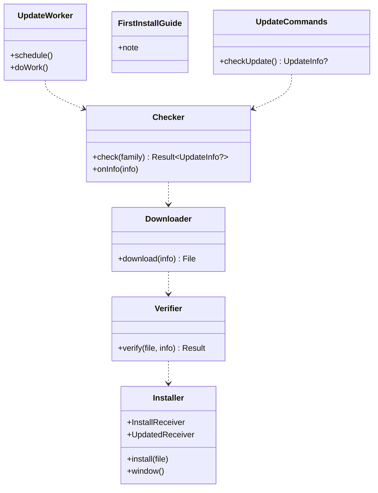

# and-update（Android のシェル。自己更新）

## 受ける節

- [第9章 10 自己更新（DD-9-10）](../../../../docs/jp/design/09_基本設計書_Androidのシェル.md#10-自己更新dd-9-10) の自己更新の段 1〜7 と注記
  - `UpdateWorker`、取得、検証（SHA-256、署名の指紋、lineage）、自動／通知
  - `PackageInstaller`、`MY_PACKAGE_REPLACED`、失敗
  - 初回のインストールの案内、通話中は更新しない
- [第9章 3 構成（DD-9-1）](../../../../docs/jp/design/09_基本設計書_Androidのシェル.md#3-構成dd-9-1) のうち `InstallReceiver`、`UpdatedReceiver`、`UpdateWorker`
- [第9章 7 権限（DD-9-7）](../../../../docs/jp/design/09_基本設計書_Androidのシェル.md#7-権限dd-9-7) の `REQUEST_INSTALL_PACKAGES`
- [第9章 4.2 JS ブリッジの命令](../../../../docs/jp/design/09_基本設計書_Androidのシェル.md#42-js-ブリッジの命令) の `checkUpdate`、`updateAvailable`、`updateFailed`
- [第9章 14 失敗の扱い](../../../../docs/jp/design/09_基本設計書_Androidのシェル.md#14-失敗の扱い) の署名の不一致・無人の更新ができない端末
- [第13章 3 配布物（DD-13-2）](../../../../docs/jp/design/13_基本設計書_配布と更新.md#3-配布物dd-13-2)（version.json の `android` の欄：`code`、`apks`、`signing_cert_sha256[]`）
- [第13章 4.1 鍵](../../../../docs/jp/design/13_基本設計書_配布と更新.md#41-鍵) の交代（配列のどれか）
- [第13章 4.3 利用者の検証（手順書）](../../../../docs/jp/design/13_基本設計書_配布と更新.md#43-利用者の検証手順書)
- [第13章 5 開発者の確認の制度（DD-13-6）](../../../../docs/jp/design/13_基本設計書_配布と更新.md#5-開発者の確認の制度dd-13-6)（初回の案内。開発者の確認の制度の「上級者の手順」は手順書）
- [第13章 6.1 版](../../../../docs/jp/design/13_基本設計書_配布と更新.md#61-版)（`versionCode`）
- [第13章 8 失敗の扱い](../../../../docs/jp/design/13_基本設計書_配布と更新.md#8-失敗の扱い) の APK の行
- [第2章 5.11 サーバー（無認証）](../../../../docs/jp/design/02_基本設計書_境界.md#511-サーバー無認証)（`/dl/version.json`、`/dl/app.apk`、`/dl/app-<abi>.apk`）
- [第1章 7.9 更新](../../../../docs/jp/design/01_基本設計書_全体構成.md#79-更新)
- [第11章 10 更新（DD-11-9）](../../../../docs/jp/design/11_基本設計書_運用.md#10-更新dd-11-9) の「Android は版の情報で自己更新」
- 全体実装設計書 3.3（自己更新の状態）

## 依存

- 下：
  - [and-shell](and-shell.md)（`Bridge`、`Families`、`ShellToken.client`、`ShellUi.ShellSettings`）
  - [and-push](and-push.md)（`Notifier.notice`）
  - [and-calls](and-calls.md)（通話中の判定：`CallService` の稼働）
  - [api](api.md)（`ft.release/1`）
- 部品：WorkManager、`PackageInstaller`、`PackageManager.getPackageArchiveInfo(GET_SIGNING_CERTIFICATES)`。
- 依存の逆転：and-shell の `BridgeHandler` に `checkUpdate` を登録。

## クラス図

図の元の文（mermaid）

クラス図の注記（図の各メンバーの説明。仕様の節と番号を含む）

|クラス|メンバー|注記|
|---|---|---|
|UpdateWorker|`+schedule()`|WorkManager：日次。制約 Wi-Fi（充電中は任意）。起動時にも 1 回|
|UpdateWorker|`+doWork()`|各家族の /dl/version.json を取り、Checker.check に渡す|
|Checker|`+check(family) Result~UpdateInfo?~`|ft.release/1 の android.code が自分の versionCode より大きければ UpdateInfo を作る（url、sha256、code、signing_cert_sha256[]）。abi は arm64-v8a、armeabi-v7a、universal の順に合うものを選ぶ。複数の家族は最大の code|
|Checker|`+onInfo(info)`|bridge updateAvailable{version} を送る。設定「自動で更新」が ON なら Downloader、OFF なら Notifier.notice「更新があります」（タップで取得）|
|Downloader|`+download(info) File`|/dl/app-&lt;abi&gt;.apk（再開可：Range）。内部の領域 files/updates/&lt;code&gt;.apk。Wi-Fi の制約。`/dl/*` は無認証（第2章 5.11）：同じ OkHttp の client だが Authorization は付けない|
|Verifier|`+verify(file, info) Result`|SHA-256 が version.json と一致。getPackageArchiveInfo(GET_SIGNING_CERTIFICATES) の証明書の SHA-256 が自分の署名（または lineage の配列のどれか）と一致。packageName が自分と一致。失敗したら APK を破棄して記録し、bridge updateFailed{code, reason} を送る。ウェブアプリが POST /me/report（kind: update_failed）で管理者に知らせる（G-05）|
|Installer|`+install(file)`|PackageInstaller の session（setRequireUserAction(USER_ACTION_NOT_REQUIRED)：Android 12 以上で自分自身の更新は無人。11 以下は OS の確認の画面）を作って commit する。通話中は延期（夜間 2〜5 時の時間帯で再試行）|
|Installer|`+window()`|自動の時は夜間（2〜5 時）|
|Installer|`+InstallReceiver`|session の状態を受ける。PENDING_USER_ACTION なら確認の画面、SUCCESS、FAILURE なら記録|
|Installer|`+UpdatedReceiver`|MY_PACKAGE_REPLACED を受けて PushService を再開し（and-push）、Notifier.notice「更新しました」、古い APK の削除|
|FirstInstallGuide|`+note`|初回はブラウザで APK を取得し、「不明なアプリのインストール」の許可を案内してから OS のインストールに進む（手順書と家族のサーバーの配布の画面：ウェブアプリ側）。シェルは REQUEST_INSTALL_PACKAGES の設定の画面への誘導だけ（自己更新の初回）|
|UpdateCommands|`+checkUpdate() UpdateInfo?`|Checker.check（手動）|

## 公開操作（このブロックが所有する操作。番号は B-480〜）

|番号|操作（上の図）|使う側|由来|
|---|---|---|---|
|B-480|`UpdateWorker::schedule`|and-shell `MainActivity`（起動時）|[第9章 10 自己更新（DD-9-10）](../../../../docs/jp/design/09_基本設計書_Androidのシェル.md#10-自己更新dd-9-10)|
|B-481|`Checker`、`Downloader`、`Verifier`、`Installer`（自己更新の一本の流れ）|本ブロック|[第9章 10 自己更新（DD-9-10）](../../../../docs/jp/design/09_基本設計書_Androidのシェル.md#10-自己更新dd-9-10)、[第13章 4.1 鍵](../../../../docs/jp/design/13_基本設計書_配布と更新.md#41-鍵)|
|B-482|`UpdateCommands::checkUpdate`。and-shell の `BridgeHandler` の実装。イベント `updateAvailable`、`updateFailed` の送出|web-shell `Platform.checkUpdate`、web-ui（設定 > このアプリについて）|[第9章 4.2 JS ブリッジの命令](../../../../docs/jp/design/09_基本設計書_Androidのシェル.md#42-js-ブリッジの命令)|
|B-483|`Installer.UpdatedReceiver` の後の再開の合図|and-push（`PushService` の再開）|[第9章 10 自己更新（DD-9-10）](../../../../docs/jp/design/09_基本設計書_Androidのシェル.md#10-自己更新dd-9-10)|

## アルゴリズム（差し替え点）

|事項|実装|切り替え|由来|
|---|---|---|---|
|ABI の選択|`Build.SUPPORTED_ABIS` の先頭に合う APK。無ければ universal|端末で自動|[第13章 3 配布物（DD-13-2）](../../../../docs/jp/design/13_基本設計書_配布と更新.md#3-配布物dd-13-2)|
|署名の照合|証明書の SHA-256 が `signing_cert_sha256[]` のどれかと一致（lineage）|固定|[第13章 4.1 鍵](../../../../docs/jp/design/13_基本設計書_配布と更新.md#41-鍵)、[第9章 10 自己更新（DD-9-10）](../../../../docs/jp/design/09_基本設計書_Androidのシェル.md#10-自己更新dd-9-10)|
|無人の更新|Android 12 以上（`USER_ACTION_NOT_REQUIRED`）。11 以下は確認の画面|端末で自動|[第9章 10 自己更新（DD-9-10）](../../../../docs/jp/design/09_基本設計書_Androidのシェル.md#10-自己更新dd-9-10)|
|時間帯|自動は 2〜5 時。通話中は延期|固定|[第9章 10 自己更新（DD-9-10）](../../../../docs/jp/design/09_基本設計書_Androidのシェル.md#10-自己更新dd-9-10)|

## データ設計（このブロックが形を持つ記録）

|記録|形|欄|由来|
|---|---|---|---|
|`files/updates/<code>.apk`|ファイル|取得した APK（検証の前は `.part`）|[第9章 10 自己更新（DD-9-10）](../../../../docs/jp/design/09_基本設計書_Androidのシェル.md#10-自己更新dd-9-10)|
|`<noBackupFilesDir>/update.json`|JSON|`{last_check_at, available: {code, version, url, sha256}?, downloaded_code?, verified bool, last_error?, scheduled_install_at?}`|[第9章 10 自己更新（DD-9-10）](../../../../docs/jp/design/09_基本設計書_Androidのシェル.md#10-自己更新dd-9-10)|
|`ft.release/1`|api/schemas|第13章 3 の形|[第13章 3 配布物（DD-13-2）](../../../../docs/jp/design/13_基本設計書_配布と更新.md#3-配布物dd-13-2)|

## 抜け

- なし。自己更新の失敗を知らせる経路は全体実装設計書 11.1 の G-05 で足した。
  - イベント `updateFailed{code, reason}`（第9章 4.2）
  - `POST /me/report`（第2章 5。`kind: update_failed`）
