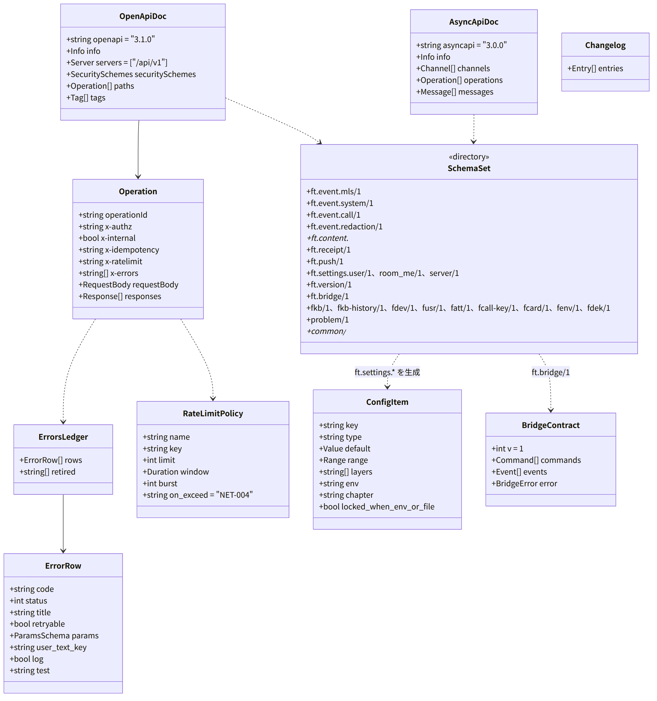
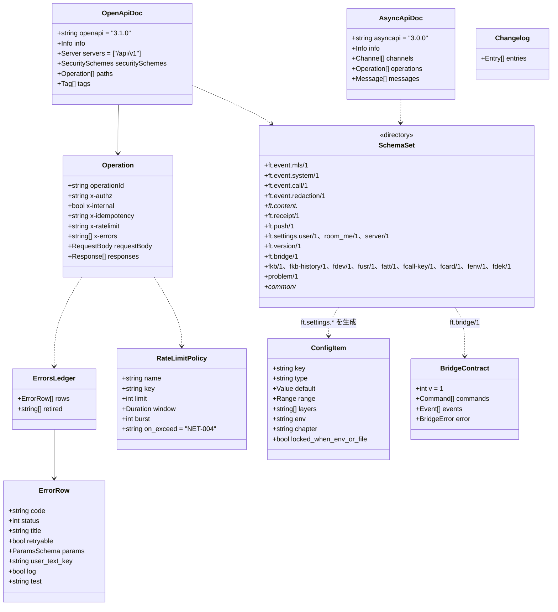

# api（境界の正本）

## 受ける節
- [第2章 3 やり取りの分類と規則](../../../../docs/jp/design/02_基本設計書_境界.md#3-やり取りの分類と規則)、[第2章 4 認証と認可](../../../../docs/jp/design/02_基本設計書_境界.md#4-認証と認可)、[第2章 5 資源の一覧（API）](../../../../docs/jp/design/02_基本設計書_境界.md#5-資源の一覧api)、[第2章 6 イベント（WebSocket と同期）](../../../../docs/jp/design/02_基本設計書_境界.md#6-イベントwebsocket-と同期)、[第2章 7 通知の中身（第7章）](../../../../docs/jp/design/02_基本設計書_境界.md#7-通知の中身第7章)、[第2章 9 エラーコード表（初期の項目）とレート制限](../../../../docs/jp/design/02_基本設計書_境界.md#9-エラーコード表初期の項目とレート制限)、[第2章 10 境界の文書と生成（R-2-8-1）](../../../../docs/jp/design/02_基本設計書_境界.md#10-境界の文書と生成r-2-8-1)、[第2章 11 競合の規則（R-2-2-5）](../../../../docs/jp/design/02_基本設計書_境界.md#11-競合の規則r-2-2-5)、[第2章 12 データの形式（本章が定める共通の型。api/schemas）](../../../../docs/jp/design/02_基本設計書_境界.md#12-データの形式本章が定める共通の型apischemas)、[第2章 13 失敗の扱い](../../../../docs/jp/design/02_基本設計書_境界.md#13-失敗の扱い)
- [第1章 8.2 識別子の体系](../../../../docs/jp/design/01_基本設計書_全体構成.md#82-識別子の体系)、[第1章 8.3 形式と版](../../../../docs/jp/design/01_基本設計書_全体構成.md#83-形式と版)、[第1章 10.3 エラー](../../../../docs/jp/design/01_基本設計書_全体構成.md#103-エラー)、[第1章 10.6 外から入るものの確かめ](../../../../docs/jp/design/01_基本設計書_全体構成.md#106-外から入るものの確かめ)（境界から入る値の型）
- [第9章 4.2 JS ブリッジの命令](../../../../docs/jp/design/09_基本設計書_Androidのシェル.md#42-js-ブリッジの命令)（JS ブリッジの命令とイベント。契約 `ft.bridge/1` の中身）
- [第11章 7.2 項目（api/config.yaml の分類。既定値は各章）](../../../../docs/jp/design/11_基本設計書_運用.md#72-項目apiconfigyaml-の分類既定値は各章)（設定の一覧の分類）、[第13章 3 配布物（DD-13-2）](../../../../docs/jp/design/13_基本設計書_配布と更新.md#3-配布物dd-13-2)（version.json の形）、[第12章 12 データの形式（本章が定めるもの）](../../../../docs/jp/design/12_基本設計書_データと暗号化.md#12-データの形式本章が定めるもの)（鍵とエンベロープの形式）、[第4章 3.1 種類](../../../../docs/jp/design/04_基本設計書_トークとメッセージ.md#31-種類)、[第5章 3 添付の項目（`ft.content.attachment_item/1`）](../../../../docs/jp/design/05_基本設計書_メディア.md#3-添付の項目ftcontentattachment_item1)（復号後の中身の形）
- 生成：[第14章 8 境界の型の生成](../../../../docs/jp/design/14_基本設計書_開発基盤.md#8-境界の型の生成)

- [第1章 4.3 境界（サーバー側とクライアント側）](../../../../docs/jp/design/01_基本設計書_全体構成.md#43-境界サーバー側とクライアント側)（境界を 1 つの文書に定義し、型を生成する）
## 依存
- 下：なし（文書だけのブロック。生成の道具は ci-tools の `tools/gen_*` と部品）。
- 上：srv-boundary（Go の生成ファイル）、web-core（TypeScript の生成ファイル）、and-shell（Kotlin の生成ファイル）。全体実装設計書 5。

## クラス図（文書の構造。1 つの「クラス」= 1 つのファイルまたは 1 つの行の形）

図の元の文（mermaid）

クラス図の注記（図の各メンバーの説明。仕様の節と番号を含む）

|クラス|メンバー|注記|
|---|---|---|
|OpenApiDoc|`+Info info`|version = 境界の版（SemVer。asyncapi と同じ値）|
|OpenApiDoc|`+SecuritySchemes securitySchemes`|cookie（__Host-session）、wsToken、shellToken、setupToken、inviteToken|
|OpenApiDoc|`+Operation[] paths`|第2章 5.1〜5.11 の全経路 + /internal/auth、/internal/sfu/webhook|
|OpenApiDoc|`+Tag[] tags`|setup, auth, me, devices, keys, rooms, media, calls, push, sync, admin, server, shell, internal|
|Operation|`+string operationId`|動詞 + 資源（例：postRoomEvent）|
|Operation|`+string x-authz`|self \| room_member \| admin \| device_self \| approved_device \| shell \| setup_token \| invite_token \| internal \| none（第2章 4.3。全 operation に必須）|
|Operation|`+bool x-internal`|/internal/* だけ true（caddy が外へ出さない）|
|Operation|`+string x-idempotency`|key \| natural \| none（第2章 5 の「冪等」の欄）|
|Operation|`+string x-ratelimit`|ratelimits.yaml の policy の名前（第2章 9.3）|
|Operation|`+string[] x-errors`|この経路が返し得るエラーコード表の番号|
|Operation|`+RequestBody requestBody`|schemas/ への $ref|
|Operation|`+Response[] responses`|2xx は schemas/、4xx/5xx は problem（RFC 9457 + code）|
|AsyncApiDoc|`+string asyncapi = "3.0.0"`|3.1 の入力が道具で通れば 3.1（第14章 8 の【未確認】）|
|AsyncApiDoc|`+Info info`|version = 境界の版|
|AsyncApiDoc|`+Channel[] channels`|第2章 6.2 の type ごと（room.event … sync.gap、ready、bye、ping、pong、typing、auth）|
|AsyncApiDoc|`+Operation[] operations`|send/receive の向き（S→C、C→S、両方）|
|AsyncApiDoc|`+Message[] messages`|payload は schemas/ への $ref。ft.push/1 も message として持つ|
|SchemaSet|`+ft.event.mls/1`|第2章 12|
|SchemaSet|`+ft.content.*`|第4章 3.1、第5章 3・6、第6章・第12章の call_key と url_preview。復号後。クライアントだけが使う|
|SchemaSet|`+ft.push/1`|第2章 7（kind: message\|call\|call_end\|notice）|
|SchemaSet|`+ft.settings.user/1、room_me/1、server/1`|config.yaml から生成（tools/gen_config）|
|SchemaSet|`+ft.version/1`|第13章 3（revoked_digests を含む）|
|SchemaSet|`+ft.bridge/1`|第9章 4.2 の命令とイベント|
|SchemaSet|`+fkb/1、fkb-history/1、fdev/1、fusr/1、fatt/1、fcall-key/1、fcard/1、fenv/1、fdek/1`|第12章 12|
|SchemaSet|`+problem/1`|RFC 9457 + code、retryable、params|
|SchemaSet|`+common/*`|uuidv7、rfc3339、base64url、pos（int64 ≥ 0）、grapheme_string(max)|
|ErrorRow|`+string code`|分類 3〜5 文字 + 連番 3 桁（AUTH、MEM、ROOM、MEDIA、CALL、PUSH、ADM、SRV、NET、KEY）|
|ErrorRow|`+string title`|機械向けの短い英語|
|ErrorRow|`+ParamsSchema params`|JSON Schema（空でも持つ）|
|ErrorRow|`+string user_text_key`|err.<code>（文言の表の鍵。what と next を持つ）|
|ErrorRow|`+bool log`|記録するか|
|ErrorRow|`+string test`|L1 の試験の名前（tools/errors_check が照合）|
|ErrorsLedger|`+ErrorRow[] rows`|第2章 9.2 の正本。番号の欠番は許し、消した番号は再利用しない|
|ErrorsLedger|`+string[] retired`|消した番号|
|RateLimitPolicy|`+string name`|login, invite_use, send, media, api_global, ws_messages, recovery_code, preview …（第2章 9.3）|
|RateLimitPolicy|`+string key`|ip \| user \| device \| user+room|
|ConfigItem|`+string key`|分類.名前（第11章 7.2 の分類）|
|ConfigItem|`+string type`|int \| duration \| bytes \| bool \| string \| enum \| list|
|ConfigItem|`+Range range`|min/max または enum の値|
|ConfigItem|`+string[] layers`|file \| env \| db のうち置ける層（第11章 7.1）|
|ConfigItem|`+string env`|環境変数の名前（FT_*。env が置ける時）|
|ConfigItem|`+string chapter`|既定値を定めた章と表（tools/config_check が docs の表と照合）|
|ConfigItem|`+bool locked_when_env_or_file`|画面でロック表示|
|BridgeContract|`+Command[] commands`|第9章 4.2 の cmd ごと：name、args の schema、result の schema|
|BridgeContract|`+Event[] events`|event ごと：name、data の schema|
|BridgeContract|`+BridgeError error`|{code, params}（エラーコード表の番号。シェルだけの番号は SHELL-nnn を errors.yaml に持つ）|
|Changelog|`+Entry[] entries`|境界の版ごと。破壊的な変更は major（oasdiff の結果を添える）|

## 公開操作（このブロックが所有する物。番号は全体実装設計書 12 の B-600 のバナー）
|番号|物|使う側|由来|
|---|---|---|---|
|B-600|openapi.yaml、asyncapi.yaml、schemas/、errors.yaml、ratelimits.yaml、config.yaml からの生成ファイル（Go：interface と型と埋め込みの spec。TypeScript：型と呼び出しとイベントの型。Kotlin：シェルが使う型）|srv-boundary、web-core、and-shell|[第14章 8 境界の型の生成](../../../../docs/jp/design/14_基本設計書_開発基盤.md#8-境界の型の生成)、全体実装設計書 5.1|
|B-601|`ft.push/1`（通知の中身の形）|srv-push（暗号化の前の JSON）、web-push（SW の復号の後）、and-push（connector の復号の後）|[第2章 7 通知の中身（第7章）](../../../../docs/jp/design/02_基本設計書_境界.md#7-通知の中身第7章)|
|B-603|`errors.yaml` の `user_text_key`（文言の表の鍵の一覧）|web-ui（P-8 の表に全部の鍵があることを tools/errors_check が見る）|[第10章 9.2 エラーの文言のエラーコード表（第2章 9.2 の `code` → 文。例）](../../../../docs/jp/design/10_基本設計書_画面.md#92-エラーの文言のエラーコード表第2章-92-の-code--文例)|
|B-604|`x-authz`、`x-idempotency`、`x-ratelimit`、`x-internal` の値（経路の属性）|srv-boundary（middleware の表を起動時に組む）|[第2章 3 やり取りの分類と規則](../../../../docs/jp/design/02_基本設計書_境界.md#3-やり取りの分類と規則)、[第2章 4.3 認可の 3 つの基本](../../../../docs/jp/design/02_基本設計書_境界.md#43-認可の-3-つの基本)、[第2章 9.3 レート制限（初期値。config.yaml の「レート制限」）](../../../../docs/jp/design/02_基本設計書_境界.md#93-レート制限初期値configyaml-のレート制限)|
|B-605|`ft.bridge/1`（JS ブリッジの契約）|web-shell（命令の送り手）、and-shell（命令の受け手）|[第9章 4.2 JS ブリッジの命令](../../../../docs/jp/design/09_基本設計書_Androidのシェル.md#42-js-ブリッジの命令)|
|B-606|`ft.settings.*`（設定の形）と config.yaml の `layers`・`default`|srv-admin（3 層の読み）、web-ui・web-admin（設定の画面の生成）|[第11章 7 設定（DD-11-6）](../../../../docs/jp/design/11_基本設計書_運用.md#7-設定dd-11-6)|

## アルゴリズム（差し替え点）
- なし（文書だけ）。生成の道具の差し替え（oapi-codegen、openapi-typescript、Modelina、fabrikt）は ci-tools の `tools/gen_*` が包む。

## データ設計（このブロックが形を持つ記録）
|ファイル|形|欄|由来|
|---|---|---|---|
|`api/openapi.yaml`|OpenAPI 3.1（YAML）|上の `OpenApiDoc`。`paths` は第2章 5 の表の各行が 1 operation。`/api/v1` の外の経路（`/up/{token}`、`/health`、`/version`、`/dl/*`、`/manifest.webmanifest`、`/notify.html`、`/.well-known/*`、`/maps/*`、`/internal/*`）は `servers` を `/` にした別の `paths` の群として同じファイルに置く（タグ `server`、`internal`、`static`）|[第2章 5 資源の一覧（API）](../../../../docs/jp/design/02_基本設計書_境界.md#5-資源の一覧api)、[第2章 5.11 サーバー（無認証）](../../../../docs/jp/design/02_基本設計書_境界.md#511-サーバー無認証)|
|`api/asyncapi.yaml`|AsyncAPI 3.x（YAML）|`channels` = 第2章 6.2 の type + `ready` + `bye`。`messages.push` = `ft.push/1`|[第2章 6 イベント（WebSocket と同期）](../../../../docs/jp/design/02_基本設計書_境界.md#6-イベントwebsocket-と同期)、[第2章 7 通知の中身（第7章）](../../../../docs/jp/design/02_基本設計書_境界.md#7-通知の中身第7章)|
|`api/schemas/<名>/<版>.json`|JSON Schema 2020-12|`$id` は `https://family-talk.invalid/schemas/<名>/<版>`（名は仮。R-2）。`additionalProperties: false` を既定。文字列の長さは書記素の上限を `x-grapheme-max` で持ち、サーバーの検証器はバイト長で、端末は書記素で数える（[第1章 8.6 日本語のファイル名と文字](../../../../docs/jp/design/01_基本設計書_全体構成.md#86-日本語のファイル名と文字)）|[第2章 12 データの形式（本章が定める共通の型。api/schemas）](../../../../docs/jp/design/02_基本設計書_境界.md#12-データの形式本章が定める共通の型apischemas)、[第12章 12 データの形式（本章が定めるもの）](../../../../docs/jp/design/12_基本設計書_データと暗号化.md#12-データの形式本章が定めるもの)、[第4章 3.1 種類](../../../../docs/jp/design/04_基本設計書_トークとメッセージ.md#31-種類)、[第5章 3 添付の項目（`ft.content.attachment_item/1`）](../../../../docs/jp/design/05_基本設計書_メディア.md#3-添付の項目ftcontentattachment_item1)|
|`api/errors.yaml`|YAML（`rows[]`、`retired[]`）|`ErrorRow`。初期の行は第2章 9.2 の全部 + `MEDIA-006` + シェルだけの `SHELL-001`（JS ブリッジの未知の命令）、`SHELL-002`（オリジンの不一致）、`SHELL-003`（WebView の版が足りない）、`SHELL-004`（鍵保管庫の鍵が失われた）、`SHELL-005`（APK の検証の失敗）|[第2章 9.2 エラーコード表の初期の項目（api/errors.yaml の正本。本章は番号と意味）](../../../../docs/jp/design/02_基本設計書_境界.md#92-エラーコード表の初期の項目apierrorsyaml-の正本本章は番号と意味)、[第9章 14 失敗の扱い](../../../../docs/jp/design/09_基本設計書_Androidのシェル.md#14-失敗の扱い)|
|`api/ratelimits.yaml`|YAML（`policies[]`）|`RateLimitPolicy`。値は第2章 9.3 の表|[第2章 9.3 レート制限（初期値。config.yaml の「レート制限」）](../../../../docs/jp/design/02_基本設計書_境界.md#93-レート制限初期値configyaml-のレート制限)|
|`api/config.yaml`|YAML（`items[]`）|`ConfigItem`。分類は第11章 7.2、既定値は各章の数値の表（第4章 7、第5章 9、第6章 8、第7章 11、第2章 9.3、第11章、第12章 10）|[第11章 7.2 項目（api/config.yaml の分類。既定値は各章）](../../../../docs/jp/design/11_基本設計書_運用.md#72-項目apiconfigyaml-の分類既定値は各章)|
|`api/schemas/ft.bridge/1.json`|JSON Schema|`commands[]`（第9章 4.2 の 27 命令）、`events[]`（11 イベント）。シェル → ウェブの応答の形 `{id, ok, result}` と `{id, ok: false, error}`|[第9章 4.2 JS ブリッジの命令](../../../../docs/jp/design/09_基本設計書_Androidのシェル.md#42-js-ブリッジの命令)|
|`api/CHANGELOG.md`|Keep a Changelog|境界の版ごと|[第2章 10 境界の文書と生成（R-2-8-1）](../../../../docs/jp/design/02_基本設計書_境界.md#10-境界の文書と生成r-2-8-1)|

- `x-errors` の欄は「この経路が返し得る番号」であり、srv-boundary の試験（T-L2-03）は経路ごとに 1 件の不正な要求で `NET-001` を確かめ、L1 は `x-errors` の各番号をその経路で起こす（errors.yaml の `test`）。
