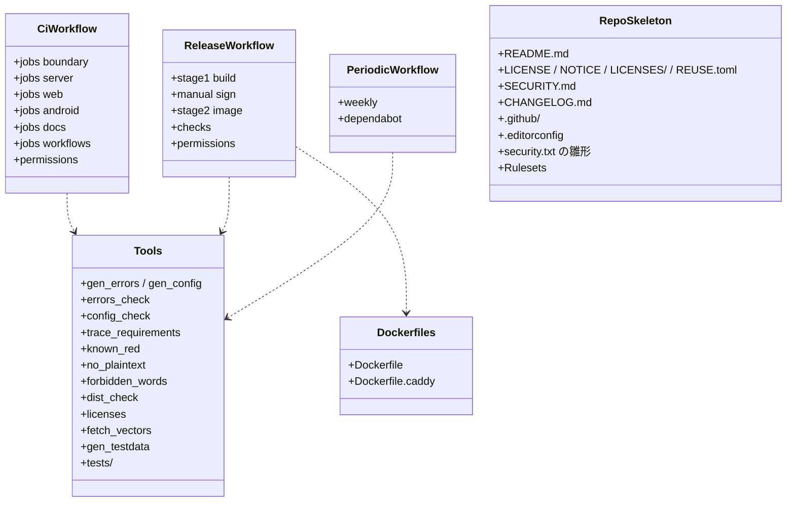

# ci-tools（配布。CI のワークフロー、Dockerfile、道具、ライセンスの表示、リポジトリの骨格）

## 受ける節
- [第14章 8 境界の型の生成](../../../../docs/jp/design/14_基本設計書_開発基盤.md#8-境界の型の生成)（生成の道具の呼び出し）、[第14章 9 ライセンスの方針と第三者の表示](../../../../docs/jp/design/14_基本設計書_開発基盤.md#9-ライセンスの方針と第三者の表示)（ライセンスの区分と道具）、[第14章 10 リポジトリの構成](../../../../docs/jp/design/14_基本設計書_開発基盤.md#10-リポジトリの構成)（リポジトリの構成、security.txt、CODEOWNERS、Rulesets）、[第14章 11 CI](../../../../docs/jp/design/14_基本設計書_開発基盤.md#11-ci)（CI：変更ごと、リリース 2 段、定期、ワークフローの安全、署名鍵の扱い）、[第14章 12 配布物（第13章への入口）](../../../../docs/jp/design/14_基本設計書_開発基盤.md#12-配布物第13章への入口)（配布物の置き場と検証）、[第14章 13.2 脆弱性の確認](../../../../docs/jp/design/14_基本設計書_開発基盤.md#132-脆弱性の確認)（脆弱性の確認）、[第14章 14 書き方の取り決め](../../../../docs/jp/design/14_基本設計書_開発基盤.md#14-書き方の取り決め)（書き方の取り決めの検査：禁止語）、[第14章 15 版の規則](../../../../docs/jp/design/14_基本設計書_開発基盤.md#15-版の規則)（版の規則）、[第14章 5.1 言語と実行環境](../../../../docs/jp/design/14_基本設計書_開発基盤.md#51-言語と実行環境)（CGO なし、最小の基盤）、[第14章 5.4 イメージ](../../../../docs/jp/design/14_基本設計書_開発基盤.md#54-イメージ)（イメージの一覧）
- [第13章 3 配布物（DD-13-2）](../../../../docs/jp/design/13_基本設計書_配布と更新.md#3-配布物dd-13-2)（配布物の作り方と置き場）、[第13章 4.2 手順（リリースのたび）](../../../../docs/jp/design/13_基本設計書_配布と更新.md#42-手順リリースのたび)（リリースのたびの手順の CI の側：前段、後段、APK の検証）、[第13章 6.1 版](../../../../docs/jp/design/13_基本設計書_配布と更新.md#61-版)（SemVer、versionCode、タグ）、[第13章 6.3 リリースの確認の一覧](../../../../docs/jp/design/13_基本設計書_配布と更新.md#63-リリースの確認の一覧)（リリースの確認の一覧）、[第13章 7 公開リポジトリの文書（DD-13-1、DD-13-9）](../../../../docs/jp/design/13_基本設計書_配布と更新.md#7-公開リポジトリの文書dd-13-1dd-13-9)（公開リポジトリの文書：README、LICENSE、NOTICE、THIRD_PARTY_NOTICES、REUSE、SECURITY.md、security.txt、CHANGELOG）、[第13章 8 失敗の扱い](../../../../docs/jp/design/13_基本設計書_配布と更新.md#8-失敗の扱い) の CI の行
- 試験設計書 第1章 2（L2、L5 の置き場）、第3章 2（T-L2）、第3章 5（T-L5）、第4章 E-2、E-3
- 全体実装設計書 5.1（生成の表）、6.1（段と置き場）、6.3（道具の一覧）、6.4（平文検査）、7（イメージの中身、署名無しの組み方、配布物の試験）、8（運営の流れ）

- [第1章 9.3 公開リポジトリ](../../../../docs/jp/design/01_基本設計書_全体構成.md#93-公開リポジトリ)（公開リポジトリの構成）、[第14章 16 失敗の扱い](../../../../docs/jp/design/14_基本設計書_開発基盤.md#16-失敗の扱い)（開発基盤の失敗の扱い：CI の失敗、生成の失敗、ランナーの欠け）
## 依存
- 下：全部（組む側）。部品：GitHub Actions（SHA 固定、actions.lock）、Docker BuildKit、cosign、`actions/attest-build-provenance`、Syft、Trivy、govulncheck、osv-scanner、zizmor、actionlint、Spectral、AsyncAPI CLI、oasdiff、cyclonedx-gomod、go-licenses、CycloneDX の npm の道具、CycloneDX Gradle Plugin、licensee、AboutLibraries、reuse、markdownlint-cli2、textlint、lychee、apksigner、testcontainers（L1）。
- 上：なし。

## クラス図（ワークフローと道具の構造）

図の元の文（mermaid）

クラス図の注記（図の各メンバーの説明。仕様の節と番号を含む）

|クラス|メンバー|注記|
|---|---|---|
|CiWorkflow|`+jobs boundary`|L2：Spectral、AsyncAPI validate、生成ファイルの鮮度（tools/gen_* を再実行して git diff --exit-code）、oasdiff、AsyncAPI diff、tools/errors_check、tools/config_check、tools/trace_requirements|
|CiWorkflow|`+jobs server`|gofmt、go vet、staticcheck、go build、go-licenses check、govulncheck、go test -race（L0）、integration（L1：testcontainers の postgres + tools/no_plaintext）、イメージのビルド（amd64、arm64。push しない）|
|CiWorkflow|`+jobs web`|eslint、prettier、tsc、許可リストのスクリプト、pnpm audit、Vitest（L0、L3 ブラウザモード Chromium と WebKit、axe）、Playwright（L4。Compose を起動）、ビルド|
|CiWorkflow|`+jobs android`|ktlint、detekt、Android Lint、kotlinc、fabrikt の鮮度、licensee、Gradle の依存検証、JUnit（L0）、Gradle Managed Devices（L4 のシェルの分。KVM）、未署名の APK（試験の鍵で署名した版も）|
|CiWorkflow|`+jobs docs`|markdownlint-cli2、textlint、lychee、tools/forbidden_words（禁止語の一覧は secret。fork の PR では secret が無いため skip し、main への merge の前の run で必ず走る：Rulesets の必須の検査）|
|CiWorkflow|`+jobs workflows`|zizmor、actionlint|
|CiWorkflow|`+permissions`|contents: read 既定。書き込みはジョブ単位|
|ReleaseWorkflow|`+stage1 build`|タグ vX.Y.Z：再現可能なビルド（SOURCE_DATE_EPOCH、-trimpath、CGO_ENABLED=0、Vite の決定性を 2 回で確認、Gradle の再現可能なアーカイブ、R8 の非決定を切る、baseline.prof 無効、PNG の最適化を切る）→ ft（amd64、arm64）+ sha256、未署名 APK 3 種、version.json の草案、SBOM、ビルド証明（attest-build-provenance。再利用可能なワークフロー。SLSA L3）→ Release の草案|
|ReleaseWorkflow|`+manual sign`|保守者：ビルド証明の検証 → PKCS#11 で署名 → 一致の検証（署名を除いた中身）→ apksigner verify → Release に署名済み APK と sha256|
|ReleaseWorkflow|`+stage2 image`|保守者の合図（workflow_dispatch）：Release の APK を取得 → sha256 と指紋の検証 → イメージ（本システム、caddy。BuildKit rewrite-timestamp、compatibility-version 固定）→ GHCR（X.Y.Z と X.Y。latest なし）→ cosign 鍵なし署名 + ビルド証明 + SBOM（CycloneDX 1.7）を referrer に → Release に digest と version.json → immutable で公開|
|ReleaseWorkflow|`+checks`|第13章 6.3 の一覧を job の summary に|
|ReleaseWorkflow|`+permissions`|id-token: write、attestations: write はリリースのジョブだけ。pull_request_target 不使用|
|PeriodicWorkflow|`+weekly`|依存の再走査（osv-scanner）、公開済みのイメージの Trivy、OpenSSF Scorecard、security.txt の Expires の 30 日前の警告|
|PeriodicWorkflow|`+dependabot`|アクション、Go、npm、Gradle、Docker の基盤。cooldown 3 日。security update は即日|
|Dockerfiles|`+Dockerfile`|本システム：多段。ビルド段（Go、Node）→ 最終段（最小の静的な基盤 + ca-certificates + tzdata）。ft、/srv/www、APK、version.json、手順書、THIRD_PARTY_NOTICES。非 root 10001。HEALTHCHECK。シェルなし|
|Dockerfiles|`+Dockerfile.caddy`|caddy + DNS の提供者のモジュール群（xcaddy 相当）+ Caddyfile|
|Tools|`+gen_errors / gen_config`|errors.yaml、config.yaml、ft.bridge → Go と TypeScript の定数|
|Tools|`+errors_check`|エラーコード表の test の欄と L1 の試験の名前、user_text_key と ja.json|
|Tools|`+config_check`|config.yaml と docs の数値の表|
|Tools|`+trace_requirements`|試験のコードの注記（R:）と試験設計書 第2章の表|
|Tools|`+known_red`|known_red.txt と各段の記録（go test -json、Vitest JSON、Playwright JSON、JUnit XML）|
|Tools|`+no_plaintext`|固有の語（Git の外の一覧。CI は secret）を DB のダンプ、/data/media、ログ、restic の restore から走査|
|Tools|`+forbidden_words`|他社の名称と痕跡（Git の外の一覧）をリポジトリと配布物から|
|Tools|`+dist_check`|イメージの中身、SHA-256、非 root、HEALTHCHECK、公開ポート、THIRD_PARTY_NOTICES、version.json の整合|
|Tools|`+licenses`|3 層の THIRD_PARTY_NOTICES と許可リスト|
|Tools|`+fetch_vectors`|MLS の相互運用の検証ベクトル（版と SHA-256）|
|Tools|`+gen_testdata`|模擬の家族（D-1）|
|Tools|`+tests/`|道具の試験（L0）|
|RepoSkeleton|`+README.md`|第13章 7 の中身|
|RepoSkeleton|`+SECURITY.md`|報告の手順、14 日、対象の版、公開の方針|
|RepoSkeleton|`+CHANGELOG.md`|Keep a Changelog 1.1.0|
|RepoSkeleton|`+.github/`|workflows、dependabot.yml、CODEOWNERS、actions.lock|
|RepoSkeleton|`+security.txt の雛形`|deploy とイメージ（Expires 1 年未満）|
|RepoSkeleton|`+Rulesets`|main 1 本、PR 必須、状態の検査、force push 禁止、直線の履歴、署名コミット（個人の無料のアカウントで使えない規則は手順で代替【未確認】）|

## 公開操作（このブロックが所有する物。番号は B-640〜）
|番号|物|使う側|由来|
|---|---|---|---|
|B-640|`ci.yml`（L0〜L4 の段）、`release.yml`（前段と後段）、`periodic.yml`|公開リポジトリの CI|[第14章 11 CI](../../../../docs/jp/design/14_基本設計書_開発基盤.md#11-ci)|
|B-641|`Dockerfile`、`Dockerfile.caddy`|`release.yml`、開発機（`ft` のイメージの手元のビルド）|[第14章 5.4 イメージ](../../../../docs/jp/design/14_基本設計書_開発基盤.md#54-イメージ)、[第13章 3 配布物（DD-13-2）](../../../../docs/jp/design/13_基本設計書_配布と更新.md#3-配布物dd-13-2)、全体実装設計書 7.1|
|B-642|`tools/`（11 個 + 試験）|CI の各 job、開発機、試験設計書の記録|全体実装設計書 6.3|
|B-643|`README`、`LICENSE`、`NOTICE`、`SECURITY.md`、`CHANGELOG.md`、`LICENSES/`、`REUSE.toml`、`.github/*`|公開リポジトリ|[第13章 7 公開リポジトリの文書（DD-13-1、DD-13-9）](../../../../docs/jp/design/13_基本設計書_配布と更新.md#7-公開リポジトリの文書dd-13-1dd-13-9)、[第14章 10 リポジトリの構成](../../../../docs/jp/design/14_基本設計書_開発基盤.md#10-リポジトリの構成)|
|B-644|THIRD_PARTY_NOTICES（イメージ、ウェブ、APK）|イメージ（`/srv/www/about/`）、web-ui（このアプリについて）、and-shell（`ShellSettings`）|[第14章 9.2 道具](../../../../docs/jp/design/14_基本設計書_開発基盤.md#92-道具)|

## アルゴリズム（差し替え点）
|事項|実装|切り替え|由来|
|---|---|---|---|
|再現性の確認|同じコミットを 2 回（別のランナー）で組み、イメージの digest・`ft` の sha256・未署名 APK の中身を比較|固定|[第14章 11.2 リリース（タグ `vX.Y.Z` の push。2 段）](../../../../docs/jp/design/14_基本設計書_開発基盤.md#112-リリースタグ-vxyz-の-push2-段)|
|イメージの署名|cosign の鍵なし（OIDC）。NRSD の鍵は不要|固定|[第13章 3 配布物（DD-13-2）](../../../../docs/jp/design/13_基本設計書_配布と更新.md#3-配布物dd-13-2)|
|APK の署名|CI の外（PKCS#11）。CI は試験の鍵で署名した版も出す（L4・L5 用。指紋は version.json の草案に試験の鍵として）|固定|[第14章 11.5 Android の署名鍵の扱い](../../../../docs/jp/design/14_基本設計書_開発基盤.md#115-android-の署名鍵の扱い)、全体実装設計書 7.2|
|arm64|ネイティブのランナー。無ければ QEMU（遅い。一覧の赤にしない）|ランナーの有無|試験設計書 E-3|
|禁止語の一覧|Git の外（CI は secret として渡す）|固定|[第14章 14 書き方の取り決め](../../../../docs/jp/design/14_基本設計書_開発基盤.md#14-書き方の取り決め)|

## データ設計（このブロックが形を持つ記録）
|記録|形|欄|由来|
|---|---|---|---|
|`.github/workflows/ci.yml`、`release.yml`、`periodic.yml`|GitHub Actions（SHA 固定）|上の図の job|[第14章 11 CI](../../../../docs/jp/design/14_基本設計書_開発基盤.md#11-ci)|
|`.github/actions.lock`、`dependabot.yml`、`CODEOWNERS`|—|第14章 11.4、10|[第14章 11.4 ワークフローの安全](../../../../docs/jp/design/14_基本設計書_開発基盤.md#114-ワークフローの安全)|
|`tools/known_red.txt`|テキスト|1 行：`<試験の名前> <無い物>`（NRSD の物が無い間だけ）|試験設計書 第1章 4.2|
|`dev/generated/fixtures/`|JSON|L1 が書き出す（全体実装設計書 5.4）。コミットする|全体実装設計書 5.4|
|`version.json` の草案|`ft.version/1`|前段が作り、後段が digest を埋める。`signing_cert_sha256` は NRSD の鍵の指紋（README の値）だけ。試験の鍵で署名した APK 用の `dev/generated/version.test.json` は CI が別に作る（L4・L5。S-16）|[第13章 3 配布物（DD-13-2）](../../../../docs/jp/design/13_基本設計書_配布と更新.md#3-配布物dd-13-2)|
|SBOM|CycloneDX 1.7|イメージ、`ft`、APK ごと|[第14章 9.2 道具](../../../../docs/jp/design/14_基本設計書_開発基盤.md#92-道具)|
