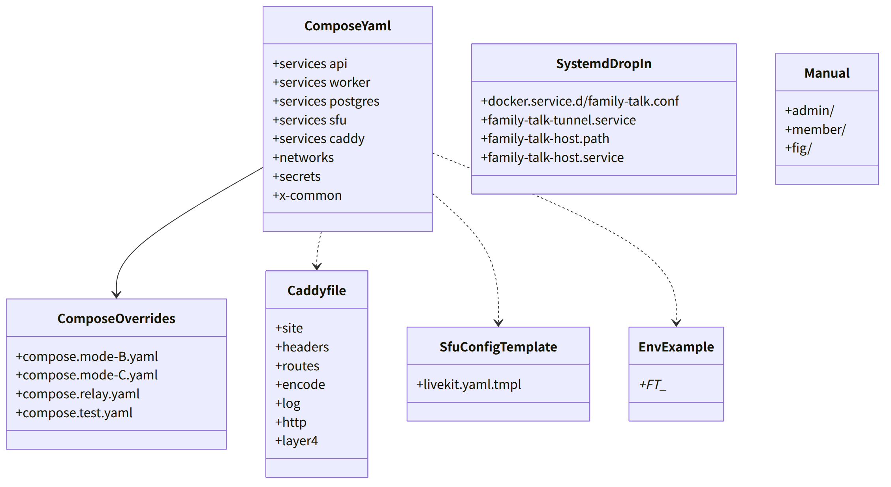
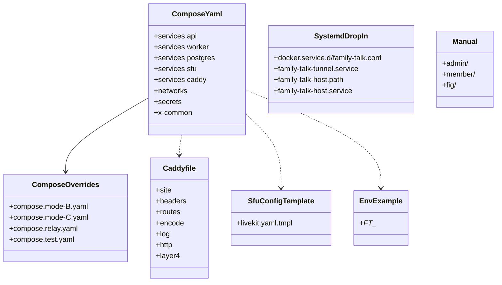

# deploy（配布。compose、Caddyfile、sfu の設定の雛形、env.example、systemd、手順書）

## 受ける節

- [第11章 3.1 compose.yaml（初期値。digest は版ごと）](../../../../docs/jp/design/11_基本設計書_運用.md#31-composeyaml初期値digest-は版ごと)（compose.yaml の 5 サービス、secrets、depends_on、logging、内部の通信）
- [第11章 3.2 env.example](../../../../docs/jp/design/11_基本設計書_運用.md#32-envexample)（env.example）
- [第11章 3.3 /data と /etc](../../../../docs/jp/design/11_基本設計書_運用.md#33-data-と-etc) の全部
- [第11章 4 設置の流れ（DD-11-2、DD-11-3）](../../../../docs/jp/design/11_基本設計書_運用.md#4-設置の流れdd-11-2dd-11-3)（設置の流れの雛形の側：`ft setup` が埋める値）
- [第11章 5 回線の分岐（DD-11-4）](../../../../docs/jp/design/11_基本設計書_運用.md#5-回線の分岐dd-11-4)（回線の形ごとの compose の差：ポート、UDP の範囲、C の VPS の中継）
- [第11章 6 ドメインと証明書（DD-11-5）](../../../../docs/jp/design/11_基本設計書_運用.md#6-ドメインと証明書dd-11-5)（caddy の ACME DNS-01。TURN/TLS の TLS も caddy が終える）
- [第11章 12 ログ（DD-11-11）](../../../../docs/jp/design/11_基本設計書_運用.md#12-ログdd-11-11)（各サービスのログの設定）
- [第11章 13.4 手順書（docs/jp/manual/）](../../../../docs/jp/design/11_基本設計書_運用.md#134-手順書docsjpmanual)（手順書の章立て）
- [第11章 13.1 機械の目安](../../../../docs/jp/design/11_基本設計書_運用.md#131-機械の目安)（機械の目安は手順書に）
- [第1章 9.1 家族のサーバー](../../../../docs/jp/design/01_基本設計書_全体構成.md#91-家族のサーバー)（配置、CIS Docker Benchmark に沿う compose の属性、ネットワーク、固定の digest）
- [第1章 10.10 URL と QR の形](../../../../docs/jp/design/01_基本設計書_全体構成.md#1010-url-と-qr-の形)（caddy が配る経路）
- [第6章 3.1 SFU の設定（deploy/livekit.yaml。初期値）](../../../../docs/jp/design/06_基本設計書_通話.md#31-sfu-の設定deploylivekityaml初期値)（sfu の設定の雛形。値の生成は srv-calls `SfuConfig`）
- [第8章 6 配信の完全性（DD-8-8）](../../../../docs/jp/design/08_基本設計書_iPhoneとPCのシェル.md#6-配信の完全性dd-8-8)（CSP 等のヘッダは caddy が付ける）
- [第14章 10 リポジトリの構成](../../../../docs/jp/design/14_基本設計書_開発基盤.md#10-リポジトリの構成) の `deploy/`
- [第14章 12 配布物（第13章への入口）](../../../../docs/jp/design/14_基本設計書_開発基盤.md#12-配布物第13章への入口) の配布物の置き場
- [第13章 7 公開リポジトリの文書（DD-13-1、DD-13-9）](../../../../docs/jp/design/13_基本設計書_配布と更新.md#7-公開リポジトリの文書dd-13-1dd-13-9) の手順書の免責の文
- 全体実装設計書
  - 2.1（api の 127.0.0.1:8080、`/internal/*` の遮断、forward auth）
  - 7.1（イメージの中身の `/dl/manual/`）、7.3（試験用の compose）

- [第12章 4 通信の保護](../../../../docs/jp/design/12_基本設計書_データと暗号化.md#4-通信の保護) の「端末と caddy の間」の行（TLS 1.3 既定、1.2 下限、AEAD だけ、HSTS）

## 依存

- 下：なし（文書と設定の雛形）。実行時の部品：Docker Engine、Compose 2.24.6 以上、caddy（本システムのビルド）、SFU の公式のイメージ、postgres 18 の公式のイメージ。
- 上：srv-admin `HostTools.Setup`（雛形に値を埋める）、ci-tools（イメージの中に手順書を入れる、試験用の compose で L5）。

## クラス図（設定の構造。1 つの「クラス」= 1 つのファイル）

図の元の文（mermaid）

クラス図の注記（図の各メンバーの説明。仕様の節と番号を含む）

|クラス|メンバー|注記|
|---|---|---|
|ComposeYaml|`+services api`|image ${FT_IMAGE_DIGEST}、command serve、networks [internal, edge]、ports ["127.0.0.1:8080:8080"]、extra_hosts [host.docker.internal:host-gateway]（sfu の 7880 へ。第11章 3.1）、volumes /data、user 10001、cap_drop ALL、no-new-privileges、read_only、tmpfs /tmp、secrets [db_password, kek]、healthcheck ft health、depends_on postgres healthy|
|ComposeYaml|`+services worker`|同じイメージ、command work、networks [internal]、secrets [db_password, kek, backup_password, dns_token]|
|ComposeYaml|`+services postgres`|${FT_POSTGRES_DIGEST}、user 10001、POSTGRES_PASSWORD_FILE、POSTGRES_USER と POSTGRES_DB は family_talk、shm_size 256m、healthcheck pg_isready、volume /data/postgres|
|ComposeYaml|`+services sfu`|${FT_SFU_DIGEST}、network_mode host、volumes /data/sfu（設定）。証明書を持たない（第6章 3.1）。cap_drop ALL、cap_add NET_BIND_SERVICE|
|ComposeYaml|`+services caddy`|${FT_CADDY_DIGEST}、networks [edge, internal]、ports 80 と ${FT_HTTPS_PORT} と ${FT_TURN_TLS_PORT}（TURN/TLS。Layer4）、extra_hosts [host.docker.internal:host-gateway]（/rtc と TURN の送り先）、volumes /data/caddy、/data/www（ro）、secrets [dns_token]、cap_add NET_BIND_SERVICE、depends_on api healthy|
|ComposeYaml|`+networks`|internal（internal: true）、edge|
|ComposeYaml|`+secrets`|db_password（/data/secrets/db_password）、kek（/etc/family-talk/secrets/kek）、backup_password（/data/secrets/backup）、dns_token（/etc/family-talk/secrets/dns_token）|
|ComposeYaml|`+x-common`|restart unless-stopped、logging json-file 100m × 7、stop_grace_period 15s（api は Shutdown で bye を送ってから止まる。S-13）|
|ComposeOverrides|`+compose.mode-B.yaml`|MAP-E：HTTPS のポート、UDP の範囲、TURN のポートを割り当てに|
|ComposeOverrides|`+compose.mode-C.yaml`|自宅 + VPS（第11章 5）：`FT_EXTERNAL_IPV4` を `FT_RELAY_VPS_HOST` に固定、sfu の `rtc.use_external_ip` を偽。TURN は内蔵のまま。トンネル（WireGuard）は compose の外（`ft relay setup --home` が置く systemd の service）|
|RelayFiles|`+wg0.conf、nftables.conf`|VPS の側：`ft relay setup` が置く WireGuard の設定と nftables の転送（compose は無い）|
|ComposeOverrides|`+compose.test.yaml`|L5：sfu を bridge に、ポートを変え、本物の DNS を使わない（自己署名は使わない方針のため、caddy は internal の tls を試験だけ許す）|
|Caddyfile|`+site`|{$FT_DOMAIN}:{$FT_HTTPS_PORT}。tls { dns {$FT_DNS_PROVIDER} {file.{$DNS_TOKEN_FILE}} }。ACME は DNS-01。FT_ACME_FALLBACK で代替の発行機関|
|Caddyfile|`+headers`|HSTS（1 年、preload なし）、CSP（第8章 6 の値。nonce は api が index の応答ごとに作って CSP のヘッダごと付けるため、/ と `/r/*` 等の SPA の経路は api に逆プロキシし、静的な資産だけ caddy が直接。caddy は `header ?Content-Security-Policy` で、上流が付けていない応答にだけ nonce の無い値を付ける）、COOP same-origin、Referrer-Policy、Permissions-Policy|
|Caddyfile|`+routes`|`/api/*` は api:8080 へ（WebSocket を含む）。/rtc は host.docker.internal:7880 へ（sfu。`extra_hosts` の `host-gateway`）。`/up/*` は api へ。`/internal/*` は 404。`/maps/*` と `/dl/manual/*` は forward_auth api:8080 /internal/auth で確かめてから file_server /data/www。`/dl/*`、`/.well-known/*`、/manifest.webmanifest は api（family の名前を埋める物）か file_server。/health と /version は api へ。/notify.html と資産は file_server。それ以外（SPA）は api へ（index に nonce）|
|Caddyfile|`+encode`|`encode zstd gzip`（既定の Content-Type の一覧。JSON と HTML と JS は圧縮し、添付の暗号文 `application/octet-stream` は一覧に無いので圧縮しない。512 バイト未満は圧縮しない）。api は圧縮しない（第2章 3）|
|Caddyfile|`+log`|JSON。remote_ip と client_ip を除く。Cookie と Authorization を秘匿|
|Caddyfile|`+http`|:80 は HTTPS へ転送（MAP-E では未使用）|
|Caddyfile|`+layer4`|グローバルの `layer4`：:{$FT_TURN_TLS_PORT} で TLS を終え（家族のサーバーの名前の証明書）、`host.docker.internal:5350` へ PROXY protocol をつけて渡す（TURN/TLS。第6章 3.1、第14章 5.2 の caddy-l4）|
|SfuConfigTemplate|`+livekit.yaml.tmpl`|第6章 3.1 の表。値は srv-calls SfuConfig.Render が埋める（鍵、UDP の範囲、TURN、external ip、webhook の URL、codecs、simulcast、audio、logging）|
|EnvExample|`+FT_*`|第11章 3.2 の表の全項目（既定値つき。digest は ft setup が書く）|
|SystemdDropIn|`+docker.service.d/family-talk.conf`|RequiresMountsFor=/data（LUKS の後に Docker）|
|SystemdDropIn|`+family-talk-tunnel.service`|C の形のトンネル|
|SystemdDropIn|`+family-talk-host.path`|`DirectoryNotEmpty=/data/host/requests`。`RequiresMountsFor=/data`（ホストの要求の受け口。第11章 3.4）|
|SystemdDropIn|`+family-talk-host.service`|`Type=oneshot`、`ExecStart=/etc/family-talk/ft host run`（root）。path unit が起動する|
|Manual|`+admin/`|はじめに、機械と回線、設置、回線の形ごと（図）、ドメインと DNS、バックアップ、更新、障害、廃棄、引き継ぎ、紙の管理（第11章 13.4）|
|Manual|`+member/`|参加、iPhone、Android、PC、回復、データの取扱い|
|Manual|`+fig/`|図（PNG。代替のテキストつき）|

## 公開操作（このブロックが所有する物。番号は B-620〜）

|番号|物|使う側|由来|
|---|---|---|---|
|B-620|`compose.yaml` と override（A〜D、relay、test）、`env.example` の雛形|srv-admin `HostTools.Setup`（値を埋めて /etc/family-talk に置く）、ci-tools（L5 の起動）|[第11章 3.1 compose.yaml（初期値。digest は版ごと）](../../../../docs/jp/design/11_基本設計書_運用.md#31-composeyaml初期値digest-は版ごと)、[第11章 3.2 env.example](../../../../docs/jp/design/11_基本設計書_運用.md#32-envexample)、[第11章 5 回線の分岐（DD-11-4）](../../../../docs/jp/design/11_基本設計書_運用.md#5-回線の分岐dd-11-4)|
|B-621|`Caddyfile`（経路、ヘッダ、forward auth、`/internal/*` の遮断）|caddy のイメージ（ci-tools が組む）|[第1章 9.1 家族のサーバー](../../../../docs/jp/design/01_基本設計書_全体構成.md#91-家族のサーバー)、[第8章 6 配信の完全性（DD-8-8）](../../../../docs/jp/design/08_基本設計書_iPhoneとPCのシェル.md#6-配信の完全性dd-8-8)、全体実装設計書 2.1|
|B-622|`livekit.yaml.tmpl`|srv-calls `SfuConfig.Render`|[第6章 3.1 SFU の設定（deploy/livekit.yaml。初期値）](../../../../docs/jp/design/06_基本設計書_通話.md#31-sfu-の設定deploylivekityaml初期値)|
|B-623|systemd の drop-in|srv-admin `HostTools.Setup`（`Systemd.WriteDropIn`）|[第12章 6.1 サーバーの記憶装置（R-12-2-1）](../../../../docs/jp/design/12_基本設計書_データと暗号化.md#61-サーバーの記憶装置r-12-2-1)|
|B-624|手順書（`docs/jp/manual/`）|イメージ（`/dl/manual/`）、公開リポジトリ、web-ui（ヘルプの導線）|[第11章 13.4 手順書（docs/jp/manual/）](../../../../docs/jp/design/11_基本設計書_運用.md#134-手順書docsjpmanual)、[第1章 10.11 文書（手順書）](../../../../docs/jp/design/01_基本設計書_全体構成.md#1011-文書手順書)|

## アルゴリズム（差し替え点）

|事項|実装|切り替え|由来|
|---|---|---|---|
|回線の形|override のファイル（`-f compose.yaml -f compose.mode-B.yaml`）。`ft setup` が `.env` の `COMPOSE_FILE` に書く|`FT_MODE`|[第11章 5 回線の分岐（DD-11-4）](../../../../docs/jp/design/11_基本設計書_運用.md#5-回線の分岐dd-11-4)|
|CSP の nonce|SPA の index は api が返して nonce を埋める（caddy の静的配信では埋められない）|固定|[第8章 6 配信の完全性（DD-8-8）](../../../../docs/jp/design/08_基本設計書_iPhoneとPCのシェル.md#6-配信の完全性dd-8-8)|
|代替の発行機関|`FT_ACME_FALLBACK=true` で caddy の `issuer` を 2 つ|設定|[第11章 6 ドメインと証明書（DD-11-5）](../../../../docs/jp/design/11_基本設計書_運用.md#6-ドメインと証明書dd-11-5)|

## データ設計（このブロックが形を持つ記録）

|記録|形|欄|由来|
|---|---|---|---|
|`deploy/compose.yaml`、`deploy/compose.mode-*.yaml`、`deploy/compose.relay.yaml`、`deploy/compose.test.yaml`|Compose（2.24.6 の範囲の機能だけ）|上の図|[第11章 3.1 compose.yaml（初期値。digest は版ごと）](../../../../docs/jp/design/11_基本設計書_運用.md#31-composeyaml初期値digest-は版ごと)、[第11章 14 失敗の扱い](../../../../docs/jp/design/11_基本設計書_運用.md#14-失敗の扱い)|
|`deploy/Caddyfile`|Caddyfile|上の図|[第1章 9.1 家族のサーバー](../../../../docs/jp/design/01_基本設計書_全体構成.md#91-家族のサーバー)|
|`deploy/livekit.yaml.tmpl`|Go の template|第6章 3.1 の項目|[第6章 3.1 SFU の設定（deploy/livekit.yaml。初期値）](../../../../docs/jp/design/06_基本設計書_通話.md#31-sfu-の設定deploylivekityaml初期値)|
|`deploy/env.example`|dotenv|第11章 3.2|[第11章 3.2 env.example](../../../../docs/jp/design/11_基本設計書_運用.md#32-envexample)|
|`deploy/systemd/*`|unit と drop-in|上の図|[第12章 6.1 サーバーの記憶装置（R-12-2-1）](../../../../docs/jp/design/12_基本設計書_データと暗号化.md#61-サーバーの記憶装置r-12-2-1)|
|`docs/jp/manual/**/*.md`、`fig/*.png`|Markdown、PNG|第11章 13.4 の章立て。免責の文（第13章 7）を含む|[第11章 13.4 手順書（docs/jp/manual/）](../../../../docs/jp/design/11_基本設計書_運用.md#134-手順書docsjpmanual)、[第13章 7 公開リポジトリの文書（DD-13-1、DD-13-9）](../../../../docs/jp/design/13_基本設計書_配布と更新.md#7-公開リポジトリの文書dd-13-1dd-13-9)|
