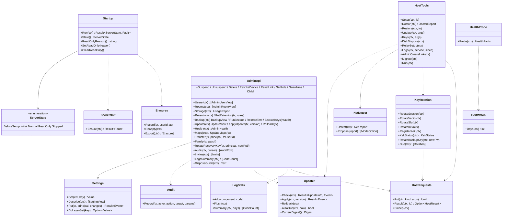

# srv-admin（サーバー側・業務。起動と状態、管理者の API、設定、秘密の交代、host モードの道具）

## 受ける節

- [第1章 7.1 家族のサーバーの起動](../../../../docs/jp/design/01_基本設計書_全体構成.md#71-家族のサーバーの起動)（起動の 8 段）
- [第1章 7.2 初回（最初の管理者）](../../../../docs/jp/design/01_基本設計書_全体構成.md#72-初回最初の管理者) の 1
- [第1章 7.9 更新](../../../../docs/jp/design/01_基本設計書_全体構成.md#79-更新)（更新）
- [第1章 7.10 異常終了の後の起動](../../../../docs/jp/design/01_基本設計書_全体構成.md#710-異常終了の後の起動)（異常終了の後の起動）
- [第1章 7.12 サーバーの停止中](../../../../docs/jp/design/01_基本設計書_全体構成.md#712-サーバーの停止中)
- [第1章 8.5 秘密情報の一覧](../../../../docs/jp/design/01_基本設計書_全体構成.md#85-秘密情報の一覧)（秘密の生成）
- [第1章 9.1 家族のサーバー](../../../../docs/jp/design/01_基本設計書_全体構成.md#91-家族のサーバー)（配置と Docker の安全：設定の生成は deploy、適用の確認は `ft doctor`）
- [第1章 10.9 版の互換性](../../../../docs/jp/design/01_基本設計書_全体構成.md#109-版の互換性)（`/version` の値）
- [第1章 18.3 NRSD の鍵の事故](../../../../docs/jp/design/01_基本設計書_全体構成.md#183-nrsd-の鍵の事故) の家族のサーバーの側（取り消したイメージ）
- [第11章 4 設置の流れ（DD-11-2、DD-11-3）](../../../../docs/jp/design/11_基本設計書_運用.md#4-設置の流れdd-11-2dd-11-3)（設置の流れ：`ft setup` の各段）
- [第11章 5 回線の分岐（DD-11-4）](../../../../docs/jp/design/11_基本設計書_運用.md#5-回線の分岐dd-11-4)（回線の分岐の検出と設定）
- [第11章 6 ドメインと証明書（DD-11-5）](../../../../docs/jp/design/11_基本設計書_運用.md#6-ドメインと証明書dd-11-5)（ドメインと証明書の設定。証明書の監視は srv-worker）
- [第11章 7 設定（DD-11-6）](../../../../docs/jp/design/11_基本設計書_運用.md#7-設定dd-11-6)（設定の 3 層と DB の層）
- [第11章 8 管理者の画面（DD-11-7。第2章 5.10 の経路）](../../../../docs/jp/design/11_基本設計書_運用.md#8-管理者の画面dd-11-7第2章-510-の経路)（管理者の画面の API の束ね。各資源の実体は持ち主）
- [第11章 9.2 戻す（`ft restore`。新しい機械）](../../../../docs/jp/design/11_基本設計書_運用.md#92-戻すft-restore新しい機械)（`ft restore`）
- [第11章 10 更新（DD-11-9）](../../../../docs/jp/design/11_基本設計書_運用.md#10-更新dd-11-9)（更新の適用と復元）
- [第11章 11 監視と知らせ（DD-11-10）](../../../../docs/jp/design/11_基本設計書_運用.md#11-監視と知らせdd-11-10) の `/health` の値の提供
- [第11章 12 ログ（DD-11-11）](../../../../docs/jp/design/11_基本設計書_運用.md#12-ログdd-11-11) の `ft logs`
- [第11章 13.2 廃棄（`ft disk dispose`）](../../../../docs/jp/design/11_基本設計書_運用.md#132-廃棄ft-disk-dispose)（`ft disk dispose`）
- [第11章 13.3 引き継ぎ](../../../../docs/jp/design/11_基本設計書_運用.md#133-引き継ぎ)（引き継ぎの一覧）
- [第11章 14 失敗の扱い](../../../../docs/jp/design/11_基本設計書_運用.md#14-失敗の扱い)（失敗）
- [第2章 5.10 管理者（第11章）](../../../../docs/jp/design/02_基本設計書_境界.md#510-管理者第11章)（管理者の API）
- [第2章 5.1 初回と招待（第3章、第11章）](../../../../docs/jp/design/02_基本設計書_境界.md#51-初回と招待第3章第11章) の `/setup/*`
- [第2章 9.2 エラーコード表の初期の項目（api/errors.yaml の正本。本章は番号と意味）](../../../../docs/jp/design/02_基本設計書_境界.md#92-エラーコード表の初期の項目apierrorsyaml-の正本本章は番号と意味) の ADM-001〜002、SRV-001〜004
- [第12章 6.1 サーバーの記憶装置（R-12-2-1）](../../../../docs/jp/design/12_基本設計書_データと暗号化.md#61-サーバーの記憶装置r-12-2-1)（LUKS2、TPM2、紙の回復鍵）
- [第12章 6.2 エンベロープ暗号化（DD-12-12）](../../../../docs/jp/design/12_基本設計書_データと暗号化.md#62-エンベロープ暗号化dd-12-12) の KEK の生成と交代
- [第12章 10 秘密の鍵（DD-12-15、R-12-7-1）](../../../../docs/jp/design/12_基本設計書_データと暗号化.md#10-秘密の鍵dd-12-15r-12-7-1)（秘密の鍵の生成と交代の操作）
- [第12章 9 消すこと（DD-12-13、R-12-6-1）](../../../../docs/jp/design/12_基本設計書_データと暗号化.md#9-消すことdd-12-13r-12-6-1) の `erasures` の先行適用
- [第12章 7.2 「データの取扱いについて」の画面](../../../../docs/jp/design/12_基本設計書_データと暗号化.md#72-データの取扱いについての画面) の「データの取扱いについて」の管理者の名前
- [第3章 3.1 初回の管理者（DD-3-1）](../../../../docs/jp/design/03_基本設計書_認証_構成員_端末.md#31-初回の管理者dd-3-1) の 1（起動の記録と CLI のリンク）
- [第3章 8.4 管理者の引き継ぎと複数の管理者](../../../../docs/jp/design/03_基本設計書_認証_構成員_端末.md#84-管理者の引き継ぎと複数の管理者) の管理者の API の束ね
- [第13章 3 配布物（DD-13-2）](../../../../docs/jp/design/13_基本設計書_配布と更新.md#3-配布物dd-13-2) の version.json の読み（更新の確認）と `revoked_digests`
- [第13章 6.2 互換の期間（第1章 DD-1-14）](../../../../docs/jp/design/13_基本設計書_配布と更新.md#62-互換の期間第1章-dd-1-14) の `/version` の `released_at`
- 全体実装設計書
  - 2.1（`ft` の 1 バイナリ、サブコマンド）
  - 3.1（`ServerState`、更新、秘密の交代）
  - 4.1 の記録：`server_state`、`key_versions`、`update_state`、`backup_state`、`maps_state`
  - 4.1 の記録：`audit`、`notices`、`settings_db`、`erasures`、`retention_rules`
  - I-7、I-9

## 依存

- 下：
  - [srv-common](srv-common.md)（`Config`、`Secrets`、`Deps.Docker`／`Luks`／`Systemd`／`ReleaseSource`／`SfuAdmin`、`Envelope`）
  - [srv-store](srv-store.md)（`Migrator`、`Jobs`、`Dump`、`Pool`）
  - [srv-identity](srv-identity.md)（`SetupLink`、`Users`、`Devices`、`Invites`、`ResetLink`、`Families`、`Guardians`）
  - [srv-keys](srv-keys.md)（`FamilyRecoveryKey.SetPublic`）
  - [srv-rooms](srv-rooms.md)（`Rooms`、`FamilyRoom`）
  - [srv-media](srv-media.md)（`Quota`、`Gc.PreviewRetention`、`Maps`）
  - [srv-push](srv-push.md)（`Notices`、`Subscriptions.Vapid` の版）
  - [srv-calls](srv-calls.md)（`SfuConfig`、`Tokens.Keys`、`CountActive`、`RingTimer.RecoverAfterRestart`）
- 依存の逆転：次を本ブロックが実装する。
  - srv-boundary の `ServerStateReader` と `HealthProbe`
  - srv-common の `DbLayer` と `ErrorCounter`（LogStats）
  - srv-identity の `Audit` と `OnUser*` の hook（監査）
- 上：cmd/ft（全サブコマンド）。

## クラス図

図の元の文（mermaid）

クラス図の注記（図の各メンバーの説明。仕様の節と番号を含む）

|クラス|メンバー|注記|
|---|---|---|
|Startup|`+Run(ctx) Result~ServerState, Fault~`|第1章 7.1 の 8 段を順に行う。1. Config（必須の欠けは止まる）。2. Secrets.Ensure（KEK が無ければ止まる）、KeyRotation.RegisterKek。3. Migrator（失敗なら読み取り専用）。4. ディレクトリと権限（media、maps、backups、www。書けなければ読み取り専用）。5. /srv/www を /data/www に同期し、manifest・assetlinks・security.txt を生成。6. sfu の設定の書き出し（内容が前と変われば HostRequests.Put(sfu_restart)。sfu は設定を起動の時にだけ読む）、caddy の証明書の状態。7. 後始動（Jobs.Recover、RingTimer.RecoverAfterRestart、Erasures.Reapply、SweepParts。server_state.restored_at が前回の起動より新しければ全利用者の feed に sync.gap{restore}：S-13）。8. 状態の確定（管理者がいなければ「初回」。リンクは作らない。作るのは `ft setup` の最後と `ft admin create-link` だけ：G-08）|
|Startup|`+State() ServerState`|srv-boundary ServerStateReader。`ServerState` の型は srv-boundary が定める（本ブロックより下に置くため）|
|Startup|`+SetReadOnly(reason)`|reason は SRV-001 の params の値：migration（移行の失敗）、capacity（容量 100%）、storage（置き場に書けない、DB が書き込みを拒む）、restore（復元の後の抹消の再適用の間）。server_state に書く。srv-boundary の ServerStateReader.ReadOnlyReason が読む|
|SecretsInit|`+Ensure(ctx) Result~Fault~`|session-keys、vapid、sfu（2 本）、backup、db_password を無ければ生成（第12章 10 の順）。KEK は ft setup が /etc に作る（無ければ Fault）|
|KeyRotation|`+RotateSession(ctx)`|新鍵を加え発行を切り替え、旧鍵は最長の寿命（90 日）の後に消す。手動は全セッションの失効|
|KeyRotation|`+RotateVapid(ctx)`|版を上げる。端末は GET /me/push/vapid で取り直す|
|KeyRotation|`+RotateSfu(ctx)`|新しい鍵を sfu の設定に加え（2 本）、`HostRequests.Put(sfu_restart)`（通話が無い時）。再起動の後に発行を新しい鍵に切り替え、古い鍵を設定から外してもう一度 `sfu_restart`。SFU は鍵を起動の時にだけ読む（第6章 3.1）|
|KeyRotation|`+RotateKek(ctx)`|ホストの `ft keys rotate kek`（HostTools.Keys）だけが呼ぶ。第12章 6.2 の 1〜6：Secrets.Write で /etc の KEK のファイルに新しい鍵を加え、紙を表示して確かめ、Docker.ComposeRecreate で api と worker を作り直し、KekStatus が完了を返すまで待ち、前の KEK をファイルから消してもう一度作り直す。途中で止まった時は、ファイルの鍵の数と KekStatus から続きを決める（I-7）|
|KeyRotation|`+RegisterKek(ctx)`|Startup の 2 が呼ぶ。KEK のファイルにあって key_versions に無い id を加えて現在の鍵にし、jobs kek_rewrap を積む（第12章 6.2 の 4）。ファイルに無い id が key_versions で現在なら Fault（起動しない）|
|KeyRotation|`+KekStatus(ctx) KekStatus`|現在の KEK の id と、前の KEK で包んだままの user_dek の行の数。ホストの `ft` が Docker.Exec でコンテナの中の `ft admin kek-status` として呼ぶ（JSON の 1 行。秘密を含まない）|
|KeyRotation|`+RotateBackupKey(ctx, newPw)`|restic key add の後に key remove|
|KeyRotation|`+Due(ctx) [Rotation]`|周期（セッション 90 日、SFU 1 年）。srv-worker が呼ぶ。KEK は自動で交代しないので入れず、作ってから `keys.kek_rotation_reminder` を過ぎていれば「KEK の交代の勧め」を返す（srv-worker が知らせる。第7章 9）|
|Settings|`+Get(ctx, key) Value`|srv-common Config（3 層）|
|Settings|`+Describe(ctx) [SettingView]`|/admin/settings：値、層、ロック（env/file 由来は読み取り専用）|
|Settings|`+Put(tx, principal, changes) Result~Event~`|DB の層だけ。ADM-002。範囲の検証。Config.Reload。audit。notice（管理者の操作）|
|Settings|`+DbLayerGet(key) Option~Value~`|srv-common DbLayer|
|AdminApi|`+Users(ctx) [AdminUserView]`|/admin/users：状態、端末の数、最終の利用、容量|
|AdminApi|`+Suspend / Unsuspend / Delete / RevokeDevice / ResetLink / SetRole / Guardians / Child`|srv-identity の関数 + Audit + Notices|
|AdminApi|`+Rooms(ctx) [AdminRoomView]`|識別子、種類、人数、容量（名前は見えない）。DELETE /admin/rooms/{id}（空のグループ）|
|AdminApi|`+Storage(ctx) UsageReport`|srv-media Quota|
|AdminApi|`+Retention(ctx) / PutRetention(tx, rules)`|retention_rules + バックアップの保持期間。30 日前の知らせの予約|
|AdminApi|`+Backup(ctx) BackupView / RunBackup / RestoreTest / BackupKeys(reauth)`|backup_state、jobs backup / restore_test、バックアップの鍵と KEK の紙の再表示（再認証）|
|AdminApi|`+Update(ctx) UpdateView / ApplyUpdate(tx, version) / Rollback(tx)`|update_state と `HostRequests.Result`。ApplyUpdate と Rollback は `HostRequests.Put`（update_apply、update_rollback）。コンテナは Docker を操作しない（第11章 3.4）|
|AdminApi|`+Health(ctx) AdminHealth`|依存するサービス、証明書の期限、回線の分岐、通話の数、DDNS|
|AdminApi|`+Maps(ctx) / UpdateMaps(tx)`|jobs maps_update|
|AdminApi|`+Transfer(tx, principal, toUserId)`|srv-identity Users.Transfer|
|AdminApi|`+Family(tx, patch)`|srv-identity Families.Update|
|AdminApi|`+RotateRecoveryKey(tx, principal, newPub)`|srv-keys FamilyRecoveryKey.SetPublic + 全員に keybundle.changed|
|AdminApi|`+LogsSummary(ctx) [CodeCount]`|`GET /admin/logs/summary`（G-01）：LogStats.Summary(28)。本文と秘密なし（第11章 12）|
|AdminApi|`+DisposeGuide(ctx) Text`|/admin/disk/dispose の手順|
|Audit|`+Record(tx, actor, action, target, params)`|audit 表 + 本人と全員へのイベント（FamilyRoom.Flow(admin_action)）+ notice。対象の構成員がいない操作（設定の変更等）は audience = all（S-11）|
|Erasures|`+Record(tx, userId, at)`|抹消の実行の記録（srv-identity Users.Erase から）|
|Erasures|`+Reapply(ctx)`|起動時：erasures の各行に DEK の破棄を再実行（復元の後。第11章 9.2 の 4）|
|Erasures|`+Export(ctx) [Erasure]`|ft restore の先行適用|
|Updater|`+Check(ctx) Result~UpdateInfo, Event~`|ReleaseSource.VersionJson を JSON Schema（`ft.release/1`）で検証し、openapi の生成の型に読む（srv-common は形を確かめない）。新しい版、内容、revoked_digests に今の digest が含まれるか（知らせ）|
|Updater|`+Apply(ctx, version) Result~Event~`|ホストの `ft` だけで動く（`ft update apply` と、`ft host run` の要求 `update_apply`。第11章 3.4）。次の順。1. 通話中の確認（Docker.Exec で api の中の `ft admin calls-active`）。2. バックアップ（Docker.Exec で worker の中の `ft admin backup-now --reason before_update` を終わりまで待つ。restic はイメージの中にある）。3. Docker.Pull(digest)。4. ReleaseSource.VerifyImage（失敗なら中止）。5. .env の digest を書き換え。6. Docker.ComposeUp。7. health を 60 秒待つ。8. 結果を `/data/host/results/` に書く（`ft update apply` から直接動いた時も書く。知らせと update_state は worker の HostRequests.Sweep が反映する。ホストの `ft` は DB に触れない）。失敗したら Rollback|
|Updater|`+Rollback(ctx)`|前の digest に戻す。マイグレーションが進んでいれば（schema の版で判定）バックアップから（手順書）|
|Updater|`+AutoDue(ctx, now) bool`|設定「自動で更新」（既定 OFF）、週 1 の時間帯（既定 火 4:00）、通話中は延期（最大 7 日）|
|HostTools|`+Setup(ctx, io)`|ft setup：第11章 4 の 0〜11（前提の確認、LUKS2 + TPM2 + 紙、KEK + 紙、ドメイン、DNS の提供者とトークン、回線の判定と形、.env と compose.yaml の生成（deploy の雛形）、起動と地図の仕事 maps_update の積み込み、外からの確認、管理者のリンク、バックアップの置き場の案内）|
|HostTools|`+Doctor(ctx) DoctorReport`|回線の種別、ポート、DNS の A/AAAA、証明書、health、ディスク、TPM、Compose の版、digest の一致、NTP|
|HostTools|`+Restore(ctx, io)`|第11章 9.2 の 1〜6（抹消の一覧の先行適用を含む）|
|HostTools|`+Update(ctx, args)`|check / apply <版> / rollback|
|HostTools|`+Keys(ctx, args)`|rotate に session、vapid、sfu、kek、backup のいずれか。kek は KeyRotation.RotateKek（/etc に書くのでホストだけ）|
|HostTools|`+Run(ctx)`|`ft host run`：systemd の path unit が起動する。`/data/host/requests/` の要求を古い順に 1 つずつ、種類と引数を確かめて行う（update_apply は Updater.Apply、update_rollback は Updater.Rollback、sfu_restart は通話の数を確かめて Docker.ComposeRecreate(sfu)）。結果を `/data/host/results/<id>.json` に書き、要求を done へ移す。同じ id は 1 回だけ。done と results は 30 日で消す（第11章 3.4）|
|HostRequests|`+Put(ctx, kind, args) Uuid`|コンテナの側：要求を一時の名前で書いてから `/data/host/requests/` に改名する。種類は update_apply、update_rollback、sfu_restart だけ|
|HostRequests|`+Result(ctx, id) Option~HostResult~`|`/data/host/results/<id>.json` を読む（ok、code、finished_at）。無ければまだ|
|HostRequests|`+Sweep(ctx)`|worker の監視（5 分）が呼ぶ。結果の届いた要求を update_state と知らせに反映する。要求から 2 時間で結果が無ければ知らせ（ホストの受け口が動いていない）|
|HostTools|`+DiskDispose(ctx)`|第11章 13.2 の 1〜5（Luks.Erase）|
|HostTools|`+RelaySetup(ctx)`|C の形：VPS に TURN（coturn の compose）とトンネルの設定|
|HostTools|`+Logs(ctx, service, since)`|要約と直近（本文と秘密なし）|
|HostTools|`+AdminCreateLink(ctx)`|srv-identity SetupLink.Create|
|NetDetect|`+Detect(ctx) NetReport`|(1) グローバル IPv6、(2) UPnP の GetExternalIPAddress（無ければ入力）でグローバル、100.64/10、RFC 1918 のどれかを判定、(3) 事業者の方式の選択、(4) 形の提案と費用。外部のサービスに送信しない|
|NetDetect|`+Propose(report) [ModeOption]`|A/B/C/D と費用|
|CertWatch|`+Days(ctx) int`|/data/caddy の証明書の期限（/health の caddy_cert_days）|
|LogStats|`+Add(component, code)`|srv-common の ErrorCounter の実装。プロセスの記憶の上で数える|
|LogStats|`+Flush(ctx)`|1 分ごとに log_counts に足す（api と worker の両方のプロセスで。第11章 12）|
|LogStats|`+Summary(ctx, days) [CodeCount]`|日ごと、component ごと、code ごとの件数|
|HealthProbe|`+Probe(ctx) HealthFacts`|caddy_cert_days、disk_free_pct、ddns_last_ok_at、mode（`HealthFacts` は srv-boundary の型。state は ServerStateReader で別に読む）。srv-boundary の `Links.Probe` に入れる|

## 公開操作（このブロックが所有する操作。番号は B-180〜）

|番号|操作（上の図）|使う側|由来|
|---|---|---|---|
|B-180|`Startup::Run`、`State`、`SetReadOnly`、`ClearReadOnly`。srv-boundary の `ServerStateReader` の実装|cmd/ft `serve`／`work`、srv-boundary、srv-store（移行の失敗）、srv-media（容量 100%）|[第1章 7.1 家族のサーバーの起動](../../../../docs/jp/design/01_基本設計書_全体構成.md#71-家族のサーバーの起動)、[第1章 7.10 異常終了の後の起動](../../../../docs/jp/design/01_基本設計書_全体構成.md#710-異常終了の後の起動)、DD-1-15|
|B-181|`SecretsInit::Ensure`|`Startup`|[第12章 10 秘密の鍵（DD-12-15、R-12-7-1）](../../../../docs/jp/design/12_基本設計書_データと暗号化.md#10-秘密の鍵dd-12-15r-12-7-1)、[第1章 8.5 秘密情報の一覧](../../../../docs/jp/design/01_基本設計書_全体構成.md#85-秘密情報の一覧)|
|B-182|`KeyRotation`|cmd/ft `keys`（`RotateKek`）と `admin kek-status`（`KekStatus`）、Startup（`RegisterKek`）、srv-worker（`Due`）、AdminApi（カードの作り直しは srv-keys）|[第12章 10 秘密の鍵（DD-12-15、R-12-7-1）](../../../../docs/jp/design/12_基本設計書_データと暗号化.md#10-秘密の鍵dd-12-15r-12-7-1)、[第12章 6.2 エンベロープ暗号化（DD-12-12）](../../../../docs/jp/design/12_基本設計書_データと暗号化.md#62-エンベロープ暗号化dd-12-12)|
|B-183|`Settings`（`Describe`、`Put`、`DbLayerGet`）。srv-common の `DbLayer` の実装|operation（`/admin/settings`）、srv-common|[第11章 7 設定（DD-11-6）](../../../../docs/jp/design/11_基本設計書_運用.md#7-設定dd-11-6)|
|B-184|`AdminApi`（第2章 5.10 の全経路の実装。実体は持ち主の関数）|srv-boundary（`Implementations.Admin`）|[第2章 5.10 管理者（第11章）](../../../../docs/jp/design/02_基本設計書_境界.md#510-管理者第11章)、[第11章 8 管理者の画面（DD-11-7。第2章 5.10 の経路）](../../../../docs/jp/design/11_基本設計書_運用.md#8-管理者の画面dd-11-7第2章-510-の経路)|
|B-185|`Audit::Record`。srv-identity の `Audit` の実装|srv-identity、本ブロック|[第1章 10.4 操作の記録（ログ）](../../../../docs/jp/design/01_基本設計書_全体構成.md#104-操作の記録ログ)、DD-12-16|
|B-186|`Erasures`（`Record`、`Reapply`、`Export`）|srv-identity（`Users.Erase`）、`Startup`、`HostTools.Restore`|[第12章 9 消すこと（DD-12-13、R-12-6-1）](../../../../docs/jp/design/12_基本設計書_データと暗号化.md#9-消すことdd-12-13r-12-6-1)、[第11章 9.2 戻す（`ft restore`。新しい機械）](../../../../docs/jp/design/11_基本設計書_運用.md#92-戻すft-restore新しい機械)|
|B-187|`Updater`（`Check`、`Apply`、`Rollback`、`AutoDue`、`CurrentDigest`）|srv-worker（`update_check`、自動の更新の要求）、cmd/ft `update` と `host run`、AdminApi|[第11章 10 更新（DD-11-9）](../../../../docs/jp/design/11_基本設計書_運用.md#10-更新dd-11-9)、[第13章 3 配布物（DD-13-2）](../../../../docs/jp/design/13_基本設計書_配布と更新.md#3-配布物dd-13-2)|
|B-188|`HostTools`（`Setup`、`Doctor`、`Restore`、`Update`、`Keys`、`DiskDispose`、`RelaySetup`、`Logs`、`AdminCreateLink`、`Migrate`、`Run`）|cmd/ft|[第11章 4 設置の流れ（DD-11-2、DD-11-3）](../../../../docs/jp/design/11_基本設計書_運用.md#4-設置の流れdd-11-2dd-11-3)、[第11章 9.2 戻す（`ft restore`。新しい機械）](../../../../docs/jp/design/11_基本設計書_運用.md#92-戻すft-restore新しい機械)、[第11章 13.2 廃棄（`ft disk dispose`）](../../../../docs/jp/design/11_基本設計書_運用.md#132-廃棄ft-disk-dispose)、[第11章 12 ログ（DD-11-11）](../../../../docs/jp/design/11_基本設計書_運用.md#12-ログdd-11-11)|
|B-192|`HostRequests`（`Put`、`Result`、`Sweep`）|AdminApi（更新とロールバック）、`KeyRotation.RotateSfu`、srv-worker（自動の更新、監視の `Sweep`）|[第11章 3.4 ホストの要求の受け口（DD-11-15）](../../../../docs/jp/design/11_基本設計書_運用.md#34-ホストの要求の受け口dd-11-15)|
|B-189|`NetDetect`|`HostTools.Setup`、`Doctor`、srv-worker（回線の形の変化の監視）|[第11章 5 回線の分岐（DD-11-4）](../../../../docs/jp/design/11_基本設計書_運用.md#5-回線の分岐dd-11-4)|
|B-190|`HealthProbe`、`CertWatch`|srv-boundary `Health`、srv-worker（証明書の期限の知らせ）|[第11章 11 監視と知らせ（DD-11-10）](../../../../docs/jp/design/11_基本設計書_運用.md#11-監視と知らせdd-11-10)、[第11章 6 ドメインと証明書（DD-11-5）](../../../../docs/jp/design/11_基本設計書_運用.md#6-ドメインと証明書dd-11-5)|
|B-191|`LogStats`。srv-common の `ErrorCounter` の実装|`Startup`（api と worker の起動で `Logger.SetCounter` に渡し、1 分の `Flush` を始める）、`AdminApi.LogsSummary`|[第11章 12 ログ（DD-11-11）](../../../../docs/jp/design/11_基本設計書_運用.md#12-ログdd-11-11)|

## アルゴリズム（差し替え点）

|事項|実装|切り替え|由来|
|---|---|---|---|
|読み取り専用への遷移|`server_state` の 1 行（理由、時刻）。遷移は本ブロックの関数だけ|固定|DD-1-15|
|更新の検証|`ReleaseSource.VerifyImage`（cosign の鍵なし署名とビルド証明。`ft` が内蔵）。失敗は中止|固定|[第11章 10 更新（DD-11-9）](../../../../docs/jp/design/11_基本設計書_運用.md#10-更新dd-11-9)、[第13章 3 配布物（DD-13-2）](../../../../docs/jp/design/13_基本設計書_配布と更新.md#3-配布物dd-13-2)|
|回線の検出|UPnP の `GetExternalIPAddress`（対応しなければ入力）。外へ出る検査はしない|固定|[第11章 5 回線の分岐（DD-11-4）](../../../../docs/jp/design/11_基本設計書_運用.md#5-回線の分岐dd-11-4)|
|LUKS2 と TPM2|`cryptsetup`（2.7 以上）、`systemd-cryptenroll --tpm2-pcrs=7`。TPM が無ければパスフレーズ|固定|[第12章 6.1 サーバーの記憶装置（R-12-2-1）](../../../../docs/jp/design/12_基本設計書_データと暗号化.md#61-サーバーの記憶装置r-12-2-1)|
|`.env` と compose.yaml の生成|deploy の雛形に値を埋める（digest は version.json から）|固定|[第11章 4 設置の流れ（DD-11-2、DD-11-3）](../../../../docs/jp/design/11_基本設計書_運用.md#4-設置の流れdd-11-2dd-11-3)|

## データ設計（このブロックが形を持つ記録）

|記録|形|欄|由来|
|---|---|---|---|
|`server_state`|表（1 行）|`state`、`reason?`、`changed_at`、`setup_done_at?`、`restored_at?`（`ft restore` が書く）、`last_boot_at`|DD-1-15|
|`key_versions`|表|`kind`（session、vapid、sfu、kek、backup）、`id`、`created_at`、`retired_at?`、`active bool`|[第12章 10 秘密の鍵（DD-12-15、R-12-7-1）](../../../../docs/jp/design/12_基本設計書_データと暗号化.md#10-秘密の鍵dd-12-15r-12-7-1)|
|`settings_db`|表|`key PK`、`value jsonb`、`updated_by`、`updated_at`|[第11章 7.1 層](../../../../docs/jp/design/11_基本設計書_運用.md#71-層)|
|`audit`|表|`id`、`actor_user_id`、`action`、`target_type`、`target_id?`、`params jsonb`（秘密なし）、`at`|DD-12-16|
|`erasures`|表|`user_id PK`、`erased_at`、`dek_id`|[第12章 9 消すこと（DD-12-13、R-12-6-1）](../../../../docs/jp/design/12_基本設計書_データと暗号化.md#9-消すことdd-12-13r-12-6-1)|
|`retention_rules`|表（1 行）|`video_years?`、`original_photo_years?`、`include_files bool`、`notice_sent_for jsonb`、`backup_window_days`|[第5章 7 容量と消す規則（DD-5-9。O-07 の結論）](../../../../docs/jp/design/05_基本設計書_メディア.md#7-容量と消す規則dd-5-9o-07-の結論)、[第11章 9.1 取る](../../../../docs/jp/design/11_基本設計書_運用.md#91-取る)|
|`update_state`|表（1 行）|`current_digest`、`previous_digest?`、`available_version?`、`available_notes?`、`last_check_at`、`applying bool`、`history jsonb`、`revoked_notice_at?`|[第11章 10 更新（DD-11-9）](../../../../docs/jp/design/11_基本設計書_運用.md#10-更新dd-11-9)|
|`/data/host/requests/<id>.json`、`results/<id>.json`、`done/`|JSON|要求：`{v: 1, id, kind, args, requested_by, created_at}`。結果：`{v: 1, id, ok, code?, finished_at}`。所有者 10001（コンテナが書く）。`ft`（root）が読んで結果を書く|[第11章 3.4 ホストの要求の受け口（DD-11-15）](../../../../docs/jp/design/11_基本設計書_運用.md#34-ホストの要求の受け口dd-11-15)|
|`backup_state`|表（1 行）|`targets jsonb`（local のパス、S3 互換の endpoint/bucket/key id。秘密は secrets）、`schedule`、`last_run_at`、`last_ok_at`、`last_error?`、`last_check_at`、`last_check_ok`、`last_restore_test_at`、`last_restore_test_ok`、`unset_since?`|[第11章 9 バックアップと復元（DD-11-8）](../../../../docs/jp/design/11_基本設計書_運用.md#9-バックアップと復元dd-11-8)|
|`log_counts`|表|`day date`、`component`（api、worker）、`code`、`count`。PK (day, component, code)。28 日|[第11章 12 ログ（DD-11-11）](../../../../docs/jp/design/11_基本設計書_運用.md#12-ログdd-11-11)|
|`maps_state`|表（1 行）|`version?`、`region`、`updated_at?`、`last_error?`|[第5章 8.1 データと配信](../../../../docs/jp/design/05_基本設計書_メディア.md#81-データと配信)|
|`/etc/family-talk/.env`、`compose.yaml`|生成ファイル|deploy の雛形（第11章 3.1、3.2）|[第11章 4 設置の流れ（DD-11-2、DD-11-3）](../../../../docs/jp/design/11_基本設計書_運用.md#4-設置の流れdd-11-2dd-11-3)|
|`/data/www/.well-known/assetlinks.json`、`security.txt`|生成ファイル|パッケージ名と指紋の配列（version.json の `signing_cert_sha256`）、`Expires` 1 年未満|[第13章 4.2 手順（リリースのたび）](../../../../docs/jp/design/13_基本設計書_配布と更新.md#42-手順リリースのたび)、[第14章 10 リポジトリの構成](../../../../docs/jp/design/14_基本設計書_開発基盤.md#10-リポジトリの構成)|
|`/var/log/family-talk/ft.log`|ファイル|host モードの記録（秘密なし）|[第11章 12 ログ（DD-11-11）](../../../../docs/jp/design/11_基本設計書_運用.md#12-ログdd-11-11)|
|`DoctorReport`|構造|`{net: NetReport, ports: [...], dns: {a, aaaa}, cert_days, health, disk, tpm, compose_version, digest_match, ntp_ok}`|[第11章 4 設置の流れ（DD-11-2、DD-11-3）](../../../../docs/jp/design/11_基本設計書_運用.md#4-設置の流れdd-11-2dd-11-3)|
