# srv-boundary（サーバー側・基盤）

## 受ける節
- [第2章 3 やり取りの分類と規則](../../../../docs/jp/design/02_基本設計書_境界.md#3-やり取りの分類と規則)（分類と規則：大きさの上限、圧縮、カーソル）、[第2章 4.1 セッション](../../../../docs/jp/design/02_基本設計書_境界.md#41-セッション)（セッションの Cookie の検証。発行は srv-identity）、[第2章 4.2 CSRF と cross-site](../../../../docs/jp/design/02_基本設計書_境界.md#42-csrf-と-cross-site)（CSRF と cross-site）、[第2章 4.3 認可の 3 つの基本](../../../../docs/jp/design/02_基本設計書_境界.md#43-認可の-3-つの基本)（認可の判定の実装）、[第2章 4.4 WebSocket と通知と SFU](../../../../docs/jp/design/02_基本設計書_境界.md#44-websocket-と通知と-sfu)（WebSocket の `auth`、シェルのトークンの検証）、[第2章 5.9 同期（第4章、第7章）](../../../../docs/jp/design/02_基本設計書_境界.md#59-同期第4章第7章)（`/sync`、`/ws`）、[第2章 5.11 サーバー（無認証）](../../../../docs/jp/design/02_基本設計書_境界.md#511-サーバー無認証)（`/health`、`/version`、`/metrics`）、[第2章 6.1 共通の形](../../../../docs/jp/design/02_基本設計書_境界.md#61-共通の形)、[第2章 6.3 接続の規則](../../../../docs/jp/design/02_基本設計書_境界.md#63-接続の規則)（接続の規則）、[第2章 9.1 形](../../../../docs/jp/design/02_基本設計書_境界.md#91-形)（problem）、[第2章 9.3 レート制限（初期値。config.yaml の「レート制限」）](../../../../docs/jp/design/02_基本設計書_境界.md#93-レート制限初期値configyaml-のレート制限)（レート制限の適用）、[第2章 13 失敗の扱い](../../../../docs/jp/design/02_基本設計書_境界.md#13-失敗の扱い)（WebSocket が使えない時、410、レート制限）
- [第1章 10.6 外から入るものの確かめ](../../../../docs/jp/design/01_基本設計書_全体構成.md#106-外から入るものの確かめ)（外から入るものの確かめ、WebSocket の規則、レート制限）、[第1章 10.9 版の互換性](../../../../docs/jp/design/01_基本設計書_全体構成.md#109-版の互換性)（`/version` と最低限の版）、[第1章 7 実行時の場面](../../../../docs/jp/design/01_基本設計書_全体構成.md#7-実行時の場面)（状態に応じた応答：読み取り専用の middleware）
- [第11章 11 監視と知らせ（DD-11-10）](../../../../docs/jp/design/11_基本設計書_運用.md#11-監視と知らせdd-11-10)（`/health` の中身、`/metrics` の bind）、[第13章 6.2 互換の期間（第1章 DD-1-14）](../../../../docs/jp/design/13_基本設計書_配布と更新.md#62-互換の期間第1章-dd-1-14)（`Deprecation`、`Sunset`、`NET-006` の判定）
- 全体実装設計書 2.1（1 プロセス、forward auth、内部の経路）、2.3（WebSocket の送信の channel）、2.4（hub のキャッチアップ）、5.2（`x-authz` の確かめ）、I-9、I-12

- [第1章 4.3 境界（サーバー側とクライアント側）](../../../../docs/jp/design/01_基本設計書_全体構成.md#43-境界サーバー側とクライアント側)（WebSocket の Origin、cross-site の拒否）、[第12章 4 通信の保護](../../../../docs/jp/design/12_基本設計書_データと暗号化.md#4-通信の保護) の WebSocket の行（専用トークンとオリジンの検証）
## 依存
- 下：[srv-common](srv-common.md)、[srv-store](srv-store.md)、[api](api.md)（生成ファイル `server/internal/boundary/gen/`）。部品：net/http、coder/websocket、libopenapi-validator。
- 上：業務のブロック（srv-identity、srv-keys、srv-rooms、srv-media、srv-push、srv-calls、srv-admin）が生成した interface の operation を実装し、本ブロックが束ねる。本ブロックは業務の判断を持たない。
- 依存の逆転：`SessionVerifier`（Cookie → セッション）、`ShellTokenVerifier`、`WsTokenVerifier`、`RoomMembership`（room_member の判定）、`DeviceApproval`（approved_device の判定）、`ServerStateReader`（読み取り専用の判定）は本ブロックが定義し、srv-identity・srv-rooms・srv-keys・srv-admin が実装して渡す。

## クラス図

```mermaid
classDiagram
  class Server {
    +Build(cfg, deps, impls Implementations, verifiers Verifiers) http.Handler
    +ListenAndServe(addr)
    +Shutdown(ctx)
  }
  class Implementations {
    +Setup SetupApi
    +Auth AuthApi
    +Me MeApi
    +Devices DevicesApi
    +Keys KeysApi
    +Rooms RoomsApi
    +Media MediaApi
    +Calls CallsApi
    +Push PushApi
    +Admin AdminApi
    +Internal InternalApi
  }
  class MiddlewareChain {
    +RequestId
    +Recover
    +BodyLimit
    +FetchMetadata
    +Session
    +ReadOnlyGate
    +Authz
    +RateLimit
    +Validate
    +Idempotency
    +Deprecation
    +AppVersion
    +Problem
    +Compress
  }
  class Principal {
    +Kind string
    +UserId Option~Uuid~
    +DeviceId Option~Uuid~
    +SessionId Option~Uuid~
    +Role string
    +DeviceApproved bool
    +ReauthAt Option~Time~
  }
  class Verifiers {
    +Session SessionVerifier
    +Shell ShellTokenVerifier
    +Ws WsTokenVerifier
    +Membership RoomMembership
    +Approval DeviceApproval
    +State ServerStateReader
  }
  class SessionVerifier {
    <<interface>>
    +Verify(ctx, cookie) Result~Principal, Event~
    +ExpiresHeader(p) Time
  }
  class ShellTokenVerifier {
    <<interface>>
    +Verify(ctx, token) Result~Principal, Event~
  }
  class WsTokenVerifier {
    <<interface>>
    +Verify(ctx, token) Result~Principal, Event~
  }
  class RoomMembership {
    <<interface>>
    +IsMember(ctx, userId, roomId) bool
    +RoomRole(ctx, userId, roomId) RoomRole
  }
  class DeviceApproval {
    <<interface>>
    +IsApproved(ctx, deviceId) bool
  }
  class ServerStateReader {
    <<interface>>
    +State() ServerState
  }
  class AuthzTable {
    +FromSpec(spec) AuthzTable
    +Check(op, principal, args) Result~Event~
  }
  class Hub {
    +Run(ctx)
    +Attach(conn, principal, lastPos)
    +Detach(deviceId)
    +Broadcast(kind, payload)
    +CatchUp(deviceId)
    +Connected(userId) [DeviceId]
    +OnReconnectListen()
  }
  class WsConn {
    +DeviceId Uuid
    +UserId Uuid
    +Send chan~Frame~
    +LastSentPos int64
    +LastPong Time
    +MsgRate RateLimiter
    +Close(reason)
  }
  class WsHandler {
    +Upgrade(w, r)
    +Auth(conn)
    +ReadLoop(conn)
  }
  class SyncHandler {
    +Get(ctx, principal, since, timeout, limit) Result~SyncResponse, Event~
  }
  class UpWsHandler {
    +Upgrade(w, r)
  }
  class Health {
    +Get() HealthResponse
  }
  class VersionHandler {
    +Get() VersionResponse
  }
  class InternalAuth {
    +Get(r) int
  }
  class SpaIndex {
    +Get(w, r)
  }
  class Metrics {
    +Handler() http.Handler
  }
  Server --> MiddlewareChain
  Server --> Implementations
  Server --> Verifiers
  Server --> Hub
  Server --> WsHandler
  Server --> SyncHandler
  Server --> UpWsHandler
  Server --> Health
  Server --> VersionHandler
  Server --> InternalAuth
  Server --> Metrics
  Server --> SpaIndex
  MiddlewareChain --> Principal
  MiddlewareChain --> AuthzTable
  Verifiers --> SessionVerifier
  Verifiers --> ShellTokenVerifier
  Verifiers --> WsTokenVerifier
  Verifiers --> RoomMembership
  Verifiers --> DeviceApproval
  Verifiers --> ServerStateReader
  Hub --> WsConn
  WsHandler --> WsConn
```

図の元の文（mermaid）

クラス図の注記（図の各メンバーの説明。仕様の節と番号を含む）

|クラス|メンバー|注記|
|---|---|---|
|Server|`+Build(cfg, deps, impls Implementations, verifiers Verifiers) http.Handler`|生成した StrictServerInterface を束ね、middleware を順に（下の順）|
|Server|`+ListenAndServe(addr)`|:8080（Compose の internal + host の 127.0.0.1）|
|Server|`+Shutdown(ctx)`|全接続に bye{retry_after} → 待つ（最大 10 秒）|
|Implementations|`+Setup SetupApi`|srv-admin / srv-identity|
|Implementations|`+Auth AuthApi`|srv-identity|
|Implementations|`+Keys KeysApi`|srv-keys|
|Implementations|`+Rooms RoomsApi`|srv-rooms|
|Implementations|`+Media MediaApi`|srv-media|
|Implementations|`+Calls CallsApi`|srv-calls|
|Implementations|`+Push PushApi`|srv-push|
|Implementations|`+Admin AdminApi`|srv-admin|
|Implementations|`+Internal InternalApi`|/internal/sfu/webhook は srv-calls|
|MiddlewareChain|`+RequestId`|X-Request-Id（無ければ UUIDv7）。ログの req_id|
|MiddlewareChain|`+Recover`|panic → Fault → SRV-003（I-9 の後始末は Tx の rollback）|
|MiddlewareChain|`+BodyLimit`|JSON 1 MiB、追記 64 MiB（経路で切り替え）|
|MiddlewareChain|`+FetchMetadata`|状態を変える動詞は Sec-Fetch-Site が same-origin\|none かつ X-Requested-With: family-talk（NET-003）|
|MiddlewareChain|`+Session`|Cookie __Host-session → SessionVerifier → Principal|
|MiddlewareChain|`+ReadOnlyGate`|ServerStateReader が読み取り専用なら、x-authz が admin かつ許可の経路（backup、update、health）以外の書き込みを SRV-001|
|MiddlewareChain|`+Authz`|x-authz の表（5.2）。Principal と経路の引数で判定|
|MiddlewareChain|`+RateLimit`|x-ratelimit の policy。NET-004 + Retry-After + RateLimit-* ヘッダ（草案）|
|MiddlewareChain|`+Validate`|要求（常に）と応答（試験と開発だけ）を spec で検証。NET-001（params.errors[]）|
|MiddlewareChain|`+Idempotency`|x-idempotency = key：Idempotency-Key の欠けは NET-007、同じ鍵は Stored を返す、本文が違えば NET-008|
|MiddlewareChain|`+Deprecation`|Deprecation / Sunset ヘッダ（第13章 6.2）|
|MiddlewareChain|`+AppVersion`|X-Family-Talk-App を読み min_app と比べ NET-006|
|MiddlewareChain|`+Problem`|Event → application/problem+json|
|MiddlewareChain|`+Compress`|JSON は gzip/brotli。暗号文は圧縮しない|
|Principal|`+Kind string`|user \| shell \| setup \| invite \| internal \| none|
|Principal|`+Role string`|member \| admin|
|Principal|`+ReauthAt Option~Time~`|再認証の時刻（5 分の判定は業務）|
|SessionVerifier|`+Verify(ctx, cookie) Result~Principal, Event~`|AUTH-001 / AUTH-002（理由を params に）。無操作の期限の延長もここで（srv-identity）|
|SessionVerifier|`+ExpiresHeader(p) Time`|X-Session-Expires|
|WsTokenVerifier|`+Verify(ctx, token) Result~Principal, Event~`|60 秒の使い切り|
|RoomMembership|`+IsMember(ctx, userId, roomId) bool`|現在の構成員（第2章 4.3）|
|RoomMembership|`+RoomRole(ctx, userId, roomId) RoomRole`|creator \| member|
|DeviceApproval|`+IsApproved(ctx, deviceId) bool`|KEY-004 の判定|
|ServerStateReader|`+State() ServerState`|初回 \| 通常 \| 読み取り専用 \| …（srv-admin）|
|AuthzTable|`+FromSpec(spec) AuthzTable`|起動時に全 operation の x-authz を読む。欠けは Fault（I-12）|
|AuthzTable|`+Check(op, principal, args) Result~Event~`|none \| setup_token \| invite_token \| self \| device_self \| approved_device \| room_member \| admin \| shell \| internal|
|Hub|`+Run(ctx)`|Notifier.Listen を 1 本。通知を受けた利用者の接続に「キャッチアップ」|
|Hub|`+Attach(conn, principal, lastPos)`|ready{pos} を送る。1 端末 1 接続（2 本目は古い方を切る）|
|Hub|`+Broadcast(kind, payload)`|feed に無い種類（room.typing、bye）|
|Hub|`+CatchUp(deviceId)`|Feed.ReadSince(lastSent) → 送る → lastSent を進める|
|Hub|`+Connected(userId) [DeviceId]`|srv-push の「開いている端末」の判定（第7章 3.2）|
|Hub|`+OnReconnectListen()`|LISTEN が切れて戻ったら全接続を CatchUp|
|WsConn|`+Send chan~Frame~`|長さ 256。満杯で切る|
|WsConn|`+LastPong Time`|30 秒の ping、60 秒で切る|
|WsConn|`+MsgRate RateLimiter`|100 件/分、64 KiB|
|WsHandler|`+Upgrade(w, r)`|Origin の許可リスト（家族のサーバーのオリジン）。失敗は 403|
|WsHandler|`+Auth(conn)`|5 秒以内に {type: auth, token} → WsTokenVerifier。失敗で切る|
|WsHandler|`+ReadLoop(conn)`|typing → srv-rooms Typing、ping/pong|
|SyncHandler|`+Get(ctx, principal, since, timeout, limit) Result~SyncResponse, Event~`|since なし：初回（srv-rooms Timeline.Snapshot）。since あり：Feed.ReadSince。保持の外は NET-005。timeout > 0 はロングポール（hub の通知を待つ。待ちの間に Shutdown が来たら 200 と空の配列：端末は再接続する。S-09）|
|UpWsHandler|`+Upgrade(w, r)`|/up/ws。シェルのトークン。srv-push UpBox と結ぶ（未配信を順に、ack、ping 60 秒）|
|Health|`+Get() HealthResponse`|checks: postgres(Ping)、sfu(host の 7880 の疎通)、caddy_cert_days（srv-admin）、disk_free_pct、worker_last_job_at（Jobs.Stats）、ddns_last_ok_at、mode。503 なら reason の分類。秘密なし|
|VersionHandler|`+Get() VersionResponse`|ft.version/1：server、boundary、min_app、released_at、deprecations[]|
|InternalAuth|`+Get(r) int`|forward auth：Cookie → 200 + X-User-Id、または 401。本文なし|
|SpaIndex|`+Get(w, r)`|/、/r/*、/d/*、/i/*、/settings/*、/welcome/*、/login、/recover/*、/admin/*、/calls、/call/*、/albums/*、/stickers/*、/new：index.html に CSP の nonce を埋めて返す。認証なし（タグ static。S-15）|
|Metrics|`+Handler() http.Handler`|Prometheus の形式。FT_ADMIN_BIND の bind だけ。opt-in|

## 公開操作（このブロックが所有する操作。番号は B-040〜）
|番号|操作（上の図）|使う側|由来|
|---|---|---|---|
|B-040|`Server::Build`／`ListenAndServe`／`Shutdown`|cmd/ft `serve`|全体実装設計書 2.1|
|B-041|`Principal`（要求の文脈。`ctx` から取る `PrincipalFrom(ctx)`）|業務のブロックの全 operation|[第2章 4 認証と認可](../../../../docs/jp/design/02_基本設計書_境界.md#4-認証と認可)|
|B-042|`Verifiers` の各 interface（定義）|実装：srv-identity（`SessionVerifier`、`ShellTokenVerifier`、`WsTokenVerifier`）、srv-rooms（`RoomMembership`）、srv-keys（`DeviceApproval`）、srv-admin（`ServerStateReader`）|[第2章 4.1 セッション](../../../../docs/jp/design/02_基本設計書_境界.md#41-セッション)、[第2章 4.3 認可の 3 つの基本](../../../../docs/jp/design/02_基本設計書_境界.md#43-認可の-3-つの基本)、[第2章 4.4 WebSocket と通知と SFU](../../../../docs/jp/design/02_基本設計書_境界.md#44-websocket-と通知と-sfu)|
|B-043|`Hub::Connected`、`Hub::Broadcast`（`room.typing`、`bye`）、`Hub::Detach`（ログアウト・取り消しで切る）|srv-push（開いている端末の判定）、srv-rooms（入力中）、srv-identity（失効で切る）、srv-admin（再起動の前の `bye`）|[第2章 6.2 イベントの一覧（asyncapi.yaml の `channels`）](../../../../docs/jp/design/02_基本設計書_境界.md#62-イベントの一覧asyncapiyaml-の-channels)、[第2章 6.3 接続の規則](../../../../docs/jp/design/02_基本設計書_境界.md#63-接続の規則)、[第7章 3.2 送信（api）](../../../../docs/jp/design/07_基本設計書_通知.md#32-送信api)|
|B-044|`SyncHandler`（`/sync`）|生成した operation（本ブロック）|[第2章 5.9 同期（第4章、第7章）](../../../../docs/jp/design/02_基本設計書_境界.md#59-同期第4章第7章)|
|B-045|`UpWsHandler`（`/up/ws` の接続の器。メールボックスの読みと ack は srv-push `UpBox`）|srv-push|[第7章 3.1 家族のサーバーの受け口（(i)）](../../../../docs/jp/design/07_基本設計書_通知.md#31-家族のサーバーの受け口i)|
|B-046|`Health`（`checks` の各値の提供者は interface `HealthProbe` を srv-admin・srv-worker が登録）|cmd/ft、caddy の healthcheck|[第11章 11 監視と知らせ（DD-11-10）](../../../../docs/jp/design/11_基本設計書_運用.md#11-監視と知らせdd-11-10)|
|B-047|`InternalAuth`（forward auth）|caddy|全体実装設計書 2.1|
|B-048|`AuthzTable`（経路の属性の表。`x-idempotency`・`x-ratelimit` も同じ表）|本ブロックの middleware|全体実装設計書 5.2|

## アルゴリズム（差し替え点）
|事項|実装|切り替え|由来|
|---|---|---|---|
|要求の検証|libopenapi-validator（埋め込みの spec）|固定。応答の検証は環境（試験・開発）で切る|[第14章 8 境界の型の生成](../../../../docs/jp/design/14_基本設計書_開発基盤.md#8-境界の型の生成)|
|WebSocket の再接続の待ち|端末の側（1、2、4、…、60 秒）。サーバーは `bye{retry_after}` だけ|固定|[第2章 6.3 接続の規則](../../../../docs/jp/design/02_基本設計書_境界.md#63-接続の規則)|
|ロングポールの待ち|hub の通知を `timeout` 秒まで待つ（上限 30）|固定|[第2章 5.9 同期（第4章、第7章）](../../../../docs/jp/design/02_基本設計書_境界.md#59-同期第4章第7章)|
|圧縮|gzip、brotli（Accept-Encoding）。`application/octet-stream` は圧縮しない|固定|[第2章 3 やり取りの分類と規則](../../../../docs/jp/design/02_基本設計書_境界.md#3-やり取りの分類と規則)|

## データ設計（このブロックが形を持つ記録）
- 記録を持たない（接続の表は記憶の上。再起動で消え、端末が再接続する）。
- `/health` の応答の形：`{status: "ok"|"degraded"|"readonly"|"setup", checks: {postgres: bool, sfu: bool, caddy_cert_days: int, disk_free_pct: int, worker_last_job_at: rfc3339, ddns_last_ok_at: rfc3339?, mode: "A"|"B"|"C"|"D"}, reason?: string}`（第11章 11）。
- WebSocket のフレーム：第2章 6.1 の形。`ready`、`bye`、`ping`、`pong`、`room.typing` は pos を持たない。
