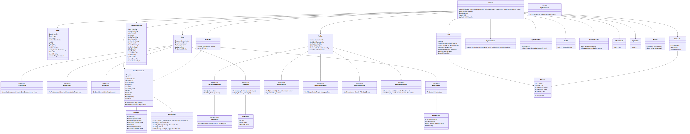

# srv-boundary（サーバー側・基盤）

## 受ける節

- [第2章 3 やり取りの分類と規則](../../../../docs/jp/design/02_基本設計書_境界.md#3-やり取りの分類と規則)（分類と規則：大きさの上限、カーソル）
- [第2章 4.1 セッション](../../../../docs/jp/design/02_基本設計書_境界.md#41-セッション)（セッションの Cookie の検証。発行は srv-identity）
- [第2章 4.2 CSRF と cross-site](../../../../docs/jp/design/02_基本設計書_境界.md#42-csrf-と-cross-site)（CSRF と cross-site）
- [第2章 4.3 認可の 3 つの基本](../../../../docs/jp/design/02_基本設計書_境界.md#43-認可の-3-つの基本)（認可の判定の実装）
- [第2章 4.4 WebSocket と通知と SFU](../../../../docs/jp/design/02_基本設計書_境界.md#44-websocket-と通知と-sfu)（WebSocket の `auth`、シェルのトークンの検証）
- [第2章 5.9 同期（第4章、第7章）](../../../../docs/jp/design/02_基本設計書_境界.md#59-同期第4章第7章)（`/sync`、`/ws`）
- [第2章 5.11 サーバー（無認証）](../../../../docs/jp/design/02_基本設計書_境界.md#511-サーバー無認証)（`/health`、`/version`、`/metrics`）
- [第2章 6.1 共通の形](../../../../docs/jp/design/02_基本設計書_境界.md#61-共通の形)
- [第2章 6.3 接続の規則](../../../../docs/jp/design/02_基本設計書_境界.md#63-接続の規則)（接続の規則）
- [第2章 9.1 形](../../../../docs/jp/design/02_基本設計書_境界.md#91-形)（problem）
- [第2章 9.3 レート制限（初期値。config.yaml の「レート制限」）](../../../../docs/jp/design/02_基本設計書_境界.md#93-レート制限初期値configyaml-のレート制限)（レート制限の適用）
- [第2章 13 失敗の扱い](../../../../docs/jp/design/02_基本設計書_境界.md#13-失敗の扱い)（WebSocket が使えない時、410、レート制限）
- [第1章 10.6 外から入るものの確かめ](../../../../docs/jp/design/01_基本設計書_全体構成.md#106-外から入るものの確かめ)（外から入るものの確かめ、WebSocket の規則、レート制限）
- [第1章 10.9 版の互換性](../../../../docs/jp/design/01_基本設計書_全体構成.md#109-版の互換性)（`/version` と最低限の版）
- [第1章 7 実行時の場面](../../../../docs/jp/design/01_基本設計書_全体構成.md#7-実行時の場面)（状態に応じた応答：読み取り専用の middleware）
- [第11章 11 監視と知らせ（DD-11-10）](../../../../docs/jp/design/11_基本設計書_運用.md#11-監視と知らせdd-11-10)（`/health` の中身、`/metrics` の bind）
- [第13章 6.2 互換の期間（第1章 DD-1-14）](../../../../docs/jp/design/13_基本設計書_配布と更新.md#62-互換の期間第1章-dd-1-14)（`Deprecation`、`Sunset`、`NET-006` の判定）
- 全体実装設計書
  - 2.1（1 プロセス、forward auth、内部の経路）、2.3（WebSocket の送信の channel）
  - 2.4（hub のキャッチアップ）、5.2（`x-authz` の確かめ）
  - I-9、I-12

- [第1章 4.3 境界（サーバー側とクライアント側）](../../../../docs/jp/design/01_基本設計書_全体構成.md#43-境界サーバー側とクライアント側)（WebSocket の Origin、cross-site の拒否）
- [第12章 4 通信の保護](../../../../docs/jp/design/12_基本設計書_データと暗号化.md#4-通信の保護) の WebSocket の行（専用トークンとオリジンの検証）

## 依存

- 下：
  - [srv-common](srv-common.md)
  - [srv-store](srv-store.md)
  - [api](api.md)（生成ファイル `server/internal/boundary/gen/`）
- 部品：net/http、coder/websocket、libopenapi-validator。
- 上：業務のブロックが生成した interface の operation を実装し、本ブロックが束ねる。本ブロックは業務の判断を持たない。
  - srv-identity、srv-keys、srv-rooms、srv-media
  - srv-push、srv-calls、srv-admin
- 依存の逆転：次の interface は本ブロックが定義し、srv-identity・srv-rooms・srv-keys・srv-admin が実装して渡す。
  - `SessionVerifier`（Cookie からセッションを得る）、`ShellTokenVerifier`、`WsTokenVerifier`
  - `RoomMembership`（room_member の判定）。端末の承認の有無は `SessionVerifier` が `Principal` の `DeviceApproved` で渡す（srv-identity の devices.state が正）
  - `ServerStateReader`（読み取り専用の判定）。値の型 `ServerState`（第1章 DD-1-15 の 5 つ）も本ブロックが定め、srv-admin の `Startup` が返す
- 依存の逆転（本ブロックが上のブロックの処理を呼ぶ所）：次の interface も本ブロックが定義し、`Links` にまとめて受ける。
  - `Snapshotter`（srv-rooms `Timeline.Snapshot`。`/sync` の初回）
  - `TypingSink`（srv-rooms `Typing.Set`。WebSocket の `typing`）
  - `EventSource`（srv-rooms `Timeline.ForFeed`。feed の room.event の payload）
  - `UpMailbox`（srv-push `UpBox` の `Pending` と `Ack`。`/up/ws`）。要素の型 `UpMessage` は本ブロックが定める
  - `HealthProbe`（srv-admin。`/health` の caddy_cert_days、disk_free_pct、ddns_last_ok_at、mode）。値の型 `HealthFacts` は本ブロックが定める

## クラス図

```mermaid
classDiagram
  class Server {
    +Build(base Base, impls Implementations, verifiers Verifiers, links Links) Result~http.Handler, Fault~
    +ListenAndServe(addr)
    +Shutdown(ctx)
    +Hub() Hub
    +UpWs() UpWsHandler
  }
  class Base {
    +Config Config
    +Deps Deps
    +Log Logger
    +Limiter RateLimiter
    +Ids Ids
    +Pool Pool
    +Feed Feed
    +Notifier Notifier
    +Idempotency Idempotency
    +Jobs Jobs
    +WwwDir string
    +ValidateResponses bool
  }
  class Links {
    +Snapshot Snapshotter
    +Events EventSource
    +Typing TypingSink
    +Up UpMailbox
    +Probe HealthProbe
  }
  class Snapshotter {
    <<interface>>
    +Snapshot(ctx, userId) Result~SyncSnapshot, pos, Event~
  }
  class EventSource {
    <<interface>>
    +ForFeed(ctx, userId, deviceId, eventIds) Result~map~
  }
  class TypingSink {
    <<interface>>
    +Set(userId, roomId, typing, timeout)
  }
  class UpMailbox {
    <<interface>>
    +Pending(ctx, deviceId) [UpMessage]
    +Ack(ctx, deviceId, messageId)
  }
  class UpMessage {
    +Id Uuid
    +Body []byte
    +ExpiresAt Time
  }
  class HealthProbe {
    <<interface>>
    +Probe(ctx) HealthFacts
  }
  class HealthFacts {
    +CaddyCertDays int
    +DiskFreePct int
    +DdnsLastOkAt Option~Time~
    +Mode string
  }
  class ServerState {
    <<enumeration>>
    BeforeSetup Initial Normal ReadOnly Stopped
  }
  class Implementations {
    +Setup SetupApi
    +Invites InvitesApi
    +Auth AuthApi
    +Me MeApi
    +Family FamilyApi
    +Users UsersApi
    +Devices DevicesApi
    +Keys KeysApi
    +Rooms RoomsApi
    +Media MediaApi
    +Calls CallsApi
    +Push PushApi
    +Admin AdminApi
    +Shell ShellApi
    +Sync SyncApi
    +Server ServerApi
    +Internal InternalApi
  }
  class MiddlewareChain {
    +Global(next) http.Handler
    +ForRoute(op, next) http.Handler
    +RequestId
    +Recover
    +FetchMetadata
    +AppVersion
    +Deprecation
    +BodyLimit
    +Session
    +ReadOnlyGate
    +Authz
    +RateLimit
    +Validate
    +Idempotency
    +Problem
  }
  class RouteMux {
    +HandleFunc(pattern, handler)
    +ServeHTTP(w, r)
  }
  class Principal {
    +Kind string
    +UserId Option~Uuid~
    +DeviceId Option~Uuid~
    +SessionId Option~Uuid~
    +Role string
    +DeviceApproved bool
    +ReauthAt Option~Time~
  }
  class Verifiers {
    +Session SessionVerifier
    +Shell ShellTokenVerifier
    +Ws WsTokenVerifier
    +UpWs UpWsVerifier
    +Membership RoomMembership
    +State ServerStateReader
  }
  class UpWsVerifier {
    <<interface>>
    +Verify(ctx, secret) Result~DeviceId, Event~
  }
  class SessionVerifier {
    <<interface>>
    +Verify(ctx, cookie) Result~Principal, Event~
    +ExpiresHeader(p) Time
  }
  class ShellTokenVerifier {
    <<interface>>
    +Verify(ctx, token) Result~Principal, Event~
  }
  class WsTokenVerifier {
    <<interface>>
    +Verify(ctx, token) Result~Principal, Event~
  }
  class RoomMembership {
    <<interface>>
    +IsMember(ctx, userId, roomId) Result~bool~
    +RoomRole(ctx, userId, roomId) Result~RoomRole~
  }
  class ServerStateReader {
    <<interface>>
    +State() ServerState
    +ReadOnlyReason() string
  }
  class AuthzTable {
    +FromSpec(spec, membership) Result~AuthzTable, Fault~
    +Route(op) Option~Route~
    +RouteByPattern(pattern) Option~Route~
    +Routes() [Route]
    +Check(ctx, op, principal, args) Result~Event~
  }
  class Hub {
    +Run(ctx)
    +Attach(conn, principal, lastPos)
    +Broadcast(userIds, kind, payload)
    +CatchUp(ctx, deviceId)
    +Connected(userId) [DeviceId]
    +Wait(ctx, userId) bool
    +CloseAll(retryAfter)
  }
  class WsConn {
    +DeviceId Uuid
    +UserId Uuid
    +Send chan~Frame~
    +LastSentPos int64
    +LastPong Time
    +Close(reason)
  }
  class WsHandler {
    +Upgrade(w, r)
    +Auth(conn)
    +ReadLoop(conn)
  }
  class SyncHandler {
    +Get(ctx, principal, since, timeout, limit) Result~SyncResponse, Event~
  }
  class UpWsHandler {
    +Upgrade(w, r)
    +Deliver(deviceId, msg UpMessage) bool
  }
  class Health {
    +Get() HealthResponse
  }
  class VersionHandler {
    +Get() VersionResponse
    +MinApp(platform) Option~string~
  }
  class InternalAuth {
    +Get(r) int
  }
  class SpaIndex {
    +Get(w, r)
  }
  class Metrics {
    +Handler() http.Handler
    +Observe(op, status, dur)
  }
  Server --> MiddlewareChain
  Server --> Implementations
  Server --> Verifiers
  Server --> Base
  Server --> Links
  Links --> Snapshotter
  Links --> TypingSink
  Links --> EventSource
  Links --> UpMailbox
  Links --> HealthProbe
  UpMailbox --> UpMessage
  HealthProbe --> HealthFacts
  ServerStateReader --> ServerState
  Server --> Hub
  Server --> WsHandler
  Server --> SyncHandler
  Server --> UpWsHandler
  Server --> Health
  Server --> VersionHandler
  Server --> InternalAuth
  Server --> Metrics
  Server --> SpaIndex
  MiddlewareChain --> Principal
  Server --> RouteMux
  RouteMux ..> MiddlewareChain
  MiddlewareChain --> AuthzTable
  Verifiers --> SessionVerifier
  Verifiers --> ShellTokenVerifier
  Verifiers --> WsTokenVerifier
  Verifiers --> RoomMembership
  Verifiers --> ServerStateReader
  Hub --> WsConn
  WsHandler --> WsConn
```

図の元の文（mermaid）

クラス図の注記（図の各メンバーの説明。仕様の節と番号を含む）

|クラス|メンバー|注記|
|---|---|---|
|Server|`+Build(base Base, impls Implementations, verifiers Verifiers, links Links) Result~http.Handler, Fault~`|AuthzTable.FromSpec の欠け（I-12）は Fault で、起動を止める。生成した StrictServerInterface を束ね、middleware を順に（下の順）。static のタグ（caddy が配る）と WebSocket の 2 つ（`connectWs`、`connectUpWs`）は strict の生成から除き、WebSocket は WsHandler と UpWsHandler を直接登録する（認可は同じ AuthzTable）|
|Base|（作り方）|下のブロックの部品（srv-common の Config、Deps、Logger、RateLimiter、Ids。srv-store の Pool、Feed、Notifier、Idempotency、Jobs）。cmd/ft が作って渡す|
|Base|`+ValidateResponses bool`|応答を spec で検証する（試験と開発だけ真。運用の設定ではない）|
|Base|`+WwwDir string`|SpaIndex が読む index.html の置き場（イメージの中の /srv/www）。version.json（AppVersion、VersionHandler）も同じ置き場の dl/ から読む|
|Links|（作り方）|上のブロックの実装を cmd/ft が入れる。WP-1 の試験は偽物を入れる|
|Snapshotter|`+Snapshot(ctx, userId) Result~SyncSnapshot, pos, Event~`|srv-rooms `Timeline.Snapshot`。`SyncSnapshot` は生成の型。snapshot と pos は 1 つの読みで取る（srv-rooms の SyncInitial）|
|EventSource|`+ForFeed(ctx, userId, deviceId, eventIds) Result~map~`|srv-rooms `Timeline.ForFeed`。feed の room.event の行の payload（ft.room_event/1）を、その利用者と端末に見える形で返す（取り消しの反映、transaction_id は送った端末にだけ）。見えない物（退出、削除）は返さず、本ブロックはその行のフレームを送らない|
|TypingSink|`+Set(userId, roomId, typing, timeout)`|srv-rooms `Typing.Set`。WebSocket の `typing` は timeout を持たないので 0（既定の 10 秒）。構成員の確かめは本ブロックが RoomMembership で先に行う|
|UpMailbox|`+Pending(ctx, deviceId) [UpMessage]`|srv-push `UpBox.Pending`。接続の時に未配信を古い順に|
|UpMailbox|`+Ack(ctx, deviceId, messageId)`|srv-push `UpBox.Ack`。端末の `ack` で消す。他の端末宛の id は無視する|
|UpMessage|`+Body []byte`|RFC 8291 の暗号文のまま。フレームでは base64url（asyncapi の upMsg）|
|HealthProbe|`+Probe(ctx) HealthFacts`|srv-admin。2 秒で打ち切る（Health の外への確かめと同じ）|
|ServerState|（値）|第1章 DD-1-15 の 5 つ。srv-admin の Startup が返し、ServerStateReader で読む。`/health` の status は Normal が ok（確かめが全部通れば）か degraded、ReadOnly が readonly、BeforeSetup と Initial が setup|
|Server|`+ListenAndServe(addr)`|:8080（Compose の internal + host の 127.0.0.1）|
|Server|`+Shutdown(ctx)`|全接続に bye{retry_after} を送り、最大 10 秒待つ|
|Server|`+Hub() Hub`|Build で作った hub（B-043 の使う側へ cmd/ft が渡す）|
|Implementations|（作り方）|生成の道具 genimpl が、生成した `StrictServerInterface` をタグごとの interface（`SetupApi` 等）に分けて書く。1 つのタグは 1 つのブロックが実装する（タグは実装するブロックで決める）。各ブロックは自分のタグの interface を実装し、`Implementations` の欄に入れる（コンパイルの時に確かめられる）|
|Implementations|`+Setup SetupApi`|srv-identity（SetupLink）|
|Implementations|`+Invites InvitesApi`|srv-identity（Invites）|
|Implementations|`+Auth AuthApi`|srv-identity|
|Implementations|`+Me MeApi`|srv-identity（Users、Guardians、Reports）|
|Implementations|`+Family FamilyApi`|srv-identity（Families、Icon。`/manifest.webmanifest` の Families.Manifest も。DD-8-1）|
|Implementations|`+Users UsersApi`|srv-identity（Users）|
|Implementations|`+Devices DevicesApi`|srv-identity（Devices。承認は QrFlow と srv-keys）|
|Implementations|`+Keys KeysApi`|srv-keys|
|Implementations|`+Rooms RoomsApi`|srv-rooms|
|Implementations|`+Media MediaApi`|srv-media|
|Implementations|`+Calls CallsApi`|srv-calls（`/internal/sfu/webhook` の Webhook も）|
|Implementations|`+Push PushApi`|srv-push|
|Implementations|`+Admin AdminApi`|srv-admin|
|Implementations|`+Shell ShellApi`|srv-push（配布元の受け口 `/up/*`。`/up/ws` は本ブロックの UpWsHandler が受けて srv-push に結ぶ）|
|Implementations|`+Sync SyncApi`|本ブロック（SyncHandler、WsHandler）|
|Implementations|`+Server ServerApi`|本ブロック（Health、VersionHandler、Metrics）|
|Implementations|`+Internal InternalApi`|本ブロック（`/internal/auth` の InternalAuth）|
|Implementations|（static のタグ）|`/maps/*`、`/.well-known/*`、`/dl/*`、`/notify.html` は caddy が配る（api/ の `x-served-by: caddy`）。実装を持たない|
|MiddlewareChain|（層と順）|2 つの層に分ける。全体の層（経路を引く前。外から順）：RequestId、Recover、FetchMetadata、AppVersion。圧縮は前段の caddy の encode（第2章 3。api は圧縮しない）。経路の層（operationId ごと。外から順）：Deprecation、BodyLimit、Session、ReadOnlyGate、Authz、RateLimit、Validate、Idempotency、生成の handler（引数の取り込みはこの後）。AppVersion を Session より前に置くのは、古いアプリに認証の誤りより更新を求めるため。Problem は層ではない（下の行）|
|MiddlewareChain|`+Global(next) http.Handler`|全体の層をかける。WebSocket の 2 つ、SpaIndex、/metrics を含む全部の要求|
|MiddlewareChain|`+ForRoute(op, next) http.Handler`|経路の層をかける。op は AuthzTable の Route|
|RouteMux|（作り方）|生成の `ServeMux` の interface を満たす口。生成の HandlerWithOptions が `HandleFunc("GET /api/v1/sync", h)` を呼ぶと、動詞と path から AuthzTable の operationId を引き、`ForRoute` で包んで持ち、全部の後に標準の ServeMux に登録する。引けない経路は Fault（起動を止める）。標準の ServeMux は GET のパターンを HEAD にも当てるので、HEAD だけのパターンは他の GET とぶつかる（HEAD /media/{id} と GET /media/config）。同じ path の GET と HEAD は 1 つの GET の登録にまとめ、HEAD の要求を HEAD の操作へ振り分ける|
|MiddlewareChain|`+RequestId`|要求ごとに UUIDv7 を発行する（端末の X-Request-Id は使わない。第2章 9.1）。ログの req_id と problem の instance|
|MiddlewareChain|`+Recover`|panic を Fault にし、SRV-003 を返す（I-9 の後始末は Tx の rollback）|
|MiddlewareChain|`+BodyLimit`|JSON 1 MiB、追記 64 MiB（経路で切り替え）|
|MiddlewareChain|`+FetchMetadata`|状態を変える動詞は、Sec-Fetch-Site が same-origin か none で、かつ X-Requested-With: family-talk（違えば NET-003）。Sec-Fetch-Site の無い要求（ブラウザでない端末）は X-Requested-With の確かめに頼る（第2章 4.2）|
|MiddlewareChain|`+Session`|Cookie __Host-session を SessionVerifier で、Bearer を ShellTokenVerifier で確かめ、Principal を得る。確かめの誤りを返すのは、経路の x-authz が全部セッションを要する値の時だけ（他は主体なしで続ける）|
|MiddlewareChain|`+ReadOnlyGate`|ServerStateReader が読み取り専用なら、GET と HEAD と `x-readonly: allow` の経路（第2章 10）以外を SRV-001（params.reason は ReadOnlyReason、Retry-After 60）で拒む。Retry-After の 60 秒は、状態が変わるのが管理者の操作か worker の 5 分の monitor であるため|
|MiddlewareChain|`+Authz`|x-authz の表（5.2）。Principal と経路の引数で判定|
|MiddlewareChain|`+RateLimit`|x-ratelimit の policy。NET-004 + Retry-After + RateLimit-* ヘッダ（草案）|
|MiddlewareChain|`+Validate`|要求（常に）と応答（試験と開発だけ）を spec で検証。NET-001（params.errors[]）。Content-Type が経路の型に合わなければ NET-002（415）、Accept が経路の応答の型（spec の responses）を受けなければ NET-002（406）。ただし Idempotency-Key のヘッダの欠けと形の誤りは NET-007（エラーコード表の専用の番号。部品は必須のヘッダの欠けも要求の誤りにするため、ここで分ける）で、他の誤りより先に返す|
|MiddlewareChain|`+Idempotency`|x-idempotency = key：Idempotency-Key の欠けは NET-007。トランザクションを開き、srv-store Idempotency.Begin（同じ鍵は入れた応答を返す、本文が違えば NET-008）、同じトランザクションを operation に渡し、応答を Finish してコミットする（同時の再送でも 1 回だけ処理する。第2章 11）|
|MiddlewareChain|`+Deprecation`|経路の `x-deprecation` があれば `Deprecation: @<at の秒>` と `Sunset: <sunset の HTTP の日時>` を付ける（RFC 9745、8594。第2章 10）。誤りの応答にも付ける。古いアプリへの告知には使わない（第13章 6.2）|
|MiddlewareChain|`+AppVersion`|X-Family-Talk-App（`<platform>/<version>`）を読み、platform（web、android）の min_app と SemVer で比べ、下回れば NET-006。ヘッダが無ければ比べない（caddy の forward auth、/health、シェルのネイティブ）。min_app はイメージの中の version.json（/srv/www/dl/version.json）を起動の時に読む（VersionHandler と同じ値）|
|MiddlewareChain|`+Problem`|層ではなく書き出しの口。全部の middleware と、生成の誤りの口（StdHTTPServerOptions.ErrorHandlerFunc、StrictHTTPServerOptions の 2 つ）が Event を application/problem+json で書く。instance は RequestId|
|Principal|`+Kind string`|user、shell、setup、invite、internal、none のいずれか|
|Principal|`+Role string`|member か admin|
|Principal|`+ReauthAt Option~Time~`|再認証の時刻（5 分の判定は業務）|
|SessionVerifier|`+Verify(ctx, cookie) Result~Principal, Event~`|AUTH-001 / AUTH-002（理由を params に）。無操作の期限の延長もここで（srv-identity）|
|SessionVerifier|`+ExpiresHeader(p) Time`|X-Session-Expires|
|WsTokenVerifier|`+Verify(ctx, token) Result~Principal, Event~`|60 秒の使い切り|
|RoomMembership|`+IsMember(ctx, userId, roomId) Result~bool~`|現在の構成員（第2章 4.3）。DB の読みの失敗は error（Fault。SRV-003）|
|RoomMembership|`+RoomRole(ctx, userId, roomId) Result~RoomRole~`|creator か member。構成員でなければ空|
|ServerStateReader|`+ReadOnlyReason() string`|ReadOnly の時の理由（SRV-001 の params.reason：migration、capacity、storage、restore）。ReadOnlyGate と Health が使う|
|ServerStateReader|`+State() ServerState`|初回、通常、読み取り専用など（第1章 DD-1-15 の 5 つ。srv-admin）|
|AuthzTable|`+FromSpec(spec, membership) Result~AuthzTable, Fault~`|起動時に束ねた spec（`gen.Spec`）から全 operation の x- の欄を読む。x-authz の欠けと第2章 10 の表に無い値は Fault（I-12）|
|AuthzTable|`+RouteByPattern(pattern) Option~Route~`|生成の HandleFunc の pattern（「動詞 path」）から引く（RouteMux）|
|AuthzTable|`+Route(op) Option~Route~`|operationId の属性（x-authz、x-authz-rule、x-reauth、x-idempotency、x-idempotency-natural、x-ratelimit、x-websocket、x-internal、x-errors）|
|AuthzTable|`+Check(ctx, op, principal, args) Result~Event~`|`x-authz` の配列のどれか 1 つ（値は第2章 10 の表）。本ブロックが判定するのは session、approved、device_self、room_member、admin、shell、ws_token（WebSocket は接続の後の auth）、none。トークン（setup_token、invite_token、reset_token、device_code）は経路を通し、使い切る操作（srv-identity）が同じトランザクションの中で確かめる。internal はネットワークの側で守る（全体実装設計書 5.2）。未承認の端末は `session`・`device_self` を含む経路だけ（他は KEY-004）。`x-authz-rule` はハンドラが資源を読んでから同じ表の名前で確かめる|
|Hub|`+Run(ctx)`|Notifier.Listen を 1 本。通知を受けた利用者の接続に「キャッチアップ」。LISTEN が切れて戻ったら全接続を CatchUp（`uuid.Nil` の通知。srv-store）。最初に LISTEN を張り終えた直後も全接続を CatchUp し、待ちを起こす（受け付けは LISTEN より先に始まりうるため）|
|Hub|`+Attach(conn, principal, lastPos)`|ready{pos} を送る。1 端末 1 接続（2 本目は古い方を切る）|
|Hub|`+Broadcast(userIds, kind, payload)`|feed に無い種類（room.typing、bye）を利用者たちの接続へ。room.typing の宛先はトークの構成員（呼ぶ側が渡す）|
|Hub|`+CatchUp(ctx, deviceId)`|Feed.ReadSince(userId, deviceId, lastSent) で読み（宛先が端末の行はその端末の分だけ読まれる）、room.event の行は EventSource で payload を引いてフレーム（第2章 6.1）にして送り、lastSent を進める。`session.revoked` の行は、そのフレームを書いた直後に接続を 4001 で閉じる（第2章 6.3。以後の行は送らない）|
|Hub|`+Connected(userId) [DeviceId]`|srv-push の「開いている端末」の判定（第7章 3.2）|
|Hub|`+Wait(ctx, userId) bool`|/sync のロングポール：利用者の通知が来るか ctx が終わるまで待つ|
|Hub|`+CloseAll(retryAfter)`|Shutdown：全接続に bye{retry_after}|
|WsConn|`+Send chan~Frame~`|長さ 256。満杯で切る|
|WsConn|`+LastPong Time`|30 秒の ping、60 秒で切る|
|WsConn|（メッセージの数と大きさ）|100 件/分は Base.Limiter の ws_messages（接続ごとの connection の鍵）で数え、超えたら 1008。1 件の上限 64 KiB は WebSocket の部品の読みの上限（`SetReadLimit(65536)`。既定は 32768 バイト。超えると状態 1009 で閉じる。調査資料 1.17）|
|WsHandler|`+Upgrade(w, r)`|Origin が家族のサーバーのオリジン（`https://` と `server.domain`）と完全に一致することを、部品の Accept の前に本ブロックが確かめる。Origin の無い要求も拒む（ブラウザは必ず付ける。RFC 6455 4.1）。部品の Accept の確かめは host だけを比べ、Origin の無い要求を許すので、それだけには頼らない（調査資料 1.17）。失敗は 403|
|WsHandler|`+Auth(conn)`|5 秒以内の {type: auth, token} を WsTokenVerifier で確かめる。失敗で切る|
|WsHandler|`+ReadLoop(conn)`|typing は srv-rooms Typing へ。ping/pong|
|SyncHandler|`+Get(ctx, principal, since, timeout, limit) Result~SyncResponse, Event~`|since なし：初回（srv-rooms Timeline.Snapshot）。since あり：Feed.ReadSince。保持の外は NET-005。timeout > 0 はロングポール（hub の通知を待つ。起きても新しい物が無ければ期限まで待ち直す。待ちの間に Shutdown が来たら 200 と空の配列：端末は再接続する。S-09）|
|UpWsHandler|`+Deliver(deviceId, msg UpMessage) bool`|srv-push `UpBox.Receive` が呼ぶ。その端末の接続があれば送りの channel に入れて true。無ければ false（メールボックスに残り、次の接続で Pending）|
|UpWsHandler|`+Upgrade(w, r)`|/up/ws（x-authz `up_secret`。認可の層は通し、ここで確かめる）。配布元の接続の秘密（`Authorization: Bearer`。形は第2章 6.4。`Verifiers.UpWs`：srv-push `UpBox.VerifyWs`）。相手はネイティブの配布元なので Origin の無い要求を許し、ある時は WsHandler と同じ一致を求める（Bearer はブラウザが自動で付けないので、他のサイトからの接続は認証を通らない）。srv-push UpBox と結ぶ（未配信を順に、ack、ping 60 秒）|
|Health|`+Get() HealthResponse`|checks: postgres(Ping)、sfu（`http://host.docker.internal:7880/` への GET が 200。SFU 本体の疎通の確かめの経路で、ノードの統計の更新が 4 秒を超えて遅れると 406。調査資料 1.17）、caddy_cert_days（srv-admin）、disk_free_pct、worker_last_job_at（Jobs.Stats）、ddns_last_ok_at、mode。503 なら reason の分類。秘密なし。外への確かめ（postgres、sfu）は並行に行い、各 2 秒で打ち切って false とする（応答しない相手を待って `/health` 自体が遅れないように。Compose の healthcheck の既定の待ち 30 秒より十分短い）|
|VersionHandler|`+MinApp(platform) Option~string~`|AppVersion の middleware が引く（web、android）|
|VersionHandler|`+Get() VersionResponse`|ft.version/1：server、boundary、min_app、released_at は起動の時に dl/version.json（ft.release/1）から読む。deprecations[] は AuthzTable の `x-deprecation` を持つ経路（path と sunset）|
|InternalAuth|`+Get(r) int`|forward auth：Cookie が有効なら 200 と X-User-Id、無効なら 401。本文なし|
|SpaIndex|`+Get(w, r)`|/、`/r/*`、`/d/*`、`/i/*`、`/settings/*`、`/welcome/*`、/login、`/recover/*`、`/admin/*`、/calls、`/call/*`、`/albums/*`、`/stickers/*`、/new：応答ごとに暗号論的な乱数で 128 ビットの nonce を作り（CSP Level 2 の 4.2）、index.html の nonce の置き場に埋め、同じ nonce の CSP のヘッダ（第8章 6 の値）を付けて返す。Cache-Control は no-store。index.html はイメージの WwwDir から起動の時に読む。認証なし。画面の入口で API ではないため openapi.yaml には載せない（経路の一覧はこの注記と deploy の Caddyfile の routes。S-15）|
|Metrics|`+Observe(op, status, dur)`|RequestId の終わりに 1 要求を数える（ラベルは operationId と状態の数だけ）|
|Metrics|`+Handler() http.Handler`|OpenMetrics の形式。opt-in（server.metrics。FT_METRICS）。同じ受け口の `/metrics` に登録し、caddy は回さない。api の 8080 はホストの FT_ADMIN_BIND（127.0.0.1）と Compose の内側だけで受けるので外から届かない|

## 公開操作（このブロックが所有する操作。番号は B-040〜）

|番号|操作（上の図）|使う側|由来|
|---|---|---|---|
|B-040|`Server::Build`／`ListenAndServe`／`Shutdown`|cmd/ft `serve`|全体実装設計書 2.1|
|B-041|`Principal`（要求の文脈。`ctx` から取る `PrincipalFrom(ctx)`）と、端末の IP の `ClientIpFrom(ctx) netip.Addr`（RequestId の middleware が置く。X-Forwarded-For の最後の値、無ければ RemoteAddr。レート制限と同じ値）|業務のブロックの全 operation|[第2章 4 認証と認可](../../../../docs/jp/design/02_基本設計書_境界.md#4-認証と認可)|
|B-042|`Verifiers` と `Links` の各 interface と値の型（定義。`ServerState`、`UpMessage`、`HealthFacts`）|実装：srv-identity（`SessionVerifier`、`ShellTokenVerifier`、`WsTokenVerifier`）、srv-rooms（`RoomMembership`、`Snapshotter`、`TypingSink`）、srv-admin（`ServerStateReader`、`HealthProbe`）、srv-push（`UpMailbox`）|[第2章 4.1 セッション](../../../../docs/jp/design/02_基本設計書_境界.md#41-セッション)、[第2章 4.3 認可の 3 つの基本](../../../../docs/jp/design/02_基本設計書_境界.md#43-認可の-3-つの基本)、[第2章 4.4 WebSocket と通知と SFU](../../../../docs/jp/design/02_基本設計書_境界.md#44-websocket-と通知と-sfu)|
|B-043|`Hub::Connected`、`Hub::Broadcast`（`room.typing`、`bye`）。失効で切る口は無い：hub が feed の `session.revoked` をその端末に書いた後に 4001 で閉じる（全体実装設計書 2.4。失効を書く側は本ブロックを呼ばない）|srv-push（開いている端末の判定）、srv-rooms（入力中）、srv-admin（再起動の前の `bye`）|[第2章 6.2 イベントの一覧（asyncapi.yaml の `channels`）](../../../../docs/jp/design/02_基本設計書_境界.md#62-イベントの一覧asyncapiyaml-の-channels)、[第2章 6.3 接続の規則](../../../../docs/jp/design/02_基本設計書_境界.md#63-接続の規則)、[第7章 3.2 送信（api）](../../../../docs/jp/design/07_基本設計書_通知.md#32-送信api)|
|B-044|`SyncHandler`（`/sync`。Feed.ReadSince に要求の端末を渡し、他の端末宛ての行を返さない。応答の `pos` は `has_more` が真なら最後の行、偽なら Feed.LastPos。第2章 5.9）|生成した operation（本ブロック）|[第2章 5.9 同期（第4章、第7章）](../../../../docs/jp/design/02_基本設計書_境界.md#59-同期第4章第7章)|
|B-045|`UpWsHandler`（`/up/ws` の接続の器と `Deliver`。メールボックスの読みと ack は srv-push `UpBox` を `UpMailbox` として呼ぶ）|srv-push|[第7章 3.1 家族のサーバーの受け口（(i)）](../../../../docs/jp/design/07_基本設計書_通知.md#31-家族のサーバーの受け口i)|
|B-046|`Health`（`checks` のうち caddy_cert_days、disk_free_pct、ddns_last_ok_at、mode は srv-admin が `HealthProbe` で渡す。postgres、sfu、worker_last_job_at（srv-store `Jobs.Stats`）は本ブロックが読む）|cmd/ft、caddy の healthcheck|[第11章 11 監視と知らせ（DD-11-10）](../../../../docs/jp/design/11_基本設計書_運用.md#11-監視と知らせdd-11-10)|
|B-047|`InternalAuth`（forward auth）|caddy|全体実装設計書 2.1|
|B-048|`AuthzTable`（経路の属性の表。`x-idempotency`・`x-ratelimit` も同じ表）|本ブロックの middleware|全体実装設計書 5.2|

## アルゴリズム（差し替え点）

|事項|実装|切り替え|由来|
|---|---|---|---|
|要求の検証|libopenapi-validator（埋め込みの spec）|固定。応答の検証は環境（試験・開発）で切る|[第14章 8 境界の型の生成](../../../../docs/jp/design/14_基本設計書_開発基盤.md#8-境界の型の生成)|
|WebSocket の再接続の待ち|端末の側（1、2、4、…、60 秒）。サーバーは `bye{retry_after}` だけ|固定|[第2章 6.3 接続の規則](../../../../docs/jp/design/02_基本設計書_境界.md#63-接続の規則)|
|ロングポールの待ち|hub の通知を `timeout` 秒まで待つ（上限 30）|固定|[第2章 5.9 同期（第4章、第7章）](../../../../docs/jp/design/02_基本設計書_境界.md#59-同期第4章第7章)|
|圧縮|本ブロックでは行わない。前段の caddy の encode（zstd、gzip。deploy の Caddyfile）|固定|[第2章 3 やり取りの分類と規則](../../../../docs/jp/design/02_基本設計書_境界.md#3-やり取りの分類と規則)|

## データ設計（このブロックが形を持つ記録）

- 記録を持たない（接続の表は記憶の上。再起動で消え、端末が再接続する）。
- `/health` の応答の形は第11章 11 が正（status、reason、checks）。api の `GetHealthResponse` はそれに合わせる。

- WebSocket のフレーム：第2章 6.1 の形。`ready`、`bye`、`ping`、`pong`、`room.typing` は pos を持たない。
