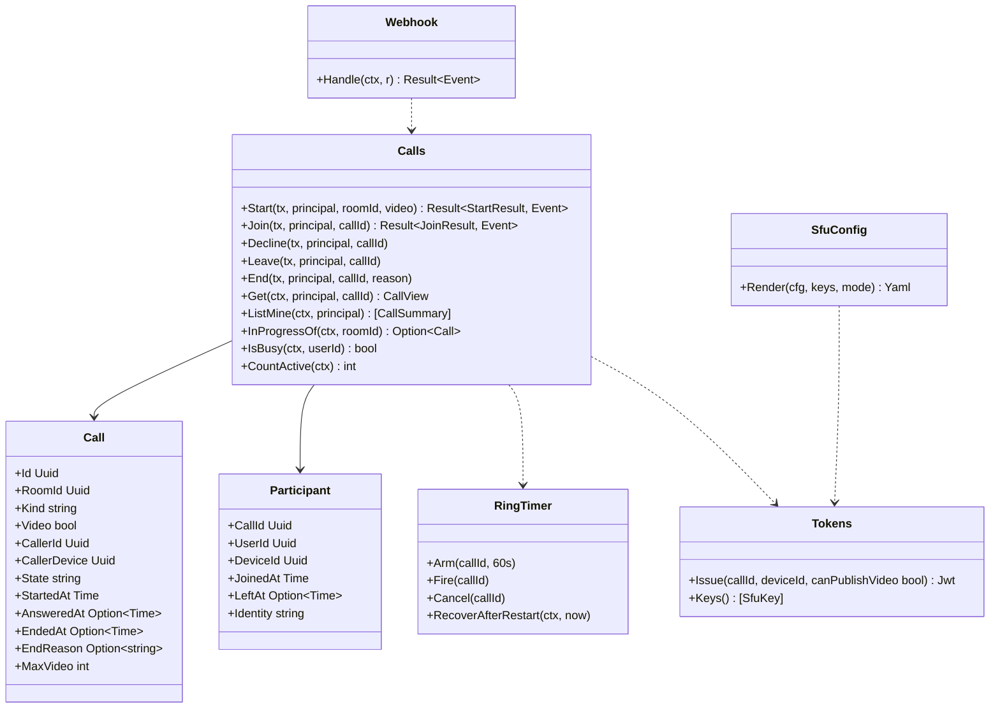

# srv-calls（サーバー側・業務。通話のシグナリング、SFU のトークンと Webhook）

## 受ける節

- [第6章 3.1 SFU の設定（deploy/livekit.yaml。初期値）](../../../../docs/jp/design/06_基本設計書_通話.md#31-sfu-の設定deploylivekityaml初期値) のサーバーの側
  - SFU の設定の生成：鍵、Webhook の URL、bind_addresses、UDP の範囲、TURN
  - 設定ファイルは srv-admin が書き、本ブロックが値を持つ
- [第6章 3.2 人数と帯域](../../../../docs/jp/design/06_基本設計書_通話.md#32-人数と帯域)（人数の上限 `CALL-006`）
- [第6章 4.1 1 対 1](../../../../docs/jp/design/06_基本設計書_通話.md#41-1-対-1)（1 対 1：記録、`call.ring`、60 秒、応答・拒否・取消・不在、通話中 `CALL-003`、着信を受けない `CALL-005`、同時の発信 `CALL-002`）
- [第6章 4.2 グループ](../../../../docs/jp/design/06_基本設計書_通話.md#42-グループ)（グループ：`call.started`、参加・離脱、空の 60 秒）
- [第6章 6 記録（DD-6-8）](../../../../docs/jp/design/06_基本設計書_通話.md#6-記録dd-6-8)（記録）
- [第6章 7 暗号化の運用（DD-6-9）](../../../../docs/jp/design/06_基本設計書_通話.md#7-暗号化の運用dd-6-9) の「SFU の Webhook とシグナリングは E2EE の外」
- [第6章 8 数値の一覧（config.yaml の「通話」）](../../../../docs/jp/design/06_基本設計書_通話.md#8-数値の一覧configyaml-の通話)（数値）
- [第6章 9 失敗の扱い](../../../../docs/jp/design/06_基本設計書_通話.md#9-失敗の扱い) のサーバーの行（`CALL-004`、通話中の更新）
- [第2章 5.7 通話（第6章）](../../../../docs/jp/design/02_基本設計書_境界.md#57-通話第6章)（通話の経路）
- [第2章 4.4 WebSocket と通知と SFU](../../../../docs/jp/design/02_基本設計書_境界.md#44-websocket-と通知と-sfu) の SFU のトークン
- [第2章 6.2 イベントの一覧（asyncapi.yaml の `channels`）](../../../../docs/jp/design/02_基本設計書_境界.md#62-イベントの一覧asyncapiyaml-の-channels) の `call.ring`、`call.state`
- [第2章 11 競合の規則（R-2-2-5）](../../../../docs/jp/design/02_基本設計書_境界.md#11-競合の規則r-2-2-5) の同時の開始
- [第2章 13 失敗の扱い](../../../../docs/jp/design/02_基本設計書_境界.md#13-失敗の扱い) の SFU のトークンの期限
- [第1章 7.6 通話](../../../../docs/jp/design/01_基本設計書_全体構成.md#76-通話)（通話の場面）
- [第1章 8.1 データの一覧](../../../../docs/jp/design/01_基本設計書_全体構成.md#81-データの一覧) の通話の行
- [第12章 3 データの所在と保護の区分](../../../../docs/jp/design/12_基本設計書_データと暗号化.md#3-データの所在と保護の区分) の「通話の音声と映像は保存しない」「通話の記録は平文」
- [第12章 5.11 通話（DD-12-11。第6章と往復）](../../../../docs/jp/design/12_基本設計書_データと暗号化.md#511-通話dd-12-11第6章と往復) のサーバーの側（SFU は暗号文を中継するだけ。鍵は本文で配る＝本ブロックは触らない）
- [第11章 3.1 compose.yaml（初期値。digest は版ごと）](../../../../docs/jp/design/11_基本設計書_運用.md#31-composeyaml初期値digest-は版ごと) の api と sfu の内部の通信
- 全体実装設計書 2.1（Webhook の到達と認証）、3.1（通話の機械、60 秒の timer と再起動の後始末）

## 依存

- 下：
  - [srv-common](srv-common.md)（`Secrets.Sfu`、`Clock`、`SfuAdmin`）
  - [srv-store](srv-store.md)（`Tx`、`Feed`、`Jobs`）
  - [srv-identity](srv-identity.md)（`Users.Settings` の「着信を受けない」、`Devices`）
  - [srv-rooms](srv-rooms.md)（`Members.IsMember`、`Members.Of`、`Timeline.CallEvent`、`SystemEvent`）
  - [srv-push](srv-push.md)（`CallRinger`、`NotifierImpl` 経由の通常の通知）
- 部品：SFU の server SDK（Go。トークンの JWT と Webhook の検証。第14章 5.2）。

## クラス図

図の元の文（mermaid）

クラス図の注記（図の各メンバーの説明。仕様の節と番号を含む）

|クラス|メンバー|注記|
|---|---|---|
|Call|`+Kind string`|dm か group|
|Call|`+State string`|ringing、active、ended、missed、declined、cancelled のいずれか|
|Call|`+MaxVideo int`|設定（8）|
|Participant|`+Identity string`|SFU の identity = device_id|
|Calls|`+Start(tx, principal, roomId, video) Result~StartResult, Event~`|構成員（ROOM-002）。進行中があれば CALL-002 で合流。dm で相手が通話中なら CALL-003（相手に不在の記録と知らせ）。相手が着信を受けないなら CALL-005（記録なし）。自分が通話中なら CALL-003。SFU が応答しなければ CALL-004。通れば calls を作り、トークンを出す。dm は call.ring と CallRinger.Ring、group は call.started と通常の通知と SystemEvent(started)。60 秒の timer（dm）|
|Calls|`+Join(tx, principal, callId) Result~JoinResult, Event~`|CALL-001。映像の上限 CALL-006（音声のみなら可）。dm の応答：state active、他の端末に call.state(active)、CallRinger.Stop(answered)（着信の push を送った相手の端末に kind call_end、reason answered。着信の通知を閉じるため。第7章 7）。トークン|
|Calls|`+Decline(tx, principal, callId)`|dm の相手の端末。call.state(declined)、CallEvent(declined)、CallRinger.Stop(declined)（相手の他の端末に call_end、reason declined）|
|Calls|`+Leave(tx, principal, callId)`|参加者。最後の 1 人なら End(empty)（group は 60 秒の猶予：Webhook room_finished が正）|
|Calls|`+End(tx, principal, callId, reason)`|発信者・参加者。dm の取消（ringing のまま）は cancelled：call.state(cancelled)、CallEvent(cancelled)、CallRinger.Stop(cancelled)。dm の通話中の終了は SfuAdmin.DeleteRoom（B-009）でルームを閉じ、Webhook を待たずに CallEvent(ended)（S-07）|
|Calls|`+ListMine(ctx, principal) [CallSummary]`|/me/calls（発信・着信・不在。トークのイベントの骨から）|
|Calls|`+IsBusy(ctx, userId) bool`|参加の状態（通話中の判定）|
|Calls|`+CountActive(ctx) int`|/admin/health の通話の数（更新の延期）|
|RingTimer|`+Arm(callId, 60s)`|api のプロセスの中|
|RingTimer|`+Fire(callId)`|ringing のままなら missed にする：call.state(missed)、CallEvent(missed) を双方、相手に不在の通知（CallRinger.Stop(missed)：kind call_end、reason missed）|
|RingTimer|`+RecoverAfterRestart(ctx, now)`|起動時（srv-admin Startup の後始末から）：ringing かつ started_at + 60 秒 < now なら missed にする。60 秒未満なら残りの時間で Arm し直す（全体実装設計書 3.1）|
|Tokens|`+Issue(callId, deviceId, canPublishVideo bool) Jwt`|SFU の鍵で署名。room = call_id、identity = device_id、権限 publish/subscribe、5 分。TURN の資格はトークンに含む（埋め込み TURN）|
|Tokens|`+Keys() [SfuKey]`|2 本。発行は新しい方、検証は両方（srv-admin KeyRotation）|
|Webhook|`+Handle(ctx, r) Result~Event~`|/internal/sfu/webhook。Authorization の JWT を SFU の鍵で検証。room_started、participant_joined（Participant を joined）、participant_left（left。最後なら 60 秒の猶予）、room_finished（End(ended)：CallEvent(ended, duration, participants)）、track_published（記録だけ）。冪等（同じ event id は無視）|
|SfuConfig|`+Render(cfg, keys, mode) Yaml`|第6章 3.1 の表 + 第11章 5 の形（UDP の範囲、TURN のポート、external ip、webhook の URL http://127.0.0.1:8080/internal/sfu/webhook、bind_addresses は host の内部の IP、TURN の tls_port 5350 と external_tls と proxy_protocol）。/data/sfu/config.yaml（srv-admin Startup が書く。初回は `ft setup` が起動の前に書く）。SFU は起動の時にだけ読む|

## 公開操作（このブロックが所有する操作。番号は B-160〜）

|番号|操作（上の図）|使う側|由来|
|---|---|---|---|
|B-160|`Calls`（`Start`、`Join`、`Decline`、`Leave`、`End`、`Get`、`ListMine`、`InProgressOf`、`IsBusy`、`CountActive`）|operation（`/rooms/{id}/calls`、`/calls/{id}/*`、`/me/calls`）、srv-rooms（トークの削除で `End`）、srv-admin（`/admin/health` の通話の数。更新の延期）、srv-push（`IsBusy` は不要：`CALL-003` は本ブロックが判定）|[第6章 4 開始と着信（DD-6-3、DD-6-4）](../../../../docs/jp/design/06_基本設計書_通話.md#4-開始と着信dd-6-3dd-6-4)、[第2章 5.7 通話（第6章）](../../../../docs/jp/design/02_基本設計書_境界.md#57-通話第6章)|
|B-161|`RingTimer`（`RecoverAfterRestart` は srv-admin `Startup` の後始末から）|本ブロック、srv-admin|[第6章 4.1 1 対 1](../../../../docs/jp/design/06_基本設計書_通話.md#41-1-対-1)、全体実装設計書 3.1|
|B-162|`Tokens::Issue`、`Keys`|本ブロック、srv-admin（鍵の交代）|[第2章 4.4 WebSocket と通知と SFU](../../../../docs/jp/design/02_基本設計書_境界.md#44-websocket-と通知と-sfu)、[第12章 10 秘密の鍵（DD-12-15、R-12-7-1）](../../../../docs/jp/design/12_基本設計書_データと暗号化.md#10-秘密の鍵dd-12-15r-12-7-1)|
|B-163|`Webhook::Handle`（operation `/internal/sfu/webhook`）|srv-boundary（`Implementations.Calls`。openapi のタグは calls）|[第6章 3.1 SFU の設定（deploy/livekit.yaml。初期値）](../../../../docs/jp/design/06_基本設計書_通話.md#31-sfu-の設定deploylivekityaml初期値)、全体実装設計書 2.1|
|B-164|`SfuConfig::Render`|srv-admin `Startup`（設定の書き出し）、srv-admin `KeyRotation.RotateSfu`（鍵の交代。書いた後に sfu の再起動を要求する）|[第6章 3.1 SFU の設定（deploy/livekit.yaml。初期値）](../../../../docs/jp/design/06_基本設計書_通話.md#31-sfu-の設定deploylivekityaml初期値)、[第11章 5 回線の分岐（DD-11-4）](../../../../docs/jp/design/11_基本設計書_運用.md#5-回線の分岐dd-11-4)|

## アルゴリズム（差し替え点）

|事項|実装|切り替え|由来|
|---|---|---|---|
|不在の判定|api の timer（60 秒。設定「呼び出し」）。再起動の後は `RecoverAfterRestart`|設定|[第6章 4.1 1 対 1](../../../../docs/jp/design/06_基本設計書_通話.md#41-1-対-1)|
|グループの終了|SFU の `room.empty_timeout`（60 秒）の `room_finished` を正とし、api は Webhook で記録|設定|[第6章 4.2 グループ](../../../../docs/jp/design/06_基本設計書_通話.md#42-グループ)|
|通話中の判定|`call_participants` に `left_at` が無い行がある利用者|固定|[第6章 4.1 1 対 1](../../../../docs/jp/design/06_基本設計書_通話.md#41-1-対-1)|
|トークン|SFU の SDK の JWT（HS256、SFU の API 鍵）。5 分|固定|[第2章 4.4 WebSocket と通知と SFU](../../../../docs/jp/design/02_基本設計書_境界.md#44-websocket-と通知と-sfu)|

## データ設計（このブロックが形を持つ記録）

|記録|形|欄|由来|
|---|---|---|---|
|`calls`|表|`id`、`room_id`、`kind`、`video`、`caller_id`、`caller_device`、`state`、`started_at`、`answered_at?`、`ended_at?`、`end_reason?`、`max_video`。索引 (room_id, started_at)、(state)|[第6章 6 記録（DD-6-8）](../../../../docs/jp/design/06_基本設計書_通話.md#6-記録dd-6-8)、[第2章 5.7 通話（第6章）](../../../../docs/jp/design/02_基本設計書_境界.md#57-通話第6章)|
|`call_participants`|表|`call_id`、`user_id`、`device_id`、`joined_at`、`left_at?`。PK (call_id, device_id)|[第6章 4 開始と着信（DD-6-3、DD-6-4）](../../../../docs/jp/design/06_基本設計書_通話.md#4-開始と着信dd-6-3dd-6-4)|
|`sfu_webhook_seen`|表|`event_id text PK`、`at`。7 日（冪等）|全体実装設計書 I-10|
|`/data/sfu/config.yaml`|YAML（生成ファイル）|第6章 3.1 の表の値。鍵は `/data/secrets/sfu` から|[第6章 3.1 SFU の設定（deploy/livekit.yaml。初期値）](../../../../docs/jp/design/06_基本設計書_通話.md#31-sfu-の設定deploylivekityaml初期値)|
|通話の記録のイベント|`ft.event.call/1`|`{call_id, kind, duration, participants[]}`（平文。kind は started、ended、missed、declined、cancelled のいずれか）|[第2章 12 データの形式（本章が定める共通の型。api/schemas）](../../../../docs/jp/design/02_基本設計書_境界.md#12-データの形式本章が定める共通の型apischemas)、[第6章 6 記録（DD-6-8）](../../../../docs/jp/design/06_基本設計書_通話.md#6-記録dd-6-8)|
|`StartResult`／`JoinResult`|構造|`{call_id, sfu: {url: wss://<サーバー>/rtc, token}, started_at, video_allowed}`|[第2章 5.7 通話（第6章）](../../../../docs/jp/design/02_基本設計書_境界.md#57-通話第6章)|
