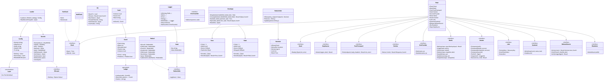

# srv-common（サーバー側・基盤）

## 受ける節

- [第1章 8.2 識別子の体系](../../../../docs/jp/design/01_基本設計書_全体構成.md#82-識別子の体系)（識別子）
- [第1章 8.5 秘密情報の一覧](../../../../docs/jp/design/01_基本設計書_全体構成.md#85-秘密情報の一覧)（秘密の置き場）
- [第1章 10.3 エラー](../../../../docs/jp/design/01_基本設計書_全体構成.md#103-エラー)（エラー）
- [第1章 10.4 操作の記録（ログ）](../../../../docs/jp/design/01_基本設計書_全体構成.md#104-操作の記録ログ)（ログ）
- [第1章 10.6 外から入るものの確かめ](../../../../docs/jp/design/01_基本設計書_全体構成.md#106-外から入るものの確かめ)（レート制限の規則の器）
- [第1章 10.7 時刻](../../../../docs/jp/design/01_基本設計書_全体構成.md#107-時刻)（時刻）
- [第11章 7 設定（DD-11-6）](../../../../docs/jp/design/11_基本設計書_運用.md#7-設定dd-11-6)（設定の 3 層と優先）
- [第11章 3.2 env.example](../../../../docs/jp/design/11_基本設計書_運用.md#32-envexample)（env.example の項目）
- [第11章 3.3 /data と /etc](../../../../docs/jp/design/11_基本設計書_運用.md#33-data-と-etc) の全部
- [第11章 12 ログ（DD-11-11）](../../../../docs/jp/design/11_基本設計書_運用.md#12-ログdd-11-11)（ログの形式と秘匿）
- [第12章 6.2 エンベロープ暗号化（DD-12-12）](../../../../docs/jp/design/12_基本設計書_データと暗号化.md#62-エンベロープ暗号化dd-12-12)（エンベロープ暗号化。KEK と DEK）
- [第12章 10 秘密の鍵（DD-12-15、R-12-7-1）](../../../../docs/jp/design/12_基本設計書_データと暗号化.md#10-秘密の鍵dd-12-15r-12-7-1)（秘密の鍵の生成・置き場・交代。生成と交代の操作は srv-admin が呼ぶ）
- [第12章 11 ログの秘匿（第1章 10.4 の具体）](../../../../docs/jp/design/12_基本設計書_データと暗号化.md#11-ログの秘匿第1章-104-の具体)（ログの秘匿）
- [第12章 12 データの形式（本章が定めるもの）](../../../../docs/jp/design/12_基本設計書_データと暗号化.md#12-データの形式本章が定めるもの)（`fenv/1`、`fdek/1`）
- [第2章 9.1 形](../../../../docs/jp/design/02_基本設計書_境界.md#91-形)（problem の形）
- [第2章 9.3 レート制限（初期値。config.yaml の「レート制限」）](../../../../docs/jp/design/02_基本設計書_境界.md#93-レート制限初期値configyaml-のレート制限)（レート制限の値は api/ の ratelimits.yaml）
- 全体実装設計書 2.7（`Event`／`Fault`）、2.8（`Deps`）、4.4 の I-1、I-7

- [第2章 8 外部との経路（第12章 8 と一致）](../../../../docs/jp/design/02_基本設計書_境界.md#8-外部との経路第12章-8-と一致)（外部との経路の一覧。`Deps` の interface がこの表の相手と 1 対 1）
- [第14章 5.2 部品](../../../../docs/jp/design/14_基本設計書_開発基盤.md#52-部品)（サーバー側の部品の表の採用）

## 依存

- 下：なし。
- 部品：
  - log/slog、gofrs/uuid（v7）、x/crypto（chacha20poly1305、hkdf）、go.yaml.in/yaml/v3（`server.yaml` の読み）
  - 生成ファイル `server/internal/common/gen/`（api の errors.yaml、ratelimits.yaml、config.yaml から）
- 依存の逆転：`Deps` の各 interface は本ブロックが定義し、実装は本ブロック（本物）と各試験（偽物）が持つ。
- Go の署名：外と触れる操作は先頭に `context.Context` を取り、失敗は `error`（`*fault.Event` か `*fault.Fault`）で返す。図は読みやすさのため省く。

## クラス図

```mermaid
classDiagram
  class Config {
    +Domain string
    +HttpsPort int
    +Mode string
    +DataDir Path
    +Tz string
    +Get(key) Value
    +Source(key) Layer
    +Reload(db DbLayer)
  }
  class Layer {
    <<enumeration>>
    Env File Db Default
  }
  class DbLayer {
    <<interface>>
    +Get(key) Option~Value~
  }
  class Loader {
    +Load(env, fileYaml, catalog) Config
    +ReadSecretFile(path) []byte
  }
  class Secrets {
    +SessionKeys() [KeyWithId]
    +Vapid() VapidKey
    +Sfu() [SfuKey]
    +Backup() []byte
    +Kek() [KekWithId]
    +DbPassword() []byte
    +DnsToken() []byte
    +Exists(name) bool
    +Write(name, bytes)
    +Zero(bytes)
  }
  class Clock {
    <<interface>>
    +Now() Time
    +After(d) chan
  }
  class WallClock
  class TestClock {
    +Set(t)
    +Advance(d)
  }
  class Ids {
    +NewV7() Uuid
    +Parse(s) Result~Uuid, Event~
    +NewToken() []byte
    +EncodeToken(b) string
    +HashToken(b) []byte
    +UserCode() string
  }
  class Event {
    +Code string
    +Status int
    +Retryable bool
    +Params map
    +Instance Uuid
    +Error() string
    +Problem() ProblemJson
  }
  class Fault {
    +Instance Uuid
    +Cause error
    +Stack string
    +AsEvent() Event
  }
  class Ledger {
    <<generated>>
    +Lookup(code) ErrorDef
    +New(code, params...) Event
    +Codes() [string]
  }
  class Logger {
    +Info(msg, fields...)
    +Warn(...)
    +Error(...)
    +Debug(...)
    +With(fields...) Logger
    +SetLevel(level)
    +SetCounter(c ErrorCounter)
  }
  class ErrorCounter {
    <<interface>>
    +Add(component, code)
  }
  class Field {
    +Key string
    +Value Redactable
  }
  class Redactable {
    <<interface>>
    +LogValue() Value
  }
  class Redact {
    +Id(uuid) Redactable
    +Code(code) Redactable
    +Count(n) Redactable
    +Duration(d) Redactable
    +Path(route) Redactable
    +Secret(any) Redactable
    +Ip(ip) Redactable
    +Label(name LabelName) Redactable
  }
  class Envelope {
    +WrapDek(kek KekWithId, dekId, dek) Fdek
    +UnwrapDek(keks [KekWithId], dekId, fdek) Result~[]byte, Event~
    +Seal(dek, dekId, plaintext, aad) Fenv
    +Open(dek, dekId, fenv, aad) Result~[]byte, Event~
    +NewDek() []byte
  }
  class Fenv {
    +V byte = 1
    +DekId Uuid
    +Nonce [12]byte
    +Ciphertext []byte
    +Encode() []byte
    +Decode([]byte) Result~Fenv, Event~
  }
  class Fdek {
    +V byte = 1
    +KekId Uuid
    +Nonce [24]byte
    +Wrapped [48]byte
    +Encode() []byte
    +Decode([]byte) Result~Fdek, Event~
  }
  class RateLimiter {
    +Allow(policy, subjects Subjects) Decision
    +Policies() [Policy]
    +Update(policies [Policy])
  }
  class Decision {
    +Allowed bool
    +RetryAfter Duration
    +Remaining int
    +Limit int
    +Reset Time
  }
  class Deps {
    +Clock Clock
    +Rand Rand
    +Push PushTransport
    +Fetch Fetcher
    +Dns DnsProvider
    +Restic Restic
    +Docker Docker
    +Luks Luks
    +Systemd Systemd
    +Release ReleaseSource
    +Sfu SfuAdmin
    +Maps MapSource
  }
  class Rand {
    <<interface>>
    +Read(p []byte) (int, error)
  }
  class MapSource {
    <<interface>>
    +Extract(region, dest) Result
  }
  class PushTransport {
    <<interface>>
    +Post(endpoint, body, headers) Result~int, error~
  }
  class Fetcher {
    <<interface>>
    +Get(url, limits) Result~Response, Event~
  }
  class DnsProvider {
    <<interface>>
    +SetA(name, ip)
    +SetAAAA(name, ip)
  }
  class Restic {
    <<interface>>
    +Backup(repo, input BackupInput) Result
    +Forget(repo, policy)
    +Check(repo, subset)
    +Restore(repo, snapshot, dest)
    +KeyAdd(repo, pw)
    +KeyRemove(repo, id)
    +Snapshots(repo) [Snapshot]
  }
  class Docker {
    <<interface>>
    +ComposeUp(dir)
    +ComposeStop(dir, service)
    +ComposeRecreate(dir, services)
    +ComposeDown(dir)
    +Pull(ref) Digest
    +Inspect(ref) ImageInfo
    +Exec(service, cmd) Result
  }
  class Luks {
    <<interface>>
    +Format(dev) RecoveryKey
    +EnrollTpm2(dev)
    +Erase(dev)
  }
  class Systemd {
    <<interface>>
    +WriteDropIn(unit, name, text)
    +Enable(unit)
  }
  class ReleaseSource {
    <<interface>>
    +VersionJson() Result~VersionJson, Event~
    +FetchFt(arch, sha256, dest)
    +VerifyImage(digest) Result
  }
  class SfuAdmin {
    <<interface>>
    +DeleteRoom(callId)
  }
  Config --> Layer
  Config ..> DbLayer
  Loader --> Config
  Loader ..> Secrets
  Event ..> Ledger
  Fault --> Event
  Logger --> Field
  Field --> Redactable
  Redact ..> Redactable
  Envelope --> Fenv
  Envelope --> Fdek
  RateLimiter --> Decision
  Deps --> Clock
  Deps --> Rand
  Deps --> MapSource
  Deps --> PushTransport
  Deps --> Fetcher
  Deps --> DnsProvider
  Deps --> Restic
  Deps --> Docker
  Deps --> Luks
  Deps --> Systemd
  Deps --> ReleaseSource
  Deps --> SfuAdmin
  WallClock ..|> Clock
  TestClock ..|> Clock
```

図の元の文（mermaid）

クラス図の注記（図の各メンバーの説明。仕様の節と番号を含む）

|クラス|メンバー|注記|
|---|---|---|
|Config|`+Domain string`|FT_DOMAIN（必須）|
|Config|`+HttpsPort int`|443 または割り当て|
|Config|`+Mode string`|A、B、C、D のいずれか|
|Config|`+DataDir Path`|/data|
|Config|`+Get(key) Value`|config.yaml の鍵。層の優先：env > file > db > default（第11章 7.1）|
|Config|`+Source(key) Layer`|どの層の値か（画面のロック表示）|
|Config|`+Reload(db DbLayer)`|DB の層だけ再読み込み（管理者の画面の変更）|
|DbLayer|`+Get(key) Option~Value~`|実装は srv-admin（settings_db 表）。値は `config.NewValue`（Go の値を JSON にして Value にする）で作る|
|Loader|`+Load(env, fileYaml, catalog) Config`|必須の欠け、範囲の外、置けない層の値、config.yaml に無い鍵は、起動を止める誤り（第1章 7.1 の 1。鍵と理由を起動の記録に出す。値は出さない）。誤りの型は `LoadError`（鍵と理由の一覧）|
|Config|`+Reload(db DbLayer)` の誤り|DB の層の範囲の外は ADM-004（設定の値の範囲。管理者の画面の変更）|
|Loader|`+ReadSecretFile(path) []byte`|*_FILE と /run/secrets。所有者が自分（ホストの root は可）で、グループと他人に権限が無いことを確かめる（第12章 10）|
|Secrets|`+SessionKeys() [KeyWithId]`|/data/secrets/session-keys（新旧 2 本。鍵 ID）|
|Secrets|`+Vapid() VapidKey`|/data/secrets/vapid（P-256、版）|
|Secrets|`+Sfu() [SfuKey]`|/data/secrets/sfu（2 本）|
|Secrets|`+Backup() []byte`|/data/secrets/backup（restic のパスワード）。秘密は []byte で返し、使い終えたら Zero（第12章 10）|
|Secrets|`+Kek() [KekWithId]`|コンテナの中は /run/secrets/kek（Compose の secret。ホストの /etc/family-talk/secrets/kek）。現在と交代中の前の鍵|
|Secrets|`+DbPassword() []byte`|コンテナの中は /run/secrets/db_password（ホストの /data/secrets/db_password）|
|Secrets|`+DnsToken() []byte`|コンテナの中は /run/secrets/dns_token（ホストの /etc/family-talk/secrets/dns_token）|
|Secrets|`+Write(name, bytes)`|一時の名前で書き、0400 にしてから改名する。ホストの `ft` が書く時は所有者を 10001 にする（第12章 10）。生成は srv-admin Startup。kek と dns_token はホストの `ft` だけが /etc に書く（コンテナの Store は /etc の置き場を持たず、書けば誤り。第12章 6.2）|
|Secrets|`+Zero(bytes)`|使い終えた秘密をゼロで埋める（第12章 10）|
|Clock|`+Now() Time`|UTC、ミリ秒|
|Clock|`+After(d) chan`|timer|
|Ids|`+NewV7() Uuid`|RFC 9562|
|Ids|`+NewToken() []byte`|256 ビットの乱数（招待、端末のコード、セッション）|
|Ids|`+EncodeToken(b) string`|URL-safe Base64、43 文字|
|Ids|`+HashToken(b) []byte`|SHA-256（DB に置く側）|
|Ids|`+UserCode() string`|8 文字。I、O、0、1 を除く Base32。4-4（第3章 4.4）|
|Event|`+Code string`|エラーコード表の番号|
|Event|`+Instance Uuid`|要求の識別子（ログの req_id と同じ値）。srv-boundary が応答の時に入れる。problem には `urn:uuid:` の形で出す（第2章 9.1）|
|Event|`+Problem() ProblemJson`|RFC 9457 + code、retryable、params、instance|
|Fault|`+AsEvent() Event`|SRV-003（500）。中身は出さない|
|Ledger|`+Lookup(code) ErrorDef`|status、retryable、params の型、log、user_text_key|
|Logger|`+With(fields...) Logger`|要求の識別子、構成員、端末、部品|
|Logger|`+SetLevel(level)`|info か debug（設定）|
|Logger|`+SetCounter(c ErrorCounter)`|code を持つ warn と error の記録ごとに ErrorCounter.Add を呼ぶ（第11章 12 の「ログ」の要約）|
|ErrorCounter|`+Add(component, code)`|本ブロックが定義し、srv-admin の LogStats が実装する（依存の逆転）|
|Field|`+Value Redactable`|型で秘匿を強制。string を直接渡せない（lint）|
|Redact|`+Id(uuid) Redactable`|そのまま|
|Redact|`+Path(route) Redactable`|経路の雛形（/rooms/{id}/events）。実際の id は出さない|
|Redact|`+Secret(any) Redactable`|常に "&lt;redacted&gt;"|
|Redact|`+Ip(ip) Redactable`|常に "&lt;ip&gt;"（生の IP は ip_log へ。第12章 11）|
|Redact|`+Label(name LabelName) Redactable`|定数の名（仕事の種類、結果の分類、秘密の種類）。第12章 11 の「書く」の認証の成否、認可の失敗、レート制限、裏の処理の結果、秘密の生成と交代の事実に使う。`LabelName` は専用の文字列の型で、変数の string は型が合わずに渡せない（明示の変換は lint で止める）|
|Envelope|`+WrapDek(kek KekWithId, dekId, dek) Fdek`|fdek/1。XChaCha20-Poly1305、24 バイトの nonce。認証の追加データは頭と dekId（第12章 12）|
|Envelope|`+UnwrapDek(keks [KekWithId], dekId, fdek) Result~[]byte, Event~`|kek_id で選ぶ。無ければ Fault（SRV-003）。KEK が無い時は起動の段 2 で止まるため、ここで欠けるのは交代の不整合だけ|
|Envelope|`+Seal(dek, dekId, plaintext, aad) Fenv`|fenv/1。AES-256-GCM、96 ビットの nonce。aad は呼ぶ側の文脈（表、列、行の識別子）。認証の追加データは頭の 29 バイトと aad（第12章 12）|
|Envelope|`+Open(dek, dekId, fenv, aad) Result~[]byte, Event~`|dekId が fenv の dek_id と違えば開かずに Fault（SRV-003）。認証の失敗も Fault|
|Envelope|`+NewDek() []byte`|256 ビット|
|Fenv|`+Encode() []byte`|版 1、dek_id 16、nonce 12、暗号文と認証タグの順（DB の bytea。第12章 12）|
|Fdek|`+Encode() []byte`|版 1、kek_id 16、nonce 24、包んだ DEK 48 の順で 89 バイト（DB の bytea。第12章 12）|
|RateLimiter|`+Allow(policy, subjects Subjects) Decision`|token bucket。記憶の上（api は 1 プロセス）。Subjects は ip、user、device、room、connection の値。1 つの policy の全部の上限を確かめ、どれかが尽きれば拒む（login は IP と端末の 2 つ。第2章 9.3）|
|RateLimiter|`+Update(policies [Policy])`|設定の「レート制限」が変わった時に表を入れ替える（Config.Reload の後。第11章 7.2）|
|RateLimiter|`+Policies() [Policy]`|生成ファイル（ratelimits.yaml）|
|PushTransport|`+Post(endpoint, body, headers) Result~int, error~`|RFC 8030 の POST。応答の状態（201、404、410、429 + Retry-After、5xx）|
|Restic|`+Backup(repo, input BackupInput) Result`|input はファイルの道のり（Paths）か、標準出力を保存する命令（StdinCmd と StdinFilename）のどちらか一方。restic の `--stdin-from-command` は同じ実行で道のりと一緒に使えない（restic v0.19.1）。worker は DB の書き出し、media の順に 2 回呼ぶ（全体実装設計書 I-5）。パスワードはパイプで渡す（引数と環境変数に置かない）|
|Fetcher|（本物の作り方）|`NewHttpFetcher(resolver, self, userAgent)`。resolver は名前の解決の差し替え点（`LookupNetIP`。本物は net.DefaultResolver）。self は家族のサーバー自身のアドレス（名前の解決の結果と、インターフェースのアドレス。cmd/ft が起動の時に集める）|
|Fetcher|`+Get(url, limits) Result~Response, Event~`|転送を 1 段ずつ追い、各段で内部のアドレス帯を拒む（MEDIA-010）。時間切れ 10 秒、1 MiB。名前の解決は差し込みの解決器で行い、解決した全部のアドレスを確かめてから、そのアドレスに直接つなぐ（解決とつなぐ間の差し替えを防ぐ。試験は解決器を表に差し替える）|
|DnsProvider|（提供者の表）|`RegisterDnsProvider(name, factory)` で、`FT_DNS_PROVIDER` の名から libdns の `RecordSetter` を作る関数を表に足す（deploy が足す）。`NewDnsApi(provider, token, zone)` は表に無い名を起動の誤りにする|
|Docker|（クラス全体）|ホストの `ft` だけが使う（設置、`ft host run`、KEK の交代）。コンテナは Docker を操作しない（第11章 3.4。socket を渡さない）|
|Docker|`+ComposeRecreate(dir, services)`|`docker compose up -d --force-recreate`（秘密のファイルを変えた後に、そのサービスに読み直させる。KEK の交代。第12章 6.2）|
|Docker|`+ComposeStop(dir, service)`|`docker compose stop`（更新の前に api へ SIGTERM を送り、Server::Shutdown が bye を送ってから止まる。S-13）|
|Luks|`+Erase(dev)`|cryptsetup erase（第12章 6.1）|
|ReleaseSource|`+FetchFt(arch, sha256, dest)`|Release の資産の `ft` を取り、sha256 が version.json の値と一致した時だけ dest に置く（一時の名前から改名）|
|ReleaseSource|`+VersionJson() Result~VersionJson, Event~`|`VersionJson` は取得した version.json のバイト列（1 MiB 以下の JSON であることだけを確かめる）。JSON Schema（`ft.release/1`）の検証と型への読み込みは srv-admin が openapi の生成ファイル（`ft.release/1`）で行う（全体実装設計書 5.1。手で写した型を置かない）|
|ReleaseSource|`+VerifyImage(digest) Result`|第13章 3.1 の順。referrer から署名とビルド証明の bundle を取り（go-containerregistry）、sigstore-go で検証する。信頼の起点は TUF から取り /etc/family-talk/tuf にキャッシュする。ホストの `ft` だけが使う|
|SfuAdmin|`+DeleteRoom(callId)`|SFU のサーバーの SDK のルームの削除（1 対 1 の即時の終了）。SFU は設定と鍵を読み直せないので、読み直しの操作は持たない（再起動はホストの要求の受け口。第11章 3.4）|
|Rand|`+Read(p []byte) (int, error)`|本物は crypto/rand。試験は決まった列（UUIDv7 と token の再現）|
|MapSource|`+Extract(region, dest) Result`|地図のデータの供給元から領域を切り出して dest に書く（PMTiles。第2章 8、第5章 8.1）。本物は同梱した pmtiles の CLI（`pmtiles extract`。第14章 5.2）|

## 公開操作（このブロックが所有する操作。番号は B-001〜）

|番号|操作（上の図）|使う側|由来|
|---|---|---|---|
|B-001|`Loader::Load`、`Config::Get`／`Source`／`Reload`|cmd/ft、srv-boundary、srv-admin、全ブロック（値の読み）|[第11章 7 設定（DD-11-6）](../../../../docs/jp/design/11_基本設計書_運用.md#7-設定dd-11-6)、[第11章 3.2 env.example](../../../../docs/jp/design/11_基本設計書_運用.md#32-envexample)|
|B-002|`Secrets`（読み、`Write`、`Zero`）|srv-admin（生成と交代）、srv-identity（セッションの署名鍵）、srv-push（VAPID）、srv-calls（SFU の鍵）、srv-worker（バックアップの鍵、DNS のトークン）、srv-boundary（セッションの検証）|[第1章 8.5 秘密情報の一覧](../../../../docs/jp/design/01_基本設計書_全体構成.md#85-秘密情報の一覧)、[第12章 10 秘密の鍵（DD-12-15、R-12-7-1）](../../../../docs/jp/design/12_基本設計書_データと暗号化.md#10-秘密の鍵dd-12-15r-12-7-1)|
|B-003|`Clock`（`Deps.Clock`）|全ブロック（時刻を直接読まない。lint で `time.Now` を禁じる）|[第1章 10.7 時刻](../../../../docs/jp/design/01_基本設計書_全体構成.md#107-時刻)|
|B-004|`Ids`|srv-store（採番）、srv-identity（token、user_code）、全ブロック|[第1章 8.2 識別子の体系](../../../../docs/jp/design/01_基本設計書_全体構成.md#82-識別子の体系)|
|B-005|`Event`、`Fault`、`Ledger`|全ブロック（失敗は必ずこの型）、srv-boundary（problem の応答）|[第1章 10.3 エラー](../../../../docs/jp/design/01_基本設計書_全体構成.md#103-エラー)、[第2章 9.1 形](../../../../docs/jp/design/02_基本設計書_境界.md#91-形)|
|B-006|`Logger`、`Redact`、`ErrorCounter`（定義）|全ブロック|[第1章 10.4 操作の記録（ログ）](../../../../docs/jp/design/01_基本設計書_全体構成.md#104-操作の記録ログ)、[第12章 11 ログの秘匿（第1章 10.4 の具体）](../../../../docs/jp/design/12_基本設計書_データと暗号化.md#11-ログの秘匿第1章-104-の具体)|
|B-007|`Envelope`、`Fenv`|srv-identity（`user_private`、端末の名前、ip_log）、srv-push（規則の判定で設定を復号）、srv-worker（`kek_rewrap`）|[第12章 6.2 エンベロープ暗号化（DD-12-12）](../../../../docs/jp/design/12_基本設計書_データと暗号化.md#62-エンベロープ暗号化dd-12-12)、[第12章 12 データの形式（本章が定めるもの）](../../../../docs/jp/design/12_基本設計書_データと暗号化.md#12-データの形式本章が定めるもの)|
|B-008|`RateLimiter`|srv-boundary（middleware）、srv-keys（回復コードの試行 10 回/日は DB の計数。本器ではない）|[第1章 10.6 外から入るものの確かめ](../../../../docs/jp/design/01_基本設計書_全体構成.md#106-外から入るものの確かめ)、[第2章 9.3 レート制限（初期値。config.yaml の「レート制限」）](../../../../docs/jp/design/02_基本設計書_境界.md#93-レート制限初期値configyaml-のレート制限)|
|B-009|`Deps`（`Clock`、`Rand`、`PushTransport`、`Fetcher`、`DnsProvider`、`Restic`、`Docker`、`Luks`、`Systemd`、`ReleaseSource`、`SfuAdmin`、`MapSource`）|srv-push、srv-media、srv-worker、srv-admin、srv-calls|全体実装設計書 2.8|
|B-010|本物の実装：`WallClock`、`HttpPush`（net/http + RFC 8291 は srv-push）、`HttpFetcher`（内部のアドレス帯の判定を含む）、`ResticCli`（イメージに同梱した restic を呼ぶ。第14章 5.4）、`PmtilesCli`（イメージに同梱した pmtiles の CLI を呼ぶ。第14章 5.2）、`DockerApi`、`CryptsetupCli`、`SystemdFiles`、`GhRelease`、`DnsApi`（libdns の `RecordSetter` を包む。提供者は `FT_DNS_PROVIDER` の名で選び、caddy の DNS のモジュールと同じ提供者のパッケージ。第14章 5.2）、`SfuApi`（SFU のサーバーの SDK。第14章 5.2）|cmd/ft（配線）|同上|

## アルゴリズム（差し替え点）

|interface|実装|切り替え|由来|
|---|---|---|---|
|`Clock`|`WallClock`／`TestClock`|cmd/ft（本物）、試験（偽物）|全体実装設計書 2.8|
|`Fetcher` の内部のアドレス帯の判定|第1章 10.6（IANA の special-purpose の登録で global でない範囲の全部、マルチキャスト、NAT64 の中の IPv4、自分自身のアドレス）。表は登録の取得の日付つきで固定する|固定|[第1章 10.6 外から入るものの確かめ](../../../../docs/jp/design/01_基本設計書_全体構成.md#106-外から入るものの確かめ)|
|レート制限の器|token bucket（記憶の上）|固定（api は 1 プロセス）|[第2章 9.3 レート制限（初期値。config.yaml の「レート制限」）](../../../../docs/jp/design/02_基本設計書_境界.md#93-レート制限初期値configyaml-のレート制限)|
|エンベロープの暗号|DEK は AES-256-GCM、DEK の包みは XChaCha20-Poly1305|固定（版の欄で将来の切り替え）|[第12章 6.2 エンベロープ暗号化（DD-12-12）](../../../../docs/jp/design/12_基本設計書_データと暗号化.md#62-エンベロープ暗号化dd-12-12)|

## データ設計（このブロックが形を持つ記録）

|記録|形|欄|由来|
|---|---|---|---|
|`/data/secrets/session-keys`|JSON|`{keys: [{id, alg, key(base64), created_at, retire_after}]}`。alg は HS256（第12章 10）。新旧 2 本|[第12章 10 秘密の鍵（DD-12-15、R-12-7-1）](../../../../docs/jp/design/12_基本設計書_データと暗号化.md#10-秘密の鍵dd-12-15r-12-7-1)|
|`/data/secrets/vapid`|JSON|`{version, private(JWK P-256), public(base64url)}`|[第12章 10 秘密の鍵（DD-12-15、R-12-7-1）](../../../../docs/jp/design/12_基本設計書_データと暗号化.md#10-秘密の鍵dd-12-15r-12-7-1)、[第7章 4 購読](../../../../docs/jp/design/07_基本設計書_通知.md#4-購読)|
|`/data/secrets/sfu`|JSON|`{keys: [{id, secret}]}`。sfu の設定（`/data/sfu/config.yaml`）にも srv-admin が書く|[第6章 3.1 SFU の設定（deploy/livekit.yaml。初期値）](../../../../docs/jp/design/06_基本設計書_通話.md#31-sfu-の設定deploylivekityaml初期値)|
|`/data/secrets/backup`|文字列|restic のパスワード（256 ビットの乱数の base64）|[第11章 9.1 取る](../../../../docs/jp/design/11_基本設計書_運用.md#91-取る)|
|`/data/secrets/db_password`|文字列|Compose の secret としても渡る|[第11章 3.1 compose.yaml（初期値。digest は版ごと）](../../../../docs/jp/design/11_基本設計書_運用.md#31-composeyaml初期値digest-は版ごと)|
|`/etc/family-talk/secrets/kek`|JSON|`{keys: [{id, key(base64), created_at}]}`。id は UUIDv7。現在と交代中の前の鍵（I-7）|[第12章 6.2 エンベロープ暗号化（DD-12-12）](../../../../docs/jp/design/12_基本設計書_データと暗号化.md#62-エンベロープ暗号化dd-12-12)|
|`/etc/family-talk/secrets/dns_token`|文字列|提供者のトークン|[第11章 4 設置の流れ（DD-11-2、DD-11-3）](../../../../docs/jp/design/11_基本設計書_運用.md#4-設置の流れdd-11-2dd-11-3)|
|`/data/config/server.yaml`|YAML|config.yaml の鍵（`layers` に file を含む項目だけ）|[第11章 7.1 層](../../../../docs/jp/design/11_基本設計書_運用.md#71-層)|
|`.env`|dotenv|第11章 3.2 の `FT_*`|[第11章 3.2 env.example](../../../../docs/jp/design/11_基本設計書_運用.md#32-envexample)|
|ログ（標準出力）|JSON Lines（UTF-8、1 行 1 件）|`ts`（UTC）、`level`、`component`、`req_id`、`user_id?`、`device_id?`、`code?`、`dur_ms?`、`msg`、`route?`。本文・添付・トークン・鍵・Cookie・生の IP は出ない（型で強制）|[第1章 10.4 操作の記録（ログ）](../../../../docs/jp/design/01_基本設計書_全体構成.md#104-操作の記録ログ)、[第12章 11 ログの秘匿（第1章 10.4 の具体）](../../../../docs/jp/design/12_基本設計書_データと暗号化.md#11-ログの秘匿第1章-104-の具体)|
|エンベロープの列（DB の bytea）|`fenv/1`|`v`、`dek_id`、`nonce`、`ciphertext`（KEK の id は持たない）|[第12章 12 データの形式（本章が定めるもの）](../../../../docs/jp/design/12_基本設計書_データと暗号化.md#12-データの形式本章が定めるもの)|
|DEK の包み（DB の bytea）|`fdek/1`|`v`、`kek_id`、`nonce`（192 ビット）、`wrapped`|[第12章 12 データの形式（本章が定めるもの）](../../../../docs/jp/design/12_基本設計書_データと暗号化.md#12-データの形式本章が定めるもの)|
