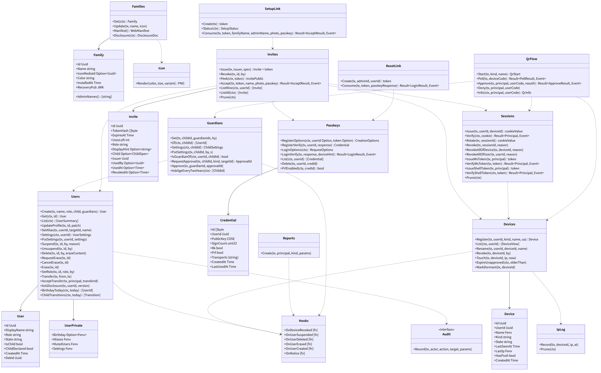
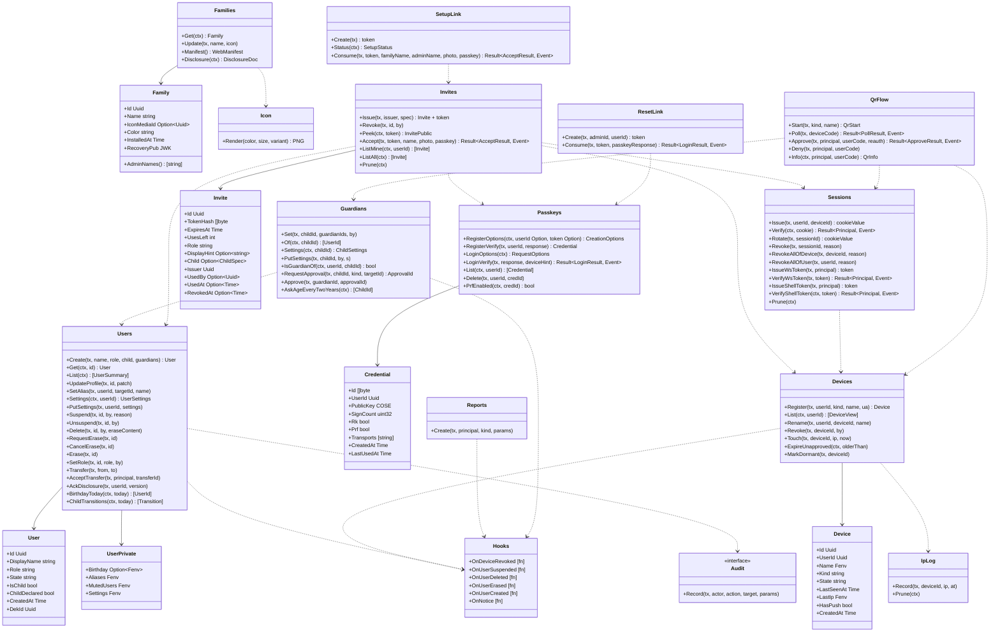

# srv-identity（サーバー側・業務）

## 受ける節

- [第3章 3 家族の作り方](../../../../docs/jp/design/03_基本設計書_認証_構成員_端末.md#3-家族の作り方)（家族の作り方：初回の管理者、招待、参加）
- [第3章 4 ログインと認証](../../../../docs/jp/design/03_基本設計書_認証_構成員_端末.md#4-ログインと認証)（ログインと認証：パスキー、ログイン、セッション、新しい端末の追加、再認証、回復、アプリのロックはサーバーに状態なし）
- [第3章 5 端末とセッション（DD-3-6）](../../../../docs/jp/design/03_基本設計書_認証_構成員_端末.md#5-端末とセッションdd-3-6)（端末とセッション）
- [第3章 6 アカウントとプロフィール（DD-3-14）](../../../../docs/jp/design/03_基本設計書_認証_構成員_端末.md#6-アカウントとプロフィールdd-3-14)（アカウントとプロフィール）
- [第3章 7 役割と権限（DD-3-10）](../../../../docs/jp/design/03_基本設計書_認証_構成員_端末.md#7-役割と権限dd-3-10)（役割と権限）
- [第3章 8 構成の変化（DD-3-11、DD-3-12）](../../../../docs/jp/design/03_基本設計書_認証_構成員_端末.md#8-構成の変化dd-3-11dd-3-12)（構成の変化）
- [第3章 9 子ども（DD-3-13。O-09 の結論）](../../../../docs/jp/design/03_基本設計書_認証_構成員_端末.md#9-子どもdd-3-13o-09-の結論)（子ども）
- [第3章 10 複数の家族（DD-3-16。O-04 の確認）](../../../../docs/jp/design/03_基本設計書_認証_構成員_端末.md#10-複数の家族dd-3-16o-04-の確認)（複数の家族はサーバーの間に関係なし）
- [第3章 12 失敗の扱い](../../../../docs/jp/design/03_基本設計書_認証_構成員_端末.md#12-失敗の扱い)（失敗の扱い）
- [第2章 4.1 セッション](../../../../docs/jp/design/02_基本設計書_境界.md#41-セッション)（セッションの発行と失効）
- [第2章 4.4 WebSocket と通知と SFU](../../../../docs/jp/design/02_基本設計書_境界.md#44-websocket-と通知と-sfu)（`ws-token`、`shell-token` の発行）
- [第2章 5.1 初回と招待（第3章、第11章）](../../../../docs/jp/design/02_基本設計書_境界.md#51-初回と招待第3章第11章)
- [第2章 5.2 認証（第3章）](../../../../docs/jp/design/02_基本設計書_境界.md#52-認証第3章)
- [第2章 5.3 構成員とプロフィール（第3章）](../../../../docs/jp/design/02_基本設計書_境界.md#53-構成員とプロフィール第3章)
- [第2章 5.4 端末と鍵の運搬（第3章、第12章）](../../../../docs/jp/design/02_基本設計書_境界.md#54-端末と鍵の運搬第3章第12章) のうち `/me/devices`、`/me/devices/{id}`（名前・取り消し）
- [第1章 7.2 初回（最初の管理者）](../../../../docs/jp/design/01_基本設計書_全体構成.md#72-初回最初の管理者)
- [第1章 7.3 構成員の参加](../../../../docs/jp/design/01_基本設計書_全体構成.md#73-構成員の参加)
- [第1章 7.7 新しい端末の追加と紛失](../../../../docs/jp/design/01_基本設計書_全体構成.md#77-新しい端末の追加と紛失)
- [第1章 8.2 識別子の体系](../../../../docs/jp/design/01_基本設計書_全体構成.md#82-識別子の体系)（招待の token、端末の追加のコード）
- [第1章 10.10 URL と QR の形](../../../../docs/jp/design/01_基本設計書_全体構成.md#1010-url-と-qr-の形)（URL と QR の形）
- [第1章 13 端末と人](../../../../docs/jp/design/01_基本設計書_全体構成.md#13-端末と人)（端末と人）
- [第12章 7 読める人の明示（DD-12-14。第10章と往復）](../../../../docs/jp/design/12_基本設計書_データと暗号化.md#7-読める人の明示dd-12-14第10章と往復)（読める人の明示の文の提供 `/family/disclosure`）
- [第12章 8 外へ送る情報の一覧（DD-12-14、R-12-5-1。第1章 4.2 と一致）](../../../../docs/jp/design/12_基本設計書_データと暗号化.md#8-外へ送る情報の一覧dd-12-14r-12-5-1第1章-42-と一致)（外へ送る情報の一覧の提供）
- [第12章 9 消すこと（DD-12-13、R-12-6-1）](../../../../docs/jp/design/12_基本設計書_データと暗号化.md#9-消すことdd-12-13r-12-6-1) の停止・削除・抹消のサーバー側（鍵の破棄は srv-keys の hook）
- [第12章 11 ログの秘匿（第1章 10.4 の具体）](../../../../docs/jp/design/12_基本設計書_データと暗号化.md#11-ログの秘匿第1章-104-の具体)（IP の別の表）
- [第8章 3.1 manifest（DD-8-1）](../../../../docs/jp/design/08_基本設計書_iPhoneとPCのシェル.md#31-manifestdd-8-1)（manifest と家族のアイコンの生成）
- [第11章 8 管理者の画面（DD-11-7。第2章 5.10 の経路）](../../../../docs/jp/design/11_基本設計書_運用.md#8-管理者の画面dd-11-7第2章-510-の経路) の構成員・招待の記録・家族の画面の API のうち本ブロックの資源
- 全体実装設計書 3.1（`UserState`、`DeviceState`、セッション、招待、端末の追加）、4.1（表）、4.3、I-6、I-8

## 依存

- 下：
  - [srv-common](srv-common.md)（`Ids`、`Envelope`、`Secrets`、`Clock`、`Event`）
  - [srv-store](srv-store.md)（`Tx`、`Feed`、`Jobs`、`Retention`）
- 部品：go-webauthn（WebAuthn L3、PRF の拡張）。回復コードのハッシュは srv-keys が持つ。
- 依存の逆転：次の hook を本ブロックが定義し、他のブロックが登録する。同じトランザクションで走る（I-8）。
  - `OnDeviceRevoked(tx, deviceId)`、`OnUserSuspended(tx, userId)`
  - `OnUserDeleted(tx, userId, eraseContent)`、`OnUserErased(tx, userId)`
  - `OnNotice(tx, kind, params, audience)`（知らせ）
  - 登録する側：srv-keys（鍵の失効）、srv-push（購読の削除、知らせ）、srv-rooms（leaf の削除待ち、削除済みの印）、srv-admin（監査）
- 上：srv-boundary（`SessionVerifier` 等の実装を渡す）、srv-admin（管理者の操作は本ブロックの関数を呼ぶ）。

## クラス図

図の元の文（mermaid）

クラス図の注記（図の各メンバーの説明。仕様の節と番号を含む）

|クラス|メンバー|注記|
|---|---|---|
|Family|`+Name string`|20 文字（書記素）|
|Family|`+Color string`|家族の色（manifest の theme_color）|
|Family|`+RecoveryPub JWK`|家族回復鍵の公開部（srv-keys が書く）|
|Family|`+AdminNames() [string]`|明示の文に埋める|
|Families|`+Update(tx, name, icon)`|/admin/family。家族全員のトークにもイベント（srv-rooms SystemEvent）|
|Families|`+Manifest() WebManifest`|第8章 3.1。api が返す。アイコンは Icon が作りキャッシュ|
|Families|`+Disclosure(ctx) DisclosureDoc`|第12章 7・8 の文（P-8 の文言を埋め込み、版と管理者の名前と VPS の有無を差し込む）|
|Icon|`+Render(color, size, variant) PNG`|同梱の絵柄を家族の色で着色（any、maskable、monochrome）。/data/www/family/icon-&lt;size&gt;-&lt;variant&gt;.png にキャッシュ|
|User|`+DisplayName string`|20 文字|
|User|`+Role string`|member か admin|
|User|`+State string`|normal、suspended、deleted、erase_pending、erased のいずれか|
|User|`+ChildDeclared bool`|申告（誕生日があればそちらが正）|
|User|`+DekId Uuid`|user_dek|
|UserPrivate|`+Birthday Option~Fenv~`|エンベロープ。年は任意|
|UserPrivate|`+Aliases Fenv`|{user_id: 表示名} の対応（本人の DEK）|
|UserPrivate|`+MutedUsers Fenv`|[user_id]|
|UserPrivate|`+Settings Fenv`|ft.settings.user/1 のうちエンベロープに置く項目（プライバシー）|
|Users|`+Create(tx, name, role, child, guardians) User`|DEK を生成し KEK で包む（Envelope）|
|Users|`+List(ctx) [UserSummary]`|/users（識別子、表示名、アイコン、役割、状態、本人の署名鍵の公開部は srv-keys から）|
|Users|`+UpdateProfile(tx, id, patch)`|/me PATCH。平文の欄は user.changed、暗号の欄は本人の端末が家族全員のトークへ|
|Users|`+Settings(ctx, userId) UserSettings`|/me/settings。エンベロープを開く（srv-push の規則の判定もこれを呼ぶ）|
|Users|`+Suspend(tx, id, by, reason)`|状態を suspended にする。hook OnUserSuspended。session.revoked(suspended)、SystemEvent、notice|
|Users|`+Delete(tx, id, by, eraseContent)`|停止 + hook OnUserDeleted + 状態 deleted。最後の管理者は MEM-003|
|Users|`+RequestErase(tx, id)`|erase_pending。24 時間の仕事（Jobs.Enqueue erasure）。子どもは保護者の承認（MEM-006）|
|Users|`+CancelErase(tx, id)`|`DELETE /me/erase`：猶予の間なら erase_pending を外し、erasure の仕事を取り消す。全端末に知らせ。求めが無ければ何もしない|
|Users|`+Erase(tx, id)`|srv-worker から。hook OnUserErased。DEK の破棄。erasures に記録|
|Users|`+SetRole(tx, id, role, by)`|最後の 1 人の解除は MEM-003|
|Users|`+Transfer(tx, from, to)`|/admin/transfer：admin_transfers に求めを置き（7 日。前の求めは取り消す。第3章 8.4）、相手に OnNotice で知らせる|
|Users|`+AcceptTransfer(tx, principal, transferId)`|`POST /me/transfer/{id}/accept`（G-18）。指名された本人だけ。期限内なら役割を入れ替え、Audit と全員への知らせ。期限切れは 404|
|Users|`+AckDisclosure(tx, userId, version)`|`POST /me/disclosure-ack`（G-09）。users.disclosure_ack_version に書く|
|Users|`+BirthdayToday(ctx, today) [UserId]`|srv-worker の誕生日の知らせ（エンベロープを開く）|
|Users|`+ChildTransitions(ctx, today) [Transition]`|16 歳・18 歳の解除|
|Guardians|`+Settings(ctx, childId) ChildSettings`|時間帯、リンクの確認、端末の追加の承認、招待の可否（`GET /me/guardian/children/{id}/controls`。第2章 5.3）|
|Guardians|`+PutSettings(tx, childId, by, s)`|`PUT /me/guardian/children/{id}/controls`。子と他の保護者に知らせる|
|Guardians|`+RequestApproval(tx, childId, kind, targetId) ApprovalId`|kind は erase か device。guardian_approvals に求めを置き、保護者に OnNotice で知らせる。期限は erase 7 日、device 10 分（第3章 8.3、9.2）|
|Guardians|`+Approve(tx, guardianId, approvalId)`|`POST /me/guardian/approvals/{id}`（G-17）。子の保護者だけ。erase なら 24 時間の猶予を始める（Jobs.Enqueue erasure）。device なら QrFlow の承認を続ける|
|Guardians|`+AskAgeEveryTwoYears(ctx) [ChildId]`|申告だけの子|
|Invite|`+ExpiresAt Time`|7 日|
|Invite|`+UsesLeft int`|1|
|Invites|`+Issue(tx, issuer, spec) Invite + token`|同時に 20 まで（MEM-004）。子ども区分と「構成員も招待を出せる」の設定（MEM-007）|
|Invites|`+Peek(ctx, token) InvitePublic`|未認証。家族の名前、招待者、期限。子ども区分の招待なら child.guardian_names（G-12）。誤りも同じ時間（constant-time の比較 + 固定の遅延）|
|Invites|`+Accept(tx, token, name, photo, passkey) Result~AcceptResult, Event~`|AUTH-007。構成員の作成、最初の端末、セッションの順に作る|
|Invites|`+ListAll(ctx) [Invite]`|/admin/invites|
|Invites|`+Prune(ctx)`|1 年|
|SetupLink|`+Create(tx) token`|1 回限り・7 日。`ft setup` の最後と `ft admin create-link` だけが呼ぶ（srv-admin HostTools。G-08）|
|SetupLink|`+Status(ctx) SetupStatus`|/setup/status|
|SetupLink|`+Consume(tx, token, familyName, adminName, photo, passkey) Result~AcceptResult, Event~`|設置の状態が初回でなければ 404|
|Passkeys|`+RegisterOptions(ctx, userId Option, token Option) CreationOptions`|第3章 4.1 の値。excludeCredentials|
|Passkeys|`+RegisterVerify(tx, userId, response) Credential`|credProps.rk、prf.enabled を記録|
|Passkeys|`+LoginOptions(ctx) RequestOptions`|allowCredentials は空（条件付き UI）|
|Passkeys|`+LoginVerify(tx, response, deviceHint) Result~LoginResult, Event~`|AUTH-003。失敗の回数（DD-3-9）を超えたら AUTH-004。既知の端末か新しい端末か|
|Passkeys|`+List(ctx, userId) [Credential]`|`GET /me/passkeys`（第2章 5.2）|
|Passkeys|`+Delete(tx, userId, credId)`|`DELETE /me/passkeys/{id}`。最後の 1 つは AUTH-008|
|Sessions|`+Issue(tx, userId, deviceId) cookieValue`|256 ビット。ハッシュを置く。絶対 90 日・無操作 30 日。UV のあるパスキーの登録・ログインの直後に出す時は reauth_at = 今（第3章 4.5）|
|Sessions|`+Verify(ctx, cookie) Result~Principal, Event~`|AUTH-001 / AUTH-002。無操作の期限を延ばす（1 分に 1 回まで書く）|
|Sessions|`+Rotate(tx, sessionId) cookieValue`|7 日前の静かな作り直し|
|Sessions|`+RevokeAllOfUser(tx, userId, reason)`|停止、鍵の交代|
|Sessions|`+IssueWsToken(tx, principal) token`|60 秒、使い切り|
|Sessions|`+IssueShellToken(tx, principal) token`|24 時間|
|Sessions|`+Prune(ctx)`|失効から 90 日|
|Device|`+Name Fenv`|エンベロープ|
|Device|`+Kind string`|iphone、android、pc のいずれか|
|Device|`+State string`|unapproved、approved、dormant、revoked、expired のいずれか|
|Device|`+LastIp Fenv`|エンベロープ。ip_log は別の表|
|Device|`+HasPush bool`|srv-push から|
|Devices|`+Register(tx, userId, kind, name, ua) Device`|ログイン・参加・QR の成功で。未承認|
|Devices|`+List(ctx, userId) [DeviceView]`|名前、種類、最終の利用、IP の国と市（端末の中の地理のデータで求めるため、サーバーは国と市を知らない：生の IP をエンベロープから開いて返す）、承認、購読、鍵の指紋（srv-keys）|
|Devices|`+Revoke(tx, deviceId, by)`|状態 revoked。Sessions.RevokeAllOfDevice。hook OnDeviceRevoked。device.changed（本人の全端末、家族の全員）。session.revoked をその端末へ|
|Devices|`+Touch(tx, deviceId, ip, now)`|最終の利用と ip_log|
|Devices|`+ExpireUnapproved(ctx, olderThan)`|7 日|
|Devices|`+MarkDormant(tx, deviceId)`|srv-keys の休眠の提案から|
|QrFlow|`+Start(tx, kind, name) QrStart`|device_code（256 ビットのハッシュ）、user_code（8 文字）、/d/&lt;code&gt;、10 分、interval 5|
|QrFlow|`+Poll(tx, deviceCode) Result~PollResult, Event~`|AUTH-005（理由は authorization_pending、slow_down、expired のいずれか）。成功でセッション（未承認の端末）|
|QrFlow|`+Approve(tx, principal, userCode, reauth) Result~ApproveResult, Event~`|本人の既存の端末。再認証（AUTH-006）。子どもは保護者（MEM-006。Guardians.RequestApproval）|
|QrFlow|`+Info(ctx, principal, userCode) QrInfo`|`GET /auth/qr/{user_code}`（G-13）。本人の承認済みの端末だけ。新しい端末の種類、名前、IP（生の値）、鍵の指紋|
|Reports|`+Create(tx, principal, kind, params)`|`POST /me/report`（G-05。シェルのトークンも可）。kind は update_failed など。本文なし。OnNotice で管理者に知らせる（第7章 9）|
|ResetLink|`+Create(tx, adminId, userId) token`|24 時間、1 回。監査|
|ResetLink|`+Consume(tx, token, passkeyResponse) Result~LoginResult, Event~`|パスキーを作り直し、未承認の端末として登録する。recovery.used(method: reset)|
|IpLog|`+Record(tx, deviceId, ip, at)`|生の IP。28 日で消す|
|Audit|`+Record(tx, actor, action, target, params)`|実装は srv-admin|
|Hooks|`+OnUserCreated [fn]`|家族全員のトークへの追加待ち（srv-rooms）|
|Hooks|`+OnNotice [fn]`|知らせの発行（srv-push Notices.Emit が登録する）。停止、引き継ぎの求め、保護者の承認の求め、報告|

## 公開操作（このブロックが所有する操作。番号は B-060〜）

|番号|操作（上の図）|使う側|由来|
|---|---|---|---|
|B-060|`Families`（`Get`、`Update`、`Manifest`、`Disclosure`）、`Icon`|srv-admin（`/admin/family`）、srv-boundary（manifest、`/family`、`/family/disclosure` の operation は本ブロックが実装）、srv-push（通知の title の家族の名前）|[第3章 3.1 初回の管理者（DD-3-1）](../../../../docs/jp/design/03_基本設計書_認証_構成員_端末.md#31-初回の管理者dd-3-1)、[第8章 3.1 manifest（DD-8-1）](../../../../docs/jp/design/08_基本設計書_iPhoneとPCのシェル.md#31-manifestdd-8-1)、[第12章 7 読める人の明示（DD-12-14。第10章と往復）](../../../../docs/jp/design/12_基本設計書_データと暗号化.md#7-読める人の明示dd-12-14第10章と往復)|
|B-061|`Users`（作成、取得、一覧、プロフィール、設定、停止・再開・削除・抹消・役割・引き継ぎとその承認、明示の確認、誕生日、子どもの解除）|srv-admin（管理者の操作）、srv-push（`Settings` の規則）、srv-rooms（表示名、役割）、srv-worker（`Erase`、`BirthdayToday`、`ChildTransitions`、`AskAgeEveryTwoYears`）|[第3章 6 アカウントとプロフィール（DD-3-14）](../../../../docs/jp/design/03_基本設計書_認証_構成員_端末.md#6-アカウントとプロフィールdd-3-14)、[第3章 7 役割と権限（DD-3-10）](../../../../docs/jp/design/03_基本設計書_認証_構成員_端末.md#7-役割と権限dd-3-10)、[第3章 8 構成の変化（DD-3-11、DD-3-12）](../../../../docs/jp/design/03_基本設計書_認証_構成員_端末.md#8-構成の変化dd-3-11dd-3-12)、[第3章 9 子ども（DD-3-13。O-09 の結論）](../../../../docs/jp/design/03_基本設計書_認証_構成員_端末.md#9-子どもdd-3-13o-09-の結論)|
|B-062|`Guardians`（承認の求めと承認を含む）|operation（`/me/guardian/*`）、srv-admin、srv-push（子どもの時間帯）、srv-keys（子どもの端末の承認は保護者）|[第3章 9 子ども（DD-3-13。O-09 の結論）](../../../../docs/jp/design/03_基本設計書_認証_構成員_端末.md#9-子どもdd-3-13o-09-の結論)|
|B-063|`Invites`（`Issue`、`Revoke`、`Peek`、`Accept`、一覧、`Prune`）|operation（本ブロック）、srv-admin（`/admin/invites`）、srv-worker（`Prune`）|[第3章 3.2 招待（DD-3-2）](../../../../docs/jp/design/03_基本設計書_認証_構成員_端末.md#32-招待dd-3-2)、[第3章 3.3 参加の流れ（DD-3-3）](../../../../docs/jp/design/03_基本設計書_認証_構成員_端末.md#33-参加の流れdd-3-3)|
|B-064|`SetupLink`|srv-admin `HostTools`（`ft setup` の最後、`ft admin create-link`）、operation（`/setup/*`）|[第3章 3.1 初回の管理者（DD-3-1）](../../../../docs/jp/design/03_基本設計書_認証_構成員_端末.md#31-初回の管理者dd-3-1)、[第11章 4 設置の流れ（DD-11-2、DD-11-3）](../../../../docs/jp/design/11_基本設計書_運用.md#4-設置の流れdd-11-2dd-11-3)|
|B-065|`Passkeys`|operation（本ブロック）、srv-keys（PRF の有無でコピー (e)）|[第3章 4.1 パスキーの登録（DD-3-4）](../../../../docs/jp/design/03_基本設計書_認証_構成員_端末.md#41-パスキーの登録dd-3-4)、[第3章 4.2 ログイン（DD-3-4）](../../../../docs/jp/design/03_基本設計書_認証_構成員_端末.md#42-ログインdd-3-4)|
|B-066|`Sessions`（発行、検証、作り直し、失効、ws/shell のトークン）。srv-boundary の `SessionVerifier`、`WsTokenVerifier`、`ShellTokenVerifier` の実装|srv-boundary、srv-keys（鍵の交代で `RevokeAllOfUser`）、srv-admin（セッションの署名鍵の交代で全失効）|[第2章 4.1 セッション](../../../../docs/jp/design/02_基本設計書_境界.md#41-セッション)、[第2章 4.4 WebSocket と通知と SFU](../../../../docs/jp/design/02_基本設計書_境界.md#44-websocket-と通知と-sfu)、[第3章 4.3 セッション（DD-3-5）](../../../../docs/jp/design/03_基本設計書_認証_構成員_端末.md#43-セッションdd-3-5)|
|B-067|`Devices`（登録、一覧、名前、取り消し、`Touch`、`ExpireUnapproved`、`MarkDormant`）|operation、srv-admin（`/admin/users/{id}/devices/{did}`）、srv-keys（承認で状態を進める `Devices.Approve` は srv-keys が `fdev/1` の `user_sig` を置いた後に呼ぶ）、srv-worker（期限切れ）|[第3章 5 端末とセッション（DD-3-6）](../../../../docs/jp/design/03_基本設計書_認証_構成員_端末.md#5-端末とセッションdd-3-6)|
|B-068|`QrFlow`（`Info` を含む）|operation|[第3章 4.4 新しい端末の追加（DD-3-7）](../../../../docs/jp/design/03_基本設計書_認証_構成員_端末.md#44-新しい端末の追加dd-3-7)|
|B-069|`ResetLink`|srv-admin（発行）、operation（消費）|[第3章 4.6 回復（パスキーを失った）](../../../../docs/jp/design/03_基本設計書_認証_構成員_端末.md#46-回復パスキーを失った)|
|B-070|`Hooks`（定義。登録は srv-keys、srv-push、srv-rooms、srv-admin）|同左|[第12章 9 消すこと（DD-12-13、R-12-6-1）](../../../../docs/jp/design/12_基本設計書_データと暗号化.md#9-消すことdd-12-13r-12-6-1)、I-8|
|B-071|`IpLog`|本ブロック（`Touch`）、srv-worker（`Prune`）|[第12章 11 ログの秘匿（第1章 10.4 の具体）](../../../../docs/jp/design/12_基本設計書_データと暗号化.md#11-ログの秘匿第1章-104-の具体)、[第3章 5.3 IP と場所](../../../../docs/jp/design/03_基本設計書_認証_構成員_端末.md#53-ip-と場所)|
|B-072|`Reports::Create`|operation（`/me/report`）|[第2章 5.3 構成員とプロフィール（第3章）](../../../../docs/jp/design/02_基本設計書_境界.md#53-構成員とプロフィール第3章)、[第7章 9 システムの知らせ（DD-7-9）](../../../../docs/jp/design/07_基本設計書_通知.md#9-システムの知らせdd-7-9)|

## アルゴリズム（差し替え点）

|事項|実装|切り替え|由来|
|---|---|---|---|
|招待の token の照合|SHA-256 のハッシュの constant-time の比較 + 固定の遅延（誤りも同じ応答の時間）|固定|[第2章 5.1 初回と招待（第3章、第11章）](../../../../docs/jp/design/02_基本設計書_境界.md#51-初回と招待第3章第11章)|
|セッションの署名|Cookie の値は乱数（署名しない）。DB のハッシュで照合。`session-keys` は ws/shell のトークン（HMAC-SHA256、鍵 ID）に使う|固定|[第2章 4.1 セッション](../../../../docs/jp/design/02_基本設計書_境界.md#41-セッション)、[第12章 10 秘密の鍵（DD-12-15、R-12-7-1）](../../../../docs/jp/design/12_基本設計書_データと暗号化.md#10-秘密の鍵dd-12-15r-12-7-1)|
|WebAuthn|go-webauthn（L3）。`attestation: none`|固定|[第3章 4.1 パスキーの登録（DD-3-4）](../../../../docs/jp/design/03_基本設計書_認証_構成員_端末.md#41-パスキーの登録dd-3-4)|
|ログインの失敗の回数|IP あたり 1 分 10 回、端末あたり 1 時間 30 回（ratelimits.yaml の `login`）+ 構成員ごとの連続の失敗の計数（DB）|固定|[第2章 9.3 レート制限（初期値。config.yaml の「レート制限」）](../../../../docs/jp/design/02_基本設計書_境界.md#93-レート制限初期値configyaml-のレート制限)|

## データ設計（このブロックが形を持つ記録）

|記録|形|欄|由来|
|---|---|---|---|
|`families`|表（1 行）|`id`、`name`、`icon_media_id`、`color`、`installed_at`、`recovery_pub jsonb`|[第3章 3.1 初回の管理者（DD-3-1）](../../../../docs/jp/design/03_基本設計書_認証_構成員_端末.md#31-初回の管理者dd-3-1)|
|`users`|表|`id`、`display_name`、`role`、`state`、`is_child`、`child_declared`、`created_at`、`dek_id`、`deleted_at?`、`erase_at?`、`disclosure_ack_version?`|[第3章 6 アカウントとプロフィール（DD-3-14）](../../../../docs/jp/design/03_基本設計書_認証_構成員_端末.md#6-アカウントとプロフィールdd-3-14)、[第3章 8 構成の変化（DD-3-11、DD-3-12）](../../../../docs/jp/design/03_基本設計書_認証_構成員_端末.md#8-構成の変化dd-3-11dd-3-12)|
|`user_dek`|表|`user_id PK`、`wrapped bytea`（`fdek/1`）|[第12章 6.2 エンベロープ暗号化（DD-12-12）](../../../../docs/jp/design/12_基本設計書_データと暗号化.md#62-エンベロープ暗号化dd-12-12)|
|`user_private`|表|`user_id PK`、`birthday bytea?`、`aliases bytea`、`muted_users bytea`、`settings bytea`（すべて `fenv/1`）|[第3章 6 アカウントとプロフィール（DD-3-14）](../../../../docs/jp/design/03_基本設計書_認証_構成員_端末.md#6-アカウントとプロフィールdd-3-14)、[第4章 5.10 ミュートと管理者の対処（DD-4-12）](../../../../docs/jp/design/04_基本設計書_トークとメッセージ.md#510-ミュートと管理者の対処dd-4-12)|
|`guardians`|表|`child_id`、`guardian_id`、`settings jsonb`（時間帯、リンクの確認、端末の承認、招待の可否）、`set_by`、`set_at`|[第3章 9 子ども（DD-3-13。O-09 の結論）](../../../../docs/jp/design/03_基本設計書_認証_構成員_端末.md#9-子どもdd-3-13o-09-の結論)|
|`invites`|表|`id`、`token_sha256`、`expires_at`、`uses_left`、`role`、`display_hint bytea?`（エンベロープ。発行者の DEK）、`child jsonb?`、`issuer`、`used_by?`、`used_at?`、`revoked_at?`、`created_at`|[第3章 3.2 招待（DD-3-2）](../../../../docs/jp/design/03_基本設計書_認証_構成員_端末.md#32-招待dd-3-2)|
|`admin_transfers`|表|`id`、`from_user_id`、`to_user_id`、`state`（open、accepted、cancelled、expired）、`created_at`、`expires_at`（7 日）|[第3章 8.4 管理者の引き継ぎと複数の管理者](../../../../docs/jp/design/03_基本設計書_認証_構成員_端末.md#84-管理者の引き継ぎと複数の管理者)|
|`guardian_approvals`|表|`id`、`child_id`、`kind`（erase、device）、`target_id?`（device の時の端末のコード）、`state`（open、approved、expired）、`approved_by?`、`created_at`、`expires_at`|[第3章 9.2 保護者が設定できること（制限型）](../../../../docs/jp/design/03_基本設計書_認証_構成員_端末.md#92-保護者が設定できること制限型)|
|`setup_links`|表|`token_sha256`、`expires_at`、`used_at?`|[第3章 3.1 初回の管理者（DD-3-1）](../../../../docs/jp/design/03_基本設計書_認証_構成員_端末.md#31-初回の管理者dd-3-1)|
|`passkeys`|表|`cred_id bytea PK`、`user_id`、`public_key bytea`、`sign_count`、`rk`、`prf`、`transports`、`created_at`、`last_used_at`|[第3章 4.1 パスキーの登録（DD-3-4）](../../../../docs/jp/design/03_基本設計書_認証_構成員_端末.md#41-パスキーの登録dd-3-4)|
|`login_challenges`|表|`challenge bytea PK`、`kind`（register、login、setup、invite）、`user_id?`、`token_sha256?`、`expires_at`（5 分）|[第3章 4 ログインと認証](../../../../docs/jp/design/03_基本設計書_認証_構成員_端末.md#4-ログインと認証)|
|`devices`|表|`id`、`user_id`、`name bytea`（エンベロープ）、`kind`、`state`、`last_seen_at`、`last_ip bytea`（エンベロープ）、`created_at`、`revoked_at?`、`revoked_by?`|[第3章 5.1 端末の状態](../../../../docs/jp/design/03_基本設計書_認証_構成員_端末.md#51-端末の状態)|
|`sessions`|表|`id`、`token_sha256`、`user_id`、`device_id`、`created_at`、`absolute_expires_at`、`idle_expires_at`、`revoked_at?`、`revoked_reason?`、`reauth_at?`|[第2章 4.1 セッション](../../../../docs/jp/design/02_基本設計書_境界.md#41-セッション)|
|`short_tokens`|表|`token_sha256`、`kind`（ws、shell）、`session_id`、`expires_at`、`used_at?`|[第2章 4.4 WebSocket と通知と SFU](../../../../docs/jp/design/02_基本設計書_境界.md#44-websocket-と通知と-sfu)|
|`device_codes`|表|`device_code_sha256`、`user_code`、`kind`、`name`、`expires_at`、`state`、`approved_session_id?`、`last_poll_at`|[第3章 4.4 新しい端末の追加（DD-3-7）](../../../../docs/jp/design/03_基本設計書_認証_構成員_端末.md#44-新しい端末の追加dd-3-7)|
|`reset_links`|表|`token_sha256`、`user_id`、`admin_id`、`expires_at`、`used_at?`|[第3章 4.6 回復（パスキーを失った）](../../../../docs/jp/design/03_基本設計書_認証_構成員_端末.md#46-回復パスキーを失った)|
|`login_failures`|表|`user_id`、`count`、`last_at`|DD-3-9|
|`ip_log`|表|`device_id`、`ip inet`、`at`。28 日|[第12章 11 ログの秘匿（第1章 10.4 の具体）](../../../../docs/jp/design/12_基本設計書_データと暗号化.md#11-ログの秘匿第1章-104-の具体)|
|`/data/www/manifest.webmanifest`、`/data/www/family/icon-*.png`|ファイル（生成ファイル）|第8章 3.1 の形|[第8章 3.1 manifest（DD-8-1）](../../../../docs/jp/design/08_基本設計書_iPhoneとPCのシェル.md#31-manifestdd-8-1)|
|`AcceptResult`|構造|`user`、`device`、`session cookie`、`passkey`、`next: "keys"`（端末は鍵バンドルの作成へ）|[第3章 3.3 参加の流れ（DD-3-3）](../../../../docs/jp/design/03_基本設計書_認証_構成員_端末.md#33-参加の流れdd-3-3)|
