# srv-identity（サーバー側・業務）

## 受ける節

- [第3章 3 家族の作り方](../../../../docs/jp/design/03_基本設計書_認証_構成員_端末.md#3-家族の作り方)（家族の作り方：初回の管理者、招待、参加）
- [第3章 4 ログインと認証](../../../../docs/jp/design/03_基本設計書_認証_構成員_端末.md#4-ログインと認証)（ログインと認証：パスキー、ログイン、セッション、新しい端末の追加、再認証、回復、アプリのロックはサーバーに状態なし）
- [第3章 5 端末とセッション（DD-3-6）](../../../../docs/jp/design/03_基本設計書_認証_構成員_端末.md#5-端末とセッションdd-3-6)（端末とセッション）
- [第3章 6 アカウントとプロフィール（DD-3-14）](../../../../docs/jp/design/03_基本設計書_認証_構成員_端末.md#6-アカウントとプロフィールdd-3-14)（アカウントとプロフィール）
- [第3章 7 役割と権限（DD-3-10）](../../../../docs/jp/design/03_基本設計書_認証_構成員_端末.md#7-役割と権限dd-3-10)（役割と権限）
- [第3章 8 構成の変化（DD-3-11、DD-3-12）](../../../../docs/jp/design/03_基本設計書_認証_構成員_端末.md#8-構成の変化dd-3-11dd-3-12)（構成の変化）
- [第3章 9 子ども（DD-3-13。O-09 の結論）](../../../../docs/jp/design/03_基本設計書_認証_構成員_端末.md#9-子どもdd-3-13o-09-の結論)（子ども）
- [第3章 10 複数の家族（DD-3-16。O-04 の確認）](../../../../docs/jp/design/03_基本設計書_認証_構成員_端末.md#10-複数の家族dd-3-16o-04-の確認)（複数の家族はサーバーの間に関係なし）
- [第3章 12 失敗の扱い](../../../../docs/jp/design/03_基本設計書_認証_構成員_端末.md#12-失敗の扱い)（失敗の扱い）
- [第2章 4.1 セッション](../../../../docs/jp/design/02_基本設計書_境界.md#41-セッション)（セッションの発行と失効）
- [第2章 4.4 WebSocket と通知と SFU](../../../../docs/jp/design/02_基本設計書_境界.md#44-websocket-と通知と-sfu)（`ws-token`、`shell-token` の発行）
- [第2章 5.1 初回と招待（第3章、第11章）](../../../../docs/jp/design/02_基本設計書_境界.md#51-初回と招待第3章第11章)
- [第2章 5.2 認証（第3章）](../../../../docs/jp/design/02_基本設計書_境界.md#52-認証第3章)
- [第2章 5.3 構成員とプロフィール（第3章）](../../../../docs/jp/design/02_基本設計書_境界.md#53-構成員とプロフィール第3章)
- [第2章 5.4 端末と鍵の運搬（第3章、第12章）](../../../../docs/jp/design/02_基本設計書_境界.md#54-端末と鍵の運搬第3章第12章) のうち `/me/devices`、`/me/devices/{id}`（名前・取り消し）
- [第1章 7.2 初回（最初の管理者）](../../../../docs/jp/design/01_基本設計書_全体構成.md#72-初回最初の管理者)
- [第1章 7.3 構成員の参加](../../../../docs/jp/design/01_基本設計書_全体構成.md#73-構成員の参加)
- [第1章 7.7 新しい端末の追加と紛失](../../../../docs/jp/design/01_基本設計書_全体構成.md#77-新しい端末の追加と紛失)
- [第1章 8.2 識別子の体系](../../../../docs/jp/design/01_基本設計書_全体構成.md#82-識別子の体系)（招待の token、端末の追加のコード）
- [第1章 10.10 URL と QR の形](../../../../docs/jp/design/01_基本設計書_全体構成.md#1010-url-と-qr-の形)（URL と QR の形）
- [第1章 13 端末と人](../../../../docs/jp/design/01_基本設計書_全体構成.md#13-端末と人)（端末と人）
- [第12章 7 読める人の明示（DD-12-14。第10章と往復）](../../../../docs/jp/design/12_基本設計書_データと暗号化.md#7-読める人の明示dd-12-14第10章と往復)（読める人の明示の文の提供 `/family/disclosure`）
- [第12章 8 外へ送る情報の一覧（DD-12-14、R-12-5-1。第1章 4.2 と一致）](../../../../docs/jp/design/12_基本設計書_データと暗号化.md#8-外へ送る情報の一覧dd-12-14r-12-5-1第1章-42-と一致)（外へ送る情報の一覧の提供）
- [第12章 9 消すこと（DD-12-13、R-12-6-1）](../../../../docs/jp/design/12_基本設計書_データと暗号化.md#9-消すことdd-12-13r-12-6-1) の停止・削除・抹消のサーバー側（鍵の破棄は srv-keys の hook）
- [第12章 11 ログの秘匿（第1章 10.4 の具体）](../../../../docs/jp/design/12_基本設計書_データと暗号化.md#11-ログの秘匿第1章-104-の具体)（IP の別の表）
- [第8章 3.1 manifest（DD-8-1）](../../../../docs/jp/design/08_基本設計書_iPhoneとPCのシェル.md#31-manifestdd-8-1)（manifest と家族のアイコンの生成）
- [第11章 8 管理者の画面（DD-11-7。第2章 5.10 の経路）](../../../../docs/jp/design/11_基本設計書_運用.md#8-管理者の画面dd-11-7第2章-510-の経路) の構成員・招待の記録・家族の画面の API のうち本ブロックの資源
- 全体実装設計書 3.1（`UserState`、`DeviceState`、セッション、招待、端末の追加）、4.1（表）、4.3、I-6、I-8

## 依存

- 下：
  - [srv-common](srv-common.md)（`Ids`、`Envelope`、`Secrets`、`Clock`、`Event`）
  - [srv-store](srv-store.md)（`Tx`、`Feed`、`Jobs`、`Retention`）
- 部品：go-webauthn（WebAuthn L3、PRF の拡張）。回復コードのハッシュは srv-keys が持つ。
- 依存の逆転：次の hook を本ブロックが定義し、他のブロックが登録する。同じトランザクションで走る（I-8）。
  - `OnDeviceRevoked(tx, deviceId)`、`OnUserSuspended(tx, userId)`
  - `OnUserDeleted(tx, userId, eraseContent)`、`OnUserErased(tx, userId)`
  - `OnUserCreated(tx, userId, firstDeviceId)`（最初の端末の登録の後。srv-rooms が家族全員のトークを作るか、追加待ちに置く）
  - `OnNotice(tx, notice)`（知らせ。notice は kind、params、audience。第7章 9）。level と text_key は srv-push が kind から決める
  - `Hooks.Notify(tx, notice)` は OnNotice を呼ぶ公開の口。srv-push より下のブロック（srv-keys）はこの口から知らせを出す
  - `OnPasskeyReset(tx, userId, deviceId)`（管理者の再設定のリンクの使用。第3章 4.6）。srv-keys が `recovery.used`（method `reset`）を本人の全端末と管理者へ書く
  - `OnPasskeyDeleted(tx, userId, credId)`（パスキーの削除。srv-keys がコピー (e) を消す。第12章 5.4 (e)）
  - 登録する側：srv-keys（鍵の失効、コピー (e) の削除、再設定の `recovery.used`）と srv-push（購読の削除、知らせ）。srv-rooms（leaf の削除待ち、削除済みの印）と srv-admin（監査）
- 依存の逆転（interface を本ブロックが定め、上のブロックが実装して渡す）：
  - `Audit`（srv-admin）
  - `DeviceKeyReader`（srv-keys。端末の署名鍵の公開部で `device_sig` を確かめる。第12章 5.3。/users の鍵の読み出し）
  - `PushReader`（srv-push。端末の一覧の購読の有無）
  - `ServerStateReader`（srv-admin。srv-boundary と同じ interface。`/setup/status` の read_only）
  - 上のブロックは組み立ての後に `SetKeys`、`SetPush`、`SetAudit`、`SetState` で渡す
  - 起動の最後に `Ready` を呼ぶ（4 つの interface か OnNotice の登録が足りなければ Fault。以後の hook の登録はプログラムの誤り）
- 上：srv-boundary（`SessionVerifier` 等の実装を渡す）、srv-admin（管理者の操作は本ブロックの関数を呼ぶ）。

## クラス図

```mermaid
classDiagram
  class Family {
    +Id Uuid
    +Name string
    +IconMediaId Option~Uuid~
    +Color string
    +InstalledAt Time
    +RecoveryPub JWK
    +RecoveryKeyVersion int
    +CardPrintedAt Option~Time~
    +CardPrintedBy Option~Uuid~
    +AdminNames() [string]
  }
  class Families {
    +Get(ctx) Family
    +Update(tx, name, icon)
    +Manifest(ctx) WebManifest
    +Disclosure(ctx) DisclosureDoc
    +MarkCardPrinted(tx, by) Time
    +ClearCardPrinted(tx)
    +MarkCardHeld(tx, userId, no) Result~Event~
    +CardHolderCandidates(ctx) int
    +HoldsCard(ctx, userId) bool
    +Cards(ctx) [RecoveryCard]
    +ClearCardHolders(tx)
    +SetRecoveryPub(tx, pub) Version
  }
  class DisclosureDoc {
    +Version string
    +Notice Notice
    +Outbound [OutboundRow]
  }
  class Icon {
    +Render(color, size, variant) PNG
  }
  class User {
    +Id Uuid
    +DisplayName string
    +Role string
    +State string
    +IsChild bool
    +ChildDeclared bool
    +CreatedAt Time
    +DekId Uuid
  }
  class UserPrivate {
    +Birthday Option~Fenv~
    +Aliases Fenv
    +MutedUsers Fenv
    +Settings Fenv
  }
  class Users {
    +Create(tx, name, role, child) User
    +Get(ctx, q, id) User
    +List(ctx, principal, page) Page~User~
    +Detail(ctx, principal, id) UserDetail
    +Me(ctx, id) MeView
    +UpdateProfile(tx, id, patch)
    +SetChild(tx, id, child, by)
    +SetAlias(tx, userId, targetId, name)
    +Settings(ctx, userId) UserSettings
    +PutSettings(tx, userId, settings)
    +Suspend(tx, id, by, reason)
    +Unsuspend(tx, id, by)
    +Delete(tx, id, by, eraseContent)
    +RequestErase(tx, id) Time
    +CancelErase(tx, id)
    +Erase(tx, id)
    +SetRole(tx, id, role, by)
    +Transfer(tx, from, to) TransferId
    +AcceptTransfer(tx, principal, transferId)
    +AckDisclosure(tx, userId, version)
    +BirthdayToday(ctx, today) [UserId]
    +ChildTransitions(ctx, today) [Transition]
    +FamilyIds(ctx, q) [UserId]
    +AdminIds(ctx, q) [UserId]
    +ExpireTransfers(ctx) int
  }
  class Guardians {
    +Set(tx, childId, guardianIds, by)
    +Of(ctx, childId) [UserId]
    +Settings(ctx, q, childId) ChildSettings
    +PutSettings(tx, childId, by, s)
    +SetBirthday(tx, childId, birthday)
    +IsGuardianOf(ctx, userId, childId) bool
    +RequestApproval(tx, childId, kind, target ApprovalTarget) ApprovalId
    +Approve(tx, guardianId, approvalId)
    +Deny(tx, guardianId, approvalId)
    +AskAgeEveryTwoYears(ctx) [ChildId]
    +ExpireDue(ctx) int
  }
  class Invite {
    +Id Uuid
    +TokenHash []byte
    +ExpiresAt Time
    +UsesLeft int
    +Role string
    +DisplayHint Option~string~
    +Child Option~ChildSpec~
    +Issuer Uuid
    +UsedBy Option~Uuid~
    +UsedAt Option~Time~
    +RevokedAt Option~Time~
    +CreatedAt Time
  }
  class Invites {
    +Issue(tx, issuer, spec) Invite + token
    +Revoke(tx, id, by)
    +Peek(ctx, token) InvitePublic
    +Accept(tx, token, challengeId, name, passkey, device) Result~AcceptResult, Event~
    +ListMine(ctx, userId, page) Page~Invite~
    +ListAll(ctx, page) Page~Invite~
    +Prune(ctx)
  }
  class SetupLink {
    +Create(tx) token
    +Status(ctx) SetupState
    +Check(ctx, token) Result~SetupCheck, Event~
    +Consume(tx, token, challengeId, familyName, adminName, passkey, device) Result~AcceptResult, Event~
  }
  class Passkeys {
    +RegisterOptions(ctx, principal Option, token Option~RegToken~) Challenge
    +RegisterVerify(tx, userId, challengeId, response, name) Credential
    +LoginOptions(ctx) Challenge
    +LoginVerify(tx, challengeId, response, proof Option~DeviceProof~, device) Result~Issued, Event~
    +List(ctx, userId, cursor) Page~Passkey~
    +Delete(tx, userId, credId)
    +PrfEnabled(ctx, credId) bool
    +OwnerOf(ctx, q, credId) Result~CredOwner, Event~
  }
  class Challenge {
    +Id Uuid
    +Bytes []byte
    +Kind string
    +UserId Option~Uuid~
    +TokenSha256 Option~[]byte~
    +Session JSON
    +ExpiresAt Time
  }
  class DeviceProof {
    +DeviceId Uuid
    +Sig []byte
  }
  class DeviceKeyReader {
    <<interface>>
    +VerifyProof(ctx, q, deviceId, message, sig) Result~bool~
    +SigningKeys(ctx, q, userIds) Result~Map~
    +DevicesOf(ctx, q, userId) Result~[Fdev]~
    +KeysOf(ctx, q, userId) Result~Map~
  }
  class PushReader {
    <<interface>>
    +SubscribedDevices(ctx, userId) Result~[Uuid]~
  }
  class Credential {
    +Id []byte
    +UserId Uuid
    +Name Option~string~
    +Record JSON
    +Prf bool
    +CreatedAt Time
    +LastUsedAt Option~Time~
  }
  class Sessions {
    +Issue(tx, userId, deviceId, reauth) cookieValue + Session
    +Verify(ctx, cookie) Result~Principal, Event~
    +ExpiresAt(principal) Time
    +Describe(ctx, principal) Session
    +Rotate(tx, sessionId) cookieValue
    +Revoke(tx, sessionId, reason RevokeReason)
    +RevokeAllOfDevice(tx, deviceId, reason)
    +RevokeAllOfUser(tx, userId, reason)
    +ExpireDue(ctx) int
    +IssueWsToken(tx, principal) token
    +VerifyWsToken(ctx, token) Result~Principal, Event~
    +IssueShellToken(tx, principal) token
    +VerifyShellToken(ctx, token) Result~Principal, Event~
    +Prune(ctx)
  }
  class Device {
    +Id Uuid
    +UserId Uuid
    +Name Fenv
    +Kind string
    +State string
    +LastSeenAt Time
    +LastIp Option~Fenv~
    +CreatedAt Time
  }
  class Devices {
    +Register(tx, userId, kind, name) Device
    +Get(ctx, q, deviceId) Result~Device, Event~
    +List(ctx, userId, thisDevice, page) Page~DeviceView~
    +Rename(tx, userId, deviceId, name)
    +Approve(tx, deviceId, by) Result~Event~
    +UnapproveAllOfUser(tx, userId)
    +Revoke(tx, deviceId, by, self bool)
    +Touch(tx, deviceId, ip, now)
    +ExpireUnapproved(ctx, olderThan) int
    +MarkDormant(tx, deviceId, olderThan) bool
    +MarkActive(tx, deviceId)
    +LockShared(tx, deviceId) Result~Device, Event~
    +GuardianCleared(ctx, q, deviceId) bool
    +MarkGuardianCleared(tx, deviceId)
    +OfUser(ctx, q, userId) [Device]
    +NameOf(ctx, q, deviceId) string
    +ApprovedSeenBefore(ctx, olderThan) [Device]
  }
  class QrFlow {
    +Start(tx, start QrStart) QrStartResult
    +Poll(tx, deviceCode) Result~Issued, Event~
    +Approve(tx, principal, userCode) Result~Event~
    +Info(ctx, principal, userCode) QrInfo
  }
  class Reports {
    +Create(tx, principal, req)
  }
  class ResetLink {
    +Create(tx, adminId, userId) token
    +Peek(ctx, token) Result~ResetInfo, Event~
    +Consume(tx, token, challengeId, passkeyResponse, device) Result~Issued, Event~
  }
  class IpLog {
    +Record(tx, deviceId, ip, at)
    +Prune(ctx)
  }
  class Audit {
    <<interface>>
    +Record(tx, actor, action, target, params)
  }
  class Hooks {
    +OnDeviceRevoked [fn]
    +OnUserSuspended [fn]
    +OnUserDeleted [fn]
    +OnUserErased [fn]
    +OnUserCreated [fn]
    +OnNotice [fn]
    +OnPasskeyDeleted [fn]
    +OnPasskeyReset [fn]
    +Notify(tx, notice)
  }
  Families --> Family
  Families ..> Icon
  Users --> User
  Users --> UserPrivate
  Users ..> Hooks
  Users ..> Audit
  Users ..> Families
  Guardians ..> Users
  Invites --> Invite
  Invites ..> Users
  Invites ..> Passkeys
  Invites ..> Devices
  Invites ..> Sessions
  SetupLink ..> Invites
  Passkeys --> Credential
  Passkeys --> Challenge
  Passkeys ..> DeviceKeyReader
  Passkeys ..> DeviceProof
  Families --> DisclosureDoc
  Sessions ..> Devices
  Devices --> Device
  Devices ..> Hooks
  Devices ..> IpLog
  Devices ..> PushReader
  QrFlow ..> Sessions
  QrFlow ..> Devices
  ResetLink ..> Passkeys
  ResetLink ..> Hooks
  Reports ..> Hooks
  Guardians ..> Hooks
  QrFlow ..> Guardians
```

図の元の文（mermaid）

クラス図の注記（図の各メンバーの説明。仕様の節と番号を含む）

|クラス|メンバー|注記|
|---|---|---|
|Family|`+Name string`|20 文字（書記素）|
|Family|`+Color string`|家族の色（manifest の theme_color とアイコン）。設置の時に家族の識別子から 8 色の表で決める（第8章 3.1）|
|Family|`+RecoveryPub JWK`|家族回復鍵の公開部。書くのは `Families.SetRecoveryPub`（srv-keys `FamilyRecoveryKey.SetPublic` が呼ぶ）|
|Family|`+RecoveryKeyVersion int`|公開部の版（初めは 0。置くたびに 1 増やす。`GET /family/recovery-key/public` と `rotate` の応答の `version`）|
|Family|`+CardPrintedAt Option~Time~`|家族回復鍵のカードを印刷したことの記録（第3章 3.1 の 6）。空の間は管理者の画面に注意のバナー|
|Family|`+CardPrintedBy Option~Uuid~`|カード 1 の持ち主（印刷した管理者。第12章 5.4）。`GET /family/recovery-cards` の 1 枚目|
|Family|`+AdminNames() [string]`|明示の文に埋める（2 人なら「、」で結ぶ）|
|Families|`+Update(tx, name, icon)`|/admin/family（srv-admin の operation から）。名前は 20 文字（書記素。MEM-005）。家族全員のトークのイベント（srv-rooms SystemEvent）は呼ぶ側の srv-admin が流す|
|Families|`+Manifest(ctx) WebManifest`|第8章 3.1。api が返す。アイコンは Icon が作りキャッシュ|
|Families|`+Disclosure(ctx) DisclosureDoc`|第12章 7.1 の規則。生成ファイル `gen/disclosure.json`（全体実装設計書 5.1）を `go:embed` し、`{admin}`（AdminNames）、`{provider}`（設定 `server.hosting_provider`）、`{card_holders}`（Cards。第12章 7.1 の埋め込みの表）を埋める。mode D の行は設定 `server.mode` が D の時だけ残す|
|Families|`+MarkCardPrinted(tx, by) Time`|`POST /admin/family/recovery-key/printed`（srv-admin の operation から。監査は srv-admin）。families.card_printed_at を今に、card_printed_by を by に。2 回目からは最初の時刻を返す|
|Families|`+ClearCardPrinted(tx)`|カードの作り直し（srv-admin RotateRecoveryKey）で card_printed_at と card_printed_by を空に戻す|
|Families|`+MarkCardHeld(tx, userId, no) Result~Event~`|`POST /me/recovery-cards/{n}`（第3章 3.1 の 6）。n は 2 か 3。規則は第12章 5.4 の「受け取りの記録の規則」の 1〜4 の順：子ども区分（users.is_child）は MEM-010。本人が既に持つ札は何もしない（冪等）。別の人が持つ札は MEM-009（params.holder に表示名）。本人が別の札（card_printed_by か recovery_cards）を持つ時は、`CardHolderCandidates` が 3 以上なら MEM-011（params.held に本人が持つ札の番号）、3 未満なら許す。recovery_cards に持ち主と時刻。user.changed は送らず、Disclosure の版が変わる|
|Families|`+CardHolderCandidates(ctx) int`|カードを持てる構成員の数（第12章 5.4 の 1：users.is_child が偽で state が normal。管理者を含む）。MarkCardHeld の 3 の判定に使う|
|Families|`+HoldsCard(ctx, userId) bool`|本人がカード 1〜3 のどれかの持ち主か（card_printed_by か recovery_cards）。Users.Suspend、Delete、Erase が知らせの要否に使う（第12章 5.4 の持ち主の変化）|
|Families|`+Cards(ctx) [RecoveryCard]`|`GET /family/recovery-cards`。1 は card_printed_by。明示の `{card_holders}` と管理者の画面の所在の表|
|Families|`+ClearCardHolders(tx)`|カードの作り直し（srv-admin RotateRecoveryKey）で recovery_cards を空に|
|Families|`+SetRecoveryPub(tx, pub) Version`|家族回復鍵の公開部（JWK）を置き、版を 1 増やして返す。families の行の錠を取る。srv-keys `FamilyRecoveryKey.SetPublic` だけが呼ぶ（表の持ち主は本ブロック。全体実装設計書 4.3）|
|DisclosureDoc|`+Version string`|`notice` と `outbound` を RFC 8785 で正規化した JSON の SHA-256 の先頭 16 文字（16 進）。値は文字列と配列とオブジェクトだけなので、鍵を並べ HTML の escape をしない JSON で RFC 8785 と同じ列になる|
|Icon|`+Render(color, size, variant) PNG`|同梱の絵柄を家族の色で着色（any、maskable、monochrome）。/data/www/family/icon-&lt;size&gt;-&lt;variant&gt;.png にキャッシュ|
|User|`+DisplayName string`|20 文字|
|User|`+Role string`|member か admin|
|User|`+State string`|normal、suspended、deleted、erase_pending、erased のいずれか|
|User|`+ChildDeclared bool`|申告（誕生日があればそちらが正）|
|User|`+DekId Uuid`|user_dek|
|UserPrivate|`+Birthday Option~Fenv~`|エンベロープ。年は任意|
|UserPrivate|`+Aliases Fenv`|{user_id: 表示名} の対応（本人の DEK）|
|UserPrivate|`+MutedUsers Fenv`|[user_id]|
|UserPrivate|`+Settings Fenv`|ft.settings.user/1 のうちエンベロープに置く項目（プライバシー）|
|Users|`+Create(tx, name, role, child) User`|DEK を生成し KEK で包む（Envelope）。child は子ども区分と保護者（招待の child）。hook OnUserCreated|
|Users|`+Get(ctx, q, id) User`|1 行（無ければ MEM-001）。srv-keys の承認、回復の求め、使用の知らせの名前。q は ctx のトランザクションか Pool（全体実装設計書 2.4 のトランザクションの中の読み。トランザクションの中ではそれを渡す）|
|Users|`+List(ctx, principal, page) Page~User~`|/users（識別子、表示名、役割、状態、子ども区分。本人の署名鍵の公開部は DeviceKeyReader.SigningKeys から）。家族の構成員（削除と抹消を除く）を識別子の順に、第2章 3 の cursor で返す。子ども区分は見る人が本人、その子の保護者、管理者の時だけ出す（第3章 6 の公開の範囲）。写真はサーバーに無い（第3章 6）|
|Users|`+Detail(ctx, principal, id) UserDetail`|`GET /users/{id}`。構成員と承認済みの端末の公開鍵（DeviceKeyReader.DevicesOf）。削除と抹消は MEM-001。子ども区分の見せ方は List と同じ|
|Users|`+Me(ctx, id) MeView`|`GET /me`。誕生日をエンベロープから開いて返す|
|Users|`+UpdateProfile(tx, id, patch)`|/me PATCH。欄は表示名（平文。user.changed）と誕生日（エンベロープ。YYYY-MM-DD か MM-DD。年のある未来の日付は MEM-005）だけ。子ども区分の構成員の誕生日の書き込みは MEM-007（第3章 9.1。保護者が Guardians.SetBirthday で書く）。誕生日で区分は変えない。区分の無い構成員の誕生日で今日 18 歳未満になる時は管理者へ OnNotice（child_flag_suggested）。写真、背景、ひとことは端末が家族全員のトークへ（web-sync Users.publishProfile）|
|Users|`+SetChild(tx, id, child, by)`|`PUT /admin/users/{id}/child`（srv-admin の operation から。監査は srv-admin）。付ける時（child が真）：誕生日があり今日 18 歳以上なら MEM-012。users.is_child と child_declared を真に。外す時：is_child と child_declared を偽にし、guardians と child_controls を消し、その子の open の承認の求めを知らせなしで expired にする（端末の追加の求めは device_codes も expired。保護者がいなくなれば承認できないため。denied ではない：誰も断っておらず、区分が外れた本人が承認し直せる。第3章 4.4）。どちらも user.changed(fields: child) と、本人と保護者（外す時は消す前の保護者）へ OnNotice（child_flag_set／child_flag_cleared）。同じ値なら何もしない|
|Users|`+Settings(ctx, userId) UserSettings`|/me/settings。エンベロープを開く（srv-push の規則の判定もこれを呼ぶ）|
|Users|`+Suspend(tx, id, by, reason)`|状態を suspended にする。最後の管理者は MEM-003。Sessions.RevokeAllOfUser(suspended)、Devices.UnapproveAllOfUser（第3章 8.1）、本人の未使用の招待の取り消し、hook OnUserSuspended（家族全員のトークの知らせは srv-rooms が登録した hook。管理者の操作の知らせは srv-admin の Audit）。Families.HoldsCard なら管理者へ OnNotice（card_holder_changed。params に user_id、name、cards）|
|Users|`+Unsuspend(tx, id, by)`|状態を normal にする。端末は未承認のまま（本人がコピー (a) で承認し直す。第12章 5.4）|
|Users|`+Delete(tx, id, by, eraseContent)`|停止 + hook OnUserDeleted + 状態 deleted。最後の管理者は MEM-003。Families.HoldsCard なら管理者へ OnNotice（card_holder_changed。停止を経るので 1 回だけ）|
|Users|`+RequestErase(tx, id) Time`|erase_pending。24 時間の仕事（Jobs.Enqueue erasure）。猶予の終わりを返す（既に猶予の間なら今の値）。本人の全端末へ OnNotice（erase_requested。params.erase_at）。最後の管理者は MEM-003。子どもは保護者の承認（求めを別のトランザクションで確定してから MEM-006。保護者への知らせは Guardians.RequestApproval）|
|Users|`+CancelErase(tx, id)`|`DELETE /me/erase`：猶予の間なら erase_pending を外し、erasure の仕事を取り消す。本人の全端末へ OnNotice（erase_cancelled）。求めが無ければ何もしない|
|Users|`+Erase(tx, id)`|srv-worker から。hook OnUserErased。DEK の破棄。erasures に記録。Families.HoldsCard なら管理者へ OnNotice（card_holder_changed）。持ち主の記録は残す（第12章 5.4）|
|Users|`+SetRole(tx, id, role, by)`|最後の 1 人の解除は MEM-003|
|Users|`+Transfer(tx, from, to) TransferId`|/admin/transfer：admin_transfers に求めを置き（7 日。前の求めは取り消す。第3章 8.4）、相手に OnNotice（transfer_requested。params に transfer_id、from_user_id、from_name、expires_at）|
|Users|`+AcceptTransfer(tx, principal, transferId)`|`POST /me/transfer/{id}/accept`（G-18）。指名された本人だけ。期限内なら役割を入れ替え、Audit（本ブロックのタグから入る管理者の効果のある操作。全員への知らせは Audit が出す）。求めが無い・期限切れ・他人宛ては AUTH-007|
|Users|`+AckDisclosure(tx, userId, version)`|`POST /me/disclosure-ack`（G-09）。version が Families.Disclosure の今の版でなければ MEM-008（params.version に今の版）。users.disclosure_ack_version に書く|
|Users|`+BirthdayToday(ctx, today) [UserId]`|srv-worker の誕生日の知らせ（エンベロープを開く）|
|Users|`+FamilyIds(ctx, q) [UserId]`|家族の全員（状態が削除・抹消でない構成員。識別子の順）。srv-keys の feed の宛先（`recovery.used` の family、`keybundle.changed` の family）。q は ctx のトランザクションか Pool|
|Users|`+AdminIds(ctx, q) [UserId]`|状態が通常の管理者（識別子の順）。srv-keys の `recovery.used` の宛先|
|Users|`+ChildTransitions(ctx, today) [Transition]`|16 歳・18 歳の解除（第3章 9.1）。人ごとに自分のトランザクションで applyAge を呼ぶ。applyAge は、その誕生日で今日までに 16 歳を迎えていれば時間帯とリンクの確認を外し（child_relaxed_16）、18 歳を迎えていれば子ども区分を外す（child_released_18。SetChild の解除と同じ後始末で、guardians と child_controls と open の承認の求めを消し、user.changed(fields: child)。知らせの宛先は消す前の保護者と本人）。既に適用済みなら何もしない（同じ日の 2 回目、保護者が誕生日を書いた直後の適用と共通）。16 歳の緩和は、16 歳の誕生日より後に保護者が child_controls を変えていれば（updated_by が子以外）その設定が正で、適用しない。緩和の書き込みと年齢の問いは updated_by を子にする|
|Users|`+ExpireTransfers(ctx) int`|srv-worker PruneHandler から。open で期限を過ぎた admin_transfers を expired に（知らせは無し。第3章 8.4）。戻りは数|
|Guardians|`+Set(tx, childId, guardianIds, by)`|`PUT /admin/users/{id}/guardians`（srv-admin から）。子ども区分でなければ MEM-001。guardians を置き換え、子と新旧の保護者へ OnNotice（guardians_changed。params に child_id、child_name、guardian_names）|
|Guardians|`+Settings(ctx, q, childId) ChildSettings`|q は ctx のトランザクションか Pool（全体実装設計書 2.4 のトランザクションの中の読み。トランザクションの中ではそれを渡す）。時間帯、リンクの確認、端末の追加の承認、招待の可否（`GET /me/guardian/children/{id}/controls`。第2章 5.3）。child_controls の 1 行（無ければ ft.settings.guardian/1 の既定）|
|Guardians|`+PutSettings(tx, childId, by, s)`|`PUT /me/guardian/children/{id}/controls`。child_controls に書く（保護者が何人でも 1 行）。子と他の保護者へ OnNotice（guardian_settings_changed。params に child_id、child_name、by_user_id、by_name）|
|Guardians|`+SetBirthday(tx, childId, birthday)`|`PUT /me/guardian/children/{id}/birthday`（第3章 9.1。再認証）。呼ぶ側が規則 guardian（authorize）で、子が子ども区分で本人がその保護者であることを確かめる（違えば MEM-001）。年は必須で、未来の日付は不可（MEM-005）。user_private.birthday（エンベロープ）に書き、同じトランザクションで Users の applyAge（今日までに迎えた 16 歳・18 歳の解除と知らせ）|
|Guardians|`+RequestApproval(tx, childId, kind, target ApprovalTarget) ApprovalId`|kind は erase か device。target（`ApprovalTarget{CodeSha256, DeviceId}`。どちらか 1 つで、両方か無しはプログラムの誤り）は device の時だけで、QR の承認（QrFlow.Approve）なら端末のコードのハッシュ、鍵の承認（srv-keys DeviceKeys.Approve。第3章 4.4）なら端末の識別子。同じ対象の open の求めがあればその識別子を返し、知らせは出さない（冪等）。無ければ guardian_approvals に求めを置き、保護者へ OnNotice（erase なら erase_approval_requested、device なら device_approval_requested。params に approval_id、child_id、child_name、expires_at。device は device_name と platform も。端末の識別子の時は devices の行から）。期限は erase 7 日、device 10 分（第3章 8.3、9.2）|
|Guardians|`+Approve(tx, guardianId, approvalId)`|`POST /me/guardian/approvals/{id}`（G-17。approve が真）。子の保護者だけ（違えば MEM-001）。期限切れは AUTH-007（失効の書き込みと erase_approval_expired は ExpireDue の 1 か所）。erase なら 24 時間の猶予を始める（Jobs.Enqueue erasure）。device で対象が端末のコードなら QrFlow の承認を続ける（approveFor。device_codes に guardian_approved を書き、Poll が登録する端末に写す）。対象が端末の識別子なら Devices.MarkGuardianCleared と、本人の全端末と家族へ device.changed（change guardian_approved。子の端末が鍵の承認を続ける合図。第3章 4.4）|
|Guardians|`+Deny(tx, guardianId, approvalId)`|同じ経路の approve が偽。求めを denied で閉じ、device で対象が端末のコードなら device_codes も denied（新しい端末の poll は AUTH-005 の access_denied で終わる。第3章 4.4）。対象が端末の識別子なら Devices.Revoke（by は保護者。その端末は session.revoked でログインの画面に戻る。第3章 4.4、12）。拒否はこの保護者の不承認だけ|
|Guardians|`+AskAgeEveryTwoYears(ctx) [ChildId]`|申告だけの子（知らせ age_ask は srv-worker AgeAskHandler が srv-push Notices.Emit で出す）|
|Guardians|`+ExpireDue(ctx) int`|srv-worker PruneHandler から。open で期限を過ぎた guardian_approvals を自分のトランザクションで expired に。erase の求めなら子と保護者へ OnNotice（erase_approval_expired。第3章 8.3）。device の求めは知らせ無し（新しい端末の画面で分かる）。戻りは数|
|Invite|`+ExpiresAt Time`|7 日|
|Invite|`+UsesLeft int`|1|
|Invites|`+Issue(tx, issuer, spec) Invite + token`|同時に 20 まで（MEM-004）。子ども区分と「構成員も招待を出せる」の設定（MEM-007。規則 invite_issue は本ブロックが判定）。role admin の招待は管理者だけ（MEM-007。権限の昇格を防ぐ）。発行者が管理者なら Audit|
|Invites|`+Peek(ctx, token) InvitePublic`|未認証。家族の名前、招待者、期限。子ども区分の招待なら child.guardian_names（G-12）。誤りも同じ時間（constant-time の比較 + 固定の遅延）|
|Invites|`+Accept(tx, token, challengeId, name, passkey, device) Result~AcceptResult, Event~`|AUTH-007。challenge は kind invite で同じトークンのハッシュの物だけ。構成員の作成、最初の端末、セッション、hook OnUserCreated の順。写真は受けない（第3章 3.3）|
|Invites|`+Revoke(tx, id, by)`|規則 invite_issuer_or_admin。無い・発行者でも管理者でもなければ MEM-001。管理者が他人の招待を取り消す時は Audit|
|Invites|`+ListMine(ctx, userId, page) [Invite]`|`GET /invites`。page は第2章 3 の before、after、limit|
|Invites|`+ListAll(ctx, page) [Invite]`|/admin/invites|
|Invites|`+Prune(ctx)`|1 年|
|SetupLink|`+Create(tx) token`|1 回限り・7 日。`ft setup` の最後と `ft admin create-link` だけが呼ぶ（srv-admin HostTools。G-08）。管理者がいれば作らない（HostTools が断る）。未使用の古いリンクは消す|
|SetupLink|`+Status(ctx) SetupState`|/setup/status。サーバーが読み取り専用なら read_only（ServerStateReader）、role admin の行が無ければ first_run（第1章 7.1 の 8）、あれば ready|
|SetupLink|`+Check(ctx, token) Result~SetupCheck, Event~`|`GET /setup/admin/{token}`。使えるトークンなら期限。無い・期限切れ・使用済み・初回でない時は AUTH-007|
|SetupLink|`+Consume(tx, token, challengeId, familyName, adminName, passkey, device) Result~AcceptResult, Event~`|初回でなければ AUTH-007（初回でない時に届くリンクは使用済み）。challenge は kind setup。家族、管理者、最初の端末、セッションを作り、hook OnUserCreated（srv-rooms が家族全員のトークを作る）。写真、回復コード、カードは作成の後（第3章 3.1）|
|Passkeys|`+RegisterOptions(ctx, principal Option, token Option~RegToken~) Challenge`|第3章 4.1 の値。excludeCredentials。RegToken は invite、setup、reset のどれか 1 つ（要求に 2 つ以上は NET-001）。トークンが無効なら AUTH-007。トークンが無い時は認可 approved を本ブロックが確かめる（srv-boundary はトークンの値がある経路を素通しにする）：主体が無ければ AUTH-001、端末が未承認なら KEY-004。challenge を login_challenges に置き id を返す|
|Passkeys|`+RegisterVerify(tx, userId, challengeId, response, name) Credential`|name はパスキーの名前（任意）。端末が未承認なら KEY-004（認可 approved。API の層で確かめる）。credProps.rk、prf.enabled を記録。応答の clientExtensionResults に `prf.results` があれば AUTH-003（PRF の出力をサーバーが受け取らない。第12章 5.4 (e)）。challenge は 1 回で消す|
|Challenge|`+Kind string`|register、login、setup、invite、reset のいずれか。5 分|
|Challenge|`+Session JSON`|WebAuthn の session の記録（user handle を含む。login_challenges.session）|
|Passkeys|`+LoginOptions(ctx) Challenge`|allowCredentials は空（条件付き UI）。拡張は求めない（PRF の評価は端末が自分で足す。第3章 4.2）|
|Passkeys|`+LoginVerify(tx, challengeId, response, proof Option~DeviceProof~, device) Result~Issued, Event~`|device は要求の device_name と platform（新しい端末になる時だけ使う）。Issued は Cookie の値と LoginResult（応答の Set-Cookie。第2章 4.1）。AUTH-003。AUTH-004 は srv-boundary のレート制限（ratelimits.yaml の login。DD-3-9）。停止・削除・抹消の猶予は MEM-002。応答の clientExtensionResults に `prf` があれば空でも AUTH-003（求めていない拡張の出力。go-webauthn の既定の Reject がそのまま拒む。端末は送る前に `prf` を丸ごと除く。第3章 4.2）。proof があり、端末が同じ構成員の物で取り消し・期限切れでなく、DeviceKeyReader.VerifyProof が通れば同じ端末。それ以外は新しい端末（未承認。第3章 4.2）|
|DeviceKeyReader|`+VerifyProof(ctx, q, deviceId, message, sig) Result~bool~`|srv-keys が実装。4 つともq は ctx のトランザクションか Pool（全体実装設計書 2.4 のトランザクションの中の読み。トランザクションの中ではそれを渡す）。LoginVerify はトランザクションを渡す。message は第12章 5.3 の連結。公開鍵が無ければ false|
|DeviceKeyReader|`+SigningKeys(ctx, q, userIds) Result~Map~`|user_id から fusr/1。/users の user_sig_pub（srv-keys UserSigningKeys.Get）|
|DeviceKeyReader|`+DevicesOf(ctx, q, userId) Result~[Fdev]~`|/users/{id} の端末の公開鍵の一覧（srv-keys DeviceKeys.ListOfUser。承認済みだけ）|
|DeviceKeyReader|`+KeysOf(ctx, q, userId) Result~Map~`|登録のある全端末の fdev/1（未承認と休眠を含む。`GET /me/devices` の keys。srv-keys DeviceKeys.ListOfUser の偽）|
|Credential|`+Record JSON`|passkeys.record。資格情報の記録の全体（公開鍵、sign_count、flags（同期の有無）、AAGUID、transports、attestation、拡張）。PRF の結果は含まない|
|Credential|`+Prf bool`|PRF の拡張が使えるか（srv-keys がコピー (e) の可否に使う）|
|PushReader|`+SubscribedDevices(ctx, userId) Result~[Uuid]~`|srv-push が実装（Subscriptions.OfUser）。`GET /me/devices` の push。srv-push は本ブロックの上なので、本ブロックは逆転の interface で読む|
|Passkeys|`+List(ctx, userId) [Credential]`|`GET /me/passkeys`（第2章 5.2）|
|Passkeys|`+Delete(tx, userId, credId)`|`DELETE /me/passkeys/{id}`。最後の 1 つは AUTH-008。消した後に同じトランザクションで hook OnPasskeyDeleted（コピー (e) の削除）|
|Passkeys|`+OwnerOf(ctx, q, credId) Result~CredOwner, Event~`|q は ctx のトランザクションか Pool（全体実装設計書 2.4 のトランザクションの中の読み。トランザクションの中ではそれを渡す）。資格情報の持ち主の構成員と PRF の有無（`{userId, prf}`）。無ければ KEY-009（srv-keys がコピー (e) の対象を確かめる。`PUT /me/keybundle/prf/{cred_id}`）|
|Sessions|`+Issue(tx, userId, deviceId, reauth) cookieValue + Session`|reauth は UV の直後か。256 ビット。ハッシュを置く。絶対 90 日・無操作 30 日。UV のあるパスキーの登録・ログインの直後に出す時は reauth_at = 今（第3章 4.5）|
|Sessions|`+Verify(ctx, cookie) Result~Principal, Event~`|AUTH-001 / AUTH-002。無操作の期限を延ばす（1 分に 1 回まで書く）|
|Sessions|`+ExpiresAt(principal) Time`|SessionVerifier.ExpiresHeader（X-Session-Expires）の値。絶対の期限|
|Sessions|`+Describe(ctx, principal) Session`|`GET /me/session`（端末の識別子、承認、期限、明示の確認の版）|
|Sessions|`+Rotate(tx, sessionId) cookieValue`|7 日前の静かな作り直し|
|Sessions|`+Revoke(tx, sessionId, reason RevokeReason)`|RevokeReason は AUTH-002 の params.reason の 7 つ（logout、device_revoked、suspended、deleted、erased、key_rotation、expired）。sessions.revoked_reason も同じ。同じトランザクションで、そのセッションの構成員の feed に session.revoked{reason} を宛先の端末 = そのセッションの端末で 1 行書く（その端末にだけ届く。全体実装設計書 2.4。hub が書いた後に 4001 で閉じる。本ブロックは hub を呼ばない）。RevokeAllOfDevice／RevokeAllOfUser は端末ごとに 1 行。Rotate は書かない（同じ端末が新しいセッションを持つ）。Verify が期限切れを見つけた時は expired にして AUTH-002 を返すだけで書かない（その端末は応答で分かる）|
|Sessions|`+ExpireDue(ctx) int`|srv-worker SessionExpireHandler（1 時間）から。絶対か無操作の期限を過ぎた有効な行を自分のトランザクションで expired にし、Revoke と同じく session.revoked{expired} をその端末宛てに書く。接続したままで要求を出さない端末に期限を届ける（第3章 4.3）。戻りは失効させた数|
|Sessions|`+RevokeAllOfUser(tx, userId, reason)`|停止、鍵の交代|
|Sessions|`+IssueWsToken(tx, principal) token`|60 秒、使い切り。値は鍵 ID、乱数、session-keys の HMAC を . で結んだ物（第12章 10）。short_tokens に値のハッシュ|
|Sessions|`+VerifyWsToken(ctx, token) Result~Principal, Event~`|WebSocket の接続の時（要求のトランザクションの外）。使い切りの書き込みは自分のトランザクションで行う。AUTH-001|
|Sessions|`+IssueShellToken(tx, principal) token`|24 時間|
|Sessions|`+Prune(ctx)`|失効から 90 日|
|Device|`+Name Fenv`|エンベロープ|
|Device|`+Kind string`|iphone、android、pc のいずれか|
|Device|`+State string`|unapproved、approved、dormant、revoked、expired のいずれか。承認の正（device_keys.approved_at は署名の時刻の記録だけ）|
|Device|`+LastIp Option~Fenv~`|エンベロープ。ip_log は別の表|
|Devices|`+Register(tx, userId, kind, name) Device`|ログイン・参加・QR の成功・再設定のリンクで。未承認。名前は 40 文字まで（第3章 5.2）。登録の後に本人の全端末へ OnNotice（new_device。params に user_id、name、device_id、device_name、platform）。子ども区分なら保護者にも（第3章 5.2、第7章 9）|
|Devices|`+List(ctx, userId, thisDevice) [DeviceView]`|名前、種類、最終の利用、IP の国と市（端末の中の地理のデータで求めるため、サーバーは国と市を知らない：生の IP をエンベロープから開いて返す）、承認、購読（PushReader.SubscribedDevices）、この端末（thisDevice は主体の端末）、鍵の登録 keys（DeviceKeyReader.KeysOf の fdev/1。登録の前は無い。指紋は端末が第12章 5.3 の定義で求め、本ブロックは求めない）|
|Devices|`+Get(ctx, q, deviceId) Result~Device, Event~`|無ければ KEY-001。q は ctx のトランザクションか Pool（全体実装設計書 2.4 のトランザクションの中の読み。トランザクションの中ではそれを渡す）|
|Devices|`+Approve(tx, deviceId, by) Result~Event~`|未承認を承認済みにする（状態機械の「未承認から承認済みへ」だけ）。srv-keys が fdev/1 の user_sig を置いた同じトランザクションで呼ぶ。承認済みと休眠は KEY-002（休眠は承認が要らず rejoin の経路。第3章 5.1）、取り消し済み・期限切れ・無しは KEY-001。device.changed|
|Devices|`+UnapproveAllOfUser(tx, userId)`|停止で、承認済みと休眠の端末を未承認に戻す（取り消しではない。hook は呼ばない）。device.changed は出さない（change に当たる値が無い。家族は user.changed で知る）|
|Devices|`+Revoke(tx, deviceId, by, self bool)`|状態 revoked。Sessions.RevokeAllOfDevice（device_revoked）。hook OnDeviceRevoked。device.changed（本人の全端末、家族の全員）。session.revoked は Sessions.Revoke がその端末宛てに書く。self は自分の端末（再認証なし、応答で Cookie を消す。第3章 4.5）|
|Devices|`+Touch(tx, deviceId, ip, now)`|最終の利用と ip_log|
|Devices|`+ExpireUnapproved(ctx, olderThan) int`|7 日。期限切れにした端末のセッションを失効（expired）させ、hook OnDeviceRevoked で他のブロックの記録を消す。自分のトランザクションで 1,000 台ずつ。戻りは数|
|Devices|`+MarkDormant(tx, deviceId, olderThan) bool`|srv-keys Groups.RetireDormant から。承認済みで last_seen_at が olderThan より古い時だけ休眠にし、変えたかを返す（1 つの UPDATE。休眠の判定の後に使われた端末を休眠にしない）|
|Devices|`+LockShared(tx, deviceId) Result~Device, Event~`|端末の行を共有の錠（FOR SHARE）で読む。無ければ KEY-001。srv-keys が端末を MLS のグループに加える前（Groups.Commit の Add の端末、RequestAdd、Reinit の入るべき端末）に、トークの錠より先に取る。取り消しの行の錠と直列になり、取り消しの hook が新しい leaf と追加待ちを見落とさない（全体実装設計書 I-8）|
|Devices|`+MarkActive(tx, deviceId)`|srv-keys Groups.Commit から。休眠の端末が Add で leaf を得た時に承認済みへ戻す（第3章 5.1。休眠の時だけで、他の状態は変えない）。device.changed は出さない（change に当たる値が無く、家族は room.member の added で知る）|
|Devices|`+GuardianCleared(ctx, q, deviceId) bool`|`devices.guardian_approved_at` があるか（保護者が承認した端末。第3章 4.4）。srv-keys DeviceKeys.Approve が子の端末で確かめる|
|Devices|`+MarkGuardianCleared(tx, deviceId)`|`devices.guardian_approved_at` を置く。QrFlow.Poll（保護者が承認した device_codes から登録した時）と Guardians.Approve（対象が端末の識別子の時）から|
|Devices|`+OfUser(ctx, q, userId) [Device]`|構成員の全端末（全状態。識別子の順）。srv-keys の承認と鍵の一覧（DevicesOf、KeysOf）、削除の hook の leaf の削除待ち|
|Devices|`+NameOf(ctx, q, deviceId) string`|q は ctx のトランザクションか Pool（全体実装設計書 2.4 のトランザクションの中の読み。トランザクションの中ではそれを渡す）。端末の名前（本人の DEK で開く）。srv-keys の `recovery.request` の `device_name`|
|Devices|`+ApprovedSeenBefore(ctx, olderThan) [Device]`|承認済みで `last_seen_at` が olderThan より古い端末（休眠の判定。srv-keys `Groups.DormantLeafs`）|
|QrFlow|`+Start(tx, start QrStart) QrStartResult`|QrStart は要求の名前、種類、端末の鍵の公開部 2 つ（sig_pub、kem_pub。第3章 4.4 の 1）と送り元の IP。device_code（256 ビットのハッシュ）、user_code（8 文字）、/d/&lt;code&gt;、10 分、interval 5|
|QrFlow|`+Poll(tx, deviceCode) Result~Issued, Event~`|AUTH-005（params.state は authorization_pending、slow_down、expired、access_denied のいずれか。access_denied は保護者の不承認で denied になった行。第3章 4.4、RFC 8628 3.5）。本人が断る操作は無い（承認の前の求めには持ち主が無い。第3章 4.4）。承認の後の最初の poll が、端末の登録（未承認）とセッションを同じトランザクションで作り、approved_session_id に記録する（Cookie の値はハッシュしか残らないので、承認の時には作らない）。device_codes.guardian_approved が真なら登録した端末に MarkGuardianCleared。2 回目からは expired|
|QrFlow|`+Approve(tx, principal, userCode) Result~Event~`|本人の既存の端末。再認証（AUTH-006。principal の ReauthAt で判定）。device_codes を approved にし approved_user_id を書くだけ。子どもは保護者（MEM-006。Guardians.RequestApproval の求めは別のトランザクションで確定してから返す）|
|QrFlow|`+Info(ctx, principal, userCode) QrInfo`|`GET /auth/qr/{user_code}`（G-13）。本人の承認済みの端末だけ。新しい端末の種類、名前、IP（生の値）、端末の鍵の公開部 2 つ（device_codes の sig_pub と kem_pub。指紋は既存の端末が求める。第12章 5.3）|
|Reports|`+Create(tx, principal, req)`|`POST /me/report`（G-05。シェルのトークンも可）。kind は update_failed。本文なし。管理者へ OnNotice（update_failed。params に user_id、name、code）|
|ResetLink|`+Create(tx, adminId, userId) token`|24 時間、1 回（srv-admin の operation から。監査は srv-admin）。未使用の古いリンクは消す|
|ResetLink|`+Peek(ctx, token) Result~ResetInfo, Event~`|`GET /auth/reset/{token}`。表示名と期限。使えなければ AUTH-007|
|ResetLink|`+Consume(tx, token, challengeId, passkeyResponse, device) Result~Issued, Event~`|challenge は kind reset。パスキーを作り直し、未承認の端末として登録し（Devices.Register が new_device を出す）、セッションを出す。最後に同じトランザクションで hook OnPasskeyReset（srv-keys が `recovery.used`（method reset）を本人の全端末と管理者へ書く。第3章 4.6）。本ブロックは `recovery.used` を書かない|
|IpLog|`+Record(tx, deviceId, ip, at)`|生の IP。28 日で消す|
|Audit|`+Record(tx, actor, action, target, params)`|実装は srv-admin|
|Hooks|`+OnUserCreated [fn]`|引数は (tx, userId, firstDeviceId)。最初の端末の登録の後に呼ぶ。srv-rooms が家族全員のトークを作る（設置）か追加待ちに置く（参加）|
|Hooks|`+OnNotice [fn]`|知らせの発行（srv-push が登録し、kind から level と text_key を引いて Notices.Emit を呼ぶ）。引数は (tx, notice)。notice は kind、params、audience（self か guardians は構成員の識別子を伴う、admins、all）。本ブロックが出す kind（第7章 9）：new_device、transfer_requested、erase_approval_requested、device_approval_requested、erase_approval_expired、guardian_settings_changed、guardians_changed、erase_requested、erase_cancelled、child_relaxed_16、child_released_18、child_flag_set、child_flag_cleared、child_flag_suggested、card_holder_changed、update_failed|
|Hooks|`+Notify(tx, notice)`|OnNotice の登録を呼ぶ公開の口。srv-push より下のブロック（srv-keys の recovery_used、family_key_used）が使う。登録が無ければ Fault（Ready で確かめる）|
|Hooks|`+OnPasskeyReset [fn]`|引数は (tx, userId, deviceId)。ResetLink.Consume の最後に呼ぶ。srv-keys が Recovery.NotifyUsed(method reset) で `recovery.used` を書く（第3章 4.6）|
|Hooks|`+OnPasskeyDeleted [fn]`|引数は (tx, userId, credId)。Passkeys.Delete が消した後に呼ぶ。srv-keys がその資格情報のコピー (e) を消す（第12章 5.4 (e)）|

## 公開操作（このブロックが所有する操作。番号は B-060〜）

|番号|操作（上の図）|使う側|由来|
|---|---|---|---|
|B-060|`Families`（`Get`、`Update`、`Manifest`、`Disclosure`、`MarkCardPrinted`、`ClearCardPrinted`、`MarkCardHeld`、`CardHolderCandidates`、`HoldsCard`、`Cards`、`ClearCardHolders`、`SetRecoveryPub`）、`Icon`|srv-keys（`SetRecoveryPub`、`Get` の公開部）、srv-admin（`/admin/family`、`/admin/family/recovery-key/printed`）、srv-boundary（manifest、`/family`、`/family/disclosure` の operation は本ブロックが実装）、srv-push（通知の title の家族の名前）|[第3章 3.1 初回の管理者（DD-3-1）](../../../../docs/jp/design/03_基本設計書_認証_構成員_端末.md#31-初回の管理者dd-3-1)、[第8章 3.1 manifest（DD-8-1）](../../../../docs/jp/design/08_基本設計書_iPhoneとPCのシェル.md#31-manifestdd-8-1)、[第12章 7 読める人の明示（DD-12-14。第10章と往復）](../../../../docs/jp/design/12_基本設計書_データと暗号化.md#7-読める人の明示dd-12-14第10章と往復)|
|B-061|`Users`（作成、取得、一覧、プロフィール、設定、停止・再開・削除・抹消・役割・引き継ぎとその承認と期限切れ、明示の確認、誕生日、子ども区分の設定 `SetChild` と解除、宛先の読み `FamilyIds`、`AdminIds`）|srv-keys（`Get`、`FamilyIds`、`AdminIds`）、srv-admin（管理者の操作）、srv-push（`Settings` の規則）、srv-rooms（表示名、役割）、srv-worker（`Erase`、`BirthdayToday`、`ChildTransitions`、`ExpireTransfers`）|[第3章 6 アカウントとプロフィール（DD-3-14）](../../../../docs/jp/design/03_基本設計書_認証_構成員_端末.md#6-アカウントとプロフィールdd-3-14)、[第3章 7 役割と権限（DD-3-10）](../../../../docs/jp/design/03_基本設計書_認証_構成員_端末.md#7-役割と権限dd-3-10)、[第3章 8 構成の変化（DD-3-11、DD-3-12）](../../../../docs/jp/design/03_基本設計書_認証_構成員_端末.md#8-構成の変化dd-3-11dd-3-12)、[第3章 9 子ども（DD-3-13。O-09 の結論）](../../../../docs/jp/design/03_基本設計書_認証_構成員_端末.md#9-子どもdd-3-13o-09-の結論)|
|B-062|`Guardians`（承認の求め、承認、拒否、期限切れ `ExpireDue`、子の誕生日 `SetBirthday` を含む）|operation（`/me/guardian/*`）、srv-admin、srv-push（子どもの時間帯）、srv-keys（子どもの端末の鍵の承認は保護者。`Settings` と `RequestApproval`）、srv-worker（`ExpireDue`、`AskAgeEveryTwoYears`）|[第3章 9 子ども（DD-3-13。O-09 の結論）](../../../../docs/jp/design/03_基本設計書_認証_構成員_端末.md#9-子どもdd-3-13o-09-の結論)|
|B-063|`Invites`（`Issue`、`Revoke`、`Peek`、`Accept`、一覧、`Prune`）|operation（本ブロック）、srv-admin（`/admin/invites`）、srv-worker（`Prune`）|[第3章 3.2 招待（DD-3-2）](../../../../docs/jp/design/03_基本設計書_認証_構成員_端末.md#32-招待dd-3-2)、[第3章 3.3 参加の流れ（DD-3-3）](../../../../docs/jp/design/03_基本設計書_認証_構成員_端末.md#33-参加の流れdd-3-3)|
|B-064|`SetupLink`|srv-admin `HostTools`（`ft setup` の最後、`ft admin create-link`）、operation（`/setup/*`）|[第3章 3.1 初回の管理者（DD-3-1）](../../../../docs/jp/design/03_基本設計書_認証_構成員_端末.md#31-初回の管理者dd-3-1)、[第11章 4 設置の流れ（DD-11-2、DD-11-3）](../../../../docs/jp/design/11_基本設計書_運用.md#4-設置の流れdd-11-2dd-11-3)|
|B-065|`Passkeys`|operation（本ブロック）、srv-keys（`OwnerOf`：コピー (e) の対象の資格情報の持ち主と PRF の有無）|[第3章 4.1 パスキーの登録（DD-3-4）](../../../../docs/jp/design/03_基本設計書_認証_構成員_端末.md#41-パスキーの登録dd-3-4)、[第3章 4.2 ログイン（DD-3-4）](../../../../docs/jp/design/03_基本設計書_認証_構成員_端末.md#42-ログインdd-3-4)|
|B-066|`Sessions`（発行、検証、作り直し、失効、期限切れの掃除 `ExpireDue`、ws/shell のトークン）。srv-boundary の `SessionVerifier`、`WsTokenVerifier`、`ShellTokenVerifier` の実装|srv-boundary、srv-keys（鍵の交代で `RevokeAllOfUser`）、srv-admin（セッションの署名鍵の交代で全失効）、srv-worker（`ExpireDue`。1 時間）|[第2章 4.1 セッション](../../../../docs/jp/design/02_基本設計書_境界.md#41-セッション)、[第2章 4.4 WebSocket と通知と SFU](../../../../docs/jp/design/02_基本設計書_境界.md#44-websocket-と通知と-sfu)、[第3章 4.3 セッション（DD-3-5）](../../../../docs/jp/design/03_基本設計書_認証_構成員_端末.md#43-セッションdd-3-5)|
|B-067|`Devices`（登録、一覧、名前、`Approve`、`UnapproveAllOfUser`、取り消し、`Touch`、`ExpireUnapproved`、`MarkDormant`、`MarkActive`、`LockShared`、`GuardianCleared`、`MarkGuardianCleared`、読みの `OfUser`、`NameOf`、`ApprovedSeenBefore`）。`DeviceKeyReader` の定義|operation、srv-admin（`/admin/users/{id}/devices/{did}`）、srv-keys（承認で状態を進める `Devices.Approve` は srv-keys が `fdev/1` の `user_sig` を置いた同じトランザクションで呼ぶ。`DeviceKeyReader` を実装する）、srv-worker（期限切れ）|[第3章 5 端末とセッション（DD-3-6）](../../../../docs/jp/design/03_基本設計書_認証_構成員_端末.md#5-端末とセッションdd-3-6)|
|B-068|`QrFlow`（`Start`、`Poll`、`Approve`、`Info`。本人が断る操作は無い：第3章 4.4）|operation|[第3章 4.4 新しい端末の追加（DD-3-7）](../../../../docs/jp/design/03_基本設計書_認証_構成員_端末.md#44-新しい端末の追加dd-3-7)|
|B-069|`ResetLink`|srv-admin（発行）、operation（消費）|[第3章 4.6 回復（パスキーを失った）](../../../../docs/jp/design/03_基本設計書_認証_構成員_端末.md#46-回復パスキーを失った)|
|B-070|`Hooks`（`OnDeviceRevoked`、`OnUserSuspended`、`OnUserDeleted`、`OnUserErased`、`OnUserCreated`、`OnNotice`、`OnPasskeyDeleted`、`OnPasskeyReset` の定義と、`Notify` の公開。登録は srv-keys、srv-push、srv-rooms、srv-admin）|同左。`Notify` は srv-keys（回復の使用の知らせ）|[第12章 9 消すこと（DD-12-13、R-12-6-1）](../../../../docs/jp/design/12_基本設計書_データと暗号化.md#9-消すことdd-12-13r-12-6-1)、I-8|
|B-071|`IpLog`|本ブロック（`Touch`）、srv-worker（`Prune`）|[第12章 11 ログの秘匿（第1章 10.4 の具体）](../../../../docs/jp/design/12_基本設計書_データと暗号化.md#11-ログの秘匿第1章-104-の具体)、[第3章 5.3 IP と場所](../../../../docs/jp/design/03_基本設計書_認証_構成員_端末.md#53-ip-と場所)|
|B-072|`Reports::Create`|operation（`/me/report`）|[第2章 5.3 構成員とプロフィール（第3章）](../../../../docs/jp/design/02_基本設計書_境界.md#53-構成員とプロフィール第3章)、[第7章 9 システムの知らせ（DD-7-9）](../../../../docs/jp/design/07_基本設計書_通知.md#9-システムの知らせdd-7-9)|

## アルゴリズム（差し替え点）

|事項|実装|切り替え|由来|
|---|---|---|---|
|招待の token の照合|SHA-256 のハッシュの constant-time の比較 + 固定の遅延（誤りも同じ応答の時間）|固定|[第2章 5.1 初回と招待（第3章、第11章）](../../../../docs/jp/design/02_基本設計書_境界.md#51-初回と招待第3章第11章)|
|セッションの署名|Cookie の値は乱数（署名しない）。DB のハッシュで照合。`session-keys` は ws/shell のトークン（HMAC-SHA256、鍵 ID）に使う|固定|[第2章 4.1 セッション](../../../../docs/jp/design/02_基本設計書_境界.md#41-セッション)、[第12章 10 秘密の鍵（DD-12-15、R-12-7-1）](../../../../docs/jp/design/12_基本設計書_データと暗号化.md#10-秘密の鍵dd-12-15r-12-7-1)|
|WebAuthn|go-webauthn（L3）。`attestation: none`|固定|[第3章 4.1 パスキーの登録（DD-3-4）](../../../../docs/jp/design/03_基本設計書_認証_構成員_端末.md#41-パスキーの登録dd-3-4)|
|ログインの失敗の回数|IP あたり 1 分 10 回、端末あたり 1 時間 30 回（ratelimits.yaml の `login`。srv-boundary）。構成員ごとには数えない（他人が本人を締め出せるため。DD-3-9 が退けた口座の無効化と同じ）|固定|[第2章 9.3 レート制限（初期値。config.yaml の「レート制限」）](../../../../docs/jp/design/02_基本設計書_境界.md#93-レート制限初期値configyaml-のレート制限)|

## データ設計（このブロックが形を持つ記録）

|記録|形|欄|由来|
|---|---|---|---|
|`families`|表（1 行）|`id`、`name`、`icon_media_id`、`color`、`installed_at`、`recovery_pub jsonb`、`recovery_key_version int`（初めは 0）、`card_printed_at?`、`card_printed_by?`（カード 1 の持ち主。2 つは共に空か共に値）|[第3章 3.1 初回の管理者（DD-3-1）](../../../../docs/jp/design/03_基本設計書_認証_構成員_端末.md#31-初回の管理者dd-3-1)|
|`recovery_cards`|表|`no int PK`（2、3）、`holder_user_id`、`held_at`。カードの持ち主（第12章 5.4）。持ち主の一意は張らない（3 人未満の家族では同じ人が 2 枚を持てる）。作り直しで空に|[第3章 3.1 初回の管理者（DD-3-1）](../../../../docs/jp/design/03_基本設計書_認証_構成員_端末.md#31-初回の管理者dd-3-1)|
|`users`|表|`id`、`webauthn_handle`（WebAuthn の user handle。乱数 32 バイト。一意）、`display_name`、`role`、`state`、`is_child`、`child_declared`、`created_at`、`dek_id`、`deleted_at?`、`erase_at?`、`disclosure_ack_version?`|[第3章 6 アカウントとプロフィール（DD-3-14）](../../../../docs/jp/design/03_基本設計書_認証_構成員_端末.md#6-アカウントとプロフィールdd-3-14)、[第3章 8 構成の変化（DD-3-11、DD-3-12）](../../../../docs/jp/design/03_基本設計書_認証_構成員_端末.md#8-構成の変化dd-3-11dd-3-12)|
|`user_dek`|表|`user_id PK`、`wrapped bytea`（`fdek/1`）|[第12章 6.2 エンベロープ暗号化（DD-12-12）](../../../../docs/jp/design/12_基本設計書_データと暗号化.md#62-エンベロープ暗号化dd-12-12)|
|`user_private`|表|`user_id PK`、`birthday bytea?`、`aliases bytea`、`muted_users bytea`、`settings bytea`（すべて `fenv/1`）|[第3章 6 アカウントとプロフィール（DD-3-14）](../../../../docs/jp/design/03_基本設計書_認証_構成員_端末.md#6-アカウントとプロフィールdd-3-14)、[第4章 5.10 ミュートと管理者の対処（DD-4-12）](../../../../docs/jp/design/04_基本設計書_トークとメッセージ.md#510-ミュートと管理者の対処dd-4-12)|
|`guardians`|表|`child_id`、`guardian_id`、`set_by`、`set_at`（子と保護者の組だけ）|[第3章 9 子ども（DD-3-13。O-09 の結論）](../../../../docs/jp/design/03_基本設計書_認証_構成員_端末.md#9-子どもdd-3-13o-09-の結論)|
|`invites`|表|`id`、`token_sha256`、`expires_at`、`uses_left`、`role`、`display_hint bytea?`（エンベロープ。発行者の DEK）、`child jsonb?`、`issuer`、`used_by?`、`used_at?`、`revoked_at?`、`created_at`|[第3章 3.2 招待（DD-3-2）](../../../../docs/jp/design/03_基本設計書_認証_構成員_端末.md#32-招待dd-3-2)|
|`admin_transfers`|表|`id`、`from_user_id`、`to_user_id`、`state`（open、accepted、cancelled、expired）、`created_at`、`expires_at`（7 日）|[第3章 8.4 管理者の引き継ぎと複数の管理者](../../../../docs/jp/design/03_基本設計書_認証_構成員_端末.md#84-管理者の引き継ぎと複数の管理者)|
|`child_controls`|表|`child_id PK`、`settings jsonb`（第3章 9.2 の 4 行。ft.settings.guardian/1）、`updated_by`、`updated_at`、`age_asked_at?`（申告だけの子に保護者へ年齢を問うた時刻。第3章 9.1 の 2 年ごと）。子ごとに 1 行|[第3章 9.2 保護者が設定できること（制限型）](../../../../docs/jp/design/03_基本設計書_認証_構成員_端末.md#92-保護者が設定できること制限型)|
|`guardian_approvals`|表|`id`、`child_id`、`kind`（erase、device）、`target_sha256?`（device で QR の承認の時の device_codes の主キー。端末のコードのハッシュ）、`target_device_id?`（device で鍵の承認の時の端末の識別子。第3章 4.4。device はどちらか 1 つ）、`state`（open、approved、denied、expired）、`approved_by?`、`created_at`、`expires_at`|[第3章 9.2 保護者が設定できること（制限型）](../../../../docs/jp/design/03_基本設計書_認証_構成員_端末.md#92-保護者が設定できること制限型)|
|`setup_links`|表|`token_sha256`、`expires_at`、`used_at?`|[第3章 3.1 初回の管理者（DD-3-1）](../../../../docs/jp/design/03_基本設計書_認証_構成員_端末.md#31-初回の管理者dd-3-1)|
|`passkeys`|表|`cred_id bytea PK`、`user_id`、`name?`、`record jsonb`（資格情報の記録の全体：公開鍵、sign_count、flags（同期の有無）、AAGUID、transports、attestation、拡張。PRF の結果は含まない）、`prf`、`created_at`、`last_used_at?`|[第3章 4.1 パスキーの登録（DD-3-4）](../../../../docs/jp/design/03_基本設計書_認証_構成員_端末.md#41-パスキーの登録dd-3-4)|
|`login_challenges`|表|`id uuid PK`（UUIDv7。要求の challenge_id）、`challenge bytea UNIQUE`（32 バイト）、`kind`（register、login、setup、invite、reset）、`user_id?`、`token_sha256?`（setup、invite、reset の時）、`session jsonb`（WebAuthn の session の記録。user handle を含む）、`expires_at`（5 分）。検証で消す（1 回）|[第3章 4 ログインと認証](../../../../docs/jp/design/03_基本設計書_認証_構成員_端末.md#4-ログインと認証)|
|`devices`|表|`id`、`user_id`、`name bytea`（エンベロープ）、`kind`、`state`、`last_seen_at`、`last_ip bytea`（エンベロープ）、`created_at`、`revoked_at?`、`revoked_by?`、`guardian_approved_at?`（保護者が承認した端末。第3章 4.4）|[第3章 5.1 端末の状態](../../../../docs/jp/design/03_基本設計書_認証_構成員_端末.md#51-端末の状態)|
|`sessions`|表|`id`、`token_sha256`、`user_id`、`device_id`、`created_at`、`absolute_expires_at`、`idle_expires_at`、`revoked_at?`、`revoked_reason?`（AUTH-002 の 7 つ）、`reauth_at?`|[第2章 4.1 セッション](../../../../docs/jp/design/02_基本設計書_境界.md#41-セッション)|
|`short_tokens`|表|`token_sha256`、`kind`（ws、shell）、`session_id`、`expires_at`、`used_at?`|[第2章 4.4 WebSocket と通知と SFU](../../../../docs/jp/design/02_基本設計書_境界.md#44-websocket-と通知と-sfu)|
|`device_codes`|表|`device_code_sha256`、`user_code`（pending の間は一意）、`kind`、`name`、`sig_pub jsonb`、`kem_pub jsonb`（新しい端末の署名鍵と鍵合意鍵の公開部。承認の画面の指紋の元）、`ip inet?`（承認の画面に示す生の値。構成員が決まる前で DEK が無いので平文。10 分で行ごと消える）、`expires_at`、`state`、`approved_user_id?`（承認した構成員）、`guardian_approved bool`（保護者の承認を経た求め）、`approved_session_id?`、`last_poll_at?`、`created_at`|[第3章 4.4 新しい端末の追加（DD-3-7）](../../../../docs/jp/design/03_基本設計書_認証_構成員_端末.md#44-新しい端末の追加dd-3-7)|
|`reset_links`|表|`token_sha256`、`user_id`、`admin_id`、`expires_at`、`used_at?`|[第3章 4.6 回復（パスキーを失った）](../../../../docs/jp/design/03_基本設計書_認証_構成員_端末.md#46-回復パスキーを失った)|
|`ip_log`|表|`device_id`、`ip bytea`（fenv/1。端末の持ち主の DEK）、`at`。28 日|[第12章 11 ログの秘匿（第1章 10.4 の具体）](../../../../docs/jp/design/12_基本設計書_データと暗号化.md#11-ログの秘匿第1章-104-の具体)|
|`/data/www/manifest.webmanifest`、`/data/www/family/icon-*.png`|ファイル（生成ファイル）|第8章 3.1 の形|[第8章 3.1 manifest（DD-8-1）](../../../../docs/jp/design/08_基本設計書_iPhoneとPCのシェル.md#31-manifestdd-8-1)|
|`AcceptResult`|構造|`user`、`device`、`session cookie`、`passkey`、`next: "keys"`（端末は鍵バンドルの作成へ）|[第3章 3.3 参加の流れ（DD-3-3）](../../../../docs/jp/design/03_基本設計書_認証_構成員_端末.md#33-参加の流れdd-3-3)|
|`gen/disclosure.json`|生成ファイル（`go:embed`。コミットしない）|`title`、`lead`、`items[{text, mode?}]`、`outbound[{content, destination, purpose, mode?}]`|[第12章 7.1 文言（初回のログインと設定の画面。管理者の名前は設定から）](../../../../docs/jp/design/12_基本設計書_データと暗号化.md#71-文言初回のログインと設定の画面管理者の名前は設定から)|

## 錠の順（表をまたぐ順。全体実装設計書 2.4）

同じトランザクションで本ブロックの複数の表の行の錠を取る時は、次の順に取る。同じ表の複数の行は識別子の順に取る。

1. `users`（構成員）
2. `guardian_approvals`（保護者の承認の求め）
3. `devices`（端末）
4. `sessions`（セッション）

- 次の操作は、どれもこの順に従う。
  - 停止、削除、抹消：users、devices、sessions
  - 端末の取り消し、未承認の期限切れ：devices、sessions
  - 無操作の期限の延長、同じ端末のログイン：devices、sessions
  - 保護者の承認と不承認（`Guardians.Approve`、`Deny`）：子の users、guardian_approvals、devices、sessions。子の識別子は錠なしで先に読む（変わらない欄）
  - 子ども区分を外す（`Users.SetChild`、誕生日の 18 歳の解除）：users、guardian_approvals
- hook で呼ぶ他のブロックは、これらの後に自分の表の錠を取る（srv-keys のページ「錠の順」）。
