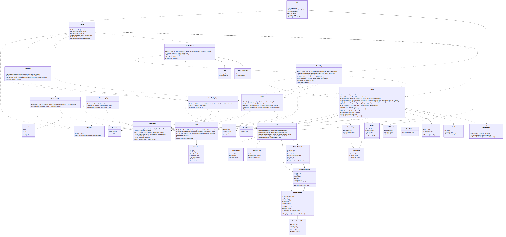

# srv-keys（サーバー側・業務。MLS の配送サービスと認証サービス、鍵の運搬）

## 受ける節

- [第12章 5.2 群の暗号（MLS）](../../../../docs/jp/design/12_基本設計書_データと暗号化.md#52-群の暗号mls) のサーバーが持つもの
  - KeyPackage の保管と確かめ、Commit の直列化と読み取り（leaf の記録）、Welcome の中継
  - 暗号文の外形の検査、端末宛メールボックスの署名、認証サービス、休眠の leaf
- [第12章 5.3 端末の鍵（DD-12-3）](../../../../docs/jp/design/12_基本設計書_データと暗号化.md#53-端末の鍵dd-12-3)（`device_sig`、`user_sig` の対象、credential の形）
- [第12章 5.4 鍵バンドルと回復（DD-12-4、DD-12-5）](../../../../docs/jp/design/12_基本設計書_データと暗号化.md#54-鍵バンドルと回復dd-12-4dd-12-5)（コピーの保管、`S` の版、回復コードの照合の値、秘密分散の断片、家族回復鍵の公開部と使用の知らせ、`S` の交代）
- [第12章 5.5 新しい端末の参加（第3章と往復）](../../../../docs/jp/design/12_基本設計書_データと暗号化.md#55-新しい端末の参加第3章と往復)（未承認の端末の制約と期限、子の保護者の承認）
- [第12章 5.6 鍵のバックアップ（履歴）（DD-12-6）](../../../../docs/jp/design/12_基本設計書_データと暗号化.md#56-鍵のバックアップ履歴dd-12-6)（鍵のバックアップの保管）
- [第12章 9 消すこと（DD-12-13、R-12-6-1）](../../../../docs/jp/design/12_基本設計書_データと暗号化.md#9-消すことdd-12-13r-12-6-1) の鍵の破棄（抹消・取り消し）
- [第12章 12 データの形式（本章が定めるもの）](../../../../docs/jp/design/12_基本設計書_データと暗号化.md#12-データの形式本章が定めるもの)（`fkb/1`、`fkb-history/1`、`fdev/1`、`fusr/1`）
- [第12章 13 失敗の扱い](../../../../docs/jp/design/12_基本設計書_データと暗号化.md#13-失敗の扱い) の Commit の拒みと版の失敗
- [第2章 5.4 端末と鍵の運搬（第3章、第12章）](../../../../docs/jp/design/02_基本設計書_境界.md#54-端末と鍵の運搬第3章第12章)（端末と鍵の運搬の経路）
- [第2章 5.5 トーク（第4章）](../../../../docs/jp/design/02_基本設計書_境界.md#55-トーク第4章) のうち `/rooms/{id}/mls/*`
- [第2章 4.3 認可の 3 つの基本](../../../../docs/jp/design/02_基本設計書_境界.md#43-認可の-3-つの基本)（未承認の端末は `KEY-004`）
- [第2章 9.2 エラーコード表の初期の項目（api/errors.yaml の正本。本章は番号と意味）](../../../../docs/jp/design/02_基本設計書_境界.md#92-エラーコード表の初期の項目apierrorsyaml-の正本本章は番号と意味) の KEY-001〜011
- [第3章 4.4 新しい端末の追加（DD-3-7）](../../../../docs/jp/design/03_基本設計書_認証_構成員_端末.md#44-新しい端末の追加dd-3-7)（承認の鍵の側。子の端末の鍵の承認は保護者が通した端末だけ）
- [第3章 5.1 端末の状態](../../../../docs/jp/design/03_基本設計書_認証_構成員_端末.md#51-端末の状態)（承認済み・休眠）
- 全体実装設計書 3.1（回復の求め、MLS のグループ）、4.2、4.3、I-4、I-11、I-12

## 依存

- 下：
  - [srv-common](srv-common.md)
  - [srv-store](srv-store.md)（`Pool`、`Querier`、`Tx`、`Feed`、`RoomLock`、`Retention`）
    - `Retention` は KeyPackage とメールボックスの期限の掃除に使い、`New` の中で `Pool` から作る
  - [srv-identity](srv-identity.md)
    - `Devices` の状態の操作：`Approve`、`MarkDormant`、`MarkActive`、`LockShared`
    - `Devices` の読み：`Get`・`OfUser`・`NameOf`・`ApprovedSeenBefore`・`GuardianCleared`
    - `Users`（`Get`、`FamilyIds`、`AdminIds`）、`Families`（`Get`、`SetRecoveryPub`）
    - `Guardians`（`Settings`、`RequestApproval`）、`Passkeys.OwnerOf`
    - 読みは全部 q を受ける形で呼ぶ。トランザクションの中ではそのトランザクションを渡す（全体実装設計書 2.4 のトランザクションの中の読み）
    - `Hooks` への登録と `Hooks.Notify`
- 部品：なし。暗号は Go の標準の `crypto/ecdsa`、`crypto/ecdh`、`crypto/sha256`、`crypto/subtle` だけ。MLS の部品は持たない。MLS の物（KeyPackage、Commit、Welcome、本文の外側）は、RFC 9420 の TLS 符号化を読む自前の最小の parser（`CommitReader`）で読む。暗号文は読まない。Argon2id は計算しない（照合の値は端末が作り、サーバーは保存した値と定数時間で比べる。第12章 5.4 (b)）。
- 依存の逆転：
  - srv-identity の `DeviceKeyReader`（端末の署名の確かめ。第12章 5.3）を実装する。端末の承認の有無は srv-identity の devices.state が正で、本ブロックは持たない。
  - srv-identity の hook の 6 つに登録する。登録は `Keys.Register` が組み立ての中で 1 回行う。
    - `OnDeviceRevoked`、`OnUserSuspended`、`OnUserErased`
    - `OnUserDeleted`、`OnPasskeyDeleted`、`OnPasskeyReset`
  - 知らせ（第7章 9 の recovery_used、family_key_used、recovery_requested）は srv-identity `Hooks.Notify` から出す。srv-push は本ブロックの上で直に呼べない。
  - srv-rooms との向き：本ブロックは srv-rooms を呼ばない。srv-rooms が本ブロックの `Groups` を呼ぶ（作成、送信の時の確かめ、`/rooms/{id}/mls/*` の 5 操作）。
  - トークの一覧と構成員は `RoomReader` で読む。本ブロックが定め、srv-rooms が実装して組み立ての後に `Keys.SetRooms` で渡す。使い道は、端末の追加待ちを立てるトーク、Commit の Add の端末が構成員の物かの確かめ、`room.mls`・`room.member` の宛先。
  - 家族全員のトークへの記録（第7章 9 の経路「トーク」）は、srv-push の OnNotice が `FamilyRoom.Flow` で行う。本ブロックは `Hooks.Notify` を呼ぶだけ。

## クラス図

```mermaid
classDiagram
  class Keys {
    +New(deps) Keys
    +SetRooms(rooms RoomReader)
    +Register(identity)
    +Ready() Result
    +Apis() KeysApi
    +Reader() DeviceKeyReader
  }
  class RoomReader {
    <<interface>>
    +RoomsOf(ctx, tx, userId) [RoomId]
    +MembersOf(ctx, tx, roomId) [UserId]
    +IsMemberOrPending(ctx, tx, roomId, userId) bool
  }
  class UserSigningKeys {
    +Put(tx, userId, byDevice, pub JWK, deviceSigs [DeviceSig]) Result~Fusr, Event~
    +Get(ctx, q, userId) Option~Fusr~
    +Version(ctx, q, userId) int
  }
  class DeviceSig {
    +DeviceId Uuid
    +UserSig []byte
  }
  class DeviceKeys {
    +Put(tx, userId, deviceId, sigPub, kemPub, credential) Result~Fdev, Event~
    +Approve(tx, userId, byDevice, deviceId, userSig) Result~Fdev, Event~
    +Get(ctx, q, deviceId) Option~Fdev~
    +ListOfUser(ctx, q, userId, approvedOnly) [Fdev]
    +VerifyProof(ctx, q, deviceId, message, sig) Result~bool~
    +VerifyUserSig(fdev, fusr) bool
    +Revoke(tx, deviceId)
  }
  class KeyPackages {
    +Push(tx, deviceId, packages [bytes], lastResort Option~bytes~) Result~int, Event~
    +Count(ctx, deviceId) KeyPackageCount
    +Take(tx, userId, deviceId) Result~Taken, Event~
    +PruneExpired(ctx) int
    +DeleteAll(tx, deviceId)
  }
  class KeyPackageCount {
    +Count int
    +LastResort bool
  }
  class Taken {
    +Package []byte
    +LastResort bool
  }
  class KeyBundles {
    +Put(tx, userId, byDevice, kind, targetId, fkb) Result~Event~
    +List(ctx, userId) [BundleMeta]
    +Get(ctx, q, userId, kind, targetId) Result~Fkb, Event~
    +Delete(tx, userId, byDevice, kind, targetId) Result~Event~
    +DeleteAllOfUser(tx, userId)
    +DeleteOfDevice(tx, deviceId)
    +DeleteOlderVersions(tx, userId, version)
  }
  class RecoveryCode {
    +PutVerifier(tx, userId, byDevice, verifier, params RecoveryParams) Result~Event~
    +Verify(tx, userId, deviceId, verifier) Result~Fkb, Event~
  }
  class RecoveryParams {
    +M int
    +T int
    +P int
    +Salt []byte
  }
  class Shares {
    +ShareFor(ctx, q, requestId, holderDevice) Result~Fkb, Event~
    +Holders(ctx, q, ownerUserId) [UserId]
    +Request(tx, requesterDevice) Result~RecoveryRequest, Event~
    +Approve(tx, holderDevice, requestId, ciphertext, sig) Result~Event~
    +Expire(ctx) int
  }
  class FamilyRecoveryKey {
    +Public(ctx) Result~PublicKey, Event~
    +SetPublic(tx, pub, by) Result~Version, Event~
    +Use(tx, userId, deviceId) Result~Fkb, Event~
  }
  class KeyBackup {
    +Put(tx, userId, groupId, epoch, fkbHistory) Result~bool, Event~
    +Replace(tx, userId, groupId, epoch, fkbHistory) Result~Event~
    +ListSince(ctx, userId, pos, limit) Result~KeyBackupEntry list and hasMore~
    +DeleteAllOfUser(tx, userId)
  }
  class Inbox {
    +Put(tx, fromDevice, toDevice, kind, ciphertext, sig) Result~Uuid, Event~
    +PutWelcome(tx, fromDevice, toDevice, welcome) Result~Uuid, Event~
    +ListSince(ctx, deviceId, pos, limit) Result~InboxItem list and hasMore~
    +Delete(tx, deviceId, id)
    +Prune(ctx) int
    +DeleteAllOfDevice(tx, deviceId)
  }
  class InboxItem {
    +Id Uuid
    +Kind string
    +FromDevice Uuid
    +Ciphertext []byte
    +Sig Option~[]byte~
    +Pos int64
    +CreatedAt Time
  }
  class Groups {
    +Create(tx, roomId, creatorDevice)
    +Epoch(ctx, roomId) Result~EpochInfo, Event~
    +CommitsSince(ctx, roomId, sinceEpoch, limit) Result~CommitPage, Event~
    +Commit(tx, roomId, byDevice, expectedEpoch, commit, welcome Option) Result~CommitResult, Event~
    +Reject(tx, roomId, byDevice, generation, epoch Option, commitRef Option, reason) Result~RejectResult, Event~
    +Reinit(tx, roomId, byDevice) Result~ReinitResult, Event~
    +CheckSender(ctx, q, roomId, device, body EventMls) Result~Event~
    +Leaves(ctx, q, roomId) [Leaf]
    +DormantLeafs(ctx, olderThan) [RoomDevice]
    +RetireDormant(tx, deviceId, olderThan)
    +RemoveLeafsOfDevice(tx, deviceId)
    +RequestAdd(tx, deviceId) int
    +PendingDevices(ctx) [PendingDevice]
  }
  class CommitReader {
    +ParseCommit(bytes) Result~ParsedCommit, Event~
    +ParseWelcome(bytes) Result~ParsedWelcome, Event~
    +ParseKeyPackage(bytes) Result~ParsedKeyPackage, Event~
    +ParsePrivateHeader(bytes) Result~PrivateHeader, Event~
    +KeyPackageRef(keyPackage bytes) []byte
  }
  class ParsedCommit {
    +GroupId []byte
    +Epoch int64
    +SenderLeaf int
    +Adds [ParsedKeyPackage]
    +Removes [int]
    +Updates int
    +Path Option~ParsedLeafNode~
  }
  class ParsedKeyPackage {
    +Bytes []byte
    +Ref []byte
    +Version int
    +Suite int
    +InitKey []byte
    +Leaf ParsedLeafNode
    +VerifySignature(pub) bool
  }
  class ParsedLeafNode {
    +EncryptionKey []byte
    +SigPub []byte
    +Credential []byte
    +UserId Uuid
    +DeviceId Uuid
    +Source int
    +NotBefore uint64
    +NotAfter uint64
    +Capabilities ParsedCapabilities
    +VerifySignature(pub, groupId, leafIndex) bool
  }
  class ParsedCapabilities {
    +Versions [int]
    +Suites [int]
    +Extensions [int]
    +Proposals [int]
    +Credentials [int]
  }
  class PendingDevice {
    +RoomId Uuid
    +DeviceId Uuid
    +Kind string
    +Since Time
  }
  class ParsedWelcome {
    +Suite int
    +NewMembers [[]byte]
    +KemOutputs [[]byte]
  }
  class PrivateHeader {
    +GroupId []byte
    +Epoch int64
    +ContentType int
  }
  class Leaf {
    +Index int
    +DeviceId Uuid
    +EncryptionKey Option~bytes~
  }
  class CommitItem {
    +Epoch int64
    +Commit []byte
    +CommitRef string
  }
  class CommitPage {
    +Generation int
    +Items [CommitItem]
    +HasMore bool
  }
  class RoomDevice {
    +RoomId Uuid
    +DeviceId Uuid
  }
  class CommitResult {
    +Epoch int64
    +CommitRef string
    +Added [DeviceId]
    +Removed [DeviceId]
  }
  class RejectResult {
    +ReinitAllowedAt Time
  }
  class ReinitResult {
    +Generation int
    +GroupId []byte
    +Epoch int64
  }
  class Group {
    +RoomId Uuid
    +Generation int
    +Epoch int64
    +Suite int = 2
    +LastCommitAt Time
  }
  class Recovery {
    +Order() [string]
    +NotifyUsed(tx, userId, deviceId, method, result)
  }
  class Hooks {
    +OnDeviceRevoked(tx, deviceId)
    +OnUserSuspended(tx, userId)
    +OnUserErased(tx, userId)
    +OnUserDeleted(tx, userId, eraseContent)
    +OnPasskeyDeleted(tx, userId, credId)
    +OnPasskeyReset(tx, userId, deviceId)
  }
  Keys --> RoomReader
  Keys ..> Hooks
  UserSigningKeys --> DeviceSig
  UserSigningKeys ..> DeviceKeys
  UserSigningKeys ..> KeyBundles
  DeviceKeys ..> UserSigningKeys
  DeviceKeys ..> Groups
  DeviceKeys ..> Shares
  Groups ..> RoomReader
  Groups ..> CommitReader
  Groups --> Leaf
  Groups --> CommitResult
  Groups --> RejectResult
  Groups --> ReinitResult
  Groups --> Group
  Groups ..> Inbox
  Groups ..> DeviceKeys
  Groups ..> KeyBundles
  Groups --> CommitItem
  Groups --> CommitPage
  CommitPage --> CommitItem
  Groups --> RoomDevice
  CommitReader --> ParsedCommit
  CommitReader --> ParsedKeyPackage
  CommitReader --> ParsedWelcome
  CommitReader --> PrivateHeader
  ParsedCommit --> ParsedKeyPackage
  ParsedCommit --> ParsedLeafNode
  ParsedKeyPackage --> ParsedLeafNode
  ParsedLeafNode --> ParsedCapabilities
  KeyPackages --> KeyPackageCount
  KeyPackages --> Taken
  RecoveryCode --> RecoveryParams
  Groups --> PendingDevice
  KeyPackages ..> CommitReader
  KeyPackages ..> DeviceKeys
  KeyBundles ..> DeviceKeys
  KeyBundles ..> UserSigningKeys
  RecoveryCode ..> KeyBundles
  Shares ..> Inbox
  Shares ..> KeyBundles
  FamilyRecoveryKey ..> KeyBundles
  FamilyRecoveryKey ..> Recovery
  KeyBackup ..> UserSigningKeys
  RecoveryCode ..> Recovery
  Shares ..> Recovery
  Inbox --> InboxItem
  Inbox ..> DeviceKeys
  Hooks ..> DeviceKeys
  Hooks ..> KeyBundles
  Hooks ..> Groups
  Hooks ..> KeyPackages
  Hooks ..> Inbox
  Hooks ..> RecoveryCode
  Hooks ..> Shares
  Hooks ..> KeyBackup
  Hooks ..> UserSigningKeys
  Hooks ..> Recovery
```

図の元の文（mermaid）

クラス図の注記（図の各メンバーの説明。仕様の節と番号を含む）

|クラス|メンバー|注記|
|---|---|---|
|Keys|`+New(deps) Keys`|本ブロックの部品を束ねる（図の UserSigningKeys から Hooks までの 12 の部品を欄に持つ）。Deps は srv-store（Pool、Feed、RoomLock）、srv-common（Ids、Clock）、srv-identity（Identity）|
|Keys|`+SetRooms(rooms RoomReader)`|srv-rooms の実装を組み立ての後に渡す（srv-rooms は本ブロックの上）|
|Keys|`+Register(identity)`|srv-identity の hook に 6 つを登録する（Hooks の行）。組み立ての中で 1 回|
|Keys|`+Ready() Result`|RoomReader の無い組み立ては Fault（起動しない）|
|Keys|`+Apis() KeysApi`|生成のタグ keys の 22 操作の実装|
|Keys|`+Reader() DeviceKeyReader`|srv-identity `DeviceKeyReader` の実装（`VerifyProof`、`SigningKeys`、`DevicesOf`、`KeysOf`）。`Identity.SetKeys` に渡す|
|RoomReader|`+RoomsOf(ctx, tx, userId) [RoomId]`|srv-rooms が実装。本人が active か pending_add の構成員のトーク（端末の追加待ちを立てる先）|
|RoomReader|`+MembersOf(ctx, tx, roomId) [UserId]`|srv-rooms が実装。`room.mls` と `room.member` の宛先（active、pending_add、pending_remove の構成員）|
|RoomReader|`+IsMemberOrPending(ctx, tx, roomId, userId) bool`|srv-rooms が実装。Commit の Add の端末の本人が、そのトークの active か pending_add の構成員か（第12章 5.2 の Commit の確かめ）|
|UserSigningKeys|`+Put(tx, userId, byDevice, pub JWK, deviceSigs [DeviceSig]) Result~Fusr, Event~`|`PUT /me/signing-key`（第2章 5.4、第12章 5.4 の `S` の交代）。JWK が P-256 の点でなければ KEY-009。初回（行が無い）：version 1 で置く。deviceSigs は空でなければ KEY-009（初回の前に承認済みの端末は無い。自己承認は `/approve`）。置き換え：byDevice が承認済みでなければ KEY-004。本人の全端末の `device_keys` の行の錠を識別子の順に取り、その後に端末の状態を読む（同時の承認と交代を直列にする。承認は `device_keys` の行の錠の後に `user_sig` を確かめる）。承認済みと休眠の全端末（`device_keys` の行がある物）が deviceSigs に 1 つずつあり、全部の `user_sig` が新しい公開部で第12章 5.3 の対象に対して通る時だけ、`device_keys.user_sig` を全部置き換え、KeyBundles.DeleteOlderVersions（新しい版より小さい全系統のコピー）、`user_signing_keys` の pub を置き換え、version を 1 増やし、rotated_at を置く。欠けるか通らなければ KEY-003（何も変えない）。知らない端末や承認済み・休眠でない端末の deviceSigs は KEY-001。同じ端末が 2 つあれば KEY-009。置き換えの後、家族の全員に `user.changed`（fields に signing_key）、本人の全端末に `keybundle.changed`（kinds は 5 つ全部）。錠は device_keys（端末の識別子の順）、keybundles、user_signing_keys の順|
|UserSigningKeys|`+Get(ctx, q, userId) Option~Fusr~`|fusr/1（version を含む）。DeviceKeyReader.SigningKeys の元。q は ctx のトランザクションか Pool（トランザクションの中ではそれを渡す。全体実装設計書 2.4）|
|UserSigningKeys|`+Version(ctx, q, userId) int`|今の `S` の版。行が無ければ 0。KeyBundles.Put と KeyBackup.Put が `key_version` と比べる（KEY-011）|
|DeviceSig|`+UserSig []byte`|r と s の 64 バイト（base64url を解いた後）|
|DeviceKeys|`+Put(tx, userId, deviceId, sigPub, kemPub, credential) Result~Fdev, Event~`|`PUT /me/devices/{id}/keys`。fdev/1 を未承認で登録（既にあれば置き換えない。KEY-002 ではなく同じ物を返す）。credential が第12章 5.3 の 35 バイト（basic、identity は本人と端末の識別子の 16 バイトずつ）と一致しなければ KEY-009。JWK が P-256 の点でなければ KEY-009。端末が無ければ KEY-001。既に登録があり、鍵と credential が要求と同じなら置き換えず同じ物を返す。違えば KEY-009（端末の保存が消えた端末は新しい端末としてログインし直す。第8章 8。盗まれたセッションによる鍵の差し替えも防ぐ）。署名鍵か鍵合意鍵の公開部が他の端末の署名鍵か鍵合意鍵に登録済みなら KEY-009（第12章 5.3。MLS の木の signature_key の一意をこの登録が担う）。JWK は点から組み直した正規の形（crv、kty と 2 つの座標）で置き、同じ鍵が同じ値になる（`device_keys` の 2 つの一意の索引が同時の登録の重なりを拒む）|
|DeviceKeys|`+Approve(tx, userId, byDevice, deviceId, userSig) Result~Fdev, Event~`|`POST /me/devices/{id}/approve`。次の順。1. 錠を取らずに読む：対象の端末が本人の物（違えば KEY-001）。対象が承認済みか休眠なら KEY-002、取り消し済み・期限切れなら KEY-001（3 と同じ番号を先に返し、承認の要らない端末に保護者への求めを出さない）。他の端末の承認（byDevice ≠ deviceId）は byDevice が承認済みの時だけ（KEY-003。再認証は操作の実装）。自己承認（第12章 5.5 の 2）は未承認でも可。2. 子ども区分で Guardians.Settings の端末の追加の承認が有効で、Devices.GuardianCleared(deviceId) が偽なら、別のトランザクションで Guardians.RequestApproval(child, device, deviceId) を確定してから MEM-006（第3章 4.4。open の求めがあれば新しい求めは出さない）。錠を持つ前に行う（別のトランザクションが外部キーで devices の行を指すので、要求のトランザクションが devices の行の錠を持っていると待ち合う）。3. Devices.Approve(deviceId, by = 本人)（devices の行の錠。二重は KEY-002、取り消し済み・期限切れ・無しは KEY-001。device.changed(approved) を書く）。4. `device_keys` の行の錠（無ければ KEY-001）。錠の後に本人の署名鍵の公開部（fusr/1。無ければ KEY-003）を読み、userSig を第12章 5.3 の対象に対して確かめる（通らなければ KEY-003）。user_sig と approved_at（署名の時刻の記録）を置く。5. その端末の open の回復の求めを expired にする（承認で要らなくなる）。6. Groups.RequestAdd（端末の追加待ち。第12章 5.5 の 4）|
|DeviceKeys|`+Get(ctx, q, deviceId) Option~Fdev~`|fdev/1。q は ctx のトランザクションか Pool|
|DeviceKeys|`+ListOfUser(ctx, q, userId, approvedOnly) [Fdev]`|approvedOnly が真なら承認済みと休眠の端末だけ（/users/{id}。E2EE の送信先。srv-identity DeviceKeyReader.DevicesOf の実装）。偽なら登録のある全端末（未承認を含む。取り消した端末の鍵は Revoke で消えている。srv-identity DeviceKeyReader.KeysOf の実装：`GET /me/devices` の keys。既存の端末が承認の前に新しい端末の鍵の指紋を求める。第3章 4.4）。指紋は端末が第12章 5.3 の定義で求め、本ブロックは求めない。q は ctx のトランザクションか Pool（トランザクションの中ではそれを渡す。全体実装設計書 2.4）|
|DeviceKeys|`+VerifyProof(ctx, q, deviceId, message, sig) Result~bool~`|srv-identity DeviceKeyReader の実装。fdev/1 の署名鍵の公開部で ECDSA P-256（SHA-256、r と s の 64 バイト）を確かめる。公開鍵が無ければ false。DB の読みの失敗は error。q は ctx のトランザクションか Pool（トランザクションの中ではそれを渡す。全体実装設計書 2.4）。srv-identity LoginVerify はトランザクションの中から呼ぶ|
|DeviceKeys|`+VerifyUserSig(fdev, fusr) bool`|第12章 5.3 の `user_sig` の対象を組み立てて確かめる（Approve と UserSigningKeys.Put が使う）。対象の欄は全部 fdev にあり、記録は読まない。fdev の `user_sig` が無いか、鍵が P-256 の点でなければ偽|
|DeviceKeys|`+Revoke(tx, deviceId)`|hook から。行を消す|
|KeyPackages|`+Push(tx, deviceId, packages [bytes], lastResort Option~bytes~) Result~int, Event~`|`POST /me/devices/{id}/keypackages`（戻りは使い切りの数。応答の `{count}`）。各要素を CommitReader.ParseKeyPackage で読み、第12章 5.2「KeyPackage の保管」の 9 つの確かめ（版 mls10、スイート 0x0002、credential がその端末の物、signature_key が登録した署名鍵の SEC 1 の非圧縮の形、leaf_node_source が key_package、KeyPackage の署名、leaf の署名（文脈なし）、encryption_key と init_key の形（P-256 の公開鍵。SEC 1 の非圧縮の 65 バイトで曲線の上、無限遠点でない。RFC 9180 7.1.1・7.1.4）と違い、capabilities（mls10、0x0002、basic。既定でない拡張の種類が capabilities にある）、有効期間）を行う。有効期間は、全長が 120 日以下、not_before が今 + 1 日より前、not_after が今 + 7 日より後。1 つでも通らなければ KEY-009 で全部を拒む。最大 20 + 最後の手段 1。超えたら古い物から消して 20 にする（誤りにしない）。最後の手段は 1 つで、新しい物が来たら置き換える。期限は、置いた時から 90 日と not_after の 1 日前の早い方。主キーの `ref` は KeyPackageRef（RFC 9420 5.2。MLSMessage の頭 4 バイトを除いた KeyPackage の符号化に対する `RefHash("MLS 1.0 KeyPackage Reference", 値)`。スイート 0x0002 なので SHA-256。ラベルと値を可変長のベクタで符号化してから求める）。同じ端末の同時の Push は `device_keys` の行の錠で直列にする（上限の数え方が崩れないため）。端末が無いか鍵が未登録なら KEY-001|
|KeyPackages|`+Take(tx, userId, deviceId) Result~Taken, Event~`|`POST /users/{uid}/devices/{did}/keypackage`。取り出しと削除を同じ tx（I-11。`FOR UPDATE SKIP LOCKED`）。経路の uid の構成員が無ければ MEM-001。did が uid の端末でないか、承認済みか休眠でなければ KEY-001。尽きたら最後の手段を返し（Taken.LastResort が真）、応答に KEY-006 の警告を添える（最後の手段は消さない。RFC 9420 16.8）。使い切りも最後の手段も無ければ KEY-001（未登録の公開鍵。第12章 13 の「端末がオンラインになるまで Add を保留」）。取り出しのレート制限は置かない（RFC 9420 16.8 は特に認証の無い要求に求める。本システムは承認済みの家族の端末だけが取り出し、最後の手段が尽きない）|
|KeyPackages|`+Count(ctx, deviceId) KeyPackageCount`|`GET /me/devices/{id}/keypackages`。期限の内の使い切りの数と、最後の手段の有無|
|KeyPackages|`+PruneExpired(ctx) int`|期限（置いてから 90 日）を過ぎた行を消す（srv-worker PruneHandler）。戻りは消した数|
|KeyPackages|`+DeleteAll(tx, deviceId)`|その端末の行を全部消す（hook OnDeviceRevoked）|
|KeyPackageCount|`+Count int`|使い切りの KeyPackage の数（最後の手段を含まない）。`GET /me/devices/{id}/keypackages` の `{count, last_resort}`|
|KeyBundles|`+Put(tx, userId, byDevice, kind, targetId, fkb) Result~Event~`|`PUT /me/keybundle/{kind}/{target}`。fkb/1。kind は device、recovery-code、share、family、prf のいずれか。承認済みの端末だけ。対象は kind device なら要求した端末自身、share なら片を持つ構成員（本人以外）の承認済みか休眠の端末（違えば KEY-001）、recovery-code と family は `self`、prf は本人の資格情報で PRF が使える物（`Passkeys.OwnerOf`。違えば KEY-009）。本文の `user_id`、`kind`、`target_id` が経路と違えば KEY-009。`key_version` が UserSigningKeys.Version と違えば KEY-011（params.version に今の版）。`created_at` はサーバーの時刻で置き換える。再認証は kind recovery-code の置き換え（回復コードの再発行）だけ。本人の他の端末に `keybundle.changed`。形の確かめ（違えば KEY-009）：alg は kind device・recovery-code・prf が A256GCM、share・family が HPKE-P256（第12章 5.4 の系統の表）。kdf は kind recovery-code だけが持ち、その時は本人の回復コードの照合の値の行（recovery_codes）があり params が同じ。share は kind share だけが持つ。share.index は、同じ持ち主の既にある片のうち、同じ構成員の端末の片と同じ番号で、別の構成員の片と違う番号（違う 2 人が同じ番号の片を持つと、2 人の承認で `S` が戻らない）|
|KeyBundles|`+List(ctx, userId) [BundleMeta]`|`GET /me/keybundle`。本人のコピーの系統、対象、版、作成日（中身は返さない。生成の `KeyBundleCopy`）|
|KeyBundles|`+Get(ctx, q, userId, kind, targetId) Result~Fkb, Event~`|`GET /me/keybundle/{kind}/{target}`。規則 prf_or_approved（kind=prf は未承認の端末にも返す。他は承認済みの端末だけ、違えば KEY-004）は操作の実装（タグ keys の `getMyKeyBundle`）が端末の状態を読んで判定する。無ければ KEY-005。kind prf を未承認の端末へ返す時は回復 (e) の使用で、操作の実装が同じトランザクションで Recovery.NotifyUsed(userId, 要求した端末, prf, success) を書く（渡したことを使用と数える。承認済みの端末には書かない。第12章 5.4 (e)、H-12-17）。q は ctx のトランザクションか Pool（トランザクションの中ではそれを渡す。全体実装設計書 2.4）（使用の知らせと同じトランザクションで読む）|
|KeyBundles|`+Delete(tx, userId, byDevice, kind, targetId) Result~Event~`|`DELETE /me/keybundle/{kind}/{target}`（再認証）。無ければ KEY-005。kind device は byDevice（要求した端末）の分だけで、target が byDevice でなければ自分の分として無いので KEY-005。本人の他の端末に `keybundle.changed`|
|KeyBundles|`+DeleteAllOfUser(tx, userId)`|抹消。本人のコピー (a)〜(e) と、本人が置いた片（user_id = 本人の kind share）|
|KeyBundles|`+DeleteOfDevice(tx, deviceId)`|取り消し・休眠：その端末が対象のコピー（kind device のコピー (a) と、その端末へ包んだ kind share の片）を消す|
|KeyBundles|`+DeleteOlderVersions(tx, userId, version)`|`S` の交代：本人の `key_version` が version より小さい全系統の行を消す（第12章 5.4）|
|RecoveryCode|`+PutVerifier(tx, userId, byDevice, verifier, params RecoveryParams) Result~Event~`|`PUT /me/recovery-code`。端末が作った照合の値（第12章 5.4 (b)。32 バイト）と Argon2id の params。初回（行が無い）は未承認の端末でも置ける。置き換え（再発行）は承認済みの端末だけ（KEY-004）で再認証。verifier が 32 バイトでないか、params.salt が本人の識別子の 16 バイトでなければ NET-001（形の誤り）|
|RecoveryCode|`+Verify(tx, userId, deviceId, verifier) Result~Fkb, Event~`|`POST /me/keybundle/recovery-code/verify`。試行の制限は境界のレート制限の policy `recovery`（第2章 9.3。構成員あたり 10 回/日、KEY-008。`useFamilyRecoveryKey` と同じ枠）。保存した照合の値と定数時間で比べる。成功：コピー (b)（無ければ KEY-005）を返し、同じトランザクションで recovery.used(method: recovery-code、success)。失敗（照合の値が無いか合わない）：recovery.used(recovery-code、failure) を別のトランザクションで確定してから（誤りの応答では要求のトランザクションが戻るため）、照合の値が無ければ KEY-005（params.kind recovery-code）、合わなければ KEY-012（第2章 9.2。32 バイトでない値と base64url で解けない値も合わない物）。照合の後にコピー (b) が無ければ KEY-005 で、使用の記録は書かない（渡していない）|
|Shares|`+Holders(ctx, q, ownerUserId) [UserId]`|owner の kind share のコピーの対象の端末の持ち主（承認済みか休眠の端末に限る）を、重複を除いて返す|
|Shares|`+Request(tx, requesterDevice) Result~RecoveryRequest, Event~`|`POST /me/recovery/request`。承認済みの端末は KEY-002。Holders が 2 人に満たなければ KEY-005（params.kind share）。本人の open の求めがあればそれを返す（冪等）。無ければ recovery_requests に open で置き（24 時間）、`recovery.request` を Holders の全端末へ（宛先の端末は持たない）、知らせ recovery_requested（params に request_id、user_id、name、device_name（Devices.NameOf）、expires_at）を Hooks.Notify で Holders の各人へ（Audience self、UserId はその人。1 人に 1 回。srv-push は self をその人に解く）|
|Shares|`+Approve(tx, holderDevice, requestId, ciphertext, sig) Result~Event~`|`POST /recovery/{request_id}/approve`。求めの行の錠。無いか open でないか期限切れなら AUTH-007。規則 share_holder（holderDevice の構成員が Holders にある）は本操作が判定し、違えば AUTH-007（他人の求めの有無を漏らさない）。求めた端末が未承認でないか、鍵の登録が無ければ AUTH-007（片を包めない）。holderDevice の持ち主が既に recovery_approvals にあれば何もしない（同じ構成員の別の端末を含む。冪等）。無ければ Inbox.Put（kind share、from = holderDevice、to = 求めた端末、署名は要求の sig。件数の上限は掛けない）と recovery_approvals に 1 行。行の数が 2 で approved にし、Recovery.NotifyUsed(method: share、success)|
|Shares|`+ShareFor(ctx, q, requestId, holderDevice) Result~Fkb, Event~`|`GET /recovery/{request_id}/share`。求めの行を読む。無いか open でないか期限切れなら AUTH-007。holderDevice の持ち主が Holders(求めた本人) に無ければ AUTH-007（規則 share_holder。Approve と同じ判定）。keybundles の (求めた本人, share, holderDevice) の行の fkb/1 を返す。無ければ KEY-005（params.kind share）。承認する端末はこのコピーを開いて片を得る（第12章 5.4 (c)。web-crypto Recovery.approveShare）|
|Shares|`+Expire(ctx) int`|open で期限を過ぎた求めを expired に（srv-worker PruneHandler）。知らせは出さない（新しい端末の画面で分かる）|
|FamilyRecoveryKey|`+Public(ctx) Result~PublicKey, Event~`|`/family/recovery-key/public`。srv-identity `Families.Get` の公開部と版。無ければ KEY-005（params.kind family）|
|FamilyRecoveryKey|`+SetPublic(tx, pub, by) Result~Version, Event~`|初回と作り直し（/admin/family/recovery-key/rotate。srv-admin から）。公開部は srv-identity の表 `families` にあるので `Families.SetRecoveryPub`（版を 1 増やす）を呼ぶ。古いコピー (d)（kind family の全行）を消し、全員に keybundle.changed(kinds: [family])。JWK が P-256 の点でなければ KEY-009|
|FamilyRecoveryKey|`+Use(tx, userId, deviceId) Result~Fkb, Event~`|`POST /family/recovery-key/use`（本文なし）。本人のコピー (d) を返す（無ければ KEY-005）。返すことを使用と数え、同じトランザクションで Recovery.NotifyUsed(method: family、success)（全員へ。第12章 5.4 (d)、H-12-17）。試行の制限は境界の policy `recovery`|
|KeyBackup|`+Put(tx, userId, groupId, epoch, fkbHistory) Result~bool, Event~`|`PUT /me/keybackup/{group_id}/{epoch}`。groupId は base64url を解いて 20 バイト（グループの識別子。第12章 5.2）でなければ KEY-009。本文の user_id、group_id、epoch が経路と違えば KEY-009。`key_version` が今の版と違えば KEY-011。既にあれば 204（上書きしない。戻りは偽）|
|KeyBackup|`+ListSince(ctx, userId, pos, limit) Result~KeyBackupEntry list and hasMore~`|`/me/keybackup?since=&limit=`。要素は `{pos, backup}`（pos は表の `pos bigserial`。端末の次の since。第2章 3、5.4）。limit + 1 件を読んで has_more を決める|
|KeyBackup|`+Replace(tx, userId, groupId, epoch, fkbHistory) Result~Event~`|`PUT ...?rewrap=true`（G-19）。鍵バンドルの作り直し（S'）の後に本人が再認証して行を置き換える。`key_version` が今の版と違えば KEY-011。pos を新しく振り、本人の他の端末が since で取り直す|
|KeyBackup|`+DeleteAllOfUser(tx, userId)`|抹消で本人の行を全部消す（hook OnUserErased）|
|Inbox|`+Put(tx, fromDevice, toDevice, kind, ciphertext, sig) Result~Uuid, Event~`|`POST /devices/{did}/inbox` と、本ブロック（Shares.Approve）と srv-rooms の中から。`welcome` は端末から来ない（要求の kind の列挙に無く、境界の形の検査で NET-001）。中から welcome か share を渡すのはプログラムの誤り（Fault。welcome は PutWelcome、share は Shares.Approve が内の置き方で置く。どちらも要求の kind の列挙に無い）。sig を fromDevice の登録した署名鍵で第12章 5.2 の対象（`ft.inbox/1`、0、kind、0、from、to、暗号文）に対して確かめ、通らなければ KEY-009。暗号文が 64 KiB を超えれば KEY-009。1 端末 1,000 件で KEY-010。device.inbox{count} を toDevice の持ち主の feed に、宛先の端末 = toDevice で書く（その端末にだけ届く。全体実装設計書 2.4。count はその端末の件数）。30 日。1 端末 1,000 件の上限（KEY-010）は `POST /devices/{did}/inbox` の経路だけに掛ける。本ブロックの中の Put（Shares.Approve）と PutWelcome は掛けない（数は片を持つ構成員とトークの数で決まり、上限で止めると回復と参加が止まる）。kind keybundle の宛先は送り手と同じ構成員の端末だけ（第12章 5.2 の表。違えば KEY-009）。宛先の端末に鍵の登録が無いか、取り消し済み・期限切れなら KEY-001|
|Inbox|`+PutWelcome(tx, fromDevice, toDevice, welcome) Result~Uuid, Event~`|Groups.Commit から。kind welcome、署名は無し（第12章 5.2。Welcome の GroupInfo の署名で守られる）。件数の上限は掛けない（Put の注記）。device.inbox は Put と同じ|
|Inbox|`+ListSince(ctx, deviceId, pos, limit) Result~InboxItem list and hasMore~`|`/me/inbox?since=&limit=`。pos は表の `pos bigserial`（第2章 3）。limit + 1 件を読んで has_more を決める|
|Inbox|`+Delete(tx, deviceId, id)`|`DELETE /me/inbox/{id}`（受け取ったら消す）。その端末宛ての物だけ。無ければ何もしない（DELETE の冪等）|
|Inbox|`+Prune(ctx) int`|期限（30 日）を過ぎた項目を消す（srv-worker PruneHandler）。戻りは消した数|
|Inbox|`+DeleteAllOfDevice(tx, deviceId)`|その端末宛ての項目と、その端末が送った項目を全部消す（hook OnDeviceRevoked。送り手の鍵が消えるので、受け手は署名を確かめられない）|
|InboxItem|`+Kind string`|第12章 5.2 の表の種類（welcome、keybundle、key_backup、key_request、share、call_key_request、call_key、sticker_remove_request）。表に無い種類は NET-001|
|InboxItem|`+Ciphertext []byte`|HPKE の暗号文（welcome は Welcome の MLSMessage そのもの）|
|InboxItem|`+Sig Option~[]byte~`|welcome だけ無し|
|Groups|`+Create(tx, roomId, creatorDevice)`|世代 0、epoch 0、leaf 0 に creatorDevice（encryption_key は空。作成者の最初の path 付きの Commit で埋まる）（rooms の作成と同じ tx。srv-rooms から。RFC 9420 の作成者は leaf 0）。グループの識別子はトークの識別子の 16 バイトと世代の 4 バイト（第12章 5.2）|
|Groups|`+Epoch(ctx, roomId) Result~EpochInfo, Event~`|`/rooms/{id}/mls/epoch`（srv-rooms が受け、構成員の追加待ち `pending_add` を足して返す）。世代、グループの識別子、epoch、端末の追加待ち・削除待ち・再参加待ち。グループが無ければ ROOM-001|
|Groups|`+CommitsSince(ctx, roomId, sinceEpoch, limit) Result~CommitPage, Event~`|`GET /rooms/{id}/mls/commits?since_epoch=`：現在の世代の mls_commits から sinceEpoch より大きい epoch の順に最大 100（`{epoch, commit, commit_ref}`）と has_more（limit + 1 件を読む）。応答に世代を添える（CommitPage）。世代と項目は 1 つの SQL 文で読む（文ごとに 1 つのスナップショットなので、再初期化と混ざらない）。`room.mls` を受けた端末が取る（第2章 5.5）。グループが無ければ ROOM-001|
|CommitPage|`+Generation int`|現在の世代（応答の `generation`）|
|Groups|`+Reject(tx, roomId, byDevice, generation, epoch Option, commitRef Option, reason) Result~RejectResult, Event~`|`POST /rooms/{id}/mls/reject`（srv-rooms が受ける。第12章 5.2 の復旧の 1）。次の順。1. RoomLock。mls_groups の行（無ければ ROOM-001）。generation が現在の世代でなければ KEY-007。epoch が無ければ現在の epoch、1 以上で現在以下でなければ KEY-009。commitRef があれば、その epoch の mls_commits の commit_ref と同じでなければ KEY-009。byDevice が mls_leaves に無ければ KEY-009。2. mls_rejections に (room, generation, epoch, byDevice, commit_ref, reason, now) を置く（同じ鍵は上書き）。3. mls_pending にその端末の readd を置く（add・remove の行があれば readd に替える）。room.member{user_id: 持ち主, device_id, pending_readd} を MembersOf へ。4. 再初期化を許す時刻を求める。現在の epoch の Commit を作った端末（mls_commits.by_device）以外の全 leaf の端末に現在の epoch の mls_rejections の行があるか、byDevice の現在の世代の行が 2 つ以上なら今。それ以外は now + 10 分。RejectResult{ReinitAllowedAt}|
|Groups|`+Reinit(tx, roomId, byDevice) Result~ReinitResult, Event~`|`POST /rooms/{id}/mls/reinit`（srv-rooms が受ける。第12章 5.2 の復旧の 2）。次の順。1〜3 の判定は、上限の知らせを錠の前に確定するため、錠を取らずに 1 度行い、RoomLock と mls_groups の行の錠の中でもう一度行う（同時の 2 つの求めの分）。1. mls_groups の行（無ければ ROOM-001）。byDevice の readd の行が無ければ KEY-013（not_pending）。2. 許す条件：Reject の 4 と同じ 2 つの即時の条件のどれか、または、byDevice の最新の報告から 10 分が過ぎ、その報告の後に mls_commits の行が増えていない。満たさなければ KEY-013（too_early。params.allowed_at は Reject の 4 の値）。3. mls_reinits の byDevice の 24 時間の行が 2 つ以上なら KEY-013（limit）と、知らせ mls_reinit_limit（Hooks.Notify。別のトランザクションで確定してから返す）。4. 世代を 1 増やす（mls_groups の generation と epoch 0、last_commit_at）。mls_leaves・mls_pending・mls_commits・mls_rejections のそのトークの行を消す。mls_leaves に leaf 0 = byDevice。mls_reinits に (room, 新しい世代, byDevice, now)。5. 入るべき端末：RoomReader.MembersOf の構成員のうち RoomReader.IsMemberOrPending が真の人（active と pending_add）の、承認済みの端末（Devices.OfUser。休眠は含めない）から byDevice を除いた物を mls_pending の add に置く。その端末の devices の行は錠の前に Devices.LockShared で押さえ（同時の取り消しと直列にする）、錠の中で求め直す。room.member{pending_add, device_id} を MembersOf へ。6. room.mls{generation: 新しい世代, epoch: 0, has_welcome_for_me: false} を MembersOf へ（commit_ref は無し）。7. 知らせ mls_reinit（user_id、name、device_name、room_id、generation）。ReinitResult{Generation, GroupId, Epoch: 0}|
|CommitItem|`+Epoch int64`|その Commit で進んだ後の epoch（`mls_commits.epoch`。`room.mls` の epoch と同じ値）|
|CommitItem|`+CommitRef string`|Commit の参照（第12章 5.2。MLSMessage のバイト列の SHA-256 の base64url。`mls_commits.commit_ref`）|
|CommitResult|`+CommitRef string`|同上（`POST /rooms/{id}/mls/commit` の応答と `room.mls` に入れる）|
|Leaf|`+EncryptionKey Option~bytes~`|その leaf の encryption_key（SEC 1 の非圧縮の 65 バイト。置く前に P-256 の点であることを確かめてある。Add の KeyPackage の leaf と path の leaf から更新。作成者の leaf 0 は最初の path 付きの Commit まで空。第12章 5.2 の leaf の記録）|
|Group|`+Generation int`|グループの世代（0 から。再初期化で 1 増える。第12章 5.2）|
|RejectResult|`+ReinitAllowedAt Time`|この端末が再初期化を求めてよい時刻（第2章 5.5）|
|ReinitResult|`+GroupId []byte`|新しい世代のグループの識別子（20 バイト）|
|Groups|`+Commit(tx, roomId, byDevice, expectedEpoch, commit, welcome Option) Result~CommitResult, Event~`|`POST /rooms/{id}/mls/commit` の本体（srv-rooms が受け、同じトランザクションで本操作、srv-rooms Members.Resolve の順に呼ぶ。本ブロックは srv-rooms を呼ばない）。次の順。1. 錠の外で CommitReader.ParseCommit と ParseWelcome（読めなければ KEY-009）。Add の端末の devices の行を識別子の順に Devices.LockShared で押さえ、休眠の物を Devices.MarkActive（下の錠の順の注記）。2. RoomLock と mls_groups の行の錠。現在の epoch が expectedEpoch でなければ KEY-007。group_id が現在の世代のグループの識別子（トークの識別子の 16 バイトと世代の 4 バイト）でなければ、このトークの別の世代の識別子なら KEY-007（端末が古い世代）、他は KEY-009。Commit の epoch が expectedEpoch でなければ KEY-009。3. 第12章 5.2「Commit の確かめ」の 9 つを順に（1 送信者の leaf、2 Remove の番号と重複、3 値の Update の禁止、4 Add の KeyPackage の 9 つの確かめと今の時刻、5 Add の端末の状態と構成員（DeviceKeys.Get、Devices.Get、RoomReader.IsMemberOrPending）と記録に無いことと重複、6 Add の encryption_key の一意、7 path の要否、8 path の leaf（credential と署名鍵が byDevice の登録、source が commit、capabilities、署名（group_id と送信者の番号を文脈に）、encryption_key が P-256 の公開鍵の形で、送信者の今の値と記録と Add の全部と違う）、9 Welcome（スイート 2、NewMembers の集合が Adds の Ref の集合と同じ、KemOutputs の各要素が P-256 の公開鍵の形。Adds が空なら welcome 無し）の 9 つ）。どれかが成り立たなければ KEY-009（トランザクションを失敗にし、epoch は進まない）。4. leaf の記録の更新（最後に `UPDATE mls_groups SET epoch = epoch+1 WHERE epoch = $expected`。1 行でなければ KEY-007。I-4）：Removes の leaf を消し、Adds を順に、記録の最大の番号から求めた幅の中の左端の空きか、無ければ幅の番号に置く（第12章 5.2。RFC 9420 12.1.1、12.1.3、12.3）。Add の leaf と byDevice の leaf（path があれば）の encryption_key を書く。5. mls_commits に置く（世代、epoch、commit_ref = MLSMessage の SHA-256 の base64url、by_device）。6. mls_pending の add（Adds の端末）と remove（Removes の端末）の行を消す。readd の端末は、Removes にあり Adds にもあれば行を消す。Removes にだけあれば行を add に替え（since は今。第12章 5.2 の復旧の 1：引き継ぐ端末が KeyPackage を取れず Remove だけ行った時）、room.member{user_id: 持ち主, device_id, pending_add} を構成員へ流す（8 の removed の後）。7. Welcome を Adds の各端末に Inbox.PutWelcome（from = byDevice）。8. room.mls{generation, epoch, commit_ref, has_welcome_for_me} を構成員（RoomReader.MembersOf）へ（has_welcome_for_me はその人の端末に Welcome を置いた時だけ真）。room.member{user_id, device_id, added／removed, by} を Adds と Removes の端末ごとに流す。9. CommitResult（Epoch、CommitRef、Added、Removed）を返し、srv-rooms が構成員の待ちを解く。RoomLock は本操作が取る。srv-rooms は本操作の前に RoomLock を取らない（下の MarkActive の順のため）。Devices.LockShared と MarkActive は RoomLock の前に行う：CommitReader.ParseCommit は錠の外で読めるので、Add の端末の行を先に押さえ、休眠の物を承認済みへ戻す。devices の行の錠は rooms より先に取る（取り消しの hook が devices の後に rooms を取るので、逆向きは待ちの輪になる）。Add の端末の行を押さえるのは、同時の取り消しと直列にするため（押さえないと、取り消しの hook が Commit の足す leaf を見落とし、取り消した端末が leaf を持ったまま削除待ちも立たない。全体実装設計書 I-8）。Commit が拒まれればトランザクションごと戻る。3 の確かめは、Removes を順に記録に当てた後の記録に対して行う：同じ leaf の Remove が 2 つあれば 2 つ目が記録に無く KEY-009。Add の端末の leaf が同じ Commit の Remove で外れるなら、その端末の Add を許す（RFC 9420 12.2）。Adds が空で welcome があれば KEY-009|
|Groups|`+CheckSender(ctx, q, roomId, device, body EventMls) Result~Event~`|srv-rooms Timeline.Post の 4（第12章 5.2 の外形の検査）。CommitReader.ParsePrivateHeader で body.ciphertext を読む。wire format が mls_private_message で content_type が application でなければ ROOM-005。外側の group_id と body.group_id が同じで、20 バイトで、先頭 16 バイトがこのトークの識別子でなければ ROOM-005。group_id の世代が現在の世代でないか、外側の epoch と body.epoch が現在の epoch でなければ ROOM-006（端末は取り直して作り直す）。device がそのグループの leaf の記録に無ければ ROOM-006。RoomLock の中で呼ばれる（srv-rooms）。q は呼ぶ側（srv-rooms Timeline.Post）のトランザクション（全体実装設計書 2.4。RoomLock を持ったまま Pool の 2 本目を取らない）。グループが無ければ ROOM-001|
|Groups|`+Leaves(ctx, q, roomId) [Leaf]`|leaf の番号と端末（Commit の確かめと DormantLeafs が使う）|
|Groups|`+DormantLeafs(ctx, olderThan) [RoomDevice]`|Devices.ApprovedSeenBefore(olderThan) の端末が持つ leaf（srv-worker DormantLeafHandler）|
|Groups|`+RetireDormant(tx, deviceId, olderThan)`|休眠（第12章 5.2）：srv-worker から端末ごとに 1 トランザクション。1. Devices.MarkDormant(deviceId, olderThan)（承認済みで last_seen_at が olderThan より古い時だけ休眠にする。devices の行の錠）。変わらなければ何もしない（休眠の判定の後に使われた端末を休眠にしない）。2. その端末のコピー (a)（kind device、target はその端末）だけを消す。その端末へ包んだ他人の片は残す（端末が戻れば片を持つ人の承認に使える）。3. RemoveLeafsOfDevice|
|Groups|`+RemoveLeafsOfDevice(tx, deviceId)`|取り消し・削除・休眠：その端末が leaf を持つ各グループに pending_remove（mls_pending の kind=remove。readd の行も remove に替える：取り消された端末は入り直さない）を置き、room.member{user_id, device_id, pending_remove} を構成員へ流す（行を入れたか替えた時だけ）。leaf の無いトークのその端末の mls_pending の add と readd は消す。leaf の記録は Remove の Commit で消える。トークの錠は、leaf か待ちのあるトークを識別子の順に取る|
|Groups|`+RequestAdd(tx, deviceId) int`|端末の追加待ち（第12章 5.5 の 4）：その端末の devices の行を Devices.LockShared で押さえてから（同時の取り消しと直列にする）、その端末の本人が active な構成員（RoomReader.RoomsOf）で、その端末の leaf も mls_pending の行（種類を問わない）も無いグループの全部に mls_pending（kind=add）を置き、room.member{user_id, device_id, pending_add} を構成員へ流す。既にあれば置かない。呼ぶ側は DeviceKeys.Approve（同じ tx）と `POST /me/mls/rejoin`（本人の承認済みか休眠の端末。応答は置いた数）|
|Groups|`+PendingDevices(ctx) [PendingDevice]`|残っている端末の待ち（トーク、端末、種類、立てた時刻 `since`）。add が 7 日残れば知らせ（srv-worker monitor が since で判定）|
|CommitReader|`+ParseCommit(bytes) Result~ParsedCommit, Event~`|MLSMessage（版 mls10、wire format mls_public_message）の PublicMessage を最後のバイトまで読む（RFC 9420 6、6.2、12.4）。sender の種類が member でなければ KEY-009。content_type が commit でなければ KEY-009。Commit の proposals を順に読み、値の Add（KeyPackage を ParseKeyPackage と同じ読み方で）と Remove（leaf の番号）を集め、値の Update は数だけ数える（Updates）。参照の提案、PSK、ReInit、ExternalInit、GroupContextExtensions は KEY-009。optional の path があれば UpdatePath の leaf_node を Path に読み、nodes は形だけ読む。auth の signature と confirmation_tag、membership_tag は形だけ読む|
|CommitReader|`+ParseWelcome(bytes) Result~ParsedWelcome, Event~`|MLSMessage（wire format mls_welcome）の Welcome を最後のバイトまで読み、cipher_suite、secrets[].new_member、secrets[].encrypted_group_secrets.kem_output を返す（RFC 9420 12.4.3.1）。encrypted_group_secrets の ciphertext と encrypted_group_info は形だけ読む|
|CommitReader|`+ParseKeyPackage(bytes) Result~ParsedKeyPackage, Event~`|MLSMessage（wire format mls_key_package）の KeyPackage を最後のバイトまで読む（RFC 9420 10、7.2、5.3）。KeyPackage の version が MLSMessage の version と違えば KEY-009（RFC 9420 10）。Ref を求め、KeyPackageTBS の符号化と署名を内に持つ|
|CommitReader|`+ParsePrivateHeader(bytes) Result~PrivateHeader, Event~`|MLSMessage の先頭 4 バイトと PrivateMessage の 6 つの欄を最後のバイトまで読み、group_id、epoch、content_type を返す（RFC 9420 6.3）。authenticated_data、encrypted_sender_data、ciphertext は長さだけ読み、中身は読まない|
|CommitReader|`+KeyPackageRef(keyPackage bytes) []byte`|RefHash（RFC 9420 5.2）。SHA-256|
|CommitReader|（読み方の約束）|読むのは RFC 9420 の形だけで、本システムの規則（スイート 0x0002、credential が第12章 5.3 の形、登録した署名鍵との一致など）は使う側（KeyPackages.Push、Groups.Commit）が確かめる。公式の相互運用の検証ベクトルの KeyPackage は他のスイートと credential を持つので、読みと規則を分けて試験する。形の誤りは全部 KEY-009：可変長のベクタの長さが最小の符号化でない・先頭 2 ビットが 11（2.1.2）、optional の先頭が 0 と 1 以外（2.1.1）、版が mls10 でない、wire format・内容の種類・sender の種類・提案の種類・credential の種類・leaf_node_source が表に無い、同じ拡張の種類が 1 つの並びに 2 つ（13.4）、ベクタの中身が要素の境で終わらない、最後のバイトの後に残りがある。未知の拡張の種類と capabilities の未知の値は読んで残す（13.4、13.5 の GREASE）。GroupInfo（wire format mls_group_info）も形を読めるが、受け付ける経路は無い（どの Parse でも KEY-009）|
|ParsedKeyPackage|`+VerifySignature(pub) bool`|KeyPackage の署名（`SignWithLabel` のラベル `KeyPackageTBS`、DER）を pub で確かめる。pub は呼ぶ側が渡す登録した端末の署名鍵（Leaf.SigPub と同じことは呼ぶ側が確かめる）。読んだ時の KeyPackageTBS の符号化と署名を内に持つ|
|ParsedKeyPackage|`+Bytes []byte`|KeyPackage の符号化（MLSMessage の頭 4 バイトを除く。Ref の元）|
|ParsedKeyPackage|`+InitKey []byte`|init_key（Welcome の HPKE の宛先。RFC 9420 10）|
|ParsedKeyPackage|`+Version int`|KeyPackage の version（1 が mls10。MLSMessage の version と同じでなければ読みで KEY-009）|
|ParsedKeyPackage|`+Suite int`|cipher_suite（本システムは 0x0002 だけを受け付ける。確かめるのは使う側）|
|ParsedKeyPackage|`+Leaf ParsedLeafNode`|leaf_node|
|ParsedLeafNode|`+EncryptionKey []byte`|encryption_key（HPKE の公開鍵）|
|ParsedLeafNode|`+NotAfter uint64`|lifetime の終わり（source が key_package の時だけ）|
|ParsedLeafNode|`+Capabilities ParsedCapabilities`|capabilities|
|ParsedLeafNode|`+SigPub []byte`|signature_key（P-256 なら SEC 1 の非圧縮の 65 バイト。RFC 9420 5.1.1）|
|ParsedLeafNode|`+Credential []byte`|Credential の TLS 符号化そのもの（第12章 5.3 の 35 バイトと比べる）|
|ParsedLeafNode|`+UserId Uuid`|credential が basic で identity が 32 バイトの時だけ、前の 16 バイト（第12章 5.3）。他の形では空|
|ParsedLeafNode|`+DeviceId Uuid`|同じく後ろの 16 バイト。他の形では空|
|ParsedLeafNode|`+Source int`|leaf_node_source（1 key_package、2 update、3 commit）|
|ParsedLeafNode|`+NotBefore uint64`|lifetime（source が key_package の時だけ。秒。RFC 9420 7.2）|
|ParsedLeafNode|`+VerifySignature(pub, groupId, leafIndex) bool`|leaf_node の署名（`SignWithLabel` のラベル `LeafNodeTBS`、DER）。source が update と commit の時は group_id と leaf の番号を対象に足す（RFC 9420 7.2）。key_package の時は groupId と leafIndex を使わない|
|ParsedCapabilities|`+Credentials [int]`|capabilities の 5 つの並び（未知の値もそのまま。RFC 9420 7.2）|
|ParsedCommit|`+Updates int`|値で含めた Update の数|
|ParsedCommit|`+Path Option~ParsedLeafNode~`|UpdatePath の leaf_node（path が無ければ空）|
|ParsedWelcome|`+NewMembers [[]byte]`|KeyPackageRef の並び|
|ParsedWelcome|`+KemOutputs [[]byte]`|secrets[] と同じ並びの kem_output（HPKE の KEM の出力。スイート 2 では P-256 の公開鍵。確かめ 9 で形を見る）|
|Recovery|`+Order() [string]`|1 既存の端末、(e) PRF、2 家族、3 回復コード、4 家族回復鍵（画面の順。第12章 5.4）|
|Recovery|`+NotifyUsed(tx, userId, deviceId, method, result)`|`recovery.used` を feed に書く（本ブロックだけが書く）。method と、書く操作は share（Shares.Approve）、recovery-code（RecoveryCode.Verify）、family（FamilyRecoveryKey.Use）、prf（`getMyKeyBundle` が未承認の端末へコピー (e) を返した時）、reset（hook OnPasskeyReset）。既存の端末による承認（DeviceKeys.Approve の byDevice が他の端末）は端末の追加であって回復ではなく、書かない（第3章 4.4、第12章 5.4）。宛先は本人の全端末 + 管理者（family は全員）。同じトランザクションで srv-identity `Hooks.Notify` に知らせを渡す（family は family_key_used を全員へ、他は recovery_used を本人と管理者へ。params に user_id、name、method、result。第7章 9）|
|Hooks|`+OnDeviceRevoked(tx, deviceId)`|DeviceKeys.Revoke、KeyPackages.DeleteAll、KeyBundles.DeleteOfDevice、その端末の open の回復の求めを expired に、Groups.RemoveLeafsOfDevice、Inbox.DeleteAllOfDevice の順（錠の順）。端末の取り消しのほか、未承認の 7 日の期限切れ、抹消（端末を 1 台ずつ取り消す）、保護者が子の端末の鍵の承認を断った時（第3章 4.4）でも呼ばれる。鍵や leaf の無い端末では何もしない|
|Hooks|`+OnUserSuspended(tx, userId)`|本人の端末の端末の追加待ち（mls_pending の add）を消す。停止で端末は未承認に戻り Add できないため。leaf と削除待ちは触らない。再開の後は自己承認が RequestAdd で立て直す|
|Hooks|`+OnUserErased(tx, userId)`|KeyBundles.DeleteAllOfUser（(a)〜(e) と本人が置いた片）、recovery_codes の行、open の回復の求めを expired に、KeyBackup.DeleteAllOfUser、UserSigningKeys の失効（revoked_at）。srv-identity は先に本人の全端末を取り消す（OnDeviceRevoked が端末ごとに走り、その端末へ包まれた他人の片も消える）|
|Hooks|`+OnPasskeyReset(tx, userId, deviceId)`|Recovery.NotifyUsed(userId, deviceId, reset, success)。管理者の再設定のリンクの使用（第3章 4.6）|
|Hooks|`+OnPasskeyDeleted(tx, userId, credId)`|KeyBundles の kind prf、target credId（base64url）のコピーを消す（Delete と同じ消し方で、無くても誤りにしない）。パスキーを消した時にそのコピー (e) も消す（第12章 5.4 (e)）|
|Hooks|`+OnUserDeleted(tx, userId, eraseContent)`|全端末の leaf を pending_remove（Groups.RemoveLeafsOfDevice を端末ごと）。本人の端末へ包まれた他人の片を消す（KeyBundles.DeleteOfDevice を端末ごと。削除された人は承認できない）。本人のコピーとバックアップは残す（第3章 8.2）。eraseContent は本ブロックでは使わない（srv-rooms の削除済みの印）。複数の端末のトークの錠は、全部の端末の分をまとめてトークの識別子の順に取る（同じ表の行は識別子の順。端末ごとに取ると順が崩れる）|

## 公開操作（このブロックが所有する操作。番号は B-080〜）

|番号|操作（上の図）|使う側|由来|
|---|---|---|---|
|B-080|`UserSigningKeys`（`Put`、`Get`、`Version`）|operation（`/me/signing-key`。`/users/{id}` の署名鍵の公開部は srv-identity の一覧に本ブロックが足す）|[第12章 5.2 群の暗号（MLS）](../../../../docs/jp/design/12_基本設計書_データと暗号化.md#52-群の暗号mls)、[第12章 5.4 鍵バンドルと回復（DD-12-4、DD-12-5）](../../../../docs/jp/design/12_基本設計書_データと暗号化.md#54-鍵バンドルと回復dd-12-4dd-12-5)、[第12章 12 データの形式（本章が定めるもの）](../../../../docs/jp/design/12_基本設計書_データと暗号化.md#12-データの形式本章が定めるもの)|
|B-081|`DeviceKeys`（`Put`、`Approve`、`Get`、`ListOfUser`、`VerifyProof`、`VerifyUserSig`）。srv-identity の `DeviceKeyReader` の実装（`VerifyProof`、`SigningKeys`、`DevicesOf`、`KeysOf`）|operation（`approveMyDevice` はタグ keys で本ブロックが実装）、srv-identity（端末の一覧の `keys`、ログインの端末の証、/users の鍵）|[第2章 5.4 端末と鍵の運搬（第3章、第12章）](../../../../docs/jp/design/02_基本設計書_境界.md#54-端末と鍵の運搬第3章第12章)、[第3章 4.4 新しい端末の追加（DD-3-7）](../../../../docs/jp/design/03_基本設計書_認証_構成員_端末.md#44-新しい端末の追加dd-3-7)、[第3章 5.2 一覧と取り消し](../../../../docs/jp/design/03_基本設計書_認証_構成員_端末.md#52-一覧と取り消し)|
|B-082|`KeyPackages`（`Push`、`Count`、`Take`、`PruneExpired`）|operation（`/me/devices/{id}/keypackages`、`/users/{uid}/devices/{did}/keypackage`）、srv-worker（期限）|[第12章 5.2 群の暗号（MLS）](../../../../docs/jp/design/12_基本設計書_データと暗号化.md#52-群の暗号mls)|
|B-083|`KeyBundles`、`RecoveryCode`、`Shares`（`ShareFor` を含む）、`FamilyRecoveryKey`、`Recovery`|operation（`/me/keybundle/*`、`/me/recovery/*`、`/recovery/*`（`share` の GET と `approve`）、`/family/recovery-key/*`）、srv-admin（`/admin/family/recovery-key/rotate`）、srv-identity（hook `OnPasskeyReset` から `NotifyUsed(reset)`）|[第12章 5.4 鍵バンドルと回復（DD-12-4、DD-12-5）](../../../../docs/jp/design/12_基本設計書_データと暗号化.md#54-鍵バンドルと回復dd-12-4dd-12-5)|
|B-084|`KeyBackup`（`Replace` を含む）|operation（`/me/keybackup*`）|[第12章 5.6 鍵のバックアップ（履歴）（DD-12-6）](../../../../docs/jp/design/12_基本設計書_データと暗号化.md#56-鍵のバックアップ履歴dd-12-6)|
|B-085|`Inbox`（`Put`、`PutWelcome`、`ListSince`、`Delete`、`Prune`）|operation（`/devices/{did}/inbox`、`/me/inbox*`）、srv-rooms（スタンプの削除の求め）、srv-push（`/up/{token}` のメールボックスは別。`UpBox`）、srv-worker（`Prune`）|[第12章 5.2 群の暗号（MLS）](../../../../docs/jp/design/12_基本設計書_データと暗号化.md#52-群の暗号mls)、[第2章 5.4 端末と鍵の運搬（第3章、第12章）](../../../../docs/jp/design/02_基本設計書_境界.md#54-端末と鍵の運搬第3章第12章)|
|B-086|`Groups`（`Create`、`Epoch`、`CommitsSince`、`Commit`、`Reject`、`Reinit`、`CheckSender`、`Leaves`、`DormantLeafs`、`RetireDormant`、`RemoveLeafsOfDevice`、`RequestAdd`、`PendingDevices`）と `CommitReader`|srv-rooms（作成、送信の時の `CheckSender`、`/rooms/{id}/mls/*` の 5 操作の受け）、operation（`/me/mls/rejoin`）、srv-worker（休眠の leaf、7 日の追加待ち）|[第12章 5.2 群の暗号（MLS）](../../../../docs/jp/design/12_基本設計書_データと暗号化.md#52-群の暗号mls)、[第2章 5.5 トーク（第4章）](../../../../docs/jp/design/02_基本設計書_境界.md#55-トーク第4章)、[第4章 4.1 種類と状態](../../../../docs/jp/design/04_基本設計書_トークとメッセージ.md#41-種類と状態)|
|B-087|`Hooks` の実装（srv-identity への登録）|srv-identity|[第12章 9 消すこと（DD-12-13、R-12-6-1）](../../../../docs/jp/design/12_基本設計書_データと暗号化.md#9-消すことdd-12-13r-12-6-1)、I-8|
|B-088|`Keys`（`New`、`SetRooms`、`Register`、`Ready`、`Apis`、`Reader`）と `RoomReader` の定義|組み立て（cmd/ft の serve）、srv-rooms（`RoomReader` の実装）|[第12章 5.2 群の暗号（MLS）](../../../../docs/jp/design/12_基本設計書_データと暗号化.md#52-群の暗号mls)、[第12章 5.5 新しい端末の参加（第3章と往復）](../../../../docs/jp/design/12_基本設計書_データと暗号化.md#55-新しい端末の参加第3章と往復)|

## アルゴリズム（差し替え点）

|事項|実装|切り替え|由来|
|---|---|---|---|
|Commit の直列化|`RoomLock` + 条件つき UPDATE|固定|[第12章 5.2 群の暗号（MLS）](../../../../docs/jp/design/12_基本設計書_データと暗号化.md#52-群の暗号mls)、I-4|
|MLS の物の読み取り|RFC 9420 の TLS 符号化を読む自前の最小の parser（`CommitReader`。MLSMessage、PublicMessage の FramedContent と Commit、Proposal の Add と Remove、KeyPackage と LeafNode と Credential、Welcome の secrets、PrivateMessage の外側）。試験は公式の相互運用の検証ベクトル（mlswg/mls-implementations の固定の版。`messages.json` の各 MLSMessage の往復、passive-client の KeyPackage と Welcome と Commit、`crypto-basics.json` の RefHash と SignWithLabel、`tree-operations.json` の leaf の番号）と本ブロックの試験のベクトル。公式のベクトルは再配布の許諾の表示が無いので、リポジトリに置かず試験の時に取得してハッシュを確かめる|固定|[第12章 5.2 群の暗号（MLS）](../../../../docs/jp/design/12_基本設計書_データと暗号化.md#52-群の暗号mls)|
|leaf の番号|RFC 9420 12.1.1（Add は左端の空き、無ければ幅の番号）、12.1.3（Remove で空にし右端を切り詰める）、12.3（Update、Remove、Add の順）。幅は記録の最大の番号 + 1 以上の最小の 2 のべき乗|固定|[第12章 5.2 群の暗号（MLS）](../../../../docs/jp/design/12_基本設計書_データと暗号化.md#52-群の暗号mls)|
|署名の確かめ|ECDSA P-256、SHA-256。本システムの署名（`device_sig`、`user_sig`、メールボックス）は r と s の 64 バイト、MLS の署名（KeyPackage）は DER（RFC 9420 5.1.2）。`SignWithLabel` のラベルの前置き（`MLS 1.0` と空白）とベクタの符号化は RFC 9420 5.1.2|固定|[第12章 5.3 端末の鍵（DD-12-3）](../../../../docs/jp/design/12_基本設計書_データと暗号化.md#53-端末の鍵dd-12-3)|
|回復コードの試行の制限|境界のレート制限の policy `recovery`（第2章 9.3。`verifyRecoveryCode` と `useFamilyRecoveryKey` を同じ枠で数える）。本ブロックは数えない|固定|[第12章 5.4 鍵バンドルと回復（DD-12-4、DD-12-5）](../../../../docs/jp/design/12_基本設計書_データと暗号化.md#54-鍵バンドルと回復dd-12-4dd-12-5)|
|休眠の判定|`devices.last_seen_at` が 90 日より古い端末の leaf|設定（保持.休眠の leaf）|[第12章 5.2 群の暗号（MLS）](../../../../docs/jp/design/12_基本設計書_データと暗号化.md#52-群の暗号mls)|

## データ設計（このブロックが形を持つ記録）

|記録|形|欄|由来|
|---|---|---|---|
|`user_signing_keys`|表|`user_id PK`、`pub jsonb`（JWK）、`version int`（`S` の版。初回 1）、`created_at`、`rotated_at?`、`revoked_at?`（`fusr/1`）|[第12章 12 データの形式（本章が定めるもの）](../../../../docs/jp/design/12_基本設計書_データと暗号化.md#12-データの形式本章が定めるもの)|
|`device_keys`|表|`device_id PK`、`user_id`、`sig_pub jsonb`、`kem_pub jsonb`、`credential bytea`（MLS の credential。35 バイト）、`user_sig bytea?`、`created_at`、`approved_at?`（`fdev/1`）|[第12章 12 データの形式（本章が定めるもの）](../../../../docs/jp/design/12_基本設計書_データと暗号化.md#12-データの形式本章が定めるもの)|
|`keypackages`|表|`ref bytea PK`、`device_id`、`package bytea`（MLSMessage）、`last_resort bool`、`expires_at`、`created_at`|[第12章 5.2 群の暗号（MLS）](../../../../docs/jp/design/12_基本設計書_データと暗号化.md#52-群の暗号mls)|
|`keybundles`|表|`user_id`、`kind`、`target_id`（kind device は端末 id、recovery-code と family は `self`、share は片を持つ構成員の端末 id、prf は cred id の base64url）、`key_version int`、`body jsonb`（`fkb/1`）、`created_at`。PK (user_id, kind, target_id)。索引 (target_id)（端末の取り消しで消すため）|[第12章 5.4 鍵バンドルと回復（DD-12-4、DD-12-5）](../../../../docs/jp/design/12_基本設計書_データと暗号化.md#54-鍵バンドルと回復dd-12-4dd-12-5)|
|`recovery_codes`|表|`user_id PK`、`verifier bytea`（32 バイト）、`params jsonb`、`issued_at`|[第12章 5.4 鍵バンドルと回復（DD-12-4、DD-12-5）](../../../../docs/jp/design/12_基本設計書_データと暗号化.md#54-鍵バンドルと回復dd-12-4dd-12-5)|
|`recovery_requests`|表|`id`、`user_id`、`device_id`、`state`（open、approved、expired）、`expires_at`、`created_at`。open の求めは本人に 1 つ（一意の索引 (user_id) WHERE open）|[第12章 5.4 鍵バンドルと回復（DD-12-4、DD-12-5）](../../../../docs/jp/design/12_基本設計書_データと暗号化.md#54-鍵バンドルと回復dd-12-4dd-12-5)|
|`recovery_approvals`|表|`request_id`、`holder_user_id`、`holder_device_id`、`created_at`。PK (request_id, holder_user_id)。片の数はこの行の数（同じ構成員の 2 台目は数えない）|[第12章 5.4 鍵バンドルと回復（DD-12-4、DD-12-5）](../../../../docs/jp/design/12_基本設計書_データと暗号化.md#54-鍵バンドルと回復dd-12-4dd-12-5)|
|`key_backup`|表|`user_id`、`group_id`（20 バイト。トークの識別子と世代）、`epoch`、`key_version int`、`body jsonb`（`fkb-history/1`）、`pos bigserial`、`created_at`。PK (user_id, group_id, epoch)|[第12章 5.6 鍵のバックアップ（履歴）（DD-12-6）](../../../../docs/jp/design/12_基本設計書_データと暗号化.md#56-鍵のバックアップ履歴dd-12-6)|
|`device_inbox`|表|`id`、`to_device`、`from_device`、`kind`、`ciphertext bytea`、`sig bytea?`（welcome は NULL）、`pos bigserial`、`created_at`、`expires_at`（30 日）|[第12章 5.2 群の暗号（MLS）](../../../../docs/jp/design/12_基本設計書_データと暗号化.md#52-群の暗号mls)|
|`mls_groups`|表|`room_id PK`、`generation int`（0 から。再初期化で 1 増える）、`epoch bigint`、`suite int`、`last_commit_at`。グループの識別子は `room_id` の 16 バイトと `generation` の 4 バイト（ビッグエンディアン）|[第12章 5.2 群の暗号（MLS）](../../../../docs/jp/design/12_基本設計書_データと暗号化.md#52-群の暗号mls)|
|`mls_leaves`|表|`room_id`、`leaf_index int`、`device_id`、`encryption_key bytea?`（65 バイト。CHECK (octet_length = 65)。置く前に P-256 の点であることを確かめるので、CHECK は不変条件の守り。作成者の leaf 0 は最初の path 付きの Commit まで NULL）、`since_epoch bigint`。PK (room_id, leaf_index)。UNIQUE (room_id, device_id)。現在の世代だけ（再初期化で消す）。サーバーが Commit から求めた leaf の記録|[第12章 5.2 群の暗号（MLS）](../../../../docs/jp/design/12_基本設計書_データと暗号化.md#52-群の暗号mls)|
|`mls_pending`|表|`room_id`、`device_id`、`kind`（add、remove、readd のいずれか）、`since`、`by?`。PK (room_id, device_id)。端末の追加待ち・削除待ち・再参加待ち。Commit の Add と Remove で行を消す（readd は同じ Commit の Remove と Add で。Remove だけなら add に替える）。現在の世代だけ|[第12章 5.2 群の暗号（MLS）](../../../../docs/jp/design/12_基本設計書_データと暗号化.md#52-群の暗号mls)|
|`mls_commits`|表|`room_id`、`generation int`、`epoch`（その Commit で進んだ後の epoch。1 以上。`since_epoch` より後を返し、`room.mls` の `epoch` と同じ値）、`commit bytea`（MLSMessage）、`commit_ref text`（SHA-256 の base64url）、`by_device`、`created_at`。PK (room_id, epoch)。現在の世代だけ（再初期化で消す。履歴の復号は鍵のバックアップで行い Commit を要しない）|[第12章 5.2 群の暗号（MLS）](../../../../docs/jp/design/12_基本設計書_データと暗号化.md#52-群の暗号mls)|
|`mls_rejections`|表|`room_id`、`generation int`、`epoch`、`device_id`、`commit_ref text?`、`reason text`、`reported_at`。PK (room_id, generation, epoch, device_id)。受け手の端末が処理できなかった Commit の報告（第12章 5.2 の復旧）。再初期化を許す条件の判定に使う。再初期化で消す|[第12章 5.2 群の暗号（MLS）](../../../../docs/jp/design/12_基本設計書_データと暗号化.md#52-群の暗号mls)|
|`mls_reinits`|表|`room_id`、`generation int`、`by_device`、`created_at`。PK (room_id, generation)。再初期化の記録。同じ端末の 24 時間の数で上限（2 回）を判定する。保持は永久|[第12章 5.2 群の暗号（MLS）](../../../../docs/jp/design/12_基本設計書_データと暗号化.md#52-群の暗号mls)|
|`EpochInfo`|構造|`{generation, group_id, epoch, pending_add_devices: [device_id], pending_remove: [device_id], pending_readd: [device_id]}`。応答の `pending_add: [user_id]`（構成員の追加待ち）は srv-rooms が足す|[第2章 5.5 トーク（第4章）](../../../../docs/jp/design/02_基本設計書_境界.md#55-トーク第4章)|

## 錠の順（表をまたぐ順。全体実装設計書 2.4）

同じトランザクションで複数の表の行の錠を取る時は、次の順に取る。同じ表の複数の行は識別子の順に取る。

1. srv-identity の行（users、devices、sessions、families。srv-identity の順）
2. `device_keys`
3. `keypackages`（取り出しは `FOR UPDATE SKIP LOCKED`）
4. `keybundles`
5. `recovery_codes`
6. `recovery_requests`、`recovery_approvals`
7. `rooms`（srv-store `RoomLock`。トークの識別子の順）
8. `mls_groups`、`mls_leaves`、`mls_pending`、`mls_commits`、`mls_rejections`、`mls_reinits`
9. `device_inbox`（1 端末 1,000 件の確かめは行の錠を取らない。同時の投入で数件を超え得るが、上限の目的は溜まり過ぎを防ぐことで、厳密な数は要らない）
10. `key_backup`
11. `user_signing_keys`
12. `feed_cursor`（srv-store `Feed.Flush`。コミットの直前）

- 次の操作は、どれもこの順に従う。
  - 承認：devices、device_keys、recovery_requests、rooms、mls_pending。保護者への求めは錠を取る前に別のトランザクションで確定する
  - 署名鍵の交代：device_keys（本人の全端末を識別子の順に。端末の状態はその後に読む）、keybundles、user_signing_keys
  - 取り消しの hook：devices、sessions の後に device_keys、keypackages、keybundles、recovery_requests
  - 取り消しの hook の続き：rooms、mls_pending、device_inbox
  - Commit：Add の端末の devices（LockShared と休眠の MarkActive。RoomLock の前）、rooms、mls_groups、mls_leaves
  - Commit の続き：mls_pending、mls_commits、device_inbox。他の Add の端末の devices と device_keys は読むだけ
  - 拒みの報告：rooms、mls_groups、mls_rejections、mls_pending
  - 再初期化：入るべき端末の devices（LockShared。RoomLock の前）、rooms、mls_groups、他の mls_ の表の順
  - 再初期化の上限の知らせは、錠を取る前に別のトランザクションで確定する
  - 回復の求めの承認：recovery_requests、recovery_approvals、device_inbox
  - 家族回復鍵の公開部：families、keybundles
  - 休眠：devices（MarkDormant）の後に keybundles、rooms、mls_pending
  - 抹消：users、devices、sessions、各端末の取り消しの後に keybundles、recovery_codes、recovery_requests
  - 抹消の続き：key_backup、user_signing_keys
- srv-rooms は `RoomLock` の後に srv-identity の行（users、devices）の錠を取らない。取り消しの hook が devices の後に rooms を取るので、逆向きは待ちの輪になる。
