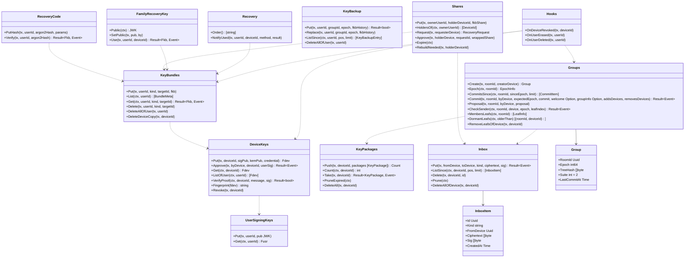

# srv-keys（サーバー側・業務。MLS の配送サービスと認証サービス、鍵の運搬）

## 受ける節

- [第12章 5.2 群の暗号（MLS）](../../../../docs/jp/design/12_基本設計書_データと暗号化.md#52-群の暗号mls) のサーバーが持つもの
  - KeyPackage の保管、Commit の直列化、Welcome と GroupInfo の中継
  - 暗号文の外形の検査、認証サービス、休眠の leaf
- [第12章 5.4 鍵バンドルと回復（DD-12-4、DD-12-5）](../../../../docs/jp/design/12_基本設計書_データと暗号化.md#54-鍵バンドルと回復dd-12-4dd-12-5)（コピーの保管、回復コードの試行、秘密分散の断片、家族回復鍵の公開部と使用の知らせ）
- [第12章 5.5 新しい端末の参加（第3章と往復）](../../../../docs/jp/design/12_基本設計書_データと暗号化.md#55-新しい端末の参加第3章と往復)（未承認の端末の制約と期限）
- [第12章 5.6 鍵のバックアップ（履歴）（DD-12-6）](../../../../docs/jp/design/12_基本設計書_データと暗号化.md#56-鍵のバックアップ履歴dd-12-6)（鍵のバックアップの保管）
- [第12章 9 消すこと（DD-12-13、R-12-6-1）](../../../../docs/jp/design/12_基本設計書_データと暗号化.md#9-消すことdd-12-13r-12-6-1) の鍵の破棄（抹消・取り消し）
- [第12章 12 データの形式（本章が定めるもの）](../../../../docs/jp/design/12_基本設計書_データと暗号化.md#12-データの形式本章が定めるもの)（`fkb/1`、`fkb-history/1`、`fdev/1`、`fusr/1`）
- [第2章 5.4 端末と鍵の運搬（第3章、第12章）](../../../../docs/jp/design/02_基本設計書_境界.md#54-端末と鍵の運搬第3章第12章)（端末と鍵の運搬の経路）
- [第2章 5.5 トーク（第4章）](../../../../docs/jp/design/02_基本設計書_境界.md#55-トーク第4章) のうち `/rooms/{id}/mls/*`
- [第2章 4.3 認可の 3 つの基本](../../../../docs/jp/design/02_基本設計書_境界.md#43-認可の-3-つの基本)（未承認の端末は `KEY-004`）
- [第2章 9.2 エラーコード表の初期の項目（api/errors.yaml の正本。本章は番号と意味）](../../../../docs/jp/design/02_基本設計書_境界.md#92-エラーコード表の初期の項目apierrorsyaml-の正本本章は番号と意味) の KEY-001〜008
- [第3章 4.4 新しい端末の追加（DD-3-7）](../../../../docs/jp/design/03_基本設計書_認証_構成員_端末.md#44-新しい端末の追加dd-3-7)（承認の鍵の側）
- [第3章 5.1 端末の状態](../../../../docs/jp/design/03_基本設計書_認証_構成員_端末.md#51-端末の状態)（承認済み・休眠）
- 全体実装設計書 3.1（回復の求め、MLS のグループ）、4.2、4.3、I-4、I-11、I-12

## 依存

- 下：
  - [srv-common](srv-common.md)
  - [srv-store](srv-store.md)（`Tx`、`Feed`、`RoomLock`、`Retention`）
  - [srv-identity](srv-identity.md)（`Devices`、`Users`、`Guardians`、`Passkeys.PrfEnabled`、`Hooks` への登録）
- 部品：なし。サーバーは Argon2id を計算しない。回復コードのハッシュは端末が Argon2id で作って送り、サーバーは保存した値と定数時間で比べる（第12章 5.4 の (b)）。
- 依存の逆転：
  - srv-identity の `DeviceKeyReader`（端末の署名の確かめ。第12章 5.3）を実装する。端末の承認の有無は srv-identity の devices.state が正で、本ブロックは持たない。
  - srv-identity の `OnDeviceRevoked`、`OnUserErased`、`OnUserDeleted` に登録する。
  - srv-rooms との向き：本ブロックは srv-rooms を呼ばない。srv-rooms が本ブロックの `Groups` を呼ぶ（追加待ち・削除待ちの登録）。

## クラス図

図の元の文（mermaid）

クラス図の注記（図の各メンバーの説明。仕様の節と番号を含む）

|クラス|メンバー|注記|
|---|---|---|
|UserSigningKeys|`+Put(tx, userId, pub JWK)`|fusr/1。初回。変えた時は rotated_at と device.changed（家族の全員に警告の元）|
|DeviceKeys|`+Put(tx, deviceId, sigPub, kemPub, credential) Fdev`|fdev/1。未承認で登録。KEY-001|
|DeviceKeys|`+Approve(tx, byDevice, deviceId, userSig) Result~Event~`|他の端末の承認は本人の承認済みの端末だけ（KEY-003。再認証）。自己承認（byDevice = deviceId。第12章 5.5 の 2）は未承認でも可。どちらも userSig を本人の署名鍵の公開部（fusr/1）で確かめ、通らなければ KEY-003。二重は KEY-002。子どもは保護者（MEM-006）。user_sig と approved_at（署名の時刻の記録）を置き、同じトランザクションで Devices.Approve を呼ぶ。device.changed(approved)|
|DeviceKeys|`+ListOfUser(ctx, userId) [Fdev]`|/users/{id}（E2EE の送信先）|
|DeviceKeys|`+VerifyProof(ctx, deviceId, message, sig) Result~bool~`|srv-identity DeviceKeyReader の実装。fdev/1 の署名鍵の公開部で ECDSA P-256（SHA-256、r と s の 64 バイト）を確かめる。公開鍵が無ければ false。DB の読みの失敗は error|
|DeviceKeys|`+Fingerprint(fdev) string`|承認の画面と端末の一覧|
|DeviceKeys|`+Revoke(tx, deviceId)`|hook から|
|KeyPackages|`+Push(tx, deviceId, packages [KeyPackage]) Count`|最大 20 + 最後の手段 1。90 日の期限|
|KeyPackages|`+Take(tx, deviceId) Result~KeyPackage, Event~`|取り出しと削除を同じ tx（I-11）。尽きたら最後の手段を返し KEY-006 を添える|
|KeyBundles|`+Put(tx, userId, kind, targetId, fkb)`|fkb/1。kind は device、recovery-code、share、family、prf のいずれか。承認済みの端末だけ（recovery-code の初回は accept の直後の未承認でも可）|
|KeyBundles|`+Get(ctx, userId, kind, targetId) Result~Fkb, Event~`|`GET /me/keybundle/{kind}/{target}`。規則 prf_or_approved（kind=prf は未承認の端末にも返す。他は承認済みの端末だけ、違えば KEY-004）。無ければ KEY-005|
|KeyBundles|`+DeleteAllOfUser(tx, userId)`|抹消|
|KeyBundles|`+DeleteDeviceCopy(tx, deviceId)`|取り消し（コピー (a)）|
|RecoveryCode|`+PutHash(tx, userId, argon2Hash, params)`|端末が作ったハッシュ。再発行で置き換え|
|RecoveryCode|`+Verify(tx, userId, argon2Hash) Result~Fkb, Event~`|10 回/日（DB の計数）を超えたら KEY-008。成功でコピー (b)。recovery.used(method: recovery-code)|
|Shares|`+Put(tx, ownerUserId, holderDeviceId, fkbShare)`|kind=share。index、threshold 2、n|
|Shares|`+HoldersOf(ctx, ownerUserId) [DeviceId]`|代表の端末|
|Shares|`+Request(tx, requesterDevice) RecoveryRequest`|recovery.request を秘密分散の断片を持つ構成員の代表の端末へ。24 時間|
|Shares|`+Approve(tx, holderDevice, requestId, wrappedShare)`|自分の片を新しい端末の鍵合意鍵へ HPKE で包んだ物を inbox へ。2 片で approved。recovery.used(method: share)|
|Shares|`+RebuildNeeded(tx, holderDeviceId)`|代表の端末が取り消されたら、本人の端末に keybundle.changed(kinds: [share]) を送る|
|FamilyRecoveryKey|`+Public(ctx) JWK`|/family/recovery-key/public|
|FamilyRecoveryKey|`+SetPublic(tx, pub, by)`|初回と作り直し（/admin/family/recovery-key/rotate）。全端末に keybundle.changed(kinds: [family])|
|FamilyRecoveryKey|`+Use(tx, userId, deviceId) Result~Fkb, Event~`|コピー (d) を返す。サーバーは F を持たず検証できない。試行を記録し全員に recovery.used(method: family) を成功・失敗とも|
|KeyBackup|`+Put(tx, userId, groupId, epoch, fkbHistory) Result~bool~`|既にあれば 204（上書きしない）|
|KeyBackup|`+ListSince(ctx, userId, pos, limit) [KeyBackupEntry]`|`/me/keybackup?since=&limit=`。要素は `{pos, backup}`（pos は表の `pos bigserial`。端末の次の since。第2章 3、5.4）。limit + 1 件を読んで has_more を決める|
|KeyBackup|`+Replace(tx, userId, groupId, epoch, fkbHistory)`|`PUT ...?rewrap=true`（G-19）。鍵バンドルの作り直し（S'）の後に本人が再認証して行を置き換える。pos を新しく振り、本人の他の端末が since で取り直す|
|Inbox|`+Put(tx, fromDevice, toDevice, kind, ciphertext, sig) Result~Event~`|1 件 64 KiB、1 端末 1,000 件（KEY-010）。device.inbox{count}。30 日|
|Inbox|`+ListSince(ctx, deviceId, pos, limit) [InboxItem]`|`/me/inbox?since=&limit=`。pos は表の `pos bigserial`（第2章 3）。limit + 1 件を読んで has_more を決める|
|InboxItem|`+Kind string`|第12章 5.2 の表の種類（welcome、keybundle、key_backup、key_request、share、call_key_request、call_key、sticker_remove_request）。表に無い種類は NET-001|
|InboxItem|`+Ciphertext []byte`|HPKE|
|Groups|`+Create(tx, roomId, creatorDevice) Group`|epoch 0（rooms の作成と同じ tx。srv-rooms から）|
|Groups|`+Epoch(ctx, roomId) EpochInfo`|/rooms/{id}/mls/epoch|
|Groups|`+CommitsSince(ctx, roomId, sinceEpoch, limit) [CommitItem]`|`GET /rooms/{id}/mls/commits?since_epoch=`：mls_commits から epoch の順に最大 100。`room.mls` を受けた端末が取る（第2章 5.5）|
|Groups|`+Commit(tx, roomId, byDevice, expectedEpoch, commit, welcome Option, groupInfo Option, addsDevices, removesDevices) Result~Event~`|RoomLock の中で UPDATE mls_groups SET epoch = epoch+1 WHERE epoch = $expected（I-4）。違えば KEY-007。room.mls を構成員へ。Welcome を対象の端末の Inbox へ。pending_add/pending_remove を解く（srv-rooms Members.Resolve）|
|Groups|`+Proposal(tx, roomId, byDevice, proposal)`|外部提案。room.mls に含めて配る|
|Groups|`+CheckSender(ctx, roomId, device, epoch, leafIndex) Result~Event~`|外形の検査：送信者の端末が leaf に一致、epoch が現在（古ければ ROOM-006）|
|Groups|`+DormantLeafs(ctx, olderThan) [(roomId, deviceId)]`|90 日現れない leaf に Remove の提案を出す（srv-worker）|
|Groups|`+RemoveLeafsOfDevice(tx, deviceId)`|取り消し・削除：各グループに pending_remove|
|Recovery|`+Order() [string]`|1 既存の端末、(e) PRF、2 家族、3 回復コード、4 家族回復鍵（画面の順。第12章 5.4）|
|Recovery|`+NotifyUsed(tx, userId, deviceId, method, result)`|recovery.used：本人の全端末 + 管理者（+ family は全員）|
|Hooks|`+OnDeviceRevoked(tx, deviceId)`|DeviceKeys.Revoke、KeyPackages.DeleteAll、KeyBundles.DeleteDeviceCopy、Inbox.DeleteAllOfDevice、Groups.RemoveLeafsOfDevice、Shares.RebuildNeeded|
|Hooks|`+OnUserErased(tx, userId)`|KeyBundles.DeleteAllOfUser、Shares の片、KeyBackup.DeleteAllOfUser、UserSigningKeys の失効|
|Hooks|`+OnUserDeleted(tx, userId)`|全端末の leaf を pending_remove（コピーとバックアップは残す。第3章 8.2）|

## 公開操作（このブロックが所有する操作。番号は B-080〜）

|番号|操作（上の図）|使う側|由来|
|---|---|---|---|
|B-080|`UserSigningKeys`|operation（`/users/{id}` の署名鍵の公開部は srv-identity の一覧に本ブロックが足す）|[第12章 5.2 群の暗号（MLS）](../../../../docs/jp/design/12_基本設計書_データと暗号化.md#52-群の暗号mls)、[第12章 12 データの形式（本章が定めるもの）](../../../../docs/jp/design/12_基本設計書_データと暗号化.md#12-データの形式本章が定めるもの)|
|B-081|`DeviceKeys`（`Put`、`Approve`、`Get`、`ListOfUser`、`VerifyProof`、`Fingerprint`）。srv-identity の `DeviceKeyReader` の実装（`VerifyProof`、`SigningKeys`、`DevicesOf`）|operation（`approveMyDevice` はタグ keys で本ブロックが実装）、srv-identity（端末の一覧の指紋、ログインの端末の証、/users の鍵）|[第2章 5.4 端末と鍵の運搬（第3章、第12章）](../../../../docs/jp/design/02_基本設計書_境界.md#54-端末と鍵の運搬第3章第12章)、[第3章 4.4 新しい端末の追加（DD-3-7）](../../../../docs/jp/design/03_基本設計書_認証_構成員_端末.md#44-新しい端末の追加dd-3-7)、[第3章 5.2 一覧と取り消し](../../../../docs/jp/design/03_基本設計書_認証_構成員_端末.md#52-一覧と取り消し)|
|B-082|`KeyPackages`（`Push`、`Count`、`Take`、`PruneExpired`）|operation（`/me/devices/{id}/keypackages`、`/users/{uid}/devices/{did}/keypackage`）、srv-worker（期限）|[第12章 5.2 群の暗号（MLS）](../../../../docs/jp/design/12_基本設計書_データと暗号化.md#52-群の暗号mls)|
|B-083|`KeyBundles`、`RecoveryCode`、`Shares`、`FamilyRecoveryKey`、`Recovery`|operation（`/me/keybundle/*`、`/me/recovery/*`、`/recovery/*`、`/family/recovery-key/*`）、srv-admin（`/admin/family/recovery-key/rotate`）、srv-identity（`ResetLink` の後の `NotifyUsed`）|[第12章 5.4 鍵バンドルと回復（DD-12-4、DD-12-5）](../../../../docs/jp/design/12_基本設計書_データと暗号化.md#54-鍵バンドルと回復dd-12-4dd-12-5)|
|B-084|`KeyBackup`（`Replace` を含む）|operation（`/me/keybackup*`）|[第12章 5.6 鍵のバックアップ（履歴）（DD-12-6）](../../../../docs/jp/design/12_基本設計書_データと暗号化.md#56-鍵のバックアップ履歴dd-12-6)|
|B-085|`Inbox`（`Put`、`ListSince`、`Delete`、`Prune`）|operation（`/devices/{did}/inbox`、`/me/inbox*`）、srv-rooms（スタンプの削除の求め）、srv-push（`/up/{token}` のメールボックスは別。`UpBox`）、srv-worker（`Prune`）|[第12章 5.2 群の暗号（MLS）](../../../../docs/jp/design/12_基本設計書_データと暗号化.md#52-群の暗号mls)、[第2章 5.4 端末と鍵の運搬（第3章、第12章）](../../../../docs/jp/design/02_基本設計書_境界.md#54-端末と鍵の運搬第3章第12章)|
|B-086|`Groups`（`Create`、`Epoch`、`CommitsSince`、`Commit`、`Proposal`、`CheckSender`、`MembersLeafs`、`DormantLeafs`、`RemoveLeafsOfDevice`）|srv-rooms（作成、送信時の `CheckSender`、構成員の変化）、operation（`/rooms/{id}/mls/*`）、srv-worker（休眠の leaf）|[第12章 5.2 群の暗号（MLS）](../../../../docs/jp/design/12_基本設計書_データと暗号化.md#52-群の暗号mls)、[第2章 5.5 トーク（第4章）](../../../../docs/jp/design/02_基本設計書_境界.md#55-トーク第4章)、[第4章 4.1 種類と状態](../../../../docs/jp/design/04_基本設計書_トークとメッセージ.md#41-種類と状態)|
|B-087|`Hooks` の実装（srv-identity への登録）|srv-identity|[第12章 9 消すこと（DD-12-13、R-12-6-1）](../../../../docs/jp/design/12_基本設計書_データと暗号化.md#9-消すことdd-12-13r-12-6-1)、I-8|

## アルゴリズム（差し替え点）

|事項|実装|切り替え|由来|
|---|---|---|---|
|Commit の直列化|`RoomLock` + 条件つき UPDATE|固定|[第12章 5.2 群の暗号（MLS）](../../../../docs/jp/design/12_基本設計書_データと暗号化.md#52-群の暗号mls)、I-4|
|外形の検査|MLS の wire format の外側（`wire_format`、`group_id`、`epoch`、`sender.leaf_index`）だけを読む自前の最小の parser（RFC 9420 の 6 節）。本文は読まない|固定|[第12章 5.2 群の暗号（MLS）](../../../../docs/jp/design/12_基本設計書_データと暗号化.md#52-群の暗号mls)|
|回復コードの試行の計数|DB の `recovery_attempts`（user_id、day、count）|固定|[第12章 5.4 鍵バンドルと回復（DD-12-4、DD-12-5）](../../../../docs/jp/design/12_基本設計書_データと暗号化.md#54-鍵バンドルと回復dd-12-4dd-12-5)|
|休眠の判定|`devices.last_seen_at` が 90 日より古い leaf|設定（保持.休眠の leaf）|[第12章 5.2 群の暗号（MLS）](../../../../docs/jp/design/12_基本設計書_データと暗号化.md#52-群の暗号mls)|

## データ設計（このブロックが形を持つ記録）

|記録|形|欄|由来|
|---|---|---|---|
|`user_signing_keys`|表|`user_id PK`、`pub jsonb`（JWK）、`created_at`、`rotated_at?`、`revoked_at?`（`fusr/1`）|[第12章 12 データの形式（本章が定めるもの）](../../../../docs/jp/design/12_基本設計書_データと暗号化.md#12-データの形式本章が定めるもの)|
|`device_keys`|表|`device_id PK`、`sig_pub jsonb`、`kem_pub jsonb`、`credential bytea`（MLS の credential）、`user_sig bytea?`、`created_at`、`approved_at?`（`fdev/1`）|[第12章 12 データの形式（本章が定めるもの）](../../../../docs/jp/design/12_基本設計書_データと暗号化.md#12-データの形式本章が定めるもの)|
|`keypackages`|表|`ref bytea PK`、`device_id`、`package bytea`、`last_resort bool`、`expires_at`、`created_at`|[第12章 5.2 群の暗号（MLS）](../../../../docs/jp/design/12_基本設計書_データと暗号化.md#52-群の暗号mls)|
|`keybundles`|表|`user_id`、`kind`、`target_id`（端末 id、"recovery-code"、持ち主の端末 id、"family"、cred id）、`body jsonb`（`fkb/1`）、`created_at`。PK (user_id, kind, target_id)|[第12章 5.4 鍵バンドルと回復（DD-12-4、DD-12-5）](../../../../docs/jp/design/12_基本設計書_データと暗号化.md#54-鍵バンドルと回復dd-12-4dd-12-5)|
|`recovery_codes`|表|`user_id PK`、`argon2_hash bytea`、`params jsonb`、`issued_at`|[第12章 5.4 鍵バンドルと回復（DD-12-4、DD-12-5）](../../../../docs/jp/design/12_基本設計書_データと暗号化.md#54-鍵バンドルと回復dd-12-4dd-12-5)|
|`recovery_attempts`|表|`user_id`、`day date`、`count`|[第12章 5.4 鍵バンドルと回復（DD-12-4、DD-12-5）](../../../../docs/jp/design/12_基本設計書_データと暗号化.md#54-鍵バンドルと回復dd-12-4dd-12-5)|
|`recovery_requests`|表|`id`、`user_id`、`device_id`、`state`（open、approved、expired）、`approvals int`、`expires_at`、`created_at`|[第12章 5.4 鍵バンドルと回復（DD-12-4、DD-12-5）](../../../../docs/jp/design/12_基本設計書_データと暗号化.md#54-鍵バンドルと回復dd-12-4dd-12-5)|
|`key_backup`|表|`user_id`、`group_id`、`epoch`、`body jsonb`（`fkb-history/1`）、`pos bigserial`、`created_at`。PK (user_id, group_id, epoch)|[第12章 5.6 鍵のバックアップ（履歴）（DD-12-6）](../../../../docs/jp/design/12_基本設計書_データと暗号化.md#56-鍵のバックアップ履歴dd-12-6)|
|`device_inbox`|表|`id`、`to_device`、`from_device`、`kind`、`ciphertext bytea`、`sig bytea`、`pos bigserial`、`created_at`、`expires_at`（30 日）|[第12章 5.2 群の暗号（MLS）](../../../../docs/jp/design/12_基本設計書_データと暗号化.md#52-群の暗号mls)|
|`mls_groups`|表|`room_id PK`、`epoch bigint`、`tree_hash bytea`、`suite int`、`last_commit_at`|[第12章 5.2 群の暗号（MLS）](../../../../docs/jp/design/12_基本設計書_データと暗号化.md#52-群の暗号mls)|
|`mls_commits`|表|`room_id`、`epoch`、`commit bytea`、`group_info bytea?`、`by_device`、`created_at`、`proposals jsonb`。PK (room_id, epoch)。保持はイベントと同じ（永久）|[第12章 5.2 群の暗号（MLS）](../../../../docs/jp/design/12_基本設計書_データと暗号化.md#52-群の暗号mls)|
|`EpochInfo`|構造|`{epoch, tree_hash, pending_add: [user_id], pending_remove: [device_id]}`|[第2章 5.5 トーク（第4章）](../../../../docs/jp/design/02_基本設計書_境界.md#55-トーク第4章)|
