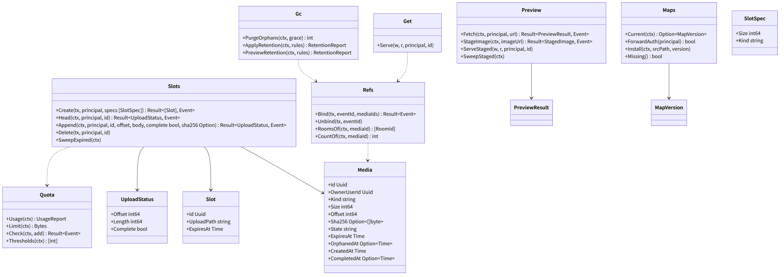
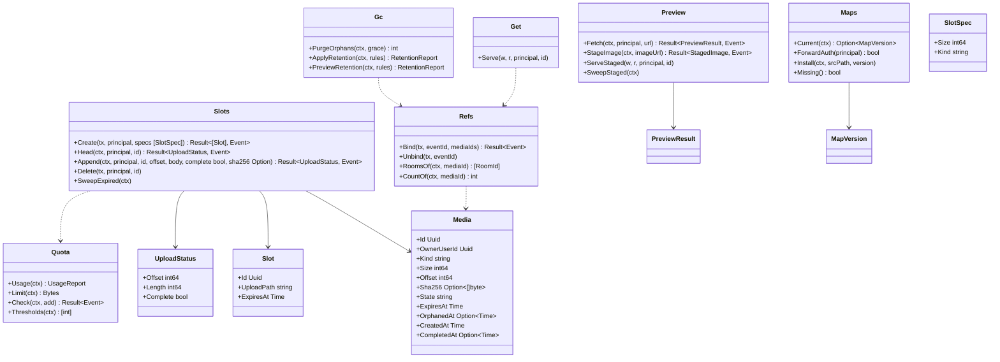

# srv-media（サーバー側・業務。添付の暗号文の保管、URL の代理、地図の配信の認可）

## 受ける節

- [第5章 5.1 アップロード（DD-5-6）](../../../../docs/jp/design/05_基本設計書_メディア.md#51-アップロードdd-5-6) のサーバーの側（スロット、追記、完了、再開、期限）
- [第5章 5.2 取得（DD-5-7）](../../../../docs/jp/design/05_基本設計書_メディア.md#52-取得dd-5-7) のサーバーの側（Range、ETag、Cache-Control、forward auth の判定）
- [第5章 7 容量と消す規則（DD-5-9。O-07 の結論）](../../../../docs/jp/design/05_基本設計書_メディア.md#7-容量と消す規則dd-5-9o-07-の結論)（容量と消す規則：上限の判定、知らせのしきい値の計算、規則の実行）
- [第5章 8.1 データと配信](../../../../docs/jp/design/05_基本設計書_メディア.md#81-データと配信) の配信（forward auth）と更新（地図のファイルの版）
- [第5章 9 数値の一覧（config.yaml の「メディア」）](../../../../docs/jp/design/05_基本設計書_メディア.md#9-数値の一覧configyaml-のメディア)（数値）
- [第5章 10 失敗の扱い](../../../../docs/jp/design/05_基本設計書_メディア.md#10-失敗の扱い) のサーバーの行（容量 100%、地図のデータがない）
- [第2章 5.6 メディア（第5章、第12章）](../../../../docs/jp/design/02_基本設計書_境界.md#56-メディア第5章第12章)（メディアの経路、`/preview`、`/maps/*`）
- [第2章 3 やり取りの分類と規則](../../../../docs/jp/design/02_基本設計書_境界.md#3-やり取りの分類と規則) の追記の大きさ
- [第2章 11 競合の規則（R-2-2-5）](../../../../docs/jp/design/02_基本設計書_境界.md#11-競合の規則r-2-2-5) の追記の重複
- [第1章 7.5 添付の送信](../../../../docs/jp/design/01_基本設計書_全体構成.md#75-添付の送信)（添付の送信のサーバーの側）
- [第1章 8.1 データの一覧](../../../../docs/jp/design/01_基本設計書_全体構成.md#81-データの一覧) の添付の行
- [第1章 9.1 家族のサーバー](../../../../docs/jp/design/01_基本設計書_全体構成.md#91-家族のサーバー)（/data/media、/data/maps）
- [第1章 10.6 外から入るものの確かめ](../../../../docs/jp/design/01_基本設計書_全体構成.md#106-外から入るものの確かめ)（添付は暗号文。大きさと件数と総量だけ。SSRF）
- [第1章 4.2 外部とのやり取り](../../../../docs/jp/design/01_基本設計書_全体構成.md#42-外部とのやり取り) の URL のプレビューの取得先の行
- [第12章 5.7 メッセージと添付（第4章・第5章と往復）](../../../../docs/jp/design/12_基本設計書_データと暗号化.md#57-メッセージと添付第4章第5章と往復)（添付は暗号文。サーバーは大きさとハッシュだけ）
- [第12章 5.10 URL のプレビュー（DD-12-9。第4章と往復）](../../../../docs/jp/design/12_基本設計書_データと暗号化.md#510-url-のプレビューdd-12-9第4章と往復)（代理の規則、一時の置き場）
- [第12章 9 消すこと（DD-12-13、R-12-6-1）](../../../../docs/jp/design/12_基本設計書_データと暗号化.md#9-消すことdd-12-13r-12-6-1) の添付の GC（参照が 0 になってから 7 日）
- [第12章 8 外へ送る情報の一覧（DD-12-14、R-12-5-1。第1章 4.2 と一致）](../../../../docs/jp/design/12_基本設計書_データと暗号化.md#8-外へ送る情報の一覧dd-12-14r-12-5-1第1章-42-と一致) の代理の行
- 全体実装設計書 3.1（添付のスロット）、4.2、I-5

## 依存

- 下：
  - [srv-common](srv-common.md)（`Fetcher`、`Config`）
  - [srv-store](srv-store.md)（`FileStore`、`Tx`、`Jobs`）
  - [srv-identity](srv-identity.md)（持ち主）
  - [srv-rooms](srv-rooms.md)（`Members.IsMember`、`MediaBinder` の実装）
- 依存の逆転：srv-rooms の `MediaBinder` を実装。

## クラス図

図の元の文（mermaid）

クラス図の注記（図の各メンバーの説明。仕様の節と番号を含む）

|クラス|メンバー|注記|
|---|---|---|
|Media|`+Kind string`|attachment、thumbnail、avatar、sticker、preview_image のいずれか|
|Media|`+Size int64`|暗号文の申告の大きさ|
|Media|`+Sha256 Option~[]byte~`|完了で確定|
|Media|`+State string`|slot、uploading、complete、orphaned、deleted のいずれか|
|Media|`+ExpiresAt Time`|slot/uploading は 24 時間|
|Slots|`+Create(tx, principal, specs [SlotSpec]) Result~[Slot], Event~`|1 回 50 まで。1 件の上限・件数・1 日の総量（MEDIA-001）。容量の上限（SRV-002）。24 時間|
|Slots|`+Head(ctx, principal, id) Result~UploadStatus, Event~`|Upload-Offset、Upload-Length（MEDIA-002）|
|Slots|`+Append(ctx, principal, id, offset, body, complete bool, sha256 Option) Result~UploadStatus, Event~`|offset が現在と違えば MEDIA-003（現在の offset を params に）。FileStore.PartWriter に流し書き（1 回 64 MiB）。complete なら Finalize（不一致は MEDIA-004 で、端末は最初から送り直す）|
|Slots|`+Delete(tx, principal, id)`|結び付く前|
|Slots|`+SweepExpired(ctx)`|24 時間（srv-worker gc）|
|Get|`+Serve(w, r, principal, id)`|認可：結び付いたどれかのトークの構成員、または結び付く前の持ち主（MEDIA-005）。実体が無ければ MEDIA-006。Accept-Ranges、ETag "&lt;sha256&gt;"、Cache-Control: private, immutable, max-age=31536000。Range は FileStore.Open|
|Refs|`+Bind(tx, eventId, mediaIds) Result~Event~`|srv-rooms MediaBinder。complete でなければ MEDIA-002。media_refs に (media_id, event_id, room_id)|
|Refs|`+Unbind(tx, eventId)`|削除済みの印。参照 0 なら orphaned_at = now|
|Refs|`+RoomsOf(ctx, mediaId) [RoomId]`|取得の認可|
|Gc|`+PurgeOrphans(ctx, grace) int`|orphaned_at から 7 日を過ぎたら FileStore.Remove し、state = deleted|
|Gc|`+ApplyRetention(ctx, rules) RetentionReport`|管理者の規則（N 年より古い動画の原本／オリジナルの写真／ファイル）。消すのは暗号文。30 日前の知らせの対象の計算 Preview(rules)|
|Gc|`+PreviewRetention(ctx, rules) RetentionReport`|件数と大きさ（知らせ用）|
|Quota|`+Usage(ctx) UsageReport`|全体、構成員ごと、トークごと（暗号文の大きさから）|
|Quota|`+Limit(ctx) Bytes`|設定（設置時の空きの 80% が既定）|
|Quota|`+Check(ctx, add) Result~Event~`|100% で SRV-002（読み取り専用の遷移は srv-admin へ知らせる）|
|Quota|`+Thresholds(ctx) [int]`|80、90、100 の到達（srv-worker monitor が notice）|
|Preview|`+Fetch(ctx, principal, url) Result~PreviewResult, Event~`|Fetcher.Get（内部のアドレス帯と自分自身を拒む MEDIA-010。10 秒、1 MiB、転送 3 回）。&lt;title&gt;、description、og:image、site_name、canonical。固有の User-Agent、no-referrer|
|Preview|`+StageImage(ctx, imageUrl) Result~StagedImage, Event~`|画像を取得して一時の平文の置き場（/data/media/preview-tmp/&lt;id&gt;）に 1 時間。端末が取得して添付として暗号化し直す|
|Preview|`+ServeStaged(w, r, principal, id)`|持ち主だけ|
|Preview|`+SweepStaged(ctx)`|1 時間（srv-worker preview_cleanup）|
|Maps|`+Current(ctx) Option~MapVersion~`|/data/maps/<版>/base.pmtiles。`GET /media/config` の `maps_version` に出す（第2章 5.6）|
|Maps|`+ForwardAuth(principal) bool`|`/maps/*` は本人（caddy の forward auth は srv-boundary InternalAuth が本ブロックに問う）|
|Maps|`+Install(ctx, srcPath, version)`|ft setup と更新（srv-worker maps_update）。一時の名前で置いてから改名する|
|Maps|`+Missing() bool`|「地図は準備中です」の知らせ|
|Slot|`+UploadPath string`|/api/v1/media/&lt;id&gt;|

## 公開操作（このブロックが所有する操作。番号は B-120〜）

|番号|操作（上の図）|使う側|由来|
|---|---|---|---|
|B-120|`Slots`（`Create`、`Head`、`Append`、`Delete`、`SweepExpired`）|operation（`/media/config`、`/media/slots`、`/media/{id}` HEAD/PATCH/DELETE）、srv-worker（`SweepExpired`）|[第5章 5.1 アップロード（DD-5-6）](../../../../docs/jp/design/05_基本設計書_メディア.md#51-アップロードdd-5-6)、[第2章 5.6 メディア（第5章、第12章）](../../../../docs/jp/design/02_基本設計書_境界.md#56-メディア第5章第12章)|
|B-121|`Get::Serve`|operation（`GET /media/{id}`）|[第5章 5.2 取得（DD-5-7）](../../../../docs/jp/design/05_基本設計書_メディア.md#52-取得dd-5-7)、[第2章 5.6 メディア（第5章、第12章）](../../../../docs/jp/design/02_基本設計書_境界.md#56-メディア第5章第12章)|
|B-122|`Refs`（`Bind`、`Unbind`、`RoomsOf`、`CountOf`）。srv-rooms の `MediaBinder` の実装|srv-rooms|[第2章 5.6 メディア（第5章、第12章）](../../../../docs/jp/design/02_基本設計書_境界.md#56-メディア第5章第12章)、[第4章 3.2 関係の規則](../../../../docs/jp/design/04_基本設計書_トークとメッセージ.md#32-関係の規則)|
|B-123|`Gc`（`PurgeOrphans`、`ApplyRetention`、`PreviewRetention`）|srv-worker（gc、保持の規則、30 日前の知らせ）|[第12章 9 消すこと（DD-12-13、R-12-6-1）](../../../../docs/jp/design/12_基本設計書_データと暗号化.md#9-消すことdd-12-13r-12-6-1)、[第5章 7 容量と消す規則（DD-5-9。O-07 の結論）](../../../../docs/jp/design/05_基本設計書_メディア.md#7-容量と消す規則dd-5-9o-07-の結論)|
|B-124|`Quota`（`Usage`、`Limit`、`Check`、`Thresholds`）|srv-admin（`/admin/storage`、`/admin/retention`）、srv-worker（監視）、本ブロック（スロット）|[第5章 7 容量と消す規則（DD-5-9。O-07 の結論）](../../../../docs/jp/design/05_基本設計書_メディア.md#7-容量と消す規則dd-5-9o-07-の結論)、[第11章 11 監視と知らせ（DD-11-10）](../../../../docs/jp/design/11_基本設計書_運用.md#11-監視と知らせdd-11-10)|
|B-125|`Preview`（`Fetch`、`StageImage`、`ServeStaged`、`SweepStaged`）|operation（`/preview`、`/media/preview/{id}`）、srv-worker（掃除）|[第12章 5.10 URL のプレビュー（DD-12-9。第4章と往復）](../../../../docs/jp/design/12_基本設計書_データと暗号化.md#510-url-のプレビューdd-12-9第4章と往復)、[第4章 5.6 URL のプレビュー（DD-4-7）](../../../../docs/jp/design/04_基本設計書_トークとメッセージ.md#56-url-のプレビューdd-4-7)|
|B-126|`Maps`（`Current`、`ForwardAuth`、`Install`、`Missing`）|srv-boundary（`InternalAuth` が `/maps/*` の認可を問う）、srv-admin（`/admin/maps`）、srv-worker（更新）、cmd/ft `setup`|[第5章 8.1 データと配信](../../../../docs/jp/design/05_基本設計書_メディア.md#81-データと配信)、[第11章 8 管理者の画面（DD-11-7。第2章 5.10 の経路）](../../../../docs/jp/design/11_基本設計書_運用.md#8-管理者の画面dd-11-7第2章-510-の経路)|

## アルゴリズム（差し替え点）

|事項|実装|切り替え|由来|
|---|---|---|---|
|追記の冪等|`Upload-Offset` が現在と一致する時だけ追記（RFC の tus に倣う形は第2章）|固定|[第2章 5.6 メディア（第5章、第12章）](../../../../docs/jp/design/02_基本設計書_境界.md#56-メディア第5章第12章)、[第2章 11 競合の規則（R-2-2-5）](../../../../docs/jp/design/02_基本設計書_境界.md#11-競合の規則r-2-2-5)|
|ハッシュの照合|追記しながら SHA-256 を流し計算し、完了時に `X-Content-SHA256` と照合|固定|[第5章 5.1 アップロード（DD-5-6）](../../../../docs/jp/design/05_基本設計書_メディア.md#51-アップロードdd-5-6)|
|SSRF の判定|`Fetcher`（srv-common）に委ねる。本ブロックは「自分自身」（家族のサーバーの名前と IP）の拒否を足す|固定|[第12章 5.10 URL のプレビュー（DD-12-9。第4章と往復）](../../../../docs/jp/design/12_基本設計書_データと暗号化.md#510-url-のプレビューdd-12-9第4章と往復)|
|保持の規則の対象|`media.kind` と結び付いたイベントの `plain.attachments[].kind`（photo/video/file）と `created_at`|設定（第5章 7）|[第5章 7 容量と消す規則（DD-5-9。O-07 の結論）](../../../../docs/jp/design/05_基本設計書_メディア.md#7-容量と消す規則dd-5-9o-07-の結論)|

## データ設計（このブロックが形を持つ記録）

|記録|形|欄|由来|
|---|---|---|---|
|`media`|表|`id`、`owner_user_id`、`kind`、`size`、`offset`、`sha256 bytea?`、`state`、`expires_at`、`orphaned_at?`、`created_at`、`completed_at?`、`item_kind text?`（photo/video/file/audio。結び付きの時にイベントの平文の欄から写す。保持の規則用）。索引 (sha256)、(state, expires_at)、(orphaned_at)|[第2章 5.6 メディア（第5章、第12章）](../../../../docs/jp/design/02_基本設計書_境界.md#56-メディア第5章第12章)、[第5章 7 容量と消す規則（DD-5-9。O-07 の結論）](../../../../docs/jp/design/05_基本設計書_メディア.md#7-容量と消す規則dd-5-9o-07-の結論)|
|`media_refs`|表|`media_id`、`event_id`、`room_id`。PK (media_id, event_id)。索引 (event_id)|[第2章 5.6 メディア（第5章、第12章）](../../../../docs/jp/design/02_基本設計書_境界.md#56-メディア第5章第12章)|
|`media_quota_day`|表|`user_id`、`day`、`bytes`（1 日の総量の判定）|[第2章 5.6 メディア（第5章、第12章）](../../../../docs/jp/design/02_基本設計書_境界.md#56-メディア第5章第12章)|
|`retention_rules`（srv-admin が持ち主。本ブロックは読む）|表|第5章 7 の規則|[第5章 7 容量と消す規則（DD-5-9。O-07 の結論）](../../../../docs/jp/design/05_基本設計書_メディア.md#7-容量と消す規則dd-5-9o-07-の結論)|
|`/data/media/<2>/<sha256>`|ファイル|暗号文（名前は暗号文の SHA-256。srv-store `FileStore`）|[第1章 9.1 家族のサーバー](../../../../docs/jp/design/01_基本設計書_全体構成.md#91-家族のサーバー)|
|`/data/media/preview-tmp/<id>`|ファイル|代理が取得した平文の画像。1 時間|[第12章 5.10 URL のプレビュー（DD-12-9。第4章と往復）](../../../../docs/jp/design/12_基本設計書_データと暗号化.md#510-url-のプレビューdd-12-9第4章と往復)|
|`/data/maps/<版>/base.pmtiles`、`/data/maps/current`（版の名前）|ファイル|PMTiles v3。caddy が `/maps/<版>/` で配る（forward auth）|[第5章 8.1 データと配信](../../../../docs/jp/design/05_基本設計書_メディア.md#81-データと配信)|
|`PreviewResult`|構造|`{title?, description?, image?: {staged_id, mime, w, h}, site_name?, canonical}`|[第2章 5.6 メディア（第5章、第12章）](../../../../docs/jp/design/02_基本設計書_境界.md#56-メディア第5章第12章)|
|`UsageReport`|構造|`{total, limit, by_user: [{user_id, bytes}], by_room: [{room_id, bytes}], pending_delete: {count, bytes}}`|[第11章 8 管理者の画面（DD-11-7。第2章 5.10 の経路）](../../../../docs/jp/design/11_基本設計書_運用.md#8-管理者の画面dd-11-7第2章-510-の経路)|
