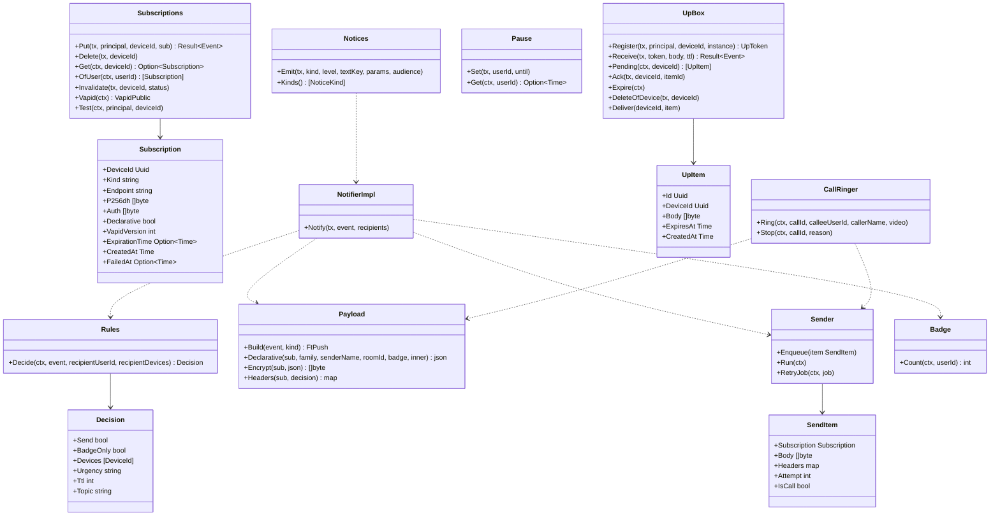

# srv-push（サーバー側・業務。通知の送信、規則、購読、(i) の受け口、知らせ）

## 受ける節
- [第7章 3 経路（DD-7-1、DD-7-2）](../../../../docs/jp/design/07_基本設計書_通知.md#3-経路dd-7-1dd-7-2)（経路）、[第7章 3.1 家族のサーバーの受け口（(i)）](../../../../docs/jp/design/07_基本設計書_通知.md#31-家族のサーバーの受け口i)（家族のサーバーの受け口 (i)）、[第7章 3.2 送信（api）](../../../../docs/jp/design/07_基本設計書_通知.md#32-送信api)（送信）、[第7章 4 購読](../../../../docs/jp/design/07_基本設計書_通知.md#4-購読)（購読）、[第7章 5.3 バッジ](../../../../docs/jp/design/07_基本設計書_通知.md#53-バッジ) のサーバーの側（バッジの値）、[第7章 6 規則（DD-7-5、DD-7-6）](../../../../docs/jp/design/07_基本設計書_通知.md#6-規則dd-7-5dd-7-6)（規則。サーバーの判定）、[第7章 7 着信の通知（DD-7-7）](../../../../docs/jp/design/07_基本設計書_通知.md#7-着信の通知dd-7-7) のサーバーの側（着信の繰り返し、`call_end`）、[第7章 8 届かない時（DD-7-8）](../../../../docs/jp/design/07_基本設計書_通知.md#8-届かない時dd-7-8) のサーバーの側（購読は消さない）、[第7章 9 システムの知らせ（DD-7-9）](../../../../docs/jp/design/07_基本設計書_通知.md#9-システムの知らせdd-7-9)（システムの知らせ：宛先と経路。しきい値の検出は srv-worker・srv-media・srv-admin）、[第7章 11 数値の一覧（config.yaml の「通知」）](../../../../docs/jp/design/07_基本設計書_通知.md#11-数値の一覧configyaml-の通知)（数値）、[第7章 13 失敗の扱い](../../../../docs/jp/design/07_基本設計書_通知.md#13-失敗の扱い)（失敗）
- [第2章 5.8 通知（第7章）](../../../../docs/jp/design/02_基本設計書_境界.md#58-通知第7章)（通知の経路）、[第2章 7 通知の中身（第7章）](../../../../docs/jp/design/02_基本設計書_境界.md#7-通知の中身第7章)（通知の中身）、[第2章 4.4 WebSocket と通知と SFU](../../../../docs/jp/design/02_基本設計書_境界.md#44-websocket-と通知と-sfu) の通知の行、[第2章 9.2 エラーコード表の初期の項目（api/errors.yaml の正本。本章は番号と意味）](../../../../docs/jp/design/02_基本設計書_境界.md#92-エラーコード表の初期の項目apierrorsyaml-の正本本章は番号と意味) の PUSH-001〜003
- [第1章 4.2 外部とのやり取り](../../../../docs/jp/design/01_基本設計書_全体構成.md#42-外部とのやり取り) のプッシュ配信サービスの行（時間切れ、失敗の扱い）、[第1章 7.4 メッセージの送信と配信](../../../../docs/jp/design/01_基本設計書_全体構成.md#74-メッセージの送信と配信) の 4（開いていない端末へ）、[第1章 7.6 通話](../../../../docs/jp/design/01_基本設計書_全体構成.md#76-通話) の 2、[第1章 12 外部への依存](../../../../docs/jp/design/01_基本設計書_全体構成.md#12-外部への依存)（中継が止まった時）
- [第12章 5.8 通知（DD-12-10。第7章・第9章と往復）](../../../../docs/jp/design/12_基本設計書_データと暗号化.md#58-通知dd-12-10第7章第9章と往復)（通知の中身は `event_id` と `room_id` と `sender_id`）、[第12章 10 秘密の鍵（DD-12-15、R-12-7-1）](../../../../docs/jp/design/12_基本設計書_データと暗号化.md#10-秘密の鍵dd-12-15r-12-7-1) の VAPID の鍵の行
- 全体実装設計書 2.3（通知の送信の channel、`push_retry`）、3.1（購読、(i) のメールボックス）、4.3、I-8 の購読

## 依存
- 下：[srv-common](srv-common.md)（`PushTransport`、`Secrets.Vapid`、`Envelope`、`Clock`）、[srv-store](srv-store.md)（`Tx`、`Feed`、`Jobs`、`Retention`）、[srv-identity](srv-identity.md)（`Users.Settings`、`Guardians.Settings`、`Devices`、`Hooks` の登録、`Families.Get`）、[srv-rooms](srv-rooms.md)（`Members.Of`、`RoomMeStore.Get`、`Receipts.UnreadCount`、`FamilyRoom.Flow`、`Notifier` の実装）。部品：webpush-go（RFC 8291/8292）。
- 依存の逆転：srv-rooms の `Notifier` を実装。srv-identity の `OnDeviceRevoked`（購読とメールボックスの削除）に登録。srv-boundary の `Hub.Connected` を読む（開いている端末）。`UpWsHandler`（srv-boundary）が `UpBox` を呼ぶ。

## クラス図

図の元の文（mermaid）

クラス図の注記（図の各メンバーの説明。仕様の節と番号を含む）

|クラス|メンバー|注記|
|---|---|---|
|Subscription|`+Kind string`|webpush \| unifiedpush|
|Subscriptions|`+Put(tx, principal, deviceId, sub) Result~Event~`|PUSH-001。UnifiedPush は endpoint と VAPID の公開鍵の確認|
|Subscriptions|`+Invalidate(tx, deviceId, status)`|404/410 → 削除 + device.changed（本人の端末）|
|Subscriptions|`+Vapid(ctx) VapidPublic`|/me/push/vapid：公開鍵と版|
|Subscriptions|`+Test(ctx, principal, deviceId)`|/me/devices/{id}/push/test|
|Rules|`+Decide(ctx, event, recipientUserId, recipientDevices) Decision`|第7章 6 の決定表：着信を受けない（送信者に CALL-005 は srv-calls が先に判定）、人のミュート、トークのミュート（メンションは mention_overrides_mute）、一時停止（着信は送る）、子どもの時間帯（着信とメンションは送る）、silent（バッジだけ）、開いている端末（着信を除く）。エンベロープの設定は Users.Settings で復号|
|Decision|`+Devices [DeviceId]`|送る端末（開いている端末を除いた残り）|
|Decision|`+Urgency string`|normal \| high|
|Payload|`+Build(event, kind) FtPush`|ft.push/1：{v, event_id, room_id, sender_id, kind, call_id?}。本文なし|
|Payload|`+Declarative(sub, family, senderName, roomId, badge, inner) json`|iOS 18.4 以上の宣言型の包み（第2章 7）|
|Payload|`+Encrypt(sub, json) []byte`|RFC 8291 aes128gcm（4,096 バイト以下）|
|Payload|`+Headers(sub, decision) map`|TTL、Urgency、Topic、Content-Encoding、VAPID（RFC 8292。aud = 中継の origin、exp 12 時間、sub = https://<サーバー>）|
|Sender|`+Enqueue(item SendItem)`|プロセスの中の channel（4 並列）|
|Sender|`+Run(ctx)`|PushTransport.Post → 201 ok / 404,410 → Invalidate / 429 → Retry-After / 5xx → 1,4,16 秒で 3 回（着信は 1 回）。それ以上は push_log に捨てた印（端末は開いた時に全差分）|
|Sender|`+RetryJob(ctx, job)`|jobs push_retry（プロセスの再起動を跨ぐ分）|
|Badge|`+Count(ctx, userId) int`|全トークの未読の合計（通知なし送信も、ミュートのトークも数える。設定で除外可）|
|CallRinger|`+Ring(ctx, callId, calleeUserId, callerName, video)`|kind: call、high、TTL 60。iPhone の購読は 15 秒 × 4 回（timer）。Android (i)/(ii) と PC は 1 回|
|CallRinger|`+Stop(ctx, callId, reason)`|kind: call_end（不在／応答／拒否／取消で最後の通知を置き換える）|
|UpBox|`+Register(tx, principal, deviceId, instance) UpToken`|/up/register：token（256 ビット）→ endpoint https://<サーバー>/up/<token>|
|UpBox|`+Receive(tx, token, body, ttl) Result~Event~`|/up/{token}（無認証）：4,096 バイト、1 端末 1,000 件（PUSH-003）。メールボックスへ。常時接続があれば即時に流す|
|UpBox|`+Pending(ctx, deviceId) [UpItem]`|接続時に未配信を順に|
|UpBox|`+Expire(ctx)`|TTL|
|UpBox|`+Deliver(deviceId, item)`|UpWsHandler の接続へ（記憶の上の表）|
|UpItem|`+Body []byte`|RFC 8291 の暗号文のまま|
|Pause|`+Set(tx, userId, until)`|1 時間、翌朝 8 時まで（端末の tz）、指定|
|Notices|`+Emit(tx, kind, level, textKey, params, audience)`|notice のイベント（feed）+ 管理者の端末へ通知（kind: notice）。audience: self \| all \| admins \| guardians。トークに残るものは FamilyRoom.Flow（srv-rooms）。重複は notices 表の (kind, key, day) で抑える|
|Notices|`+Kinds() [NoticeKind]`|第7章 9 の表の一覧（容量、証明書、バックアップ、更新、管理者の操作、回復の使用、紙の確認、地図、回線の変化、誕生日、16/18 歳の解除、時刻のずれ、DDNS、SMART、復元の試験）|
|NotifierImpl|`+Notify(tx, event, recipients)`|srv-rooms Notifier：各受け手に Rules.Decide → Payload → Sender.Enqueue（AfterCommit）。call は CallRinger|

## 公開操作（このブロックが所有する操作。番号は B-140〜）
|番号|操作（上の図）|使う側|由来|
|---|---|---|---|
|B-140|`Subscriptions`（`Put`、`Delete`、`Get`、`OfUser`、`Invalidate`、`Vapid`、`Test`）|operation（`/me/devices/{id}/push*`、`/me/push/vapid`）、srv-identity（端末の一覧の「購読の有無」、hook）、srv-admin（VAPID の交代の版）|[第7章 4 購読](../../../../docs/jp/design/07_基本設計書_通知.md#4-購読)、[第2章 5.8 通知（第7章）](../../../../docs/jp/design/02_基本設計書_境界.md#58-通知第7章)|
|B-141|`NotifierImpl`（srv-rooms の `Notifier` の実装）|srv-rooms（`Timeline.Post`、`SystemEvent`）|[第1章 7.4 メッセージの送信と配信](../../../../docs/jp/design/01_基本設計書_全体構成.md#74-メッセージの送信と配信)、[第7章 3.2 送信（api）](../../../../docs/jp/design/07_基本設計書_通知.md#32-送信api)|
|B-142|`Rules::Decide`|本ブロック、srv-calls（`CALL-005` の判定は srv-calls が `Users.Settings` を直接読む。本ブロックは通知の可否だけ）|[第7章 6 規則（DD-7-5、DD-7-6）](../../../../docs/jp/design/07_基本設計書_通知.md#6-規則dd-7-5dd-7-6)|
|B-143|`CallRinger`（`Ring`、`Stop`）|srv-calls|[第7章 7 着信の通知（DD-7-7）](../../../../docs/jp/design/07_基本設計書_通知.md#7-着信の通知dd-7-7)、[第6章 4.1 1 対 1](../../../../docs/jp/design/06_基本設計書_通話.md#41-1-対-1)|
|B-144|`UpBox`（`Register`、`Receive`、`Pending`、`Ack`、`Expire`、`DeleteOfDevice`、`Deliver`）|operation（`/up/register`、`/up/{token}`）、srv-boundary `UpWsHandler`、srv-worker（`Expire`）、srv-identity（hook）|[第7章 3.1 家族のサーバーの受け口（(i)）](../../../../docs/jp/design/07_基本設計書_通知.md#31-家族のサーバーの受け口i)、[第2章 5.8 通知（第7章）](../../../../docs/jp/design/02_基本設計書_境界.md#58-通知第7章)|
|B-145|`Pause`|operation（`/me/notifications/pause`）、本ブロック（規則）|[第7章 6 規則（DD-7-5、DD-7-6）](../../../../docs/jp/design/07_基本設計書_通知.md#6-規則dd-7-5dd-7-6)|
|B-146|`Badge::Count`|本ブロック（`app_badge`）、and-push は `/rooms` から自分で計算（第9章）|[第7章 5.3 バッジ](../../../../docs/jp/design/07_基本設計書_通知.md#53-バッジ)|
|B-147|`Notices::Emit`、`Kinds`|srv-admin（管理者の操作、更新、設定）、srv-worker（容量、証明書、バックアップ、DDNS、時刻、SMART、復元の試験、紙の確認、地図、誕生日、16/18 歳）、srv-media（容量のしきい値の値）、srv-keys（回復の使用）、srv-identity（停止・削除・引き継ぎの知らせ）|[第7章 9 システムの知らせ（DD-7-9）](../../../../docs/jp/design/07_基本設計書_通知.md#9-システムの知らせdd-7-9)|

## アルゴリズム（差し替え点）
|事項|実装|切り替え|由来|
|---|---|---|---|
|暗号化|RFC 8291 aes128gcm（webpush-go。ソースで確認済み：第14章）|固定|[第7章 3.2 送信（api）](../../../../docs/jp/design/07_基本設計書_通知.md#32-送信api)|
|再送|1、4、16 秒（揺らぎ ±20%）で 3 回。着信は 1 回。プロセスの再起動を跨ぐ分は `jobs push_retry`|固定|[第1章 4.2 外部とのやり取り](../../../../docs/jp/design/01_基本設計書_全体構成.md#42-外部とのやり取り)、[第2章 13 失敗の扱い](../../../../docs/jp/design/02_基本設計書_境界.md#13-失敗の扱い)|
|同じトークの置き換え|`Topic` = room_id（10 秒以内の連続）|固定|[第7章 3.2 送信（api）](../../../../docs/jp/design/07_基本設計書_通知.md#32-送信api)|
|iPhone の着信の繰り返し|15 秒 × 4 回（`iphone` の `kind` の端末だけ）。応答・拒否・取消・60 秒で止め、最後を `call_end` に|固定（第7章 11）|[第7章 7 着信の通知（DD-7-7）](../../../../docs/jp/design/07_基本設計書_通知.md#7-着信の通知dd-7-7)|
|「翌朝 8 時」|本人の設定の tz（`ft.settings.user/1.tz`）|固定|[第7章 6 規則（DD-7-5、DD-7-6）](../../../../docs/jp/design/07_基本設計書_通知.md#6-規則dd-7-5dd-7-6)|

## データ設計（このブロックが形を持つ記録）
|記録|形|欄|由来|
|---|---|---|---|
|`push_subscriptions`|表|`device_id PK`、`kind`、`endpoint`、`p256dh bytea`、`auth bytea`、`declarative`、`vapid_version`、`expiration_time?`、`created_at`、`failed_at?`|[第7章 4 購読](../../../../docs/jp/design/07_基本設計書_通知.md#4-購読)、[第2章 5.8 通知（第7章）](../../../../docs/jp/design/02_基本設計書_境界.md#58-通知第7章)|
|`push_log`|表|`id`、`device_id`、`event_id?`、`call_id?`、`kind`、`status int`、`attempt`、`at`。30 日。本文なし|[第1章 8.1 データの一覧](../../../../docs/jp/design/01_基本設計書_全体構成.md#81-データの一覧)|
|`up_tokens`|表|`token_sha256 PK`、`device_id`、`instance`、`created_at`|[第7章 3.1 家族のサーバーの受け口（(i)）](../../../../docs/jp/design/07_基本設計書_通知.md#31-家族のサーバーの受け口i)|
|`up_box`|表|`id`、`device_id`、`body bytea`、`expires_at`、`created_at`、`delivered_at?`。索引 (device_id, created_at)|[第7章 3.1 家族のサーバーの受け口（(i)）](../../../../docs/jp/design/07_基本設計書_通知.md#31-家族のサーバーの受け口i)|
|`notification_pause`|表|`user_id PK`、`until`|[第7章 6 規則（DD-7-5、DD-7-6）](../../../../docs/jp/design/07_基本設計書_通知.md#6-規則dd-7-5dd-7-6)|
|`notices`|表|`id`、`kind`、`key`、`day`、`level`、`text_key`、`params jsonb`、`audience`、`created_at`。一意 (kind, key, day)|[第7章 9 システムの知らせ（DD-7-9）](../../../../docs/jp/design/07_基本設計書_通知.md#9-システムの知らせdd-7-9)|
|通知の中身|`ft.push/1`|`{v: 1, event_id, room_id, sender_id, kind: message\|call\|call_end\|notice, call_id?}`（api/schemas）|[第2章 7 通知の中身（第7章）](../../../../docs/jp/design/02_基本設計書_境界.md#7-通知の中身第7章)|
|宣言型の包み|JSON|第2章 7 の形（`web_push: 8030`、`notification: {title, body, navigate, tag, app_badge}`、`ft: {...}`）|[第2章 7 通知の中身（第7章）](../../../../docs/jp/design/02_基本設計書_境界.md#7-通知の中身第7章)|
