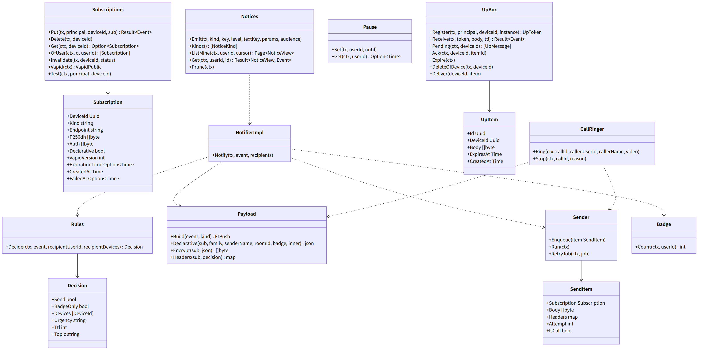
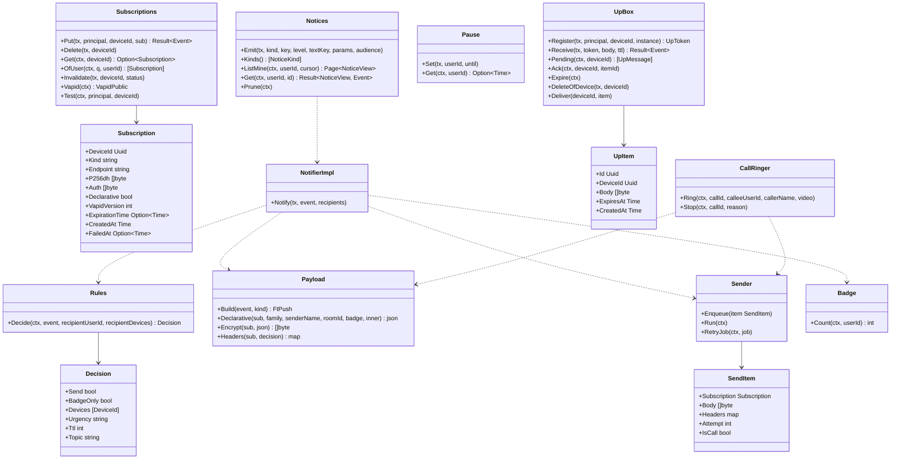

# srv-push（サーバー側・業務。通知の送信、規則、購読、(i) の受け口、知らせの発行と一覧）

## 受ける節

- [第7章 3 経路（DD-7-1、DD-7-2）](../../../../docs/jp/design/07_基本設計書_通知.md#3-経路dd-7-1dd-7-2)（経路）
- [第7章 3.1 家族のサーバーの受け口（(i)）](../../../../docs/jp/design/07_基本設計書_通知.md#31-家族のサーバーの受け口i)（家族のサーバーの受け口 (i)）
- [第7章 3.2 送信（api）](../../../../docs/jp/design/07_基本設計書_通知.md#32-送信api)（送信）
- [第7章 4 購読](../../../../docs/jp/design/07_基本設計書_通知.md#4-購読)（購読）
- [第7章 5.3 バッジ](../../../../docs/jp/design/07_基本設計書_通知.md#53-バッジ) のサーバーの側（バッジの値）
- [第7章 6 規則（DD-7-5、DD-7-6）](../../../../docs/jp/design/07_基本設計書_通知.md#6-規則dd-7-5dd-7-6)（規則。サーバーの判定）
- [第7章 7 着信の通知（DD-7-7）](../../../../docs/jp/design/07_基本設計書_通知.md#7-着信の通知dd-7-7) のサーバーの側（着信の繰り返し、`call_end`）
- [第7章 8 届かない時（DD-7-8）](../../../../docs/jp/design/07_基本設計書_通知.md#8-届かない時dd-7-8) のサーバーの側（購読は消さない）
- [第7章 9 システムの知らせ（DD-7-9）](../../../../docs/jp/design/07_基本設計書_通知.md#9-システムの知らせdd-7-9)（システムの知らせ：宛先と経路。しきい値の検出は srv-worker・srv-media・srv-admin）
- [第7章 11 数値の一覧（config.yaml の「通知」）](../../../../docs/jp/design/07_基本設計書_通知.md#11-数値の一覧configyaml-の通知)（数値）
- [第7章 13 失敗の扱い](../../../../docs/jp/design/07_基本設計書_通知.md#13-失敗の扱い)（失敗）
- [第2章 5.8 通知（第7章）](../../../../docs/jp/design/02_基本設計書_境界.md#58-通知第7章)（通知の経路）
- [第2章 5.3 構成員とプロフィール（第3章）](../../../../docs/jp/design/02_基本設計書_境界.md#53-構成員とプロフィール第3章) の `/me/notices`（自分宛の知らせの一覧）
- [第2章 7 通知の中身（第7章）](../../../../docs/jp/design/02_基本設計書_境界.md#7-通知の中身第7章)（通知の中身）
- [第2章 4.4 WebSocket と通知と SFU](../../../../docs/jp/design/02_基本設計書_境界.md#44-websocket-と通知と-sfu) の通知の行
- [第2章 9.2 エラーコード表の初期の項目（api/errors.yaml の正本。本章は番号と意味）](../../../../docs/jp/design/02_基本設計書_境界.md#92-エラーコード表の初期の項目apierrorsyaml-の正本本章は番号と意味) の PUSH-001〜003
- [第1章 4.2 外部とのやり取り](../../../../docs/jp/design/01_基本設計書_全体構成.md#42-外部とのやり取り) のプッシュ配信サービスの行（時間切れ、失敗の扱い）
- [第1章 7.4 メッセージの送信と配信](../../../../docs/jp/design/01_基本設計書_全体構成.md#74-メッセージの送信と配信) の 4（開いていない端末へ）
- [第1章 7.6 通話](../../../../docs/jp/design/01_基本設計書_全体構成.md#76-通話) の 2
- [第1章 12 外部への依存](../../../../docs/jp/design/01_基本設計書_全体構成.md#12-外部への依存)（中継が止まった時）
- [第12章 5.8 通知（DD-12-10。第7章・第9章と往復）](../../../../docs/jp/design/12_基本設計書_データと暗号化.md#58-通知dd-12-10第7章第9章と往復)（通知の中身は `event_id`、`room_id`、`sender_id`）
- [第12章 10 秘密の鍵（DD-12-15、R-12-7-1）](../../../../docs/jp/design/12_基本設計書_データと暗号化.md#10-秘密の鍵dd-12-15r-12-7-1) の VAPID の鍵の行
- 全体実装設計書 2.3（通知の送信の channel、`push_retry`）、3.1（購読、(i) のメールボックス）、4.3、I-8 の購読
- 全体実装設計書 4.1 の記録（`notices`、`notice_recipients`）

## 依存

- 下：
  - [srv-common](srv-common.md)（`PushTransport`、`Secrets.Vapid`、`Envelope`、`Clock`）
  - [srv-store](srv-store.md)（`Tx`、`Feed`、`Jobs`、`Retention`）
  - [srv-identity](srv-identity.md)（`Users.Settings`、`Guardians.Settings`、`Devices`、`Hooks` の登録、`Families.Get`）
  - srv-identity の `Users.List` と `Guardians.Of`（知らせの宛先を構成員へ解く）
  - [srv-rooms](srv-rooms.md)（`Members.Of`、`RoomMeStore.Get`、`Receipts.UnreadCount`、`FamilyRoom.Flow`、`Notifier` の実装）
- 部品：webpush-go（RFC 8291/8292）。
- 依存の逆転：
  - srv-rooms の `Notifier` を実装する。
  - srv-identity の `OnDeviceRevoked`（購読とメールボックスの削除）と `OnNotice`（`Notices.Emit`）に登録する。
  - srv-identity の `PushReader` を `Subscriptions.OfUser` で実装して渡す（端末の一覧の購読の有無）。q は srv-identity `Devices.List` の q。
  - srv-boundary の `Hub.Connected` を読む（開いている端末）。`UpWsHandler`（srv-boundary）が `UpBox` を `UpMailbox`（srv-boundary の interface）として呼ぶ。`UpBox.Receive` は `UpWsHandler.Deliver` を呼ぶ。

## クラス図

図の元の文（mermaid）

クラス図の注記（図の各メンバーの説明。仕様の節と番号を含む）

|クラス|メンバー|注記|
|---|---|---|
|Subscription|`+Kind string`|webpush か unifiedpush|
|Subscriptions|`+Put(tx, principal, deviceId, sub) Result~Event~`|PUSH-001。UnifiedPush は endpoint と VAPID の公開鍵の確認|
|Subscriptions|`+Invalidate(tx, deviceId, status)`|404 か 410 なら購読を消し、device.changed を送る（本人の端末）|
|Subscriptions|`+OfUser(ctx, q, userId) [Subscription]`|構成員の端末の購読（端末の識別子の順）。srv-identity `PushReader.SubscribedDevices` の実装。q は ctx のトランザクションか Pool（`/sync` の初回の一覧は srv-store `Pool.BeginSnapshot` の中で読む。全体実装設計書 2.4）|
|Subscriptions|`+Vapid(ctx) VapidPublic`|/me/push/vapid：公開鍵と版|
|Subscriptions|`+Test(ctx, principal, deviceId)`|/me/devices/{id}/push/test|
|Rules|`+Decide(ctx, event, recipientUserId, recipientDevices) Decision`|第7章 6 の決定表：着信を受けない（送信者に CALL-005 は srv-calls が先に判定）、人のミュート、トークのミュート（メンションは mention_overrides_mute）、一時停止（着信は送る）、子どもの時間帯（着信とメンションは送る）、silent（バッジだけ）、開いている端末（着信を除く）。エンベロープの設定は Users.Settings で復号|
|Decision|`+Devices [DeviceId]`|送る端末（開いている端末を除いた残り）|
|Decision|`+Urgency string`|normal か high|
|Payload|`+Build(event, kind) FtPush`|ft.push/1：`{v, event_id, room_id, sender_id, kind, call_id?, video?, reason?}`。本文なし。`reason` は call_end の時だけ|
|Payload|`+Declarative(sub, family, senderName, roomId, badge, inner) json`|iOS 18.4 以上の宣言型の包み `ft.push.declarative/1`（第2章 7）：`web_push: 8030`、`mutable: true`、`notification: {title, body, navigate, tag, silent, mutable: true, app_badge（文字列）, data: inner（ft.push/1）}`。`mutable` は外側と中の両方（18.4〜26.1 は中だけを読む。第2章 7）。着信は title「{name}さんから着信」、body「応答するには開いてください」、navigate `/call/<call_id>`、tag `call:<call_id>`、silent false。call_end は title「{name}さんからの着信」、body は reason が missed なら「不在着信」、他は「終わりました」で silent true。renotify は置かない。購読の `declarative` が真の時だけ|
|Payload|`+Encrypt(sub, json) []byte`|RFC 8291 aes128gcm（4,096 バイト以下）|
|Payload|`+Headers(sub, decision) map`|TTL、Urgency、Topic、Content-Encoding、VAPID（RFC 8292。aud = 中継の origin、exp 12 時間、sub = https://<サーバー>）|
|Sender|`+Enqueue(item SendItem)`|プロセスの中の channel（4 並列）|
|Sender|`+Run(ctx)`|PushTransport.Post の応答で分ける。201 は成功。404 と 410 は Invalidate。429 は Retry-After を待つ。5xx は 1、4、16 秒で 3 回（着信は 1 回）。それ以上は push_log に捨てた印（端末は開いた時に全差分）|
|Sender|`+RetryJob(ctx, job)`|jobs push_retry（プロセスの再起動を跨ぐ分）|
|Badge|`+Count(ctx, userId) int`|全トークの未読の合計（通知なし送信も、ミュートのトークも数える。設定で除外可）|
|CallRinger|`+Ring(ctx, callId, calleeUserId, callerName, video)`|kind: call、high、TTL 60、Topic は `call:<call_id>` の形（第2章 DD-2-8）。iPhone と PC の購読（Web Push）は 0 秒、20 秒、40 秒の 3 回（api のプロセスの timer。Stop で止める）。Android (i)/(ii) は 1 回（シェルが鳴らし続ける）。第7章 DD-7-7、7|
|CallRinger|`+Stop(ctx, callId, reason)`|timer を止め、Ring で送った端末へ kind: call_end（`reason` は answered、declined、cancelled、missed のいずれか。high、TTL 60、同じ Topic）。SW は着信の通知を閉じ、missed なら「不在着信」、他は音なしの「終わりました」を出す（第7章 7）。開いている端末にも送る（着信と同じ扱い。通知を閉じるため）|
|UpBox|`+Register(tx, principal, deviceId, instance) UpToken`|/up/register：token（256 ビット）と配布元の接続の秘密 ws_secret（256 ビット）を作り、endpoint https://<サーバー>/up/&lt;token&gt; と ws_secret を返す（ハッシュだけを置く。再登録は行を置き換える）|
|UpBox|`+VerifyWs(ctx, secret) Result~DeviceId, Event~`|srv-boundary `UpWsVerifier` の実装：ws_secret_sha256 で引き、無ければ AUTH-002（device_revoked）|
|UpBox|`+Receive(tx, token, body, ttl) Result~Event~`|/up/{token}（無認証）：4,096 バイト、1 端末 1,000 件（PUSH-003）。メールボックスへ。常時接続があれば即時に流す|
|UpBox|`+Pending(ctx, deviceId) [UpMessage]`|接続時に未配信を古い順に。`UpMessage` は srv-boundary の型（id、body、expires_at）|
|UpBox|`+Ack(ctx, deviceId, itemId)`|端末の ack で行を消す。その端末宛でない id は何もしない|
|UpBox|`+Expire(ctx)`|TTL|
|UpBox|`+Deliver(deviceId, item)`|srv-boundary `UpWsHandler.Deliver` を呼ぶ（接続の表は srv-boundary が持つ）。false ならメールボックスに残る|
|UpItem|`+Body []byte`|RFC 8291 の暗号文のまま|
|Pause|`+Set(tx, userId, until)`|1 時間、翌朝 8 時まで（端末の tz）、指定|
|Notices|`+Emit(tx, kind, key, level, textKey, params, audience)`|audience（self、all、admins、guardians、room のいずれか。self と guardians は構成員の識別子を、room はトークの識別子を伴う）を発行の時に構成員へ解く：self は本人、all は状態が停止・削除・抹消でない全員、admins は管理者、guardians は子の保護者（srv-identity Users.List、Guardians.Of）、room はそのトークの active の構成員のうち状態が停止・削除・抹消でない人（srv-rooms Members.Of。第7章 9 の `member_add_stalled`、`device_add_stalled`、`device_remove_stalled`）。notices 表に 1 行、notice_recipients に宛先ごとに 1 行、各宛先の feed に `notice` のイベントを積み、宛先の構成員の端末のうち開いていない端末へ通知（`ft.push/1` の kind notice、event_id は知らせの id。第7章 9、第2章 7）。srv-identity の hook OnNotice の実装は、kind から Kinds の表で level と text_key（`notice.<kind>`）を引いて Emit を呼ぶ。トークに残るものは FamilyRoom.Flow（srv-rooms）。key は事象の鍵（第7章 9 の表の「事象の鍵」の欄。呼ぶ側が欄の値を `:` で連ねて組む。hook OnNotice の実装は notice の key を渡す）。重複は notices 表の (kind, key, day) で抑える。day はサーバーの時刻帯（config `server.tz`）の暦日。`INSERT ... ON CONFLICT (kind, key, day) DO NOTHING` で行が入らなければ、宛先の記録、feed、通知、FamilyRoom.Flow のどれも行わずに戻る（第7章 9）|
|Notices|`+Kinds() [NoticeKind]`|第7章 9 の表の全行（識別子、level、params の欄の名）。表に無い kind の Emit はプログラムの誤り|
|Notices|`+Get(ctx, userId, id) Result~NoticeView, Event~`|`GET /me/notices/{id}`（第2章 5.3）。notice_recipients に本人の行が無ければ MEM-001|
|Notices|`+ListMine(ctx, userId, cursor) Page~NoticeView~`|`GET /me/notices`（第2章 5.3）：notice_recipients を本人で引き notices を結合。要素は id、kind、level、text_key、params、ts（`notice` のイベントの payload と同じ欄に id と ts）。並びは id（UUIDv7）の降順。before、after、limit は第2章 3 の一覧の規則|
|Notices|`+Prune(ctx)`|30 日より古い notices を消す（srv-store Retention.DeleteOlder。notice_recipients は同じ表の外部キーの削除に従う）。srv-worker PruneHandler が呼ぶ|
|NotifierImpl|`+Notify(tx, event, recipients)`|srv-rooms Notifier：各受け手に Rules.Decide、Payload、Sender.Enqueue（AfterCommit）の順。call は CallRinger|

## 公開操作（このブロックが所有する操作。番号は B-140〜）

|番号|操作（上の図）|使う側|由来|
|---|---|---|---|
|B-140|`Subscriptions`（`Put`、`Delete`、`Get`、`OfUser`、`Invalidate`、`Vapid`、`Test`）|operation（`/me/devices/{id}/push*`、`/me/push/vapid`）、srv-identity（`PushReader` の実装で端末の一覧の「購読の有無」、hook）、srv-admin（VAPID の交代の版）|[第7章 4 購読](../../../../docs/jp/design/07_基本設計書_通知.md#4-購読)、[第2章 5.8 通知（第7章）](../../../../docs/jp/design/02_基本設計書_境界.md#58-通知第7章)|
|B-141|`NotifierImpl`（srv-rooms の `Notifier` の実装）|srv-rooms（`Timeline.Post`、`PostScheduled`、`SystemEvent`。Flush の前に同じトランザクションで呼ばれる。送信は AfterCommit）|[第1章 7.4 メッセージの送信と配信](../../../../docs/jp/design/01_基本設計書_全体構成.md#74-メッセージの送信と配信)、[第7章 3.2 送信（api）](../../../../docs/jp/design/07_基本設計書_通知.md#32-送信api)|
|B-142|`Rules::Decide`|本ブロック、srv-calls（`CALL-005` の判定は srv-calls が `Users.Settings` を直接読む。本ブロックは通知の可否だけ）|[第7章 6 規則（DD-7-5、DD-7-6）](../../../../docs/jp/design/07_基本設計書_通知.md#6-規則dd-7-5dd-7-6)|
|B-143|`CallRinger`（`Ring`、`Stop`）|srv-calls|[第7章 7 着信の通知（DD-7-7）](../../../../docs/jp/design/07_基本設計書_通知.md#7-着信の通知dd-7-7)、[第6章 4.1 1 対 1](../../../../docs/jp/design/06_基本設計書_通話.md#41-1-対-1)|
|B-144|`UpBox`（`Register`、`Receive`、`Pending`、`Ack`、`Expire`、`DeleteOfDevice`、`Deliver`）|operation（`/up/register`、`/up/{token}`）、srv-boundary `UpWsHandler`、srv-worker（`Expire`）、srv-identity（hook）|[第7章 3.1 家族のサーバーの受け口（(i)）](../../../../docs/jp/design/07_基本設計書_通知.md#31-家族のサーバーの受け口i)、[第2章 5.8 通知（第7章）](../../../../docs/jp/design/02_基本設計書_境界.md#58-通知第7章)|
|B-145|`Pause`|operation（`/me/notifications/pause`）、本ブロック（規則）|[第7章 6 規則（DD-7-5、DD-7-6）](../../../../docs/jp/design/07_基本設計書_通知.md#6-規則dd-7-5dd-7-6)|
|B-146|`Badge::Count`|本ブロック（`app_badge`）、and-push は `/rooms` から自分で計算（第9章）|[第7章 5.3 バッジ](../../../../docs/jp/design/07_基本設計書_通知.md#53-バッジ)|
|B-147|`Notices::Emit`、`Kinds`、`ListMine`、`Get`、`Prune`|srv-admin（管理者の操作、更新、設定）、srv-worker（容量、証明書、バックアップ、DDNS、時刻、SMART、復元の試験、紙の確認、地図、KEK の交代の勧め、年齢の問い。`Prune`）、srv-media（容量のしきい値の値）、srv-identity と srv-keys（hook OnNotice と `Hooks.Notify` を経る。下のブロックは本ブロックを直に呼べない）、operation（`/me/notices` と `/me/notices/{id}`。タグ push）|[第7章 9 システムの知らせ（DD-7-9）](../../../../docs/jp/design/07_基本設計書_通知.md#9-システムの知らせdd-7-9)|

## アルゴリズム（差し替え点）

|事項|実装|切り替え|由来|
|---|---|---|---|
|暗号化|RFC 8291 aes128gcm（webpush-go。ソースで確認済み：第14章）|固定|[第7章 3.2 送信（api）](../../../../docs/jp/design/07_基本設計書_通知.md#32-送信api)|
|再送|1、4、16 秒（揺らぎ ±20%）で 3 回。着信は 1 回。プロセスの再起動を跨ぐ分は `jobs push_retry`|固定|[第1章 4.2 外部とのやり取り](../../../../docs/jp/design/01_基本設計書_全体構成.md#42-外部とのやり取り)、[第2章 13 失敗の扱い](../../../../docs/jp/design/02_基本設計書_境界.md#13-失敗の扱い)|
|同じトークの置き換え|`Topic` = SHA-256("room:" + room_id) の先頭 24 バイトの base64url（32 文字。着信は "call:" + call_id。第2章 DD-2-8）|固定|[第7章 3.2 送信（api）](../../../../docs/jp/design/07_基本設計書_通知.md#32-送信api)|
|着信の繰り返し|20 秒 × 3 回（Web Push の購読。iPhone と PC）。応答・拒否・取消・60 秒で止め、`call_end`（`reason`）を送る|固定（第7章 11）|[第7章 7 着信の通知（DD-7-7）](../../../../docs/jp/design/07_基本設計書_通知.md#7-着信の通知dd-7-7)|
|「翌朝 8 時」|本人の設定の tz（`ft.settings.user/1.tz`）|固定|[第7章 6 規則（DD-7-5、DD-7-6）](../../../../docs/jp/design/07_基本設計書_通知.md#6-規則dd-7-5dd-7-6)|

## データ設計（このブロックが形を持つ記録）

|記録|形|欄|由来|
|---|---|---|---|
|`push_subscriptions`|表|`device_id PK`、`kind`、`endpoint`、`p256dh bytea`、`auth bytea`、`declarative`、`vapid_version`、`expiration_time?`、`created_at`、`failed_at?`|[第7章 4 購読](../../../../docs/jp/design/07_基本設計書_通知.md#4-購読)、[第2章 5.8 通知（第7章）](../../../../docs/jp/design/02_基本設計書_境界.md#58-通知第7章)|
|`push_log`|表|`id`、`device_id`、`event_id?`、`call_id?`、`kind`、`status int`、`attempt`、`at`。30 日。本文なし|[第1章 8.1 データの一覧](../../../../docs/jp/design/01_基本設計書_全体構成.md#81-データの一覧)|
|`up_tokens`|表|`token_sha256 PK`、`device_id`、`instance`、`ws_secret_sha256`（一意）、`created_at`。端末の取り消しで消す|[第7章 3.1 家族のサーバーの受け口（(i)）](../../../../docs/jp/design/07_基本設計書_通知.md#31-家族のサーバーの受け口i)|
|`up_box`|表|`id`、`device_id`、`body bytea`、`expires_at`、`created_at`、`delivered_at?`。索引 (device_id, created_at)|[第7章 3.1 家族のサーバーの受け口（(i)）](../../../../docs/jp/design/07_基本設計書_通知.md#31-家族のサーバーの受け口i)|
|`notification_pause`|表|`user_id PK`、`until`|[第7章 6 規則（DD-7-5、DD-7-6）](../../../../docs/jp/design/07_基本設計書_通知.md#6-規則dd-7-5dd-7-6)|
|`notices`|表|`id`（UUIDv7）、`kind`、`key`、`day`、`level`、`text_key`、`params jsonb`、`audience`、`created_at`。一意 (kind, key, day)。30 日（`Prune`）|[第7章 9 システムの知らせ（DD-7-9）](../../../../docs/jp/design/07_基本設計書_通知.md#9-システムの知らせdd-7-9)|
|`notice_recipients`|表|`notice_id`（notices へ。削除に従う）、`user_id`。PK (notice_id, user_id)、索引 (user_id, notice_id)。発行の時に宛先を解いた結果|[第2章 5.3 構成員とプロフィール（第3章）](../../../../docs/jp/design/02_基本設計書_境界.md#53-構成員とプロフィール第3章)|
|通知の中身|`ft.push/1`|`{v: 1, event_id, room_id, sender_id, kind, call_id?}`（api/schemas。kind は message、call、call_end、notice のいずれか）|[第2章 7 通知の中身（第7章）](../../../../docs/jp/design/02_基本設計書_境界.md#7-通知の中身第7章)|
|宣言型の包み|JSON|`ft.push.declarative/1`（第2章 7。`web_push: 8030`、`mutable: true`、`notification: {title, body, navigate, tag, silent, app_badge, data: ft.push/1}`）|[第2章 7 通知の中身（第7章）](../../../../docs/jp/design/02_基本設計書_境界.md#7-通知の中身第7章)|
