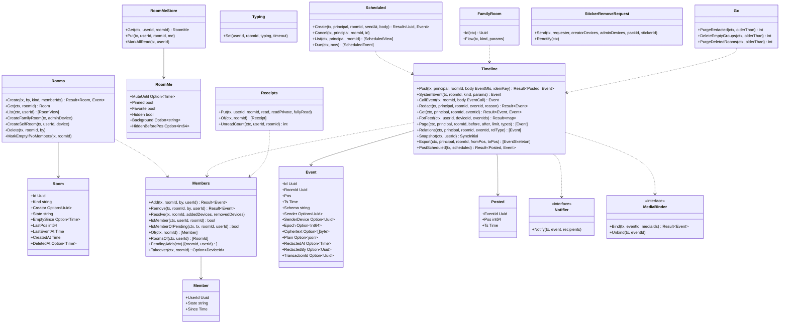

# srv-rooms（サーバー側・業務。トーク、イベント、feed、既読）

## 受ける節

- [第4章 3.2 関係の規則](../../../../docs/jp/design/04_基本設計書_トークとメッセージ.md#32-関係の規則) のサーバーが見る欄（`relates_to` の同じトークの確かめ、取消の権限と期限）
- [第4章 4.1 種類と状態](../../../../docs/jp/design/04_基本設計書_トークとメッセージ.md#41-種類と状態)（種類と状態、追加待ち・削除待ち、空のグループ、作成者）
- [第4章 4.2 一覧（DD-4-13）](../../../../docs/jp/design/04_基本設計書_トークとメッセージ.md#42-一覧dd-4-13) のサーバーの側（`/rooms/{id}/me`、すべて既読）
- [第4章 5.1 送信（DD-4-14）](../../../../docs/jp/design/04_基本設計書_トークとメッセージ.md#51-送信dd-4-14) のサーバーの側（記録、pos、エコー、`ROOM-006`）
- [第4章 5.4 既読と入力中（DD-4-4、DD-4-5）](../../../../docs/jp/design/04_基本設計書_トークとメッセージ.md#54-既読と入力中dd-4-4dd-4-5)（既読の単調、入力中）
- [第4章 5.5 メンションと通知なし送信（DD-4-6）](../../../../docs/jp/design/04_基本設計書_トークとメッセージ.md#55-メンションと通知なし送信dd-4-6)（`mentions`、`silent` の欄）
- [第4章 5.8 投票、ノート、予定、予約送信（DD-4-9）](../../../../docs/jp/design/04_基本設計書_トークとメッセージ.md#58-投票ノート予定予約送信dd-4-9) の予約送信のサーバーの側
- [第4章 5.9 スタンプ（DD-4-10、DD-4-11）](../../../../docs/jp/design/04_基本設計書_トークとメッセージ.md#59-スタンプdd-4-10dd-4-11) のスタンプの削除の求め（端末宛メールボックス）
- [第4章 6 家族全員のトーク（DD-4-16）](../../../../docs/jp/design/04_基本設計書_トークとメッセージ.md#6-家族全員のトークdd-4-16)（家族全員のトーク）
- [第4章 7 数値の一覧（config.yaml の「トーク」）](../../../../docs/jp/design/04_基本設計書_トークとメッセージ.md#7-数値の一覧configyaml-のトーク)（数値）
- [第4章 8 失敗の扱い](../../../../docs/jp/design/04_基本設計書_トークとメッセージ.md#8-失敗の扱い)（失敗）
- [第2章 5.5 トーク（第4章）](../../../../docs/jp/design/02_基本設計書_境界.md#55-トーク第4章)（トークの経路）
- [第2章 5.9 同期（第4章、第7章）](../../../../docs/jp/design/02_基本設計書_境界.md#59-同期第4章第7章) の初回（`since` なし）の中身
- [第2章 6 イベント（WebSocket と同期）](../../../../docs/jp/design/02_基本設計書_境界.md#6-イベントwebsocket-と同期)（イベントの形と一覧）
- [第2章 11 競合の規則（R-2-2-5）](../../../../docs/jp/design/02_基本設計書_境界.md#11-競合の規則r-2-2-5)（競合の規則）
- [第2章 12 データの形式（本章が定める共通の型。api/schemas）](../../../../docs/jp/design/02_基本設計書_境界.md#12-データの形式本章が定める共通の型apischemas)（`ft.event.*`）
- [第1章 7.4 メッセージの送信と配信](../../../../docs/jp/design/01_基本設計書_全体構成.md#74-メッセージの送信と配信)（送信と配信の順序）
- [第1章 8.4 保持と削除](../../../../docs/jp/design/01_基本設計書_全体構成.md#84-保持と削除)（取消と保持）
- [第1章 10.1 データのモデル](../../../../docs/jp/design/01_基本設計書_全体構成.md#101-データのモデル)（データのモデル）
- [第1章 10.5 並行処理](../../../../docs/jp/design/01_基本設計書_全体構成.md#105-並行処理)（トークの行の直列化）
- [第12章 9 消すこと（DD-12-13、R-12-6-1）](../../../../docs/jp/design/12_基本設計書_データと暗号化.md#9-消すことdd-12-13r-12-6-1) の取消・トークの削除・退出・削除の削除済みの印への置き換え
- [第12章 5.7 メッセージと添付（第4章・第5章と往復）](../../../../docs/jp/design/12_基本設計書_データと暗号化.md#57-メッセージと添付第4章第5章と往復) の予約送信と「システムの知らせは平文」
- [第12章 5.2 群の暗号（MLS）](../../../../docs/jp/design/12_基本設計書_データと暗号化.md#52-群の暗号mls) の暗号文の保管と順序
- [第7章 9 システムの知らせ（DD-7-9）](../../../../docs/jp/design/07_基本設計書_通知.md#9-システムの知らせdd-7-9) の「家族全員のトークに残る知らせ」のイベント（`notice` の発行は srv-push）
- 全体実装設計書 2.4（feed の書き方）、3.1（トーク、イベント、予約送信）、4.1〜4.3、I-2、I-3

## 依存

- 下：
  - [srv-common](srv-common.md)
  - [srv-store](srv-store.md)（`Tx`、`Feed`、`Notifier`、`RoomLock`、`Jobs`）
  - [srv-identity](srv-identity.md)（`Users`、役割、`Hooks` の登録）
  - [srv-keys](srv-keys.md)（`Groups` と `Inbox.Put`）
    - `Groups` の 8 つ：`Create`・`CheckSender`・`Epoch`・`CommitsSince`・`Commit`・`Reject`・`Reinit`・`PendingDevices`
    - タグ rooms の `/rooms/{id}/mls/*` の 5 操作は本ブロックが受けて srv-keys の `Groups` を呼ぶ。5 操作は epoch、commits、commit、reject、reinit。`reject` と `reinit` は構成員の確かめ（ROOM-002）の後にそのまま `Groups.Reject`、`Groups.Reinit` を呼ぶ（第12章 5.2 の復旧）。`POST /rooms/{id}/mls/commit` は同じトランザクションで `Groups.Commit`、`Members.Resolve` の順。`Groups.Commit` の前に RoomLock を取らない（`Groups.Commit` は、休眠の端末を承認済みへ戻す devices の行の錠を RoomLock より先に取る）。サーバーが Commit の Add と Remove を読む（第12章 5.2）。`GET /rooms/{id}/mls/epoch` は `Groups.Epoch` に構成員の追加待ち（`pending_add`）を足す
- 依存の逆転：
  - `Notifier`（イベントの後の通知の判定と送信）と `MediaBinder`（添付の結び付き）を本ブロックが定義し、srv-push と srv-media が実装して渡す。
  - srv-boundary の `RoomMembership` を実装する。
  - srv-keys の `RoomReader`（`RoomsOf`、`MembersOf`、`IsMemberOrPending`）を実装する。中身は `Members.RoomsOf`、`Members.Of`、`Members.IsMemberOrPending` で、組み立ての後に `Keys.SetRooms` で渡す。
  - 錠の順：`RoomLock` の後に srv-identity の行（users、devices）の錠を取らない。取り消しの hook が devices の後に rooms を取るため（srv-keys のページの「錠の順」）。
  - srv-identity の hook に登録する。
    - `OnUserCreated(tx, userId, firstDeviceId)`（家族全員のトークが無ければ作り、あれば追加待ちに置く。前者は設置、後者は参加）
    - `OnUserSuspended`（システムの知らせ）
    - `OnUserDeleted`（削除済みの印への置き換えの選択）
- 上：srv-calls、srv-push、srv-admin、srv-worker は `SystemEvent`／`Notice`／`PostScheduled` を呼ぶ。

## クラス図

図の元の文（mermaid）

クラス図の注記（図の各メンバーの説明。仕様の節と番号を含む）

|クラス|メンバー|注記|
|---|---|---|
|Room|`+Kind string`|dm、group、self、family のいずれか|
|Room|`+Creator Option~Uuid~`|group。退出・削除で None|
|Room|`+State string`|normal、empty、deleted のいずれか|
|Room|`+LastPos int64`|一覧の並びの元（このトークの最新のイベントの pos は利用者ごとに違うので、最新のイベントの ts を持つ）|
|Rooms|`+Create(tx, by, kind, memberIds) Result~Room, Event~`|dm は同じ 2 人で既にあれば ROOM-004 で既存。group は上限 = 家族の人数。Groups.Create（epoch 0）。room.member(added) と pending_add（作成者の端末が Commit）|
|Rooms|`+List(ctx, userId) [RoomView]`|/rooms：種類、構成員、自分の設定、未読の数（fully_read より後の件数。システムの知らせ・既読・入力中・自分の送信を除く）、最後のイベントの pos、epoch|
|Rooms|`+CreateFamilyRoom(tx, adminDevice)`|設置の時（srv-identity の hook `OnUserCreated` の中で、家族全員のトークが無い時。本ブロックは srv-identity の上なので、srv-identity からは呼ばれない）|
|Rooms|`+CreateSelfRoom(tx, userId, device)`|参加の時|
|Rooms|`+Delete(tx, roomId, by)`|作成者・管理者。全 leaf を pending_remove、イベントを削除済みの印、添付の参照を外す、通話を ended（srv-calls）。30 日の空のグループは srv-worker gc から|
|Members|`+Add(tx, roomId, by, userId) Result~Event~`|dm は不可。state = pending_add。room.member(pending_add)。Commit が来るまで読めない|
|Members|`+Remove(tx, roomId, by, userId) Result~Event~`|作成者・管理者・本人（退出）。ROOM-003 / ROOM-011。pending_remove|
|Members|`+Resolve(tx, roomId, addedDevices, removedDevices)`|`POST /rooms/{id}/mls/commit` の受けが、srv-keys Groups.Commit の後に同じトランザクションで呼ぶ（引数は Groups.Commit が返した端末。サーバーが Commit から読んだ物で、端末の申告ではない）。pending_add の構成員は、その人の端末が 1 つでも leaf を得たら active に。pending_remove の構成員は、その人の leaf が無くなったら removed か left に。room.member（added、removed、left のいずれか）。SystemEvent|
|Members|`+IsMember(ctx, userId, roomId) bool`|現在の構成員（srv-boundary RoomMembership）|
|Members|`+IsMemberOrPending(ctx, tx, roomId, userId) bool`|active か pending_add の構成員か（srv-keys RoomReader の実装。Commit の Add の端末の本人の確かめ）|
|Members|`+PendingAdds(ctx) [(roomId, userId)]`|7 日残れば知らせ（srv-worker monitor）|
|Members|`+Takeover(ctx, roomId) Option~DeviceId~`|追加待ちを次の端末が引き継ぐ判定（第4章 4.1）。構成員の追加待ち（room_members）と端末の追加待ち・削除待ち・再参加待ち（srv-keys mls_pending。第12章 5.5、5.2 の復旧）の全部。再参加待ちは、その端末の Remove と新しい KeyPackage の Add を 1 つの Commit で行う。KeyPackage が取れなければ（KEY-001）Remove だけでよく、サーバーがその端末を追加待ちに替える|
|Member|`+State string`|pending_add、active、pending_remove、removed、left のいずれか|
|RoomMe|`+HiddenBeforePos Option~int64~`|端末から消した位置（新着で戻る）|
|RoomMeStore|`+Put(tx, userId, roomId, me)`|room.me を本人の全端末へ|
|RoomMeStore|`+MarkAllRead(tx, userId)`|すべて既読（receipts を一括）|
|Event|`+Pos`|利用者ごと（feed）。本体には持たない|
|Event|`+Schema string`|ft.event.mls/1、ft.event.system/1、ft.event.call/1、ft.event.redaction/1 のいずれか|
|Event|`+Sender Option~Uuid~`|system は None|
|Event|`+Epoch Option~int64~`|mls|
|Event|`+Ciphertext Option~[]byte~`|mls。削除済みの印で NULL|
|Event|`+Plain Option~json~`|system / call / redaction の中身、mls の平文の欄（mentions、relates_to、attachments、schema_inner、expires_at）。silent は要求の欄から events.silent へ（第2章 5.5）|
|Event|`+TransactionId Option~Uuid~`|エコー用|
|Timeline|`+Post(tx, principal, roomId, body EventMls, idemKey) Result~Posted, Event~`|次の順に行う。1. RoomLock。2. 構成員か（ROOM-002）。3. 大きさ 256 KiB（ROOM-005）。4. Groups.CheckSender（本文の外側の確かめ。同じトランザクションを渡す。ROOM-005 か ROOM-006。第12章 5.2）。5. relates_to が同じトークか（ROOM-012）。rel_type が replace なら対象の sender_id が本人で、対象の ts から 15 分以内（ROOM-009。第4章 3.2）。6. MediaBinder.Bind（MEDIA-002）。7. events に書く。8. 構成員ごとに Feed.Append（溜めるだけ）。9. Feed.Flush（宛先の識別子の順に採番して書き、宛先ごとに pg_notify。本操作は応答に pos を要するので自分で呼ぶ。この後は行の錠を取らない。全体実装設計書 2.4）。応答は {id, pos(本人。Flush が入れた FeedPending.Pos), ts}|
|Timeline|`+SystemEvent(tx, roomId, kind, params) Event`|ft.event.system/1（平文）。本文なし|
|Timeline|`+CallEvent(tx, roomId, body EventCall) Event`|srv-calls から|
|Timeline|`+Redact(tx, principal, roomId, eventId, reason) Result~Event~`|送信者（7 日。ROOM-009。対象が本人の annotation なら期限なし。平文の relates_to で判定。第4章 3.2、G-15）、作成者・管理者（期限なし。理由）。ciphertext=NULL、redacted_*。MediaBinder.Unbind。ft.event.redaction/1 を feed へ。暗号文は猶予 7 日の後に物理削除（gc）|
|Timeline|`+Get(ctx, principal, roomId, eventId) Result~Event, Event~`|ROOM-007 / ROOM-008（削除済みの印は骨だけ）|
|Timeline|`+ForFeed(ctx, userId, deviceId, eventIds) Result~map~`|srv-boundary の EventSource の実装（hub と /sync）。イベントの識別子から ft.room_event/1 を 1 回の読みで返す。利用者が今の構成員でないトークの物は返さない。取り消しは骨だけ。transaction_id は deviceId が送った端末の時だけ|
|Timeline|`+Page(ctx, principal, roomId, before, after, limit, types) [Event]`|カーソル|
|Timeline|`+Snapshot(ctx, userId) SyncInitial`|/sync の since なし：全トークの一覧と最新の pos|
|Timeline|`+Export(ctx, principal, roomId, fromPos, toPos) [EventSkeleton]`|骨の一括（本文は端末）|
|Timeline|`+PostScheduled(tx, scheduled) Result~Posted, Event~`|srv-worker から。時刻は元の予約の時刻。「遅れて送られました」の印は ts と scheduled_at の差で端末が判定|
|Receipts|`+Put(tx, userId, roomId, read, readPrivate, fullyRead)`|単調に進める。後退は無視して 200。room.receipt（公開は構成員へ、私的は本人へ）|
|Receipts|`+Of(ctx, roomId) [Receipt]`|既読の名前（タップ）|
|Typing|`+Set(userId, roomId, typing, timeout)`|記憶の上。Hub.Broadcast room.typing（pos なし）。10 秒で消す|
|Scheduled|`+Create(tx, principal, roomId, sendAt, body) Result~Uuid, Event~`|30 日先まで（ROOM-010）。Jobs.Enqueue scheduled_send(run_at)。room.scheduled|
|Scheduled|`+Due(ctx, now) [ScheduledEvent]`|srv-worker|
|FamilyRoom|`+Flow(tx, kind, params)`|参加、退出、停止、再開、削除、誕生日、管理者の操作、容量・証明書・バックアップ・更新の知らせ（第4章 6 の表）を SystemEvent にする|
|StickerRemoveRequest|`+Send(tx, requester, creatorDevices, adminDevices, packId, stickerId)`|端末宛メールボックス（srv-keys Inbox.Put）。本人・作成者・管理者だけ|
|StickerRemoveRequest|`+Renotify(ctx)`|7 日ごと（srv-worker）|
|Notifier|`+Notify(tx, event, recipients)`|実装は srv-push|
|MediaBinder|`+Bind(tx, eventId, mediaIds) Result~Event~`|実装は srv-media。完了していない id は MEDIA-002|
|Gc|`+PurgeRedacted(ctx, olderThan) int`|猶予 7 日の後の暗号文の物理削除|
|Gc|`+DeleteEmptyGroups(ctx, olderThan) int`|30 日|

## 公開操作（このブロックが所有する操作。番号は B-100〜）

|番号|操作（上の図）|使う側|由来|
|---|---|---|---|
|B-100|`Rooms`（`Create`、`Get`、`List`、`CreateFamilyRoom`、`CreateSelfRoom`、`Delete`）|operation（`/rooms*`）、srv-identity（設置と参加）、srv-admin（`/admin/rooms`、空のグループの削除）|[第4章 4.1 種類と状態](../../../../docs/jp/design/04_基本設計書_トークとメッセージ.md#41-種類と状態)、[第2章 5.5 トーク（第4章）](../../../../docs/jp/design/02_基本設計書_境界.md#55-トーク第4章)|
|B-101|`Members`（`Add`、`Remove`、`Resolve`、`IsMember`、`IsMemberOrPending`、`Of`、`RoomsOf`、`PendingAdds`、`Takeover`）。srv-boundary の `RoomMembership` と srv-keys の `RoomReader` の実装|operation、本ブロックの `/mls/commit` の受け（`Resolve`）、srv-keys（`RoomReader`）、srv-identity（hook）、srv-push（宛先）、srv-calls（参加の資格）、srv-worker（`PendingAdds`）|[第4章 4.1 種類と状態](../../../../docs/jp/design/04_基本設計書_トークとメッセージ.md#41-種類と状態)、[第2章 4.3 認可の 3 つの基本](../../../../docs/jp/design/02_基本設計書_境界.md#43-認可の-3-つの基本)|
|B-102|`RoomMeStore`|operation（`/rooms/{id}/me`、すべて既読）、srv-push（`mute_until`）|[第4章 4.2 一覧（DD-4-13）](../../../../docs/jp/design/04_基本設計書_トークとメッセージ.md#42-一覧dd-4-13)、[第7章 6 規則（DD-7-5、DD-7-6）](../../../../docs/jp/design/07_基本設計書_通知.md#6-規則dd-7-5dd-7-6)|
|B-103|`Timeline`（`Post`、`SystemEvent`、`CallEvent`、`Redact`、`Get`、`Page`、`Relations`、`Snapshot`、`Export`、`PostScheduled`）|operation、srv-calls（`CallEvent`、`SystemEvent`）、srv-identity・srv-admin・srv-push（`SystemEvent`）、srv-worker（`PostScheduled`）、srv-boundary（`Snapshot`）、srv-push（通知の中身の `event_id` の確認）|[第4章 5.1 送信（DD-4-14）](../../../../docs/jp/design/04_基本設計書_トークとメッセージ.md#51-送信dd-4-14)、[第4章 3.2 関係の規則](../../../../docs/jp/design/04_基本設計書_トークとメッセージ.md#32-関係の規則)、[第2章 6 イベント（WebSocket と同期）](../../../../docs/jp/design/02_基本設計書_境界.md#6-イベントwebsocket-と同期)、[第12章 9 消すこと（DD-12-13、R-12-6-1）](../../../../docs/jp/design/12_基本設計書_データと暗号化.md#9-消すことdd-12-13r-12-6-1)|
|B-104|`Receipts`|operation（`/rooms/{id}/receipts`）、srv-push（未読の合計）|[第4章 5.4 既読と入力中（DD-4-4、DD-4-5）](../../../../docs/jp/design/04_基本設計書_トークとメッセージ.md#54-既読と入力中dd-4-4dd-4-5)|
|B-105|`Typing`|srv-boundary（WebSocket の `typing`、`PUT /rooms/{id}/typing`）|[第4章 5.4 既読と入力中（DD-4-4、DD-4-5）](../../../../docs/jp/design/04_基本設計書_トークとメッセージ.md#54-既読と入力中dd-4-4dd-4-5)|
|B-106|`Scheduled`|operation、srv-worker（`Due`）|[第4章 5.8 投票、ノート、予定、予約送信（DD-4-9）](../../../../docs/jp/design/04_基本設計書_トークとメッセージ.md#58-投票ノート予定予約送信dd-4-9)|
|B-107|`FamilyRoom`|srv-identity、srv-admin、srv-push（知らせのイベント）、srv-worker（誕生日）|[第4章 6 家族全員のトーク（DD-4-16）](../../../../docs/jp/design/04_基本設計書_トークとメッセージ.md#6-家族全員のトークdd-4-16)|
|B-108|`StickerRemoveRequest`|operation（第4章 5.9 の「削除を求める」）、srv-worker（再通知）|[第4章 5.9 スタンプ（DD-4-10、DD-4-11）](../../../../docs/jp/design/04_基本設計書_トークとメッセージ.md#59-スタンプdd-4-10dd-4-11)|
|B-109|`Notifier`、`MediaBinder`（定義）|srv-push、srv-media（実装）|[第1章 7.4 メッセージの送信と配信](../../../../docs/jp/design/01_基本設計書_全体構成.md#74-メッセージの送信と配信)|
|B-110|`Gc`|srv-worker|[第12章 9 消すこと（DD-12-13、R-12-6-1）](../../../../docs/jp/design/12_基本設計書_データと暗号化.md#9-消すことdd-12-13r-12-6-1)、[第4章 4.1 種類と状態](../../../../docs/jp/design/04_基本設計書_トークとメッセージ.md#41-種類と状態)|

## アルゴリズム（差し替え点）

|事項|実装|切り替え|由来|
|---|---|---|---|
|未読の数|正。`fully_read` の ts より後の `events` の件数。除くのは system、receipt、typing、通話の記録（`ft.event.call/1`）、削除済みの印、annotation（relates_to.rel_type）、自分の送信。索引 (room_id, ts)。人のミュートは除かない（一覧の印を薄くするだけ。第4章 5.10）|固定|[第4章 4.2 一覧（DD-4-13）](../../../../docs/jp/design/04_基本設計書_トークとメッセージ.md#42-一覧dd-4-13)|
|トークの並びの元|`rooms.last_event_at`|固定|[第4章 4.2 一覧（DD-4-13）](../../../../docs/jp/design/04_基本設計書_トークとメッセージ.md#42-一覧dd-4-13)|
|取消の権限|送信者は 7 日（設定「取消の期限」）。作成者・管理者は期限なし + 理由 + 全員に知らせ|設定|[第4章 3.2 関係の規則](../../../../docs/jp/design/04_基本設計書_トークとメッセージ.md#32-関係の規則)|
|イベントの大きさ|256 KiB（暗号文を含む本体の JSON）|固定|[第2章 6.1 共通の形](../../../../docs/jp/design/02_基本設計書_境界.md#61-共通の形)|

## データ設計（このブロックが形を持つ記録）

|記録|形|欄|由来|
|---|---|---|---|
|`rooms`|表|`id`、`kind`、`creator_id?`、`state`、`empty_since?`、`last_event_at`、`created_at`、`deleted_at?`、`dm_key text?`（dm の 2 人の id を並べた一意の鍵。ROOM-004）|[第4章 4.1 種類と状態](../../../../docs/jp/design/04_基本設計書_トークとメッセージ.md#41-種類と状態)|
|`room_members`|表|`room_id`、`user_id`、`state`、`since`、`by?`。PK (room_id, user_id)|[第4章 4.1 種類と状態](../../../../docs/jp/design/04_基本設計書_トークとメッセージ.md#41-種類と状態)|
|`room_me`|表|`user_id`、`room_id`、`mute_until?`、`pinned`、`favorite`、`hidden`、`background?`、`hidden_before_pos?`。PK (user_id, room_id)|[第4章 4.2 一覧（DD-4-13）](../../../../docs/jp/design/04_基本設計書_トークとメッセージ.md#42-一覧dd-4-13)|
|`events`|表|`id`、`room_id`、`ts`、`schema`、`sender_id?`、`sender_device_id?`、`epoch?`、`ciphertext bytea?`、`plain jsonb?`、`redacted_at?`、`redacted_by?`、`redact_reason?`、`transaction_id?`、`silent bool`。索引 (room_id, ts)、(room_id, id)。本文の平文の列は無い（I-1）|[第2章 12 データの形式（本章が定める共通の型。api/schemas）](../../../../docs/jp/design/02_基本設計書_境界.md#12-データの形式本章が定める共通の型apischemas)、[第2章 6.2 イベントの一覧（asyncapi.yaml の `channels`）](../../../../docs/jp/design/02_基本設計書_境界.md#62-イベントの一覧asyncapiyaml-の-channels)|
|`event_relations`|表|`room_id`、`event_id`、`rel_type`、`target_event_id`、`key?`。索引 (target_event_id)。`relates_to` のコピー（`/relations` の読み出し用）|[第4章 3.2 関係の規則](../../../../docs/jp/design/04_基本設計書_トークとメッセージ.md#32-関係の規則)|
|`receipts`|表|`user_id`、`room_id`、`read_event_id?`、`read_private_event_id?`、`fully_read_event_id?`、`updated_at`。PK (user_id, room_id)|[第4章 5.4 既読と入力中（DD-4-4、DD-4-5）](../../../../docs/jp/design/04_基本設計書_トークとメッセージ.md#54-既読と入力中dd-4-4dd-4-5)|
|`scheduled_events`|表|`id`、`room_id`、`user_id`、`device_id`、`send_at`、`body jsonb`（`ft.event.mls/1` の暗号文を含む）、`state`、`job_id`、`created_at`|[第4章 5.8 投票、ノート、予定、予約送信（DD-4-9）](../../../../docs/jp/design/04_基本設計書_トークとメッセージ.md#58-投票ノート予定予約送信dd-4-9)|
|`feed` の `kind`|列挙|第2章 6.2 の type（本ブロックが定義。srv-store が持つ）|[第2章 6.2 イベントの一覧（asyncapi.yaml の `channels`）](../../../../docs/jp/design/02_基本設計書_境界.md#62-イベントの一覧asyncapiyaml-の-channels)|
|`SyncInitial`|構造|`{snapshot: SyncSnapshot, pos: <最新>}`。`SyncSnapshot` は境界の生成の型（`{rooms, users, devices}`。api の `SyncSnapshot`）。snapshot と pos は 1 つの読み（同じトランザクション）で取り、pos より後の変化は端末が `/sync?since=pos` で取る|[第2章 5.9 同期（第4章、第7章）](../../../../docs/jp/design/02_基本設計書_境界.md#59-同期第4章第7章)|
|`RoomView`|構造|`{id, kind, members: [user_id], me: RoomMe, unread, last_pos, last_event_at, epoch, creator_id?}`|[第2章 5.5 トーク（第4章）](../../../../docs/jp/design/02_基本設計書_境界.md#55-トーク第4章)|
