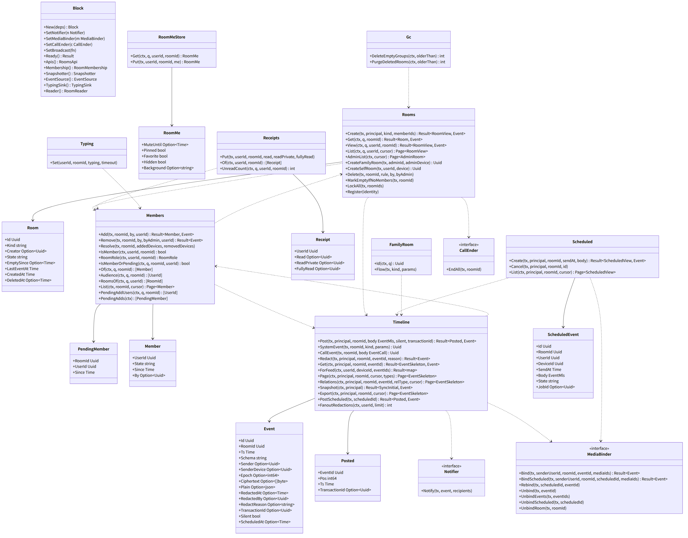
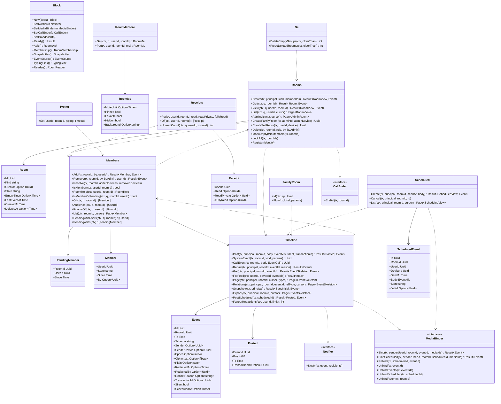

# srv-rooms（サーバー側・業務。トーク、イベント、feed、既読）

## 受ける節

- [第4章 3.2 関係の規則](../../../../docs/jp/design/04_基本設計書_トークとメッセージ.md#32-関係の規則) のサーバーが見る欄（`relates_to` の同じトークの確かめ、取消の権限と期限）
- [第4章 4.1 種類と状態](../../../../docs/jp/design/04_基本設計書_トークとメッセージ.md#41-種類と状態)（種類と状態、追加待ち・削除待ち、空のグループ、作成者）
- [第4章 4.2 一覧（DD-4-13）](../../../../docs/jp/design/04_基本設計書_トークとメッセージ.md#42-一覧dd-4-13) のサーバーの側（`/rooms/{id}/me`、すべて既読）
- [第4章 5.1 送信（DD-4-14）](../../../../docs/jp/design/04_基本設計書_トークとメッセージ.md#51-送信dd-4-14) のサーバーの側（記録、pos、エコー、`ROOM-006`）
- [第4章 5.4 既読と入力中（DD-4-4、DD-4-5）](../../../../docs/jp/design/04_基本設計書_トークとメッセージ.md#54-既読と入力中dd-4-4dd-4-5)（既読の単調、入力中）
- [第4章 5.5 メンションと通知なし送信（DD-4-6）](../../../../docs/jp/design/04_基本設計書_トークとメッセージ.md#55-メンションと通知なし送信dd-4-6)（`mentions`、`silent` の欄）
- [第4章 5.8 投票、ノート、予定、予約送信（DD-4-9）](../../../../docs/jp/design/04_基本設計書_トークとメッセージ.md#58-投票ノート予定予約送信dd-4-9) の予約送信のサーバーの側
- [第4章 6 家族全員のトーク（DD-4-16）](../../../../docs/jp/design/04_基本設計書_トークとメッセージ.md#6-家族全員のトークdd-4-16)（家族全員のトーク）
- [第4章 7 数値の一覧（config.yaml の「トーク」）](../../../../docs/jp/design/04_基本設計書_トークとメッセージ.md#7-数値の一覧configyaml-のトーク)（数値）
- [第4章 8 失敗の扱い](../../../../docs/jp/design/04_基本設計書_トークとメッセージ.md#8-失敗の扱い)（失敗）
- [第2章 5.5 トーク（第4章）](../../../../docs/jp/design/02_基本設計書_境界.md#55-トーク第4章)（トークの経路）
- [第2章 5.9 同期（第4章、第7章）](../../../../docs/jp/design/02_基本設計書_境界.md#59-同期第4章第7章) の初回（`since` なし）の中身
- [第2章 6 イベント（WebSocket と同期）](../../../../docs/jp/design/02_基本設計書_境界.md#6-イベントwebsocket-と同期)（イベントの形と一覧）
- [第2章 11 競合の規則（R-2-2-5）](../../../../docs/jp/design/02_基本設計書_境界.md#11-競合の規則r-2-2-5)（競合の規則）
- [第2章 12 データの形式（本章が定める共通の型。api/schemas）](../../../../docs/jp/design/02_基本設計書_境界.md#12-データの形式本章が定める共通の型apischemas)（`ft.event.*`）
- [第1章 7.4 メッセージの送信と配信](../../../../docs/jp/design/01_基本設計書_全体構成.md#74-メッセージの送信と配信)（送信と配信の順序）
- [第1章 8.4 保持と削除](../../../../docs/jp/design/01_基本設計書_全体構成.md#84-保持と削除)（取消と保持）
- [第1章 10.1 データのモデル](../../../../docs/jp/design/01_基本設計書_全体構成.md#101-データのモデル)（データのモデル）
- [第1章 10.5 並行処理](../../../../docs/jp/design/01_基本設計書_全体構成.md#105-並行処理)（トークの行の直列化）
- [第12章 9 消すこと（DD-12-13、R-12-6-1）](../../../../docs/jp/design/12_基本設計書_データと暗号化.md#9-消すことdd-12-13r-12-6-1) の取消・トークの削除・退出・削除の削除済みの印への置き換え
- [第12章 5.7 メッセージと添付（第4章・第5章と往復）](../../../../docs/jp/design/12_基本設計書_データと暗号化.md#57-メッセージと添付第4章第5章と往復) の予約送信と「システムの知らせは平文」
- [第12章 5.2 群の暗号（MLS）](../../../../docs/jp/design/12_基本設計書_データと暗号化.md#52-群の暗号mls) の暗号文の保管と順序
- [第7章 9 システムの知らせ（DD-7-9）](../../../../docs/jp/design/07_基本設計書_通知.md#9-システムの知らせdd-7-9) の「家族全員のトークに残る知らせ」のイベント（`notice` の発行は srv-push）
- 全体実装設計書 2.4（feed の書き方）、3.1（トーク、イベント、予約送信）、4.1〜4.3、I-2、I-3

## 依存

- 下：
  - [srv-common](srv-common.md)
  - [srv-store](srv-store.md)（`Tx`、`Feed`、`Notifier`、`RoomLock`、`Jobs`、`Pool.BeginSnapshot`）。`BeginSnapshot` は `Timeline.Snapshot` の 1 つの見え方の読み。`Feed.LastRoomEventPos` は `Rooms.List` の `last_pos`（本人の feed の、そのトークの最新の room.event の pos）
  - [srv-identity](srv-identity.md)（`Users`、`Devices` の読み（q を受ける）、役割、`Hooks` の登録）
  - [srv-keys](srv-keys.md)（`Groups`）
    - `Groups` の 13 つ。作成と確かめは `Create`、`CheckSender`。一覧の epoch は `EpochsOf`。`/mls/*` の受けは `Epoch`、`CommitsSince`、`Commit`、`Reject`、`Reinit`。読みは `Leaves`、`PendingDevices`、`RoomsOfDevices`（端末が leaf か待ちを持つトーク。hook の錠の和に使う）。退出と削除は `RequestRemoveUser`、`Drop`。`Leaves` は `Members.Resolve` が残りの leaf を読む。`RequestRemoveUser` は、その人の leaf を持つ端末ごとの削除待ちを立てる（第12章 5.2）。呼ぶのは `Members.Remove` と削除・抹消の hook。`Drop` はグループの記録を全部消す。呼ぶのは `Rooms.Delete` と、Commit を作れる端末が残らない退出の `Members.Remove`
    - タグ rooms の `/rooms/{id}/mls/*` の 5 操作は本ブロックが受けて srv-keys の `Groups` を呼ぶ。5 操作は epoch、commits、commit、reject、reinit。`reject` と `reinit` は構成員の確かめ（ROOM-002）の後にそのまま `Groups.Reject`、`Groups.Reinit` を呼ぶ（第12章 5.2 の復旧）。`POST /rooms/{id}/mls/commit` は同じトランザクションで `Groups.Commit`、`Members.Resolve` の順。`POST /rooms/{id}/mls/reinit` も同じトランザクションで `Groups.Reinit`、`Members.Resolve`（引数の端末は空）の順。前の世代の leaf が消えるので、削除待ちの構成員は全部外れる。`Groups.Commit` の前に RoomLock を取らない（`Groups.Commit` は、休眠の端末を承認済みへ戻す devices の行の錠を RoomLock より先に取る）。サーバーが Commit の Add と Remove を読む（第12章 5.2）。`GET /rooms/{id}/mls/epoch` は `Groups.Epoch` に構成員の追加待ち（`pending_add`）を足す
- 依存の逆転：
  - 本ブロックが定義する口は 3 つ。`Notifier`（イベントの後の通知の判定と送信）、`MediaBinder`（添付の結び付き）、`CallEnder`（トークの削除で進行中の通話を終える）。srv-push、srv-media、srv-calls が実装し、組み立ての後に渡す（`SetNotifier`、`SetMediaBinder`、`SetCallEnder`）。入力中（room.typing）の送り先 `SetBroadcast` も組み立ての後に渡す。中身は srv-boundary の `Hub.Broadcast` で、hub は本ブロックの `TypingSink` を受けて組まれる。
  - srv-boundary の `RoomMembership`（`IsMember`、`RoomRole`）、`Snapshotter`、`EventSource`、`TypingSink` を実装する。
  - srv-keys の `RoomReader`（`RoomsOf`、`MembersOf`、`IsMemberOrPending`）を実装する。中身は `Members.RoomsOf`、`Members.Audience`、`Members.IsMemberOrPending` で、tx を q として渡す。組み立ての後に `Keys.SetRooms` で渡す。
  - 錠の順：`RoomLock` の後に srv-identity の行（users、devices）の錠を取らない。取り消しの hook が devices の後に rooms を取るため（srv-keys のページの「錠の順」）。本ブロックが srv-identity の行を取るのは `RoomLock` の前の共有の錠だけである。`Members.Add`・`Rooms.Create` が `Users.LockShared` で、入れる人の users の行を識別子の順に取る。停止・削除・抹消が users の行を持つ間は待ち、終わった後の状態で断る。これで停止・削除・抹消が読んだトークの和が後から増えない（全体実装設計書 2.4、I-18）。本ブロックの中の順は次のとおり。
    0. srv-identity の users（共有。`Members.Add`、`Rooms.Create` だけ）
    1. rooms
    2. srv-keys の MLS の表（mls_groups、mls_pending）
    3. room_members、events、receipts、scheduled_events、redaction_backlog
    4. srv-store の jobs
    5. srv-calls の calls（CallEnder）
    - 2 と 3 の行は、そのトークの RoomLock を持つトランザクションだけが取る。srv-keys の MLS の表を書く操作は全部 RoomLock を先に取り、3 の表を書くのは本ブロックだけ。なので同じトランザクションの中の 2 と 3 の前後は待ち合いを生まない（退出の後に構成員が残らない時の `Groups.Drop` は room_members の後）。複数のトークの RoomLock は識別子の順に取る。1 つのトランザクションで 2 つ以上のトークの錠を取る時は、最初に全部を識別子の順に取り、その後に新しいトークの錠を取らない（全体実装設計書 2.4、I-18）。停止・削除・抹消・端末の取り消しでは、複数のブロックの hook が rooms の錠を取る。srv-identity が最初に呼ぶ hook `OnBeforeUserChange`・`OnBeforeDeviceRevoke` で本ブロックが和を取る（下の hook の節）。別々に順に取ると和としては順が崩れる。srv-admin の空のグループの削除は、消すトークと家族全員のトーク（監査の記録が書く）を `Rooms.LockAll` で先に取る
  - srv-calls は `Timeline.CallEvent` を呼ぶトランザクションで、calls の行を書く前に RoomLock を取る。トークの削除が rooms の後に calls を取るため
  - srv-identity の hook に登録する。
    - `OnBeforeUserChange(tx, userId, deviceIds)`：停止・削除・抹消の始めに srv-identity が呼ぶ。呼ぶのは users、devices、sessions の行の錠の後、他の hook の前である。そのトランザクションが触れ得る全部のトークの和を識別子の順に RoomLock で取る。行の無いトークは飛ばし、削除済みは取る。和は次の 4 つの読みの合わせである。本人が active か pending_add のトーク（`Members.RoomsOf`。外す対象）。本人の端末が leaf か待ちを持つトーク（srv-keys `Groups.RoomsOfDevices(q, deviceIds)`）。これは srv-keys の hook が取る集合である。本人が送った `ft.event.mls/1` で削除済みの印でない物のあるトーク（一括の取消の対象。退出済みのトークを含む）。家族全員のトーク（`FamilyRoom.Id`。停止・削除・抹消の知らせと srv-admin の `admin_action` を書く）。以後、同じトランザクションの srv-keys・本ブロック・srv-push・srv-admin の RoomLock は全部この和の中で、2 度目なので待たない。和を読むのは srv-identity が users と devices の行の錠を持った後である。増える経路は全部直列になる（全体実装設計書 2.4、I-18）。構成員の追加とトークの作成は `Users.LockShared`、端末の leaf と待ちは `Devices.LockShared`、送信は構成員のトークだけである
    - `OnBeforeDeviceRevoke(tx, deviceId)`：端末の取り消しの始め（devices と sessions の行の錠の後、`OnDeviceRevoked` の前）。その端末が leaf か待ちを持つトーク（`Groups.RoomsOfDevices`）と家族全員のトークの和を識別子の順に取る。家族全員のトークを含めるのは、管理者の取り消しの後に srv-admin の監査の記録が家族全員のトークへ書くため（本人の取り消しでも取る。取り消しは少なく、錠は短い）。抹消の中の端末ごとの呼び出しは `OnBeforeUserChange` の和の中で待たない
    - `OnUserCreated(tx, userId, firstDeviceId)`（家族全員のトークが無ければ作り、あれば追加待ちに置く。前者は設置、後者は参加。どちらも自分用メモを作る）
    - `OnUserSuspended(tx, userId, reason)`：reason が suspended の時だけ家族全員のトークに `member_suspended`。削除は停止の処理を通り、その時の reason は deleted で流さない
    - `OnUserUnsuspended(tx, userId)`（`member_unsuspended`）
    - `OnUserDeleted(tx, userId, eraseContent)`：本人が active か pending_add のトークを、家族全員を含めて識別子の順に外す。錠は `OnBeforeUserChange` で取り済みである。サーバーの処理なので by は無く、left にしない。続けて `member_deleted`。eraseContent なら本人の送った `ft.event.mls/1` を削除済みの印にする（一括の取消。下の形）。自分用メモは他の構成員がいないのでグループの記録が消え、トークの行は残る（本文は既定で残す。第12章 9）
    - `OnUserErased(tx, userId)`（本人の送ったイベントを削除済みの印に（一括の取消）、まだ外れていないトークの構成員の行を外し `member_erased`。第12章 9）
    - 一括の取消の形（第12章 9、全体実装設計書 I-16）：同じトランザクションで行うのは暗号文と添付の参照を消すことだけ。本人の送った `ft.event.mls/1` で削除済みの印でない物をトークの識別子の順にまとめる。トークごとに RoomLock（削除済みのトークは飛ばす）の後に 1 つの UPDATE で削除済みの印にする。ciphertext = NULL、redacted_at = now、redacted_by = 本人。`ft.event.redaction/1` の by は必須で、表示は送信者の取消と同じ。管理者の操作であることは srv-admin の記録と admin_action が示す。消したイベントの識別子を `MediaBinder.UnbindEvents` に渡し、送り残しの表 `redaction_backlog` に 1 行ずつ入れる。最後に srv-store `Jobs.Enqueue(redaction_fanout, {user_id}, now, "redaction_fanout:<構成員の識別子>")`。feed には書かない。取消のイベント（端末がコピーを消す合図）は srv-worker の仕事が `Timeline.FanoutRedactions` で 1,000 件ずつ出す。理由：1 人の全イベント（5 年で約 5 万件）の取消のイベントと feed を 1 つのトランザクションで書くと、全トークの錠を長く持つ。管理者の要求が応答の期限を越え得る。暗号文はこの形でも呼び出しの時に消える
- 上（本ブロックを呼ぶ）：
  - srv-calls：`Timeline.CallEvent`
  - srv-push と srv-admin：`Timeline.SystemEvent`、`FamilyRoom.Flow`
  - srv-worker：`Timeline.PostScheduled`、`Timeline.FanoutRedactions`、`Gc`、`FamilyRoom.Flow`、`Members.PendingAdds`

## クラス図

図の元の文（mermaid）

クラス図の注記（図の各メンバーの説明。仕様の節と番号を含む）

|クラス|メンバー|注記|
|---|---|---|
|Block|`+New(deps) Block`|本ブロックの部品を束ねる（図の Rooms から Gc までの部品を欄に持つ）。Deps は srv-store（Pool、Feed、RoomLock、Jobs）、srv-common（Ids、Clock、Config）、srv-identity、srv-keys|
|Block|`+SetNotifier(n Notifier)`|srv-push の実装を組み立ての後に渡す（依存の逆転。srv-push は本ブロックの上）|
|Block|`+SetMediaBinder(m MediaBinder)`|srv-media の実装（`Refs`）を組み立ての後に渡す|
|Block|`+SetCallEnder(c CallEnder)`|srv-calls の実装（`Calls.EndAllOfRoom`）を組み立ての後に渡す|
|Block|`+SetBroadcast(fn)`|入力中（room.typing）の送り先。srv-boundary の Hub.Broadcast で、hub は本ブロックの TypingSink を受けて組まれるので hub の後に渡す|
|Block|`+Ready() Result`|Notifier、MediaBinder、CallEnder、入力中の送り先の無い組み立ては Fault（起動しない）|
|Block|`+Apis() RoomsApi`|生成のタグ rooms の 25 操作の実装（各操作が呼ぶ部品は apis.go の注記。x-authz と規則と冪等は openapi.yaml が正）|
|Block|`+Membership() RoomMembership`|srv-boundary RoomMembership の実装（Members.IsMember、RoomRole へ委ねるだけ。Verifiers の欄）|
|Block|`+Snapshotter() Snapshotter`|srv-boundary Snapshotter の実装（Timeline.Snapshot へ委ねる。Links の欄）|
|Block|`+EventSource() EventSource`|srv-boundary EventSource の実装（Timeline.ForFeed へ委ねる。Links の欄）|
|Block|`+TypingSink() TypingSink`|srv-boundary TypingSink の実装（Typing.Set へ委ねる。Links の欄）|
|Block|`+Reader() RoomReader`|srv-keys RoomReader の実装（Members.RoomsOf、Audience、IsMemberOrPending。tx を q として渡す）。Keys.SetRooms に渡す|
|Room|`+Kind string`|dm、group、self、family のいずれか|
|Room|`+Creator Option~Uuid~`|group。退出・削除で None|
|Room|`+State string`|normal、empty、deleted のいずれか|
|Rooms|`+Create(tx, principal, kind, memberIds) Result~RoomView, Event~`|memberIds は作成者を含めない。dm は 1 人で本人でない。group は 2 人以上（作成者と合わせて 3 人以上。第4章 DD-4-1）。重なりと本人と人数の誤りは NET-001（params.errors の path `body/members`）。memberIds の users の行を srv-identity `Users.LockShared` で識別子の順に共有の錠で読む（新しいトークの行を書く前。停止・削除・抹消と直列にし、読んだ状態で断る。全体実装設計書 2.4、I-18）：人が無いか抹消済みは MEM-001、停止中か削除済みは MEM-002。上限は家族の人数（家族の構成員だけが入れるので超えない）。dm は同じ 2 人（`dm_key`）が既にあれば ROOM-004（params.room_id）。同時の 2 つの作成は `INSERT … ON CONFLICT (dm_key) DO NOTHING` で後の方が先のコミットを待ち、行が返らなければ先の行を読んで ROOM-004（第2章 11）。作成者は active、他は pending_add。Groups.Create（leaf 0 は作成者の端末。同じ tx）。room.settings（kind、creator_id）と、各構成員の room.member（作成者は added、他は pending_add）を Audience へ。group は room_created。作成者の端末が Commit で Add する|
|Rooms|`+Get(ctx, q, roomId) Result~Room, Event~`|行（無いか削除済みは ROOM-001）|
|Rooms|`+View(ctx, q, userId, roomId) Result~RoomView, Event~`|`GET /rooms/{id}` と Create の応答（作成のトランザクションを q に）。List の 1 件と同じ形|
|Rooms|`+List(ctx, q, userId, cursor) Page~RoomView~`|/rooms と `Timeline.Snapshot`（q は `Pool.BeginSnapshot` のトランザクション）：本人が active か pending_add のトーク。種類、構成員（active）、自分の設定、未読の数（アルゴリズムの表。追加待ちの人は 0）、最後のイベントの pos（srv-store Feed.LastRoomEventPos。feed の保持の外なら欄を付けない）、epoch（srv-keys Groups.EpochsOf）。1 つのページの読みはトークの数に比例しない数の SQL 文（トーク、構成員、自分の設定、未読、pos、epoch）。並びと cursor はトークの識別子（第2章 3。表示の並びは端末が last_pos で行う。第4章 4.2）|
|Rooms|`+AdminList(ctx, cursor) Page~AdminRoom~`|`/admin/rooms`（srv-admin）：識別子、種類、人数、空になった時刻。容量は srv-admin が srv-media から足す。名前は持たない（暗号文）|
|Rooms|`+CreateFamilyRoom(tx, adminId, adminDevice) Uuid`|設置の時（srv-identity の hook `OnUserCreated` の中で、家族全員のトークが無い時。本ブロックは srv-identity の上なので、srv-identity からは呼ばれない）。作成者は無し。管理者は active。Groups.Create（leaf 0 は管理者の端末）。room.settings|
|Rooms|`+CreateSelfRoom(tx, userId, device) Uuid`|設置と参加の時（`OnUserCreated`）。本人だけが active。Groups.Create（leaf 0 は最初の端末）。本人の他の端末は端末の追加待ち（srv-keys `RequestAdd`）で入る。room.settings|
|Rooms|`+Delete(tx, roomId, rule, by, byAdmin)`|グループだけ（1 対 1・自分用メモは ROOM-003、家族全員は ROOM-011）。rule の判定は RoomLock の後（判定の後に構成員が変わらない）。byAdmin は主体の役割が管理者か。入口は 3 つ：`DELETE /rooms/{id}`（規則 room_delete：by が作成者か管理者。他の構成員は ROOM-003。構成員でない管理者は x-authz の room_member で ROOM-002）、`DELETE /admin/rooms/{id}`（規則 empty_group：active・pending_add・pending_remove の構成員が 1 人でもいれば ROOM-003）、srv-worker gc（空になって 30 日。by は無し）。次の順に行う。1. RoomLock。行が無いか deleted なら ROOM-001。2. Groups.Drop（グループの記録を全部消す。Remove の Commit は待たない：読む人が残らないグループに Remove の意味は無く、待つと切れた端末がいる間グループが残る。第12章 9）。3. active・pending_add・pending_remove の構成員ごとに room.member{user_id, change: removed, by} を Audience と本人へ流し、行を removed にする（取消のイベントや SystemEvent は出さない：受け手が残らない）。4. イベントを全部削除済みの印に（ciphertext = NULL、redacted_at、redacted_by = by。1 つの UPDATE と MediaBinder.UnbindRoom。I-2）。5. pending の予約送信を cancelled に（Jobs.Cancel。room.scheduled{cancelled} を本人へ）。6. CallEnder.EndAll（進行中の通話を ended に）。7. state = deleted、deleted_at = now、creator_id を外す。7 日（config `retention.deleted_room_grace`）の後に Gc.PurgeDeletedRooms が本ブロックの表の行を物理削除する（暗号文は 4 で既に無い）|
|Rooms|`+MarkEmptyIfNoMembers(tx, roomId)`|active・pending_add・pending_remove の構成員が残らないグループを state = empty、empty_since = now にする（Members.Remove の 5）。30 日の後に Gc.DeleteEmptyGroups が削除済みにする（第4章 4.1）|
|Rooms|`+LockAll(tx, roomIds)`|複数のトークの RoomLock を識別子の順に取る（重複を除く。行の無いトークは飛ばす。削除済みは取る）。1 つのトランザクションで 2 つ以上のトークの錠を取る処理の最初の 1 回（全体実装設計書 2.4、I-18）。呼ぶのは本ブロックの hook `OnBeforeUserChange`・`OnBeforeDeviceRevoke`（和を組んで呼ぶ）と、srv-admin の空のグループの削除（`DELETE /admin/rooms/{id}`。消すトークと `FamilyRoom.Id` の 2 つを取ってから `Rooms.Delete` と監査の記録）|
|Rooms|`+Register(identity)`|srv-identity の hook 7 つ（依存の節。`OnBeforeUserChange`、`OnBeforeDeviceRevoke`、`OnUserCreated`、`OnUserSuspended`、`OnUserUnsuspended`、`OnUserDeleted`、`OnUserErased`）を組み立ての中で 1 回登録する|
|Members|`+Add(tx, roomId, by, userId) Result~Member, Event~`|最初に srv-identity `Users.LockShared(tx, [userId])`（users の行の共有の錠。RoomLock より先。停止・削除・抹消と直列にし、読んだ状態で断る。全体実装設計書 2.4、I-18）、次に RoomLock。グループだけ（1 対 1・自分用メモは ROOM-003。家族全員は参加の hook だけが by 無しで足す）。人が無いか抹消済みは MEM-001、停止中か削除済みは MEM-002。既に active か pending_add か pending_remove なら今の行を返して何も変えない（冪等。pending_remove を取り下げない：既に他の端末が Remove の Commit を作っている途中である場合があり、Commit が通れば active なのに leaf の無い人ができる。第4章 4.1）。removed か left なら pending_add に戻す。state = pending_add、by。room.member(pending_add) を Audience と本人へ。Commit が来るまで読めない|
|Members|`+Remove(tx, roomId, by, byAdmin, userId) Result~Event~`|作成者・管理者（byAdmin）・本人（退出。規則 room_member_remove。判定は RoomLock の後で、by が active でなければ ROOM-002）。家族全員は ROOM-011、1 対 1 と自分用メモは ROOM-003。相手が pending_remove なら何もしない（冪等）。removed・left・行なしは MEM-001。次の順に行う。1. RoomLock。2. srv-keys Groups.RequestRemoveUser(tx, roomId, userId)：その人の端末のうちこのトークに leaf を持つ物ごとに mls_pending の remove を置き（room.member{user_id, device_id, pending_remove} は srv-keys が流す）、leaf の無い端末の add・readd の行を消し、leaf を持つ端末の数 n を返す。3. n が 0（pending_add のまま、全端末が休眠・取り消し済み）なら Commit を待たずに removed（本人の退出なら left）にし、room.member{removed か left, by} と、前の状態が active のグループなら SystemEvent（member_removed か member_left）を流す。n が 1 以上なら pending_remove（by）にし room.member{user_id, pending_remove, by} を Audience と本人へ流す。以後その人は構成員でない（IsMember は偽。ROOM-002）。Remove の Commit は他の構成員の端末が引き継ぎの規則で行い、Resolve が外す。4. 作成者なら creator_id を外し room.settings。5. 他に active の構成員が 1 人も残らなければ、Commit を作れる端末が無い：Groups.Drop でグループの記録を消し、pending_remove の構成員を全部 removed か left（by が本人なら left）、pending_add を removed にして room.member を流し、MarkEmptyIfNoMembers（state = empty、empty_since）。錠の順は Commit と同じ（rooms、srv-keys の mls_pending、room_members。第12章 5.2「構成員の追加と退出」）|
|Members|`+Resolve(tx, roomId, addedDevices, removedDevices)`|`POST /rooms/{id}/mls/commit` の受けが、srv-keys Groups.Commit の後に同じトランザクションで呼ぶ（引数は Groups.Commit が返した端末。サーバーが Commit から読んだ物で、端末の申告ではない）。`POST /rooms/{id}/mls/reinit` の受けも Groups.Reinit の後に空の引数で呼ぶ（前の世代の leaf が消え、pending_remove の構成員は全部外れる）。pending_add の構成員は、その人の端末が 1 つでも leaf を得たら active に（room.member added と、グループと家族全員は member_added）。pending_remove の構成員は、Groups.Leaves で残りの leaf を読み、その人の leaf が無くなったら removed か left に（本人の退出は left と member_left、他は removed と member_removed）。room.member を Audience と本人へ|
|Members|`+IsMember(ctx, userId, roomId) bool`|現在の構成員（active だけ。srv-boundary RoomMembership。退出・外しの後は過去のイベントも取れない：第2章 4.3）|
|Members|`+RoomRole(ctx, userId, roomId) RoomRole`|srv-boundary RoomMembership。active で rooms.creator_id が本人なら creator、active なら member、他は空|
|Members|`+IsMemberOrPending(ctx, q, roomId, userId) bool`|active か pending_add の構成員か（srv-keys RoomReader の実装。Commit の Add の端末の本人の確かめ）|
|Members|`+Of(ctx, q, roomId) [Member]`|active の構成員（room.event の宛先、srv-push の通知の受け手、srv-calls の参加の資格、RoomView の members）|
|Members|`+Audience(ctx, q, roomId) [UserId]`|active、pending_add、pending_remove の構成員（room.member・room.settings の宛先。srv-keys RoomReader.MembersOf の実装）|
|Members|`+RoomsOf(ctx, q, userId) [RoomId]`|本人が active か pending_add のトーク（srv-keys RoomReader.RoomsOf の実装。端末の追加待ちを立てる先）|
|Members|`+List(ctx, roomId, cursor) Page~Member~`|`GET /rooms/{id}/members`：active、pending_add、pending_remove（api の state は active を member と書く。joined_at は active の人だけに since）。cursor は利用者の識別子|
|Members|`+PendingAddUsers(ctx, q, roomId) [UserId]`|`GET /rooms/{id}/mls/epoch` の `pending_add`（構成員の追加待ち）|
|Members|`+PendingAdds(ctx) [PendingMember]`|残っている構成員の追加待ちと立てた時刻（`room_members.since`。立てた時刻の順）。srv-worker monitor が 7 日を判定し、そのトークの構成員（active）へ `member_add_stalled`（第7章 9）を出す（srv-keys の `PendingDevice.Since` と同じ形）|
|Member|`+State string`|pending_add、active、pending_remove、removed、left のいずれか|
|Member|`+By Option~Uuid~`|最後に状態を変えた人（`room_members.by`）。家族全員の参加とサーバーの処理（Resolve、hook、Drop の後の外し）は None。pending_remove から外れる時に本人の退出（by が本人）なら left、他は removed|
|RoomMeStore|`+Get(ctx, q, userId, roomId) RoomMe`|行が無ければ既定値（config.yaml の room_me.*）。srv-push の mute_until の判定|
|RoomMeStore|`+Put(tx, userId, roomId, me) RoomMe`|`ft.settings.room_me/1` の全部の欄で置き換え。room.me を本人の全端末へ|
|Event|`+Schema string`|ft.event.mls/1、ft.event.system/1、ft.event.call/1、ft.event.redaction/1 のいずれか|
|Event|`+Sender Option~Uuid~`|system は None|
|Event|`+Epoch Option~int64~`|mls|
|Event|`+Ciphertext Option~[]byte~`|mls。削除済みの印で NULL|
|Event|`+Plain Option~json~`|system / call / redaction の中身、mls の平文の欄（mentions、relates_to、attachments、schema_inner、expires_at）。pos は利用者ごと（feed）で、本体には持たない|
|Event|`+RedactReason Option~string~`|取消の理由（`events.redact_reason`。他人の投稿の取消は必須。第4章 3.2）|
|Event|`+TransactionId Option~Uuid~`|エコー用|
|Event|`+Silent bool`|通知なし送信（要求の欄 silent。第2章 5.5、第4章 5.5）。srv-push の Notifier が見る|
|Event|`+ScheduledAt Option~Time~`|予約送信から来たイベントだけ。`scheduled_events.send_at` の値（`events.scheduled_at`）。`ft.room_event/1` の `scheduled_at` に出す。端末は ts との差が 1 分（config `room.scheduled_late_threshold`）を超えれば「遅れて送られました」を出す（第4章 5.8）|
|Timeline|`+Post(tx, principal, roomId, body EventMls, silent, transactionId) Result~Posted, Event~`|silent は要求の欄、transactionId は要求の Idempotency-Key（送った端末へのエコー）。次の順に行う。1. RoomLock。2. 構成員か（ROOM-002）。3. 大きさ 256 KiB（ROOM-005）。4. Groups.CheckSender（本文の外側の確かめ。同じトランザクションを渡す。ROOM-005 か ROOM-006。第12章 5.2）。5. relates_to が同じトークか（ROOM-012。対象が無ければ受け付ける：相手が先に届く順序を許す。全体実装設計書 4.2）。rel_type が replace なら、対象が同じトークに無ければ ROOM-012（送信者と期限を確かめられない）。対象が ft.event.mls/1 で、それ自身が replace でなく（編集を連ねて 15 分を越えない）、sender_id が本人で、ts から 15 分以内（config room.edit_window）でなければ ROOM-009（第4章 3.2）。thread は reply と同じに扱う（第4章 DD-4-2 によりスレッドは設けず、端末は作らない。MIMI の欄名の予約）。6. MediaBinder.Bind(tx, 送信者, roomId, eventId, attachments の id)（MEDIA-002、MEDIA-005）。7. events に書く。8. 構成員ごとに Feed.Append（溜めるだけ）。Notifier.Notify（受け手は送信者を除く active の構成員。Flush の前）。9. Feed.Flush（宛先の識別子の順に採番して書き、宛先ごとに pg_notify。本操作は応答に pos を要するので自分で呼ぶ。この後は行の錠を取らない。全体実装設計書 2.4）。応答は {event_id, pos(本人。Flush が入れた FeedPending.Pos), ts, transaction_id}|
|Timeline|`+SystemEvent(tx, roomId, kind, params) Uuid`|ft.event.system/1（平文）。本文なし。RoomLock。active の構成員へ room.event と Notifier.Notify（通知するかは srv-push の規則）。戻りはイベントの識別子|
|Timeline|`+CallEvent(tx, roomId, body EventCall) Uuid`|ft.event.call/1。srv-calls から（started、ended、missed、declined、cancelled）。RoomLock（呼ぶ側は calls の行の前に取る。依存の錠の順）。Notifier は呼ばない（着信は srv-calls の CallRinger、グループ通話の開始の通知は srv-calls が srv-push を直に使う。第7章 7）。戻りはイベントの識別子|
|Timeline|`+Redact(tx, principal, roomId, eventId, reason) Result~Event~`|RoomLock。対象が無いか ft.event.mls/1 でなければ ROOM-007。既に削除済みの印なら ROOM-008（端末は済んだ物として扱う）。送信者（7 日。ROOM-009。対象が本人の annotation なら期限なし。平文の relates_to で判定。第4章 3.2、G-15）、作成者（グループ）・管理者（期限なし）。それ以外は ROOM-003。送信者でない人は reason が要る（空白だけなら NET-001、path `body/reason`。第4章 3.2「理由を書き」）。消すのは対象と、対象を replace する同じ送信者のイベントの全部（編集の本文は取り消すメッセージの本文。第12章 9）。それぞれ ciphertext=NULL、redacted_*、MediaBinder.Unbind、ft.event.redaction/1（redacts、by、reason）の新しいイベントを active の構成員へ（これが全員への知らせ。別の SystemEvent は出さない。Notifier は呼ばない）。暗号文はこの時に消え、物理削除の猶予は置かない（I-2。第12章 9：サーバーに暗号文を読む者が無く、取り消しを戻す操作も無い）|
|Timeline|`+Get(ctx, principal, roomId, eventId) Result~EventSkeleton, Event~`|このトークに無ければ ROOM-007。削除済みの印は骨（`ft.room_event/1` の外側の欄と redacted。body は無い）を 200 で返す（Page、ForFeed、Export も同じ）|
|Timeline|`+ForFeed(ctx, userId, deviceId, eventIds) Result~map~`|srv-boundary の EventSource の実装（hub と /sync）。イベントの識別子から ft.room_event/1 を 1 回の読みで返す。利用者が今の構成員でないトークの物は返さない。取り消しは骨だけ。transaction_id は deviceId が送った端末の時だけ|
|Timeline|`+Page(ctx, principal, roomId, cursor, types) Page~EventSkeleton~`|`GET /rooms/{id}/events`。第2章 3 の cursor（before、after、limit）と types の絞り|
|Timeline|`+Relations(ctx, principal, roomId, eventId, relType, cursor) Page~EventSkeleton~`|`GET /rooms/{id}/events/{eid}/relations`。元が無ければ ROOM-007。rel_type の絞りと第2章 3 の cursor|
|Timeline|`+Snapshot(ctx, principal) Result~SyncInitial, Event~`|/sync の since なし：全トークの一覧と最新の pos。srv-store `Pool.BeginSnapshot` の 1 つの見え方の中で、本ブロックのトーク（Rooms.List と同じ形）、srv-identity `Users.List` と `Devices.List`（本人の端末。this_device は主体の端末）、srv-store `Feed.LastPos` を同じトランザクションを q として読む|
|Timeline|`+Export(ctx, principal, roomId, cursor) Page~EventSkeleton~`|骨の一括（本文は端末）。api の `exportRoom` の引数は第2章 3 の cursor（before、after、limit）で、pos の範囲ではない（pos は利用者ごと）|
|Timeline|`+PostScheduled(tx, scheduledId) Result~Posted, Event~`|srv-worker ScheduledSendHandler（仕事の payload は scheduled_id）から。予約の行を RoomLock の後に錠で読み直し、pending でなければ何もしない（同じ仕事の 2 度目。I-10。戻りの Posted は空）。送信者が active でなければ cancelled、`MediaBinder.UnbindScheduled`（添付の結び付きを外す。外さないと I-5 の猶予に乗らない）、room.scheduled{cancelled}。relates_to は確かめない（予約の時に Scheduled.Create が確かめ済み。対象はトークを移らず、送る前に取り消されていても返信は受け付ける。第4章 5.8）。他は Post の 6〜8 と同じ（CheckSender は呼ばない：送る時に epoch が古くてよい。第12章 5.7）で、sent と room.scheduled{sent}。時刻（ts）は実際に送った時刻（Deps.Clock）で、予約の時刻（`send_at`）は `events.scheduled_at` に入れ `ft.room_event/1` の `scheduled_at` に出す（第4章 5.8。ts を予約の時刻にすると遅れた予約が履歴の過去に入り、未読と cursor と食い違う）。添付は Bind でなく `MediaBinder.Rebind(tx, scheduledId, eventId)`（予約の時に結び付いた物をイベントへ替える。確かめは予約の時に済み）|
|Timeline|`+FanoutRedactions(ctx, userId, limit) int`|srv-worker RedactionFanoutHandler（仕事 `redaction_fanout`。payload は user_id）から。1 つのトランザクション（Pool.InTx）で、`redaction_backlog` の本人の行をトーク、イベントの識別子の順に limit 件（1,000）まで錠なしで読み、処理するトークを知る。トークごとに RoomLock の後にその行を FOR UPDATE で取り直す（錠の順は rooms が先。依存の節。読めない行は他の処理が消した物で出さない）。トークが無いか deleted なら送り残しを消すだけ（受け手が残らない）。他は各イベントに取消のイベント（`ft.event.redaction/1`。sender は本人、端末は無し、plain は {redacts, by: 本人}）を active の構成員へ room.event で出し、送り残しの行を消し、Flush。Notifier は呼ばない。戻りは錠なしで読んだ行の数（0 なら終わり。読んだ行が全部他の処理で消えていても 0 にしない：limit の外の送り残しを残して終わらない）。同じ仕事を 2 度行っても、消えた行の分は出さない（I-10、I-16）。last_event_at は進めない（Redact と同じ）|
|Posted|`+TransactionId Option~Uuid~`|要求の Idempotency-Key（送った端末のキューの transaction id。api の Posted.transaction_id）|
|Receipts|`+Put(tx, userId, roomId, read, readPrivate, fullyRead)`|このトークに無いイベントは ROOM-007。種類ごとに (ts, id) が今より新しい時だけ進める（後退と同じ値は無視して 200）。receipts の行の錠で同時の 2 つを直列に。read が進めば room.receipt{user_id, read} を active の構成員へ、read_private か fully_read が進めば今の 3 つの値を本人へ。進んだ物が無ければ書かない|
|Receipt|`+Read Option~Uuid~`|公開の既読の位置（イベントの識別子）。ReadPrivate と FullyRead は本人の分だけに入る|
|Receipts|`+Of(ctx, userId, roomId) [Receipt]`|既読の名前（タップ）。active の構成員の行だけ（外れた人を出さない）。公開の既読は全員、私的な既読と読み終えた位置は userId の分だけ|
|Receipts|`+UnreadCount(ctx, q, userId, roomId) int`|未読の数（アルゴリズムの表）。Rooms.List と srv-push の未読の合計。q は ctx のトランザクションか Pool|
|Typing|`+Set(userId, roomId, typing, timeout)`|記憶の上（トークごとの入力中の人と期限）。timeout が 0 なら config room.typing_timeout。変えるたびにそのトークの入力中の人の全部を `{type: room.typing, room_id, payload: {user_ids, timeout}}`（pos、id、ts は無い）で active の構成員へ SetBroadcast の送り先で送る。期限は Deps.Clock.After で消して送り直す|
|Scheduled|`+Create(tx, principal, roomId, sendAt, body) Result~ScheduledView, Event~`|過去か 30 日（config room.schedule_horizon）より先は ROOM-010。大きさ 256 KiB、ciphertext の形、group_id がこのトークの物でなければ ROOM-005（epoch と世代は見ない）。relates_to があれば予約の時に確かめる（第4章 5.8）：rel_type が replace か annotation なら ROOM-013（予約できない関係）。reply と thread は Post の 5 と同じ（対象が別のトークなら ROOM-012。無ければ受け付ける）。送る時には確かめない。body.attachments があれば `MediaBinder.BindScheduled(tx, 本人, roomId, id, attachments の id)`（MEDIA-002、MEDIA-005。予約の時に誤りを返す。第4章 5.8）。Jobs.Enqueue(scheduled_send、payload {scheduled_id}、run_at = sendAt、重複の鍵 `scheduled_send:<予約の識別子>`)。room.scheduled{pending} を本人へ。戻りは api の Scheduled|
|Scheduled|`+Cancel(tx, principal, roomId, id)`|`DELETE /rooms/{id}/scheduled/{sid}`（規則 own_scheduled：他人の物は ROOM-007。在ることを漏らさない）。RoomLock（ROOM-001）の後に予約の行を錠で読む（トークの削除が RoomLock の後に媒体の参照と予約の行を取るので、錠の順は rooms が先）。pending でなければ何もしない。cancelled にし Jobs.Cancel（重複の鍵 `scheduled_send:<予約の識別子>`）、`MediaBinder.UnbindScheduled(tx, id)`（添付の結び付きを外す。参照が 0 なら 7 日の猶予の後に消える。I-5）、room.scheduled{cancelled} を本人へ|
|Scheduled|`+List(ctx, principal, roomId, cursor) Page~ScheduledView~`|`GET /rooms/{id}/scheduled`。本人の分だけ（api の Scheduled。3 つの状態）。cursor は予約の識別子|
|ScheduledEvent|`+Body EventMls`|`ft.event.mls/1`（暗号文を含む。`scheduled_events.body`）。送る時に epoch が古くてよい（第12章 5.7）|
|ScheduledEvent|`+State string`|pending、sent、cancelled のいずれか（api の Scheduled.state と同じ）|
|FamilyRoom|`+Id(ctx, q) Uuid`|家族全員のトークの識別子（設置の前は ROOM-001）。q は ctx のトランザクションか Pool（hook の中は呼ぶ側のトランザクション）|
|FamilyRoom|`+Flow(tx, kind, params)`|参加、退出、停止、再開、削除、誕生日、管理者の操作、容量・証明書・バックアップ・更新の知らせ（第4章 6 の表）を SystemEvent にする|
|Notifier|`+Notify(tx, event, recipients)`|実装は srv-push|
|MediaBinder|`+Bind(tx, senderUserId, roomId, eventId, mediaIds) Result~Event~`|実装は srv-media `Refs.Bind`。完了していない id は MEDIA-002。送信者が取得できない媒体（持ち主でも、結び付いたどのトークの構成員でもない。転送）は MEDIA-005。media_refs に (media_id, event_id, room_id)|
|MediaBinder|`+BindScheduled(tx, senderUserId, roomId, scheduledId, mediaIds) Result~Event~`|実装は srv-media `Refs.BindScheduled`。予約送信の添付を予約に結び付ける（確かめは Bind と同じ。MEDIA-002、MEDIA-005）。予約の結び付きは取得の認可に数えない（送られるまで構成員から取れない。第4章 5.8、第2章 5.6）|
|MediaBinder|`+Rebind(tx, scheduledId, eventId)`|実装は srv-media。予約の結び付きをイベントの結び付きに替える（PostScheduled。同じトーク）|
|MediaBinder|`+Unbind(tx, eventId)`|実装は srv-media。そのイベントの media_refs を外す（取消の削除済みの印。参照が 0 になれば srv-media が 7 日の後に GC。I-5）|
|MediaBinder|`+UnbindEvents(tx, eventIds)`|実装は srv-media。識別子の配列で複数のイベントの media_refs を外す（一括の取消。1 回に 1,000 件まで。参照が 0 になった媒体は orphaned_at）|
|MediaBinder|`+UnbindScheduled(tx, scheduledId)`|実装は srv-media。予約の結び付きを外す（Scheduled.Cancel。参照が 0 なら orphaned_at）|
|MediaBinder|`+UnbindRoom(tx, roomId)`|実装は srv-media。そのトークの media_refs を種類（イベント、予約）を問わず全部外す（トークの削除。参照が 0 になった媒体は orphaned_at。I-5）|
|Gc|`+DeleteEmptyGroups(ctx, olderThan) int`|空（empty_since）になって 30 日（config room.empty_group_delete_after）のグループを、1 つずつのトランザクションで RoomLock の後に空のままかを確かめ、Rooms.Delete と同じ処理（by 無し）で削除済みに|
|Gc|`+PurgeDeletedRooms(ctx, olderThan) int`|deleted_at から 7 日（config `retention.deleted_room_grace`）の後に、1 つのトークを 1 つのトランザクションで、RoomLock の後に（錠の順。FanoutRedactions と待ち合わない）そのトークの本ブロックの表の行を、参照する側から消す（redaction_backlog、event_relations、receipts、events、room_me、scheduled_events、room_members、rooms。外部キーは本ブロックの表の間に張る）（srv-keys の記録は Delete の Groups.Drop で既に無い。feed の行は残り、ForFeed が削除済みの印の骨も返せないので room.event の中身は空：全体実装設計書 4.2 の feed の行）|
|CallEnder|`+EndAll(tx, roomId)`|実装は srv-calls。そのトークの進行中（ringing、active）の通話を ended にし、SFU のルームを閉じる|

## 公開操作（このブロックが所有する操作。番号は B-100〜）

|番号|操作（上の図）|使う側|由来|
|---|---|---|---|
|B-100|`Rooms`（`Create`、`Get`、`View`、`List`、`AdminList`、`CreateFamilyRoom`、`CreateSelfRoom`、`Delete`、`MarkEmptyIfNoMembers`、`LockAll`、`Register`）|operation（`/rooms*`。`DELETE /rooms/{id}` は `Delete`）、srv-identity の hook（設置と参加、錠の和）、srv-admin（`/admin/rooms`、空のグループの削除：`LockAll` で消すトークと家族全員のトークを取ってから `Delete`）、srv-worker（空のグループの削除）、組み立て（`Register`）|[第4章 4.1 種類と状態](../../../../docs/jp/design/04_基本設計書_トークとメッセージ.md#41-種類と状態)、[第2章 5.5 トーク（第4章）](../../../../docs/jp/design/02_基本設計書_境界.md#55-トーク第4章)|
|B-101|`Members`（`Add`、`Remove`、`Resolve`、`IsMember`、`RoomRole`、`IsMemberOrPending`、`Of`、`Audience`、`RoomsOf`、`List`、`PendingAddUsers`、`PendingAdds`）。srv-boundary の `RoomMembership` と srv-keys の `RoomReader` の実装|operation、本ブロックの `/mls/commit` の受け（`Resolve`）、srv-keys（`RoomReader`）、srv-identity（hook）、srv-push（宛先）、srv-calls（参加の資格）、srv-worker（`PendingAdds`）|[第4章 4.1 種類と状態](../../../../docs/jp/design/04_基本設計書_トークとメッセージ.md#41-種類と状態)、[第2章 4.3 認可の 3 つの基本](../../../../docs/jp/design/02_基本設計書_境界.md#43-認可の-3-つの基本)|
|B-102|`RoomMeStore`|operation（`/rooms/{id}/me`）、srv-push（`mute_until`）|[第4章 4.2 一覧（DD-4-13）](../../../../docs/jp/design/04_基本設計書_トークとメッセージ.md#42-一覧dd-4-13)、[第7章 6 規則（DD-7-5、DD-7-6）](../../../../docs/jp/design/07_基本設計書_通知.md#6-規則dd-7-5dd-7-6)|
|B-103|`Timeline`（`Post`、`SystemEvent`、`CallEvent`、`Redact`、`Get`、`ForFeed`、`Page`、`Relations`、`Snapshot`、`Export`、`PostScheduled`、`FanoutRedactions`）。srv-boundary の `EventSource` と `Snapshotter` の実装|operation、srv-boundary（`ForFeed`）、srv-calls（`CallEvent`）、srv-admin・srv-push（`SystemEvent`）、srv-worker（`PostScheduled`、`FanoutRedactions`）、srv-boundary（`Snapshot`）、srv-push（通知の中身の `event_id` の確認）|[第4章 5.1 送信（DD-4-14）](../../../../docs/jp/design/04_基本設計書_トークとメッセージ.md#51-送信dd-4-14)、[第4章 3.2 関係の規則](../../../../docs/jp/design/04_基本設計書_トークとメッセージ.md#32-関係の規則)、[第2章 6 イベント（WebSocket と同期）](../../../../docs/jp/design/02_基本設計書_境界.md#6-イベントwebsocket-と同期)、[第12章 9 消すこと（DD-12-13、R-12-6-1）](../../../../docs/jp/design/12_基本設計書_データと暗号化.md#9-消すことdd-12-13r-12-6-1)|
|B-104|`Receipts`|operation（`/rooms/{id}/receipts`）、srv-push（未読の合計）|[第4章 5.4 既読と入力中（DD-4-4、DD-4-5）](../../../../docs/jp/design/04_基本設計書_トークとメッセージ.md#54-既読と入力中dd-4-4dd-4-5)|
|B-105|`Typing`|srv-boundary（WebSocket の `typing`、`PUT /rooms/{id}/typing`）|[第4章 5.4 既読と入力中（DD-4-4、DD-4-5）](../../../../docs/jp/design/04_基本設計書_トークとメッセージ.md#54-既読と入力中dd-4-4dd-4-5)|
|B-106|`Scheduled`|operation（`/rooms/{id}/scheduled*`）。srv-worker は `Timeline.PostScheduled`|[第4章 5.8 投票、ノート、予定、予約送信（DD-4-9）](../../../../docs/jp/design/04_基本設計書_トークとメッセージ.md#58-投票ノート予定予約送信dd-4-9)|
|B-107|`FamilyRoom`|本ブロックの hook の処理（srv-identity の hook。参加、停止、再開、削除、抹消、錠の和の `Id`）、srv-admin（`admin_action` の `Flow`、空のグループの削除の `Id`）、srv-push（知らせのイベント）、srv-worker（誕生日）|[第4章 6 家族全員のトーク（DD-4-16）](../../../../docs/jp/design/04_基本設計書_トークとメッセージ.md#6-家族全員のトークdd-4-16)|
|B-108|（欠番）スタンプの削除の求めはサーバーの部品を持たない。求めは端末が端末宛メールボックスで直に送り（srv-keys `Inbox.Put`）、送り直しと応じられたことの判定は求めた本人の端末が持つ（web-sync `StickerRequests`。B-249）。サーバーは中身も応じられたかも読めない|—|[第4章 5.9 スタンプ（DD-4-10、DD-4-11）](../../../../docs/jp/design/04_基本設計書_トークとメッセージ.md#59-スタンプdd-4-10dd-4-11)|
|B-109|`Notifier`、`MediaBinder`（`Bind`、`BindScheduled`、`Rebind`、`Unbind`、`UnbindEvents`、`UnbindScheduled`、`UnbindRoom`）、`CallEnder`（定義）|srv-push、srv-media、srv-calls（実装）|[第1章 7.4 メッセージの送信と配信](../../../../docs/jp/design/01_基本設計書_全体構成.md#74-メッセージの送信と配信)|
|B-110|`Gc`|srv-worker|[第12章 9 消すこと（DD-12-13、R-12-6-1）](../../../../docs/jp/design/12_基本設計書_データと暗号化.md#9-消すことdd-12-13r-12-6-1)、[第4章 4.1 種類と状態](../../../../docs/jp/design/04_基本設計書_トークとメッセージ.md#41-種類と状態)|

## アルゴリズム（差し替え点）

|事項|実装|切り替え|由来|
|---|---|---|---|
|未読の数|正。`fully_read` の (ts, id) より後で、本人が active になった時刻（room_members.since）より後の `events` の件数。数えるのは ft.event.mls/1 だけ（system、receipt、typing、通話の記録、取消のイベントを除く）。除くのは削除済みの印、annotation と replace（relates_to.rel_type。編集は新しいメッセージでない）、自分の送信。追加待ちの人は 0。索引 (room_id, ts)。人のミュートは除かない（一覧の印を薄くするだけ。第4章 5.10）|固定|[第4章 4.2 一覧（DD-4-13）](../../../../docs/jp/design/04_基本設計書_トークとメッセージ.md#42-一覧dd-4-13)|
|トークの並びの元|`rooms.last_event_at`|固定|[第4章 4.2 一覧（DD-4-13）](../../../../docs/jp/design/04_基本設計書_トークとメッセージ.md#42-一覧dd-4-13)|
|取消の権限|送信者は 7 日（設定「取消の期限」）。作成者・管理者は期限なし + 理由 + 全員に知らせ|設定|[第4章 3.2 関係の規則](../../../../docs/jp/design/04_基本設計書_トークとメッセージ.md#32-関係の規則)|
|イベントの大きさ|256 KiB（暗号文を含む本体の JSON）|固定|[第2章 6.1 共通の形](../../../../docs/jp/design/02_基本設計書_境界.md#61-共通の形)|

## データ設計（このブロックが形を持つ記録）

|記録|形|欄|由来|
|---|---|---|---|
|`rooms`|表|`id`、`kind`、`creator_id?`、`state`（normal、empty、deleted）、`empty_since?`、`last_event_at`、`created_at`、`deleted_at?`（削除済みにした時刻。7 日の後に物理削除）、`dm_key text?`（dm の 2 人の id を並べた一意の鍵。ROOM-004）|[第4章 4.1 種類と状態](../../../../docs/jp/design/04_基本設計書_トークとメッセージ.md#41-種類と状態)|
|`room_members`|表|`room_id`、`user_id`、`state`（pending_add、active、pending_remove、removed、left）、`since`、`by?`。PK (room_id, user_id)。api の `Member.state` の member は active|[第4章 4.1 種類と状態](../../../../docs/jp/design/04_基本設計書_トークとメッセージ.md#41-種類と状態)|
|`room_me`|表|`user_id`、`room_id`、`mute_until?`、`pinned`、`favorite`、`hidden`、`background?`。PK (user_id, room_id)。端末から消した位置は端末が持つ（第4章 4.2）|[第4章 4.2 一覧（DD-4-13）](../../../../docs/jp/design/04_基本設計書_トークとメッセージ.md#42-一覧dd-4-13)|
|`events`|表|`id`、`room_id`、`ts`、`schema`、`sender_id?`、`sender_device_id?`、`epoch?`、`ciphertext bytea?`、`plain jsonb?`、`redacted_at?`、`redacted_by?`、`redact_reason?`、`transaction_id?`、`silent bool`、`scheduled_at?`（予約送信から来たイベントだけ）。索引 (room_id, ts)、(room_id, id)、(sender_id)。本文の平文の列は無い（I-1）|[第2章 12 データの形式（本章が定める共通の型。api/schemas）](../../../../docs/jp/design/02_基本設計書_境界.md#12-データの形式本章が定める共通の型apischemas)、[第2章 6.2 イベントの一覧（asyncapi.yaml の `channels`）](../../../../docs/jp/design/02_基本設計書_境界.md#62-イベントの一覧asyncapiyaml-の-channels)|
|`event_relations`|表|`room_id`、`event_id`、`rel_type`、`target_event_id`、`key?`。索引 (target_event_id)。`relates_to` のコピー（`/relations` の読み出し用）|[第4章 3.2 関係の規則](../../../../docs/jp/design/04_基本設計書_トークとメッセージ.md#32-関係の規則)|
|`receipts`|表|`user_id`、`room_id`、`read_event_id?`、`read_private_event_id?`、`fully_read_event_id?`、`updated_at`。PK (user_id, room_id)|[第4章 5.4 既読と入力中（DD-4-4、DD-4-5）](../../../../docs/jp/design/04_基本設計書_トークとメッセージ.md#54-既読と入力中dd-4-4dd-4-5)|
|`scheduled_events`|表|`id`、`room_id`、`user_id`、`device_id`、`send_at`、`body jsonb`（`ft.event.mls/1` の暗号文を含む）、`state`（pending、sent、cancelled）、`job_id`、`created_at`。添付の結び付きは srv-media の `media_refs`（ref_kind = scheduled）|[第4章 5.8 投票、ノート、予定、予約送信（DD-4-9）](../../../../docs/jp/design/04_基本設計書_トークとメッセージ.md#58-投票ノート予定予約送信dd-4-9)|
|`redaction_backlog`|表|`event_id PK`（events へ）、`room_id`（rooms へ）、`user_id`、`queued_at`。索引 (user_id, room_id, event_id)。一括の取消（削除で消す、抹消）の hook が入れ、仕事 `redaction_fanout` が取消のイベントを出して消す。仕事が終われば空（I-16）|[第12章 9 消すこと（DD-12-13、R-12-6-1）](../../../../docs/jp/design/12_基本設計書_データと暗号化.md#9-消すことdd-12-13r-12-6-1)|
|`feed` の `kind`|列挙|第2章 6.2 の type（本ブロックが定義。srv-store が持つ）|[第2章 6.2 イベントの一覧（asyncapi.yaml の `channels`）](../../../../docs/jp/design/02_基本設計書_境界.md#62-イベントの一覧asyncapiyaml-の-channels)|
|`SyncInitial`|構造|`{snapshot: SyncSnapshot, pos: <最新>}`。`SyncSnapshot` は境界の生成の型（`{rooms, users, devices}`。api の `SyncSnapshot`）。snapshot と pos は 1 つの読み（同じトランザクション）で取り、pos より後の変化は端末が `/sync?since=pos` で取る|[第2章 5.9 同期（第4章、第7章）](../../../../docs/jp/design/02_基本設計書_境界.md#59-同期第4章第7章)|
|`RoomView`|構造|`{id, kind, members: [user_id], me: RoomMe, unread, last_pos, epoch, creator_id?}`（api の `RoomSummary`。`rooms.last_event_at` は srv-admin と gc が使う列で、応答に含めない）|[第2章 5.5 トーク（第4章）](../../../../docs/jp/design/02_基本設計書_境界.md#55-トーク第4章)|
