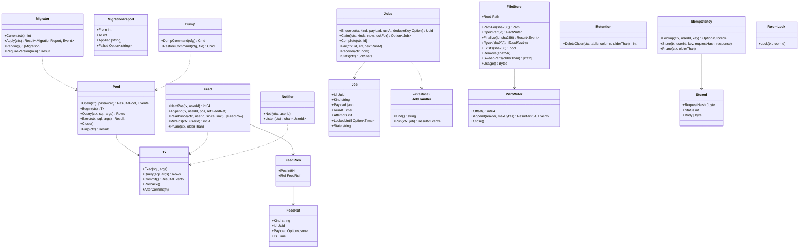

# srv-store（サーバー側・基盤）

## 受ける節
- [第1章 8.3 形式と版](../../../../docs/jp/design/01_基本設計書_全体構成.md#83-形式と版)（記録は PostgreSQL。スキーマの版と自動のマイグレーション。ダウングレード非対応）、[第1章 8.4 保持と削除](../../../../docs/jp/design/01_基本設計書_全体構成.md#84-保持と削除)（自動で消すものの期限は持ち主が呼ぶ。本ブロックは期限つきの削除の器）、[第1章 9.1 家族のサーバー](../../../../docs/jp/design/01_基本設計書_全体構成.md#91-家族のサーバー)（/data の配置）、[第1章 10.2 保存](../../../../docs/jp/design/01_基本設計書_全体構成.md#102-保存)（保存：トランザクション、一時の名前と改名）、[第1章 10.5 並行処理](../../../../docs/jp/design/01_基本設計書_全体構成.md#105-並行処理)（SKIP LOCKED、トークの行の更新による直列化）
- [第2章 6.1 共通の形](../../../../docs/jp/design/02_基本設計書_境界.md#61-共通の形)（pos は利用者ごとに単調増加）、[第2章 11 競合の規則（R-2-2-5）](../../../../docs/jp/design/02_基本設計書_境界.md#11-競合の規則r-2-2-5)（同じ Idempotency-Key の再送は同じ応答）
- [第11章 3.1 compose.yaml（初期値。digest は版ごと）](../../../../docs/jp/design/11_基本設計書_運用.md#31-composeyaml初期値digest-は版ごと)（postgres のイメージ、`shm_size`）、[第11章 9.1 取る](../../../../docs/jp/design/11_基本設計書_運用.md#91-取る)（整合：pg_dump → media の順。本ブロックはダンプの入口 `DumpCommand` を出す）
- 全体実装設計書 2.3（`jobs`）、2.4（feed + NOTIFY）、4.1（`feed`、`feed_cursor`、`idempotency`、`jobs`、`schema_migrations` の持ち主）、4.5（移行の置き場と命名）、I-3、I-10

## 依存
- 下：[srv-common](srv-common.md)（`Config`、`Clock`、`Ids`、`Event`、`Logger`）。部品：pgx v5（pool）、tern（移行）。
- 依存の逆転：`JobHandler` は本ブロックが定義し、srv-worker が種類ごとに登録する。移行の SQL は各持ち主のブロックが書き、本ブロックのディレクトリに番号で並ぶ（`NNN_<ブロック>_<名>.sql`）。

## クラス図

図の元の文（mermaid）

クラス図の注記（図の各メンバーの説明。仕様の節と番号を含む）

|クラス|メンバー|注記|
|---|---|---|
|Pool|`+Open(cfg, password) Result~Pool, Event~`|接続の数は CPU×2（上限 16）。接続の失敗は SRV-004|
|Pool|`+Ping(ctx) Result`|/health|
|Tx|`+AfterCommit(fn)`|コミットの後に走る付け足し（NOTIFY、channel への投入）。rollback なら捨てる|
|Migrator|`+Current(ctx) int`|schema_migrations|
|Migrator|`+Apply(ctx) Result~MigrationReport, Event~`|tern。1 つずつトランザクション。失敗は SRV-001 の状態（srv-admin が読み取り専用に）|
|Migrator|`+RequireVersion(min) Result`|イメージの版が要する下限。ダウングレードの検出（記録が新しい → 起動しない）|
|Feed|`+NextPos(tx, userId) int64`|feed_cursor を FOR UPDATE。欠番なし（I-3）|
|Feed|`+Append(tx, userId, pos, ref FeedRef)`|同じ tx で|
|Feed|`+ReadSince(ctx, userId, since, limit) [FeedRow]`|/sync と hub|
|Feed|`+MinPos(ctx, userId) int64`|保持の外の判定（410）|
|Feed|`+Prune(ctx, olderThan)`|90 日（持ち主の設定の値で srv-worker が呼ぶ）|
|FeedRef|`+Kind string`|room.event \| room.receipt \| room.member \| room.settings \| room.me \| room.mls \| room.scheduled \| device.inbox \| device.changed \| user.changed \| keybundle.changed \| recovery.request \| recovery.used \| call.ring \| call.state \| session.revoked \| notice \| sync.gap|
|FeedRef|`+Id Uuid`|本体の行（events 等）。本体を持たない種類は payload を feed に持つ|
|Notifier|`+Notify(tx, userId)`|AfterCommit で NOTIFY ft_feed, '<user_id>'|
|Notifier|`+Listen(ctx) chan~UserId~`|LISTEN ft_feed（api の hub が 1 本持つ）。切れたら再接続し、再接続の後は hub が全接続を「キャッチアップ」で埋める|
|Jobs|`+Enqueue(tx, kind, payload, runAt, dedupeKey Option) Uuid`|dedupe_key があり queued の同じ鍵があれば積まない|
|Jobs|`+Claim(ctx, kinds, now, lockFor) Option~Job~`|FOR UPDATE SKIP LOCKED。locked_until|
|Jobs|`+Fail(ctx, id, err, nextRunAt)`|attempts++。3 回で failed|
|Jobs|`+Recover(ctx, now)`|locked_until が過ぎた running を queued に戻す（異常終了の後）|
|Jobs|`+Stats(ctx) JobStats`|/health の worker_last_job_at|
|Job|`+State string`|queued\|running\|done\|failed|
|JobHandler|`+Run(ctx, job) Result~Event~`|冪等（I-10）|
|FileStore|`+Root Path`|/data/media|
|FileStore|`+PathFor(sha256) Path`|<2 文字>/<sha256>|
|FileStore|`+OpenPart(id) PartWriter`|/data/media/parts/<id>.part に追記|
|FileStore|`+Finalize(id, sha256) Result~Event~`|ハッシュの照合 → fsync → 改名 → ディレクトリの fsync|
|FileStore|`+Open(sha256) ReadSeeker`|Range の配信|
|FileStore|`+SweepParts(olderThan) [Path]`|期限切れのスロットの .part（24 時間）|
|FileStore|`+Usage() Bytes`|容量の監視|
|PartWriter|`+Append(reader, maxBytes) Result~int64, Event~`|流し書き（記憶に載せない）|
|Idempotency|`+Store(tx, userId, key, requestHash, response)`|30 日|
|Stored|`+RequestHash []byte`|本文の SHA-256（違えば NET-008）|
|Retention|`+DeleteOlder(ctx, table, column, olderThan) int`|セッション・招待（90 日）、push_log（30 日）、ip_log（28 日）、idempotency（30 日）、device_inbox（30 日）、up_box（TTL）の汎用の器。表の名前は持ち主が渡す|
|Dump|`+DumpCommand(cfg) Cmd`|pg_dump -Fc と pg_dumpall --globals-only の命令（restic の stdin へ。srv-worker が使う）|
|Dump|`+RestoreCommand(cfg, file) Cmd`|ft restore|
|RoomLock|`+Lock(tx, roomId)`|rooms の行を FOR UPDATE（同じトークへの同時の送信を直列に。第1章 10.5）|

## 公開操作（このブロックが所有する操作。番号は B-020〜）
|番号|操作（上の図）|使う側|由来|
|---|---|---|---|
|B-020|`Pool`、`Tx`（`AfterCommit` を含む）|全ブロック（記録の読み書きは必ず本ブロックの接続で）|[第1章 10.2 保存](../../../../docs/jp/design/01_基本設計書_全体構成.md#102-保存)|
|B-021|`Migrator`|srv-admin `Startup`（第1章 7.1 の 3）、cmd/ft `migrate`|[第1章 8.3 形式と版](../../../../docs/jp/design/01_基本設計書_全体構成.md#83-形式と版)、[第11章 10 更新（DD-11-9）](../../../../docs/jp/design/11_基本設計書_運用.md#10-更新dd-11-9)|
|B-022|`Feed`（`NextPos`、`Append`、`ReadSince`、`MinPos`、`Prune`）と `FeedRef`|srv-rooms（イベントの記録と `/sync` の読み出し）、srv-identity・srv-keys・srv-calls・srv-push・srv-admin（自分の種類のイベントを feed に積む）、srv-boundary（hub のキャッチアップ）|[第2章 6.1 共通の形](../../../../docs/jp/design/02_基本設計書_境界.md#61-共通の形)、全体実装設計書 2.4|
|B-023|`Notifier`（`Notify`、`Listen`）|書き込み担当の全部（`Notify`）、srv-boundary の hub（`Listen`）|全体実装設計書 2.4|
|B-024|`Jobs`（`Enqueue`、`Claim`、`Complete`、`Fail`、`Recover`、`Stats`）と `JobHandler`（定義）|積む側：srv-rooms（予約送信）、srv-identity（抹消の猶予）、srv-media（GC の候補）、srv-admin（バックアップ、更新、地図）。回す側：srv-worker|全体実装設計書 2.3|
|B-025|`FileStore`（`OpenPart`、`Finalize`、`Open`、`Remove`、`SweepParts`、`Usage`）|srv-media、srv-worker（GC、容量）|[第1章 9.1 家族のサーバー](../../../../docs/jp/design/01_基本設計書_全体構成.md#91-家族のサーバー)、[第1章 10.2 保存](../../../../docs/jp/design/01_基本設計書_全体構成.md#102-保存)、[第5章 5.1 アップロード（DD-5-6）](../../../../docs/jp/design/05_基本設計書_メディア.md#51-アップロードdd-5-6)|
|B-026|`Idempotency`|srv-boundary（middleware）|[第2章 11 競合の規則（R-2-2-5）](../../../../docs/jp/design/02_基本設計書_境界.md#11-競合の規則r-2-2-5)|
|B-027|`Retention::DeleteOlder`|srv-worker（持ち主の表と期限を渡す）|[第1章 8.4 保持と削除](../../../../docs/jp/design/01_基本設計書_全体構成.md#84-保持と削除)|
|B-028|`Dump`|srv-worker（バックアップ）、cmd/ft `restore`|[第11章 9 バックアップと復元（DD-11-8）](../../../../docs/jp/design/11_基本設計書_運用.md#9-バックアップと復元dd-11-8)|
|B-029|`RoomLock`|srv-rooms、srv-keys（Commit の直列化はトークの行の錠の中で epoch を更新）|[第1章 10.5 並行処理](../../../../docs/jp/design/01_基本設計書_全体構成.md#105-並行処理)、[第12章 5.2 群の暗号（MLS）](../../../../docs/jp/design/12_基本設計書_データと暗号化.md#52-群の暗号mls)|

## アルゴリズム（差し替え点）
|事項|実装|切り替え|由来|
|---|---|---|---|
|pos の採番|`feed_cursor` の行の `FOR UPDATE`|固定|全体実装設計書 2.4|
|仕事の取り出し|`FOR UPDATE SKIP LOCKED`、`locked_until` = now + 10 分（バックアップは 6 時間）|種類ごとの `lockFor` は srv-worker が渡す|[第1章 10.5 並行処理](../../../../docs/jp/design/01_基本設計書_全体構成.md#105-並行処理)|
|ファイルの置き場|SHA-256 の先頭 2 文字のディレクトリ|固定|[第1章 9.1 家族のサーバー](../../../../docs/jp/design/01_基本設計書_全体構成.md#91-家族のサーバー)|

## データ設計（このブロックが形を持つ記録）
|記録|形|欄|由来|
|---|---|---|---|
|`schema_migrations`|tern の表|`version`|[第1章 8.3 形式と版](../../../../docs/jp/design/01_基本設計書_全体構成.md#83-形式と版)|
|`feed`|表|`user_id uuid`、`pos bigint`（PK は (user_id, pos)）、`kind text`、`ref_id uuid?`、`payload jsonb?`、`ts timestamptz`。索引 (user_id, pos)。保持は `Prune`|[第2章 6.1 共通の形](../../../../docs/jp/design/02_基本設計書_境界.md#61-共通の形)、[第2章 6.2 イベントの一覧（asyncapi.yaml の `channels`）](../../../../docs/jp/design/02_基本設計書_境界.md#62-イベントの一覧asyncapiyaml-の-channels)|
|`feed_cursor`|表|`user_id uuid PK`、`next_pos bigint`|全体実装設計書 2.4|
|`jobs`|表|`id uuid PK`、`kind text`、`payload jsonb`、`run_at timestamptz`、`attempts int`、`locked_until timestamptz?`、`state text`、`dedupe_key text?`（部分一意索引：state = queued）、`last_error text?`、`created_at`。索引 (state, run_at)|全体実装設計書 2.3|
|`idempotency`|表|`user_id`、`key text`、`request_sha256 bytea`、`status int`、`body bytea`、`created_at`。PK (user_id, key)|[第2章 11 競合の規則（R-2-2-5）](../../../../docs/jp/design/02_基本設計書_境界.md#11-競合の規則r-2-2-5)|
|`/data/media/<2>/<sha256>`|ファイル|暗号文（srv-media が中身の意味を持つ）|[第1章 9.1 家族のサーバー](../../../../docs/jp/design/01_基本設計書_全体構成.md#91-家族のサーバー)|
|`/data/media/parts/<slot_id>.part`|ファイル|追記中の暗号文。完了で改名、期限で削除|[第5章 5.1 アップロード（DD-5-6）](../../../../docs/jp/design/05_基本設計書_メディア.md#51-アップロードdd-5-6)|
|移行のファイル|`server/internal/store/migrations/NNN_<ブロック>_<名>.sql`|tern の up だけ（down は持たない。ダウングレード非対応）|[第1章 8.3 形式と版](../../../../docs/jp/design/01_基本設計書_全体構成.md#83-形式と版)|
