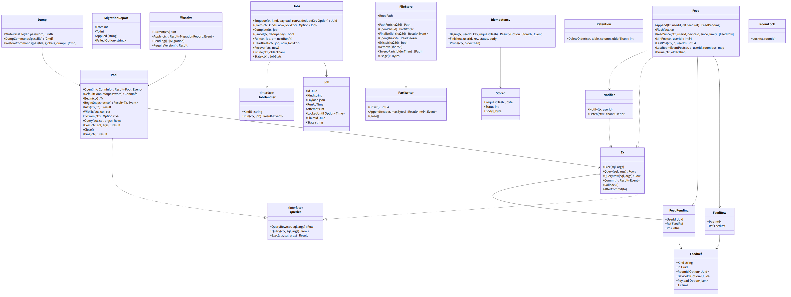
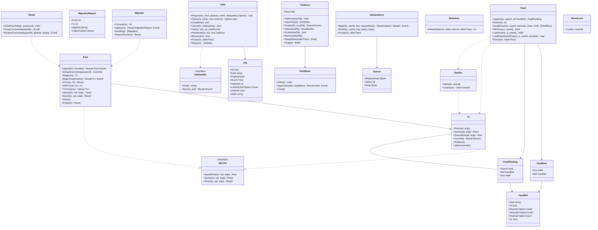

# srv-store（サーバー側・基盤）

## 受ける節

- [第1章 8.3 形式と版](../../../../docs/jp/design/01_基本設計書_全体構成.md#83-形式と版)（記録は PostgreSQL。スキーマの版と自動のマイグレーション。ダウングレード非対応）
- [第1章 8.4 保持と削除](../../../../docs/jp/design/01_基本設計書_全体構成.md#84-保持と削除)（自動で消すものの期限は持ち主が呼ぶ。本ブロックは期限つきの削除の器）
- [第1章 9.1 家族のサーバー](../../../../docs/jp/design/01_基本設計書_全体構成.md#91-家族のサーバー)（/data の配置）
- [第1章 10.2 保存](../../../../docs/jp/design/01_基本設計書_全体構成.md#102-保存)（保存：トランザクション、一時の名前と改名）
- [第1章 10.5 並行処理](../../../../docs/jp/design/01_基本設計書_全体構成.md#105-並行処理)（SKIP LOCKED、トークの行の更新による直列化）
- [第2章 6.1 共通の形](../../../../docs/jp/design/02_基本設計書_境界.md#61-共通の形)（pos は利用者ごとに単調増加）
- [第2章 11 競合の規則（R-2-2-5）](../../../../docs/jp/design/02_基本設計書_境界.md#11-競合の規則r-2-2-5)（同じ Idempotency-Key の再送は同じ応答）
- [第11章 3.1 compose.yaml（初期値。digest は版ごと）](../../../../docs/jp/design/11_基本設計書_運用.md#31-composeyaml初期値digest-は版ごと)（postgres のイメージ、`shm_size`）
- [第11章 9.1 取る](../../../../docs/jp/design/11_基本設計書_運用.md#91-取る)（整合：pg_dump、media の順。本ブロックはダンプの入口 `DumpCommand` を出す）
- 全体実装設計書
  - 2.3（`jobs`）、2.4（feed + NOTIFY）
  - 4.1（`feed`、`feed_cursor`、`idempotency`、`jobs`、`schema_migrations` の持ち主）
  - 4.5（移行の置き場と命名）、I-3、I-10

## 依存

- 下：[srv-common](srv-common.md)（`Config`、`Clock`、`Ids`、`Event`、`Logger`）。部品：pgx v5（pool）、tern（移行）。
- 依存の逆転：`JobHandler` は本ブロックが定義し、srv-worker が種類ごとに登録する。移行の SQL は各持ち主のブロックが書き、本ブロックのディレクトリに番号で並ぶ（`NNN_<ブロック>_<名>.sql`）。

## クラス図

図の元の文（mermaid）

クラス図の注記（図の各メンバーの説明。仕様の節と番号を含む）

|クラス|メンバー|注記|
|---|---|---|
|Pool|`+Open(info ConnInfo) Result~Pool, Event~`|info は接続先。本番は DefaultConnInfo、試験は testcontainers の接続先。TLS なし（第12章 4 のコンテナの間の行）。|
|Pool|`+DefaultConnInfo(password) ConnInfo`|ホスト postgres（Compose のサービスの名）、ポート 5432、DB と利用者は family_talk。パスワードは Secrets.DbPassword|
|Pool|（接続の数）|接続の数は CPU×2（上限 16）。接続の失敗は SRV-004|
|Pool|`+Ping(ctx) Result`|/health|
|Pool|`+InTx(ctx, fn) Result`|業務の操作の書き込みはこれで行う。ctx に外側のトランザクション（WithTx）があればそれを使い、コミットと rollback は外側に任せる（srv-boundary の冪等の middleware が冪等の記録と操作を 1 つのトランザクションにする。第2章 11）。無ければ自分で開き、fn が誤りなら rollback|
|Pool|`+WithTx(ctx, tx) ctx`、`+TxFrom(ctx) Option~Tx~`|外側のトランザクションを ctx で渡す口|
|Pool|`+BeginSnapshot(ctx) Result~Tx, Event~`|`REPEATABLE READ READ ONLY` のトランザクション（PostgreSQL 18 の 13.2.2：最初の文の時点の 1 つの見え方を全部の文が見る）。複数の表を読んで 1 つの時点の一覧を返す操作が使う（srv-rooms `Timeline.Snapshot`：トーク、構成員、端末、`Feed.LastPos`。srv-keys `Groups.Epoch`：世代・待ち・leaf と、srv-identity の端末の承認の状態）。書けない（書けば DB が拒む。プログラムの誤り）。呼んだ側は Rollback で閉じる|
|Querier|`+QueryRow(ctx, sql, args) Row`|Pool と Tx の共通の口。他のブロックの読みの操作が「ctx のトランザクションか Pool」を受ける時の引数の型（srv-identity の `Users.FamilyIds(ctx, q)`、srv-keys の `UserSigningKeys.Version(ctx, q, userId)` など）|
|Tx|`+Commit() Result~Event~`|溜めた feed の行があれば `Feed.Flush` と同じ処理を先に行ってから COMMIT（全体実装設計書 2.4）。`Rollback` は溜めた行を捨てる|
|Tx|`+AfterCommit(fn)`|コミットの後に走る付け足し（プロセスの中の channel への投入。例：通知の送信）。rollback なら捨てる。NOTIFY には使わない（Notifier）|
|Migrator|`+Current(ctx) int`|schema_migrations|
|Migrator|`+Apply(ctx) Result~MigrationReport, Event~`|tern。1 つずつトランザクション。失敗は SRV-001 の状態（srv-admin が読み取り専用に）|
|Migrator|`+RequireVersion() Result`|イメージに入れた移行の最後の版と記録の版を比べる。記録の方が新しければダウングレードなので起動しない|
|Feed|`+Append(tx, userId, ref FeedRef) FeedPending`|feed の 1 行をトランザクションに溜める（記録には触れない）。種類と欄の組が違えばプログラムの誤り。戻りの `Pos` は `Flush` の後に入る|
|Feed|`+Flush(ctx, tx)`|溜めた行を、宛先の利用者の識別子の順に、利用者ごとに 1 回の feed_cursor の更新（行の錠をコミットまで持つ。欠番なし I-3）で連続の pos を採って feed に書き、利用者ごとに 1 回 `Notifier.Notify`。同じ利用者への行は積んだ順。`Tx.Commit` が呼ぶ。応答に pos を要する操作（srv-rooms `Timeline.Post`）だけが操作の最後に自分で呼び、その後は行の錠を取らない（採番の錠の順。全体実装設計書 2.4）|
|FeedPending|`+UserId Uuid`、`+Ref FeedRef`、`+Pos int64`|溜めた 1 行。`Pos` は `Flush` が入れる（それまで 0）|
|Feed|`+ReadSince(ctx, userId, deviceId, since, limit) [FeedRow]`|/sync と hub。`device_id` が空か deviceId と同じ行だけ（宛先が端末の行は、その端末にだけ届く。全体実装設計書 2.4）|
|Feed|`+MinPos(ctx, userId) int64`|保持の外の判定（410）|
|Feed|`+LastPos(ctx, q, userId) int64`|利用者の最新の pos（WebSocket の ready。第2章 6.3）。feed_cursor の次の pos − 1。行が無ければ 0。q は ctx のトランザクションか Pool（srv-rooms `Timeline.Snapshot` は `BeginSnapshot` の中で一覧と同じ見え方で読む。全体実装設計書 2.4）|
|Feed|`+LastRoomEventPos(ctx, q, userId, roomIds) map`|利用者の feed の、トークごとの最新の room.event の pos（srv-rooms `Rooms.List` の `last_pos`。第2章 5.5）。部分索引 `feed_room_event` で読む。保持（90 日）の外に出たトークは地図に入らない。q は ctx のトランザクションか Pool|
|Feed|`+Prune(ctx, olderThan)`|90 日（持ち主の設定の値で srv-worker が呼ぶ）|
|FeedRef|`+Kind string`|第2章 6.2 の type のうち pos を持つ 18 のいずれか：room.event、room.receipt、room.member、room.settings、room.me、room.mls、room.scheduled、device.inbox、device.changed、user.changed、keybundle.changed、recovery.request、recovery.used、call.ring、call.state、session.revoked、notice、sync.gap|
|FeedRef|`+Id Uuid`|フレームの id（第2章 6.1。必須）。room.event はイベントの識別子、他は本体の行の識別子か、積む側が作る UUIDv7|
|FeedRef|`+RoomId Option~Uuid~`|room.* の 7 種だけが持つ（フレームの room_id）|
|FeedRef|`+DeviceId Option~Uuid~`|宛先の端末（全体実装設計書 2.4）。session.revoked と device.inbox は必須、sync.gap は任意（空なら本人の全端末）、他の 15 種は空。違えば Append がプログラムの誤りとして止める。フレームには出ない|
|FeedRef|`+Payload Option~json~`|room.event は空（hub と /sync が srv-rooms から、その利用者と端末に見える形で引く。取り消しと退出が反映され、暗号文を受け手の数だけ複製しない）。他の 17 種は書く時の payload（asyncapi の各メッセージの payload の形）で必須。種類と欄の組が違えば Append がプログラムの誤りとして止める|
|Notifier|`+Notify(tx, userId)`|`Feed.Flush` が宛先ごとに 1 回呼ぶ（書き込み担当は直接呼ばない）。トランザクションの中で `pg_notify('ft_feed', user_id)`。PostgreSQL はコミットした時だけ届け、同じ中身はまとめる（PostgreSQL 18 の NOTIFY の文書）。AfterCommit にすると、コミットと NOTIFY の間で落ちた時に抜ける|
|Notifier|`+Listen(ctx) chan~UserId~`|LISTEN ft_feed（api の hub が 1 本持つ。pool と別の専用の接続）。切れたら 1〜30 秒の待ちで再接続し、つながったら `uuid.Nil`（全員を追いつかせる合図）を流す。channel が満杯の時も、空いた時に `uuid.Nil` を流す。hub は Nil を受けたら全接続を「キャッチアップ」で埋める|
|Jobs|`+Enqueue(tx, kind, payload, runAt, dedupeKey Option) Uuid`|dedupe_key があり queued の同じ鍵があれば積まない|
|Jobs|`+Claim(ctx, kinds, now, lockFor) Option~Job~`|FOR UPDATE SKIP LOCKED。locked_until と新しい claim_id（UUIDv7）を入れる|
|Jobs|`+Complete(tx, job)`|state を done に。job の ClaimId が行と一致する時だけ効く（取り直された仕事を誤って完了にしない）。周期の仕事は同じトランザクションで次を Enqueue する（間で落ちても周期が切れない）|
|Jobs|`+Cancel(tx, dedupeKey) bool`|queued で同じ dedupe_key の仕事を消す（抹消の猶予の取り消し：srv-identity Users.CancelErase）。running の仕事は消さず偽を返す（handler が state を見て何もしない：I-10）|
|Jobs|`+Fail(ctx, job, err, nextRunAt)`|attempts++。3 回で failed。ClaimId が一致する時だけ効く|
|Jobs|`+Heartbeat(ctx, job, now, lockFor)`|走っている間、srv-worker が lockFor の 3 分の 1 ごとに locked_until を延ばす。ClaimId が一致しなければ（取り直された）誤りを返し、srv-worker は処理を止める。長い仕事が Recover で二重に走らない|
|Jobs|`+Recover(ctx, now)`|locked_until が過ぎた running を queued に戻す（異常終了の後）|
|Jobs|`+Prune(ctx, olderThan)`|done と failed で finished_at が olderThan より古い行を消す（表が増え続けない。30 日。srv-worker の retention が呼ぶ）|
|Jobs|`+Stats(ctx) JobStats`|/health の worker_last_job_at|
|Job|`+State string`|queued、running、done、failed のいずれか|
|JobHandler|`+Run(ctx, job) Result~Event~`|冪等（I-10）|
|FileStore|`+Root Path`|/data/media|
|FileStore|`+PathFor(sha256) Path`|<2 文字>/&lt;sha256&gt;|
|FileStore|`+OpenPart(id) PartWriter`|/data/media/parts/&lt;id&gt;.part に追記|
|FileStore|`+Finalize(id, sha256) Result~Event~`|ハッシュの照合、fsync、改名、ディレクトリの fsync の順|
|FileStore|`+Open(sha256) ReadSeeker`|Range の配信|
|FileStore|`+SweepParts(olderThan) [Path]`|期限切れのスロットの .part（24 時間）|
|FileStore|`+Usage() Bytes`|容量の監視|
|PartWriter|`+Append(reader, maxBytes) Result~int64, Event~`|流し書き（記憶に載せない）|
|Idempotency|`+Begin(tx, userId, key, requestHash) Result~Option~Stored~, Event~`|処理と同じトランザクションの頭で行を先に入れる（`INSERT ... ON CONFLICT DO NOTHING`）。入れられたら空を返し、処理を続ける。同じ鍵が既にあれば（同時の 2 つ目は一意索引で 1 つ目のコミットを待つ）入れた応答を返す。本文のハッシュが違えば NET-008。トランザクションは srv-boundary の Idempotency の middleware が開く|
|Idempotency|`+Finish(tx, userId, key, status, body)`|処理の応答を同じトランザクションで入れる（30 日）。処理が失敗して rollback すれば行も消え、再送で処理し直す|
|Stored|`+RequestHash []byte`|本文の SHA-256（違えば NET-008）|
|Retention|`+DeleteOlder(ctx, table, column, olderThan) int`|表と列の名は `^[a-z][a-z0-9_]*$` だけを受け、`pgx.Identifier` で引用する（合わない名はプログラムの誤り）。セッション・招待（90 日）、push_log（30 日）、ip_log（28 日）、idempotency（30 日）、device_inbox（30 日）、up_box（TTL）の汎用の器。表の名前は持ち主が渡す|
|Dump|`+DumpCommands(passfile) [Cmd]`|passfile は 0600 のパスワードのファイル（PGPASSFILE。PostgreSQL の文書は PGPASSWORD を勧めない）。pg_dumpall --globals-only、pg_dump -Fc の順の 2 つの命令（restic の `--stdin-from-command` は 1 回の実行で 1 つの命令。srv-worker は restic を 2 回呼ぶ）|
|Dump|`+WritePassFile(dir, password) Path`|dir（tmpfs の /tmp）に 0600 のパスワードのファイル（PostgreSQL の文書の形）。使い終えたら消す|
|Dump|`+RestoreCommands(passfile, globals, dump) [Cmd]`|ft restore：psql で globals、pg_restore で dump の順（第11章 9.2 の 3）|
|RoomLock|`+Lock(tx, roomId)`|rooms の行を FOR UPDATE（同じトークへの同時の送信を直列に。第1章 10.5）。行が無ければ ROOM-001|

## 公開操作（このブロックが所有する操作。番号は B-020〜）

|番号|操作（上の図）|使う側|由来|
|---|---|---|---|
|B-020|`Pool`（`Open`、`DefaultConnInfo`、`BeginSnapshot`、`InTx`、`WithTx`、`TxFrom`）、`Tx`（`AfterCommit` を含む）、`Querier`|全ブロック（記録の読み書きは必ず本ブロックの接続で）|[第1章 10.2 保存](../../../../docs/jp/design/01_基本設計書_全体構成.md#102-保存)|
|B-021|`Migrator`|srv-admin `Startup`（第1章 7.1 の 3）、cmd/ft `migrate`|[第1章 8.3 形式と版](../../../../docs/jp/design/01_基本設計書_全体構成.md#83-形式と版)、[第11章 10 更新（DD-11-9）](../../../../docs/jp/design/11_基本設計書_運用.md#10-更新dd-11-9)|
|B-022|`Feed`（`Append`、`Flush`、`ReadSince`、`MinPos`、`LastPos`、`LastRoomEventPos`、`Prune`）、`FeedRef`、`FeedPending`|srv-rooms（イベントの記録と `/sync` の読み出し）、srv-identity・srv-keys・srv-calls・srv-push・srv-admin（自分の種類のイベントを feed に積む）、srv-boundary（hub のキャッチアップ）|[第2章 6.1 共通の形](../../../../docs/jp/design/02_基本設計書_境界.md#61-共通の形)、全体実装設計書 2.4|
|B-023|`Notifier`（`Notify`、`Listen`）|`Feed.Flush`（`Notify`。書き込み担当は `Feed.Append` を経る）、srv-boundary の hub（`Listen`）|全体実装設計書 2.4|
|B-024|`Jobs`（`Enqueue`、`Claim`、`Complete`、`Fail`、`Heartbeat`、`Recover`、`Stats`）と `JobHandler`（定義）|積む側：srv-rooms（予約送信）、srv-identity（抹消の猶予）、srv-media（GC の候補）、srv-admin（バックアップ、更新、地図）。回す側：srv-worker|全体実装設計書 2.3|
|B-025|`FileStore`（`OpenPart`、`Finalize`、`Open`、`Remove`、`SweepParts`、`Usage`）|srv-media、srv-worker（GC、容量）|[第1章 9.1 家族のサーバー](../../../../docs/jp/design/01_基本設計書_全体構成.md#91-家族のサーバー)、[第1章 10.2 保存](../../../../docs/jp/design/01_基本設計書_全体構成.md#102-保存)、[第5章 5.1 アップロード（DD-5-6）](../../../../docs/jp/design/05_基本設計書_メディア.md#51-アップロードdd-5-6)|
|B-026|`Idempotency`（`Begin`、`Finish`、`Prune`）|srv-boundary（middleware がトランザクションを開いて Begin、operation に同じトランザクションを渡し、Finish の後にコミット）|[第2章 11 競合の規則（R-2-2-5）](../../../../docs/jp/design/02_基本設計書_境界.md#11-競合の規則r-2-2-5)|
|B-027|`Retention::DeleteOlder`|srv-worker（持ち主の表と期限を渡す）|[第1章 8.4 保持と削除](../../../../docs/jp/design/01_基本設計書_全体構成.md#84-保持と削除)|
|B-028|`Dump`（`WritePassFile`、`DumpCommands`、`RestoreCommands`）|srv-worker（バックアップ）、cmd/ft `restore`|[第11章 9 バックアップと復元（DD-11-8）](../../../../docs/jp/design/11_基本設計書_運用.md#9-バックアップと復元dd-11-8)|
|B-029|`RoomLock`|srv-rooms、srv-keys（Commit の直列化はトークの行の錠の中で epoch を更新）|[第1章 10.5 並行処理](../../../../docs/jp/design/01_基本設計書_全体構成.md#105-並行処理)、[第12章 5.2 群の暗号（MLS）](../../../../docs/jp/design/12_基本設計書_データと暗号化.md#52-群の暗号mls)|

## アルゴリズム（差し替え点）

|事項|実装|切り替え|由来|
|---|---|---|---|
|pos の採番|`feed_cursor` の行の更新（行の錠をコミットまで持つ）。トランザクションの中で溜め、コミットの直前に宛先の識別子の順に採る|固定|全体実装設計書 2.4|
|仕事の取り出し|`FOR UPDATE SKIP LOCKED`、`locked_until` = now + 10 分（バックアップは 6 時間）|種類ごとの `lockFor` は srv-worker が渡す|[第1章 10.5 並行処理](../../../../docs/jp/design/01_基本設計書_全体構成.md#105-並行処理)|
|ファイルの置き場|SHA-256 の先頭 2 文字のディレクトリ|固定|[第1章 9.1 家族のサーバー](../../../../docs/jp/design/01_基本設計書_全体構成.md#91-家族のサーバー)|

## データ設計（このブロックが形を持つ記録）

|記録|形|欄|由来|
|---|---|---|---|
|`schema_migrations`|tern の表|`version`|[第1章 8.3 形式と版](../../../../docs/jp/design/01_基本設計書_全体構成.md#83-形式と版)|
|`feed`|表|`user_id uuid`、`pos bigint`（PK は (user_id, pos)）、`kind text`、`ref_id uuid`、`room_id uuid?`（room.* だけ。CHECK）、`device_id uuid?`（宛先の端末。session.revoked と device.inbox は必須、sync.gap は任意、他は空。CHECK）、`payload jsonb?`（room.event だけ空。CHECK）、`ts timestamptz`。索引 (user_id, pos) と (ts)（Prune）と部分索引 `feed_room_event` (user_id, room_id, pos) WHERE kind = 'room.event'（LastRoomEventPos）。保持は `Prune`|[第2章 6.1 共通の形](../../../../docs/jp/design/02_基本設計書_境界.md#61-共通の形)、[第2章 6.2 イベントの一覧（asyncapi.yaml の `channels`）](../../../../docs/jp/design/02_基本設計書_境界.md#62-イベントの一覧asyncapiyaml-の-channels)|
|`feed_cursor`|表|`user_id uuid PK`、`next_pos bigint`|全体実装設計書 2.4|
|`jobs`|表|`id uuid PK`、`kind text`、`payload jsonb`、`run_at timestamptz`、`attempts int`、`locked_until timestamptz?`、`claim_id uuid?`（取り出しの印）、`finished_at timestamptz?`、`state text`、`dedupe_key text?`（部分一意索引：state = queued）、`last_error text?`、`created_at`。索引 (state, run_at) と (state, finished_at)|全体実装設計書 2.3|
|`idempotency`|表|`user_id`、`key text`、`request_sha256 bytea`、`status int`、`body bytea`、`created_at`。PK (user_id, key)。索引 (created_at)（Prune）|[第2章 11 競合の規則（R-2-2-5）](../../../../docs/jp/design/02_基本設計書_境界.md#11-競合の規則r-2-2-5)|
|`/data/media/<2>/<sha256>`|ファイル|暗号文（srv-media が中身の意味を持つ）|[第1章 9.1 家族のサーバー](../../../../docs/jp/design/01_基本設計書_全体構成.md#91-家族のサーバー)|
|`/data/media/parts/<slot_id>.part`|ファイル|追記中の暗号文。完了で改名、期限で削除|[第5章 5.1 アップロード（DD-5-6）](../../../../docs/jp/design/05_基本設計書_メディア.md#51-アップロードdd-5-6)|
|移行のファイル|`server/internal/store/migrations/NNN_<ブロック>_<名>.sql`|tern の up だけ（down は持たない。ダウングレード非対応）|[第1章 8.3 形式と版](../../../../docs/jp/design/01_基本設計書_全体構成.md#83-形式と版)|
