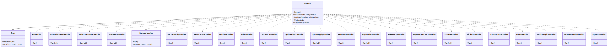

# srv-worker（サーバー側・業務。仕事の実行器と各 handler）

## 受ける節

- [第1章 4.1 構成要素](../../../../docs/jp/design/01_基本設計書_全体構成.md#41-構成要素) の worker の行
- [第1章 7.8 バックアップと復元](../../../../docs/jp/design/01_基本設計書_全体構成.md#78-バックアップと復元)（バックアップと復元：日次、一時の名前）
- [第1章 7.10 異常終了の後の起動](../../../../docs/jp/design/01_基本設計書_全体構成.md#710-異常終了の後の起動) の 1（途中の仕事を続ける）
- [第1章 8.4 保持と削除](../../../../docs/jp/design/01_基本設計書_全体構成.md#84-保持と削除)（自動で消すものの期限）
- [第1章 10.5 並行処理](../../../../docs/jp/design/01_基本設計書_全体構成.md#105-並行処理) の worker の同時の数
- [第11章 6 ドメインと証明書（DD-11-5）](../../../../docs/jp/design/11_基本設計書_運用.md#6-ドメインと証明書dd-11-5)（DDNS 5 分、証明書の監視 14/7/1）
- [第11章 9.1 取る](../../../../docs/jp/design/11_基本設計書_運用.md#91-取る)（バックアップ：日次、中身、restic、置き場、保持、検証、復元の試験、整合、知らせ）
- [第11章 10 更新（DD-11-9）](../../../../docs/jp/design/11_基本設計書_運用.md#10-更新dd-11-9) の確認（日次の版の確認）と自動の適用
- [第11章 11 監視と知らせ（DD-11-10）](../../../../docs/jp/design/11_基本設計書_運用.md#11-監視と知らせdd-11-10)（監視と知らせのしきい値）
- [第11章 14 失敗の扱い](../../../../docs/jp/design/11_基本設計書_運用.md#14-失敗の扱い) のバックアップ・DDNS・DNS-01・時刻・SMART の行
- [第12章 6.2 エンベロープ暗号化（DD-12-12）](../../../../docs/jp/design/12_基本設計書_データと暗号化.md#62-エンベロープ暗号化dd-12-12) の KEK の交代の後の包み直し
- [第12章 6.3 バックアップ（第11章と往復）](../../../../docs/jp/design/12_基本設計書_データと暗号化.md#63-バックアップ第11章と往復)（バックアップの整合と鍵）
- [第12章 9 消すこと（DD-12-13、R-12-6-1）](../../../../docs/jp/design/12_基本設計書_データと暗号化.md#9-消すことdd-12-13r-12-6-1) の抹消の実行と GC の猶予
- [第12章 5.2 群の暗号（MLS）](../../../../docs/jp/design/12_基本設計書_データと暗号化.md#52-群の暗号mls) の休眠の leaf の削除待ち（90 日）
- [第4章 5.8 投票、ノート、予定、予約送信（DD-4-9）](../../../../docs/jp/design/04_基本設計書_トークとメッセージ.md#58-投票ノート予定予約送信dd-4-9) の予約送信（指定の時刻にイベントを送る）
- [第4章 6 家族全員のトーク（DD-4-16）](../../../../docs/jp/design/04_基本設計書_トークとメッセージ.md#6-家族全員のトークdd-4-16) の誕生日
- [第4章 8 失敗の扱い](../../../../docs/jp/design/04_基本設計書_トークとメッセージ.md#8-失敗の扱い) のサーバーが止まっていた予約送信
- [第5章 7 容量と消す規則（DD-5-9。O-07 の結論）](../../../../docs/jp/design/05_基本設計書_メディア.md#7-容量と消す規則dd-5-9o-07-の結論)（消す規則の実行と 30 日前の知らせ）
- [第5章 8.1 データと配信](../../../../docs/jp/design/05_基本設計書_メディア.md#81-データと配信) の地図の更新
- [第7章 9 システムの知らせ（DD-7-9）](../../../../docs/jp/design/07_基本設計書_通知.md#9-システムの知らせdd-7-9) の知らせの時期（紙の確認 年 1 回、地図 年 1 回、16/18 歳）
- [第7章 3.2 送信（api）](../../../../docs/jp/design/07_基本設計書_通知.md#32-送信api) の再送の仕事
- [第3章 9.1 区分と保護者](../../../../docs/jp/design/03_基本設計書_認証_構成員_端末.md#91-区分と保護者)（2 年ごとの年齢の問い）
- [第3章 5.1 端末の状態](../../../../docs/jp/design/03_基本設計書_認証_構成員_端末.md#51-端末の状態)（未承認の端末の 7 日）
- 全体実装設計書 2.3（仕事の種類と同時の数）、3.1（バックアップ、更新の進み）、I-5、I-10

## 依存

- 下：
  - [srv-common](srv-common.md)（`Deps.Restic`／`DnsProvider`／`ReleaseSource`／`SfuAdmin`／`Docker`、`Clock`、`Config`）
  - [srv-store](srv-store.md)（`Jobs`、`JobHandler`、`Retention`、`Dump`、`FileStore`、`Feed.Prune`、`Idempotency.Prune`、`Jobs.Prune`）
  - [srv-identity](srv-identity.md)
    - `Users.Erase`／`BirthdayToday`／`ChildTransitions`、`Guardians.AskAgeEveryTwoYears`
    - `Devices.ExpireUnapproved`、`Invites.Prune`、`IpLog.Prune`、`Sessions.ExpireDue`
    - `Devices.Get`、`Users.Get`（待ちの知らせの params。第7章 9）
  - [srv-keys](srv-keys.md)
    - `Groups` の `DormantLeafs`、`RetireDormant`、`PendingDevices`
    - `KeyPackages.PruneExpired`、`Inbox.Prune`、`Shares.Expire`
  - [srv-rooms](srv-rooms.md)
    - `Timeline.PostScheduled`、`Timeline.FanoutRedactions`、`Gc`
    - `FamilyRoom.Flow`、`Members.PendingAdds`
  - [srv-media](srv-media.md)（`Slots.SweepExpired`、`Gc`、`Quota`、`Preview.SweepStaged`、`Maps.Install`）
  - [srv-push](srv-push.md)（`Notices.Emit`、`Notices.Prune`、`Sender.RetryJob`、`UpBox.Expire`）
  - [srv-admin](srv-admin.md)（`Updater`、`HostRequests`、`KeyRotation.Due`、`CertWatch`、`NetDetect`）
  - srv-admin の状態の表の書き込みの関数（`backup_state`、`update_state`、`maps_state`）
- 部品：restic（Go の部品として組み込み）、pg_dump（同梱【未確認】）。
- 依存の逆転：srv-store の `JobHandler` を種類ごとに実装して登録。

## クラス図

```mermaid
classDiagram
  class Runner {
    +Run(ctx)
    +RunOnce(ctx, kind) Result
    +Register(handler JobHandler)
    +OnStart(ctx)
    +LastJobAt() Time
  }
  class Cron {
    +EnsureAll(ctx)
    +Next(kind, now) Time
  }
  class GcHandler {
    +Run()
  }
  class ScheduledSendHandler {
    +Run(job)
  }
  class RedactionFanoutHandler {
    +Run(job)
  }
  class PushRetryHandler {
    +Run(job)
  }
  class BackupHandler {
    +Run()
    +RunBefore(ctx) Result
  }
  class BackupVerifyHandler {
    +Run()
  }
  class RestoreTestHandler {
    +Run()
  }
  class MonitorHandler {
    +Run()
  }
  class DdnsHandler {
    +Run()
  }
  class CertWatchHandler {
    +Run()
  }
  class UpdateCheckHandler {
    +Run()
  }
  class UpdateApplyHandler {
    +Run(job)
  }
  class RetentionHandler {
    +Run()
  }
  class MapsUpdateHandler {
    +Run(job)
  }
  class KekRewrapHandler {
    +Run()
  }
  class KeyRotationCheckHandler {
    +Run()
  }
  class ErasureHandler {
    +Run(job)
  }
  class BirthdayHandler {
    +Run()
  }
  class DormantLeafHandler {
    +Run()
  }
  class SessionExpireHandler {
    +Run()
  }
  class PruneHandler {
    +Run()
  }
  class PaperReminderHandler {
    +Run()
  }
  class AgeAskHandler {
    +Run()
  }
  Runner --> Cron
  Runner ..> GcHandler
  Runner ..> ScheduledSendHandler
  Runner ..> RedactionFanoutHandler
  Runner ..> PushRetryHandler
  Runner ..> BackupHandler
  Runner ..> BackupVerifyHandler
  Runner ..> RestoreTestHandler
  Runner ..> MonitorHandler
  Runner ..> DdnsHandler
  Runner ..> CertWatchHandler
  Runner ..> UpdateCheckHandler
  Runner ..> UpdateApplyHandler
  Runner ..> RetentionHandler
  Runner ..> MapsUpdateHandler
  Runner ..> KekRewrapHandler
  Runner ..> KeyRotationCheckHandler
  Runner ..> ErasureHandler
  Runner ..> BirthdayHandler
  Runner ..> DormantLeafHandler
  Runner ..> PruneHandler
  Runner ..> SessionExpireHandler
  Runner ..> PaperReminderHandler
  Runner ..> AgeAskHandler
```

図の元の文（mermaid）

クラス図の注記（図の各メンバーの説明。仕様の節と番号を含む）

|クラス|メンバー|注記|
|---|---|---|
|Runner|`+Run(ctx)`|種類ごとの同時の数（全体実装設計書 2.3 の表）で Jobs.Claim を回す。lockFor は種類ごと。handler が走っている間は lockFor の 3 分の 1 ごとに Jobs.Heartbeat で錠を延ばし、取り直された（Heartbeat の誤り）なら handler の ctx を取り消す。結果は取り出した Job（ClaimId つき）で Complete か Fail|
|Runner|`+RunOnce(ctx, kind) Result`|試験用（待たない）|
|Runner|`+OnStart(ctx)`|Jobs.Recover、周期の仕事の登録（Cron.EnsureAll）|
|Runner|`+LastJobAt() Time`|/health|
|Cron|`+EnsureAll(ctx)`|周期の仕事が queued に無ければ積む（dedupe_key = kind）|
|Cron|`+Next(kind, now) Time`|表：backup 日次 3:00（設定）、backup_verify 日次、restore_test 月 1、monitor 5 分、ddns 5 分、cert_watch 1 時間、session_expire 1 時間、update_check 日次、gc 1 時間、retention 日次、maps 手動（勧めは年 1 の知らせ）、kek_rewrap 年 1、key_rotation_check 日次、birthday 日次 0:00（家族の tz）、dormant_leaf 日次、prune 日次、paper_reminder 日次（参加の日の年ごと）、age_ask 日次|
|GcHandler|`+Run()`|srv-media Slots.SweepExpired（期限を過ぎて結び付かない媒体。未完了は 24 時間、完了は 8 日）、Gc.PurgeOrphans(7 日)、srv-rooms Gc.DeleteEmptyGroups(30 日)、Gc.PurgeDeletedRooms(7 日。config `retention.deleted_room_grace`)、FileStore.SweepParts、Preview.SweepStaged。取消の暗号文は取消の時に消えるので gc の対象にない（第12章 9）|
|ScheduledSendHandler|`+Run(job)`|payload: scheduled_id。1 つのトランザクションで srv-rooms Timeline.PostScheduled(scheduled_id)（予約の行を錠で読み直し、pending の時だけ送る。同じ仕事の 2 度目は何もしない。I-10）。仕事は Scheduled.Create が重複の鍵 `scheduled_send:<予約の識別子>` で積み、取り消しは同じ鍵で消す。サーバーが止まっていた分は起動後に run_at の順に|
|RedactionFanoutHandler|`+Run(job)`|payload: user_id。srv-rooms Timeline.FanoutRedactions(user_id, 1000) を、戻りが 0 になるまで繰り返す（1 回が 1 つのトランザクション。各回の間に Jobs.Heartbeat）。削除で消す・抹消の hook が積む（重複の鍵 `redaction_fanout:<構成員の識別子>`）。途中で止まっても再開で続きから（消えた送り残しは出さない。I-10、I-16）|
|PushRetryHandler|`+Run(job)`|srv-push Sender.RetryJob|
|BackupHandler|`+Run()`|置き場が未設定なら unset_since を進め 7 日で知らせ。次の順に置き場ごと（local、S3 互換）に restic backup する：DB（Dump.DumpCommands の globals と dump を、それぞれ restic --stdin-from-command で 1 回ずつ）、続いて media、config、secrets（/data の中）、caddy を道のりで 1 回。一時の名前はない（restic が原子）。forget（日次 7、週次 4、月次 6。OR）。週 1 で prune。結果を backup_state。失敗は notice（admins）|
|BackupHandler|`+RunBefore(ctx) Result`|更新の前（同期で呼ばれる）|
|BackupVerifyHandler|`+Run()`|restic check --read-data-subset=10%（10 日で全量）。失敗は notice|
|RestoreTestHandler|`+Run()`|月 1：一時の領域に最新を restore し、一時の postgres（Docker.Exec で同じイメージ）に pg_restore する。表の数と最新のイベントの pos を本番と照合し、結果を backup_state と notice に出す。一時の領域を消す|
|MonitorHandler|`+Run()`|知らせの事象の鍵は第7章 9 の表の欄のとおりに組む（繰り返しの判定で見つける知らせは段の値。抑えられた知らせは何も出ない）。容量（Quota.Thresholds の 80/90/100 で notice all と FamilyRoom。100% で Startup.SetReadOnly）、ディスクの空き（置き場 10%）、media の実体の照合（完了の行と実体。欠けは notice）、待ちが 7 日残った時の知らせ（第7章 9。srv-rooms Members.PendingAdds の行は `member_add_stalled`、srv-keys Groups.PendingDevices の add と readd は `device_add_stalled`、remove は `device_remove_stalled`。since が 7 日より古い行ごとに、端末の持ち主は Devices.Get、表示名は Users.Get で引き、Notices.Emit を宛先の列 room（そのトークの構成員）1 つで呼ぶ。事象の鍵はトーク、構成員か端末、経過した週の数 `floor((now − since) / 7 日)`。解けるまで 7 日ごとに 1 回になる）、カードの配布（srv-identity Families.Cards で 2・3 の持ち主が無ければ管理者に週 1 回の notice。第7章 9）、時刻のずれ（DNS の提供者の応答の Date との差。下のアルゴリズムの表）、SMART（読めれば）、回線の形の変化（NetDetect）、sfu の疎通、Jobs の failed の件数。srv-admin HostRequests.Sweep（ホストの要求の結果の反映と、2 時間結果が無い時の知らせ）|
|DdnsHandler|`+Run()`|5 分：自分の外部アドレス（NetDetect）を DnsProvider.SetA/SetAAAA。失敗 1 時間で notice。ddns_last_ok_at|
|CertWatchHandler|`+Run()`|1 時間：CertWatch.Days が 14/7/1 日と失効の時に notice。DNS-01 の失敗 1 時間で notice。sfu は証明書を持たないので、証明書の更新で何もしない（第6章 3.1）|
|UpdateCheckHandler|`+Run()`|日次：Updater.Check で新しい版があれば notice（内容の要約）。revoked_digests に該当なら notice（赤）。AutoDue なら update_apply を積む|
|UpdateApplyHandler|`+Run(job)`|自動の更新：通話中（CountActive）なら延期（最大 7 日、次の時間帯に再び積む）。無ければ srv-admin HostRequests.Put(update_apply)。適用はホストの `ft host run` が行う（第11章 3.4。worker は Docker を操作しない）|
|RetentionHandler|`+Run()`|日次：Gc.PreviewRetention で 30 日前の知らせ（対象の件数と大きさ。FamilyRoom）を出し、期日に Gc.ApplyRetention|
|MapsUpdateHandler|`+Run(job)`|Deps.Maps（MapSource）で地図の供給元から領域を切り出し、Maps.Install、maps_state、notice の順|
|KekRewrapHandler|`+Run()`|KEK の交代（ホストの `ft keys rotate kek`）の後に、api の起動の KeyRotation.RegisterKek が積む。user_dek の全行を現在の KEK で包み直す（I-7）。完了で key_versions の前の KEK に retired_at を書く（/etc のファイルから消すのはホストの `ft`）。途中で止まっても再開（kek_id で判定）|
|KeyRotationCheckHandler|`+Run()`|日次：KeyRotation.Due で期日のものを回す。RotateSession（90 日）、RotateSfu（1 年）。KEK は回さず、Due が「KEK の交代の勧め」を返せば Notices.Emit（管理者。`keys.kek_rotation_reminder_repeat` の 30 日ごと。第7章 9）|
|ErasureHandler|`+Run(job)`|payload: user_id。猶予 24 時間の後に Users.Erase（取り消し済みなら何もしない）|
|BirthdayHandler|`+Run()`|家族の tz の 0:00：Users.BirthdayToday の各人に FamilyRoom.Flow(birthday)。ChildTransitions は notice（本人と保護者）|
|DormantLeafHandler|`+Run()`|日次：Groups.DormantLeafs(90 日) の端末（承認済みと、停止で未承認に戻った承認されたことのある端末）ごとに自分のトランザクションで Groups.RetireDormant(端末, 90 日前)（Devices.MarkDormant が最終の利用が古い時だけ真を返し、承認済みなら休眠にし、停止で戻った端末は状態を変えない。真の時だけコピー (a) を消して各グループに削除待ちを立てる。第12章 5.2、第3章 8.1）。Remove の Commit は他の端末が行う。サーバーは提案を作らない|
|SessionExpireHandler|`+Run()`|1 時間：srv-identity Sessions.ExpireDue。絶対か無操作の期限を過ぎた有効なセッションを expired にし、その端末宛てに session.revoked{expired} を書く（接続したままで要求を出さない端末に期限を届ける。第2章 4.1、6.2）|
|PruneHandler|`+Run()`|日次：Retention.DeleteOlder（sessions 90 日、invites 1 年、push_log 30 日、ip_log 28 日、idempotency 30 日、short_tokens、device_codes、login_challenges）、Devices.ExpireUnapproved(7 日。承認されたことのない未承認の端末だけ。第3章 5.1)、Guardians.ExpireDue、Users.ExpireTransfers（求めの期限切れ。第3章 8.3、8.4）、Inbox.Prune（端末宛メールボックスの 30 日。表の持ち主の srv-keys の操作で消す）、KeyPackages.PruneExpired、UpBox.Expire、Notices.Prune（30 日）、Feed.Prune(90 日)、Jobs.Prune（done と failed、30 日）、Shares.Expire、sfu_webhook_seen、log_counts（28 日）。admin_transfers と guardian_approvals の期限切れを expired にする。erase の承認の求めの失効では抹消の求めを取り消し、子と保護者に知らせる（第3章 8.3）|
|PaperReminderHandler|`+Run()`|参加の日の年ごと：notice（各自）「紙の確認」。管理者には引き継ぎの一覧の所在の共有|
|AgeAskHandler|`+Run()`|Guardians.AskAgeEveryTwoYears の各子について Notices.Emit（age_ask。保護者。第7章 9）|

## 公開操作（このブロックが所有する操作。番号は B-195〜199。B-200 からはウェブのブロックの範囲）

|番号|操作（上の図）|使う側|由来|
|---|---|---|---|
|B-195|`Runner`（`Run`、`RunOnce`、`Register`、`OnStart`、`LastJobAt`）|cmd/ft `work`、srv-boundary `Health`（`LastJobAt` は `Jobs.Stats` 経由）、試験（`RunOnce`）|全体実装設計書 2.3、6.2|
|B-196|`Cron`（周期の表）|本ブロック|[第11章 9.1 取る](../../../../docs/jp/design/11_基本設計書_運用.md#91-取る)、[第11章 10 更新（DD-11-9）](../../../../docs/jp/design/11_基本設計書_運用.md#10-更新dd-11-9)、[第11章 11 監視と知らせ（DD-11-10）](../../../../docs/jp/design/11_基本設計書_運用.md#11-監視と知らせdd-11-10)|
|B-197|`BackupHandler::RunBefore`（更新の前のバックアップ。同期）|srv-admin `Updater.Apply`|[第11章 10 更新（DD-11-9）](../../../../docs/jp/design/11_基本設計書_運用.md#10-更新dd-11-9)|
|B-198|各 handler（`JobHandler` の実装。種類の一覧は全体実装設計書 2.3）|srv-store `Jobs` を通して|同上|

## アルゴリズム（差し替え点）

|事項|実装|切り替え|由来|
|---|---|---|---|
|バックアップの整合|pg_dump、media の順（スナップショット不要。I-5 の不変条件）|固定|[第11章 9.1 取る](../../../../docs/jp/design/11_基本設計書_運用.md#91-取る)、[第12章 6.3 バックアップ（第11章と往復）](../../../../docs/jp/design/12_基本設計書_データと暗号化.md#63-バックアップ第11章と往復)|
|restic の保持|`forget --keep-daily 7 --keep-weekly 4 --keep-monthly 6`（OR）。`--prune` 週 1。Object Lock の保持は prune より長く（S3 互換の設定は管理者）|設定|[第11章 9.1 取る](../../../../docs/jp/design/11_基本設計書_運用.md#91-取る)|
|検証の割合|`--read-data-subset=10%`（日次。10 日で全量）|設定|[第11章 9.1 取る](../../../../docs/jp/design/11_基本設計書_運用.md#91-取る)|
|復元の試験の照合|表の数と最新のイベントの pos|固定|[第11章 9.1 取る](../../../../docs/jp/design/11_基本設計書_運用.md#91-取る)|
|時刻のずれ|`timedatectl` 相当の読み（host モードの `doctor`）。コンテナの中は NTP の状態を直接見られないため、api の時刻と DNS の提供者の応答の `Date` ヘッダの差で代える（5 分で知らせ）|固定|[第1章 10.7 時刻](../../../../docs/jp/design/01_基本設計書_全体構成.md#107-時刻)、[第11章 11 監視と知らせ（DD-11-10）](../../../../docs/jp/design/11_基本設計書_運用.md#11-監視と知らせdd-11-10)|
|再試行|1・4・16 分で 3 回。以後 failed + notice|固定|全体実装設計書 2.3|

## データ設計（このブロックが形を持つ記録）

|記録|形|欄|由来|
|---|---|---|---|
|`jobs` の `kind` と `payload`|列挙と JSON|`gc {}`、`scheduled_send {scheduled_id}`、`redaction_fanout {user_id}`、`push_retry {item}`、`backup {reason}`（reason は daily、manual、before_update のいずれか）、`backup_verify {}`、`restore_test {}`、`monitor {}`、`ddns {}`、`cert_watch {}`、`update_check {}`、`update_apply {version}`、`update_rollback {}`、`retention {}`、`maps_update {region}`、`kek_rewrap {new_kek_id}`、`key_rotation_check {}`、`erasure {user_id}`、`birthday {}`、`dormant_leaf {}`、`prune {}`、`paper_reminder {}`、`age_ask {}`、`preview_cleanup {}`|全体実装設計書 2.3|
|restic のリポジトリ|restic v2（圧縮 auto）|スナップショットのタグ：`pg`、`media`、`config`、`secrets`、`caddy`。パスワードは `/data/secrets/backup`|[第11章 9.1 取る](../../../../docs/jp/design/11_基本設計書_運用.md#91-取る)|
|`/data/backups/`（勧めない置き場）|ディレクトリ|restic のリポジトリ|[第11章 3.3 /data と /etc](../../../../docs/jp/design/11_基本設計書_運用.md#33-data-と-etc)|
|復元の試験の一時の領域|`/data/restore-test/<日付>/`|試験の後に消す|[第11章 9.1 取る](../../../../docs/jp/design/11_基本設計書_運用.md#91-取る)|
