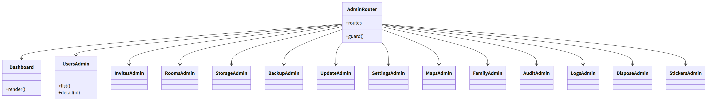
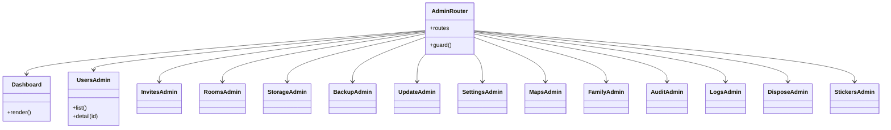

# web-admin（ウェブ・画面。管理者向けの画面）

## 受ける節
- [第11章 8 管理者の画面（DD-11-7。第2章 5.10 の経路）](../../../../docs/jp/design/11_基本設計書_運用.md#8-管理者の画面dd-11-7第2章-510-の経路)（管理者の画面の一覧：ダッシュボード、構成員、招待の記録、トーク、容量、バックアップ、更新、設定、地図、家族、操作の記録、ログ、廃棄、スタンプ）、[第11章 7 設定（DD-11-6）](../../../../docs/jp/design/11_基本設計書_運用.md#7-設定dd-11-6) の設定の画面（ロック表示）、[第11章 10 更新（DD-11-9）](../../../../docs/jp/design/11_基本設計書_運用.md#10-更新dd-11-9) の更新の画面（内容の事前の表示、自動の設定）、[第11章 9 バックアップと復元（DD-11-8）](../../../../docs/jp/design/11_基本設計書_運用.md#9-バックアップと復元dd-11-8) のバックアップの画面（置き場、検証と復元の試験の結果、鍵の再表示）、[第11章 13.2 廃棄（`ft disk dispose`）](../../../../docs/jp/design/11_基本設計書_運用.md#132-廃棄ft-disk-dispose)（廃棄の手順の表示）
- [第10章 11 シェルの画面（DD-10-10）](../../../../docs/jp/design/10_基本設計書_画面.md#11-シェルの画面dd-10-10) の「管理者の画面」の行（本システムの見た目の規則、PC を主に想定、表は折り返す）、[第10章 3 見た目（DD-10-1）](../../../../docs/jp/design/10_基本設計書_画面.md#3-見た目dd-10-1)
- [第2章 5.10 管理者（第11章）](../../../../docs/jp/design/02_基本設計書_境界.md#510-管理者第11章)（管理者の API の呼び出し）、[第3章 8 構成の変化（DD-3-11、DD-3-12）](../../../../docs/jp/design/03_基本設計書_認証_構成員_端末.md#8-構成の変化dd-3-11dd-3-12)（停止・削除・引き継ぎ・役割・保護者の画面）、[第3章 4.6 回復（パスキーを失った）](../../../../docs/jp/design/03_基本設計書_認証_構成員_端末.md#46-回復パスキーを失った)（再設定のリンクの発行）、[第12章 7.2 「データの取扱いについて」の画面](../../../../docs/jp/design/12_基本設計書_データと暗号化.md#72-データの取扱いについての画面)（管理者の名前の表示）
- 全体実装設計書 3.1（`ServerState` の表示）

## 依存
- 下：[web-core](web-core.md)（`Api`、`Session`（役割）、`Text`）、[web-ui](web-ui.md)（部品：Theme、Dialogs、ErrorView、A11y、I18n）、[web-sync](web-sync.md)（`Users`、`Notices`）、[web-shell](web-shell.md)（`AppLock.reauthWindow`）。
- 上：なし。
- 管理者も構成員として同じアプリを使う。本ブロックは `/admin/*` の経路に乗る画面だけ。他の構成員のトークを読む機能は無い（画面にも API にも無い）。

## クラス図

図の元の文（mermaid）

クラス図の注記（図の各メンバーの説明。仕様の節と番号を含む）

|クラス|メンバー|注記|
|---|---|---|
|AdminRouter|`+routes`|/admin（ダッシュボード）、/admin/users、/admin/users/:id、/admin/invites、/admin/rooms、/admin/storage、/admin/backup、/admin/update、/admin/settings、/admin/maps、/admin/family、/admin/audit、/admin/logs、/admin/dispose、/admin/stickers|
|AdminRouter|`+guard()`|Session.me.role === admin でなければ構成員の画面へ|
|Dashboard|`+render()`|/admin/health：状態（5 つ）、health の各値、容量（使用／上限）、証明書の期限、最後のバックアップと検証、更新の有無、回線の形と最後の DDNS、知らせの一覧。管理者が 1 人の間のバナー「2 人目の管理者を」|
|UsersAdmin|`+list()`|表示名、役割、状態、端末の数、最終の利用、容量|
|UsersAdmin|`+detail(id)`|招待の発行、停止・再開、削除（残す／消す：確認ダイアログ・再認証）、端末の取り消し、再設定のリンク（表示して渡す）、役割、保護者と子ども区分|
|InvitesAdmin|`（クラス全体）`|誰が誰を、いつ、使用の有無、無効化|
|RoomsAdmin|`（クラス全体）`|識別子、種類、人数、容量。空のグループの削除。名前は見えない（説明の文）|
|StorageAdmin|`（クラス全体）`|全体、構成員ごと、トークごと。保持の規則の設定（N 年、動画／オリジナルの写真／ファイル）。消す予定の件数と大きさ|
|BackupAdmin|`（クラス全体）`|置き場（ローカルのパス、S3 互換の接続：endpoint、bucket、キー。Object Lock の要件の案内）、時刻、保持、手動の実行、検証と復元の試験の結果、バックアップの鍵と KEK の紙の再表示（再認証）、未設定のバナー|
|UpdateAdmin|`（クラス全体）`|現在の版、新しい版と内容（notes_url）、適用（通話中の確認）、自動の設定（有効にする時の説明）、履歴、復元、取り消されたイメージの警告|
|SettingsAdmin|`（クラス全体）`|config.yaml の分類ごと（ft.settings.server/1 から生成）。ロック表示（層の表示）。範囲の検証。ADM-002|
|MapsAdmin|`（クラス全体）`|領域、最後の更新、更新の実行、「地図は準備中」の案内|
|FamilyAdmin|`（クラス全体）`|名前、アイコン、家族回復鍵のカードの作り直し（再認証。新しいカードの印刷は管理者の端末で web-crypto）、管理者の引き継ぎ（相手の承認を待つ）、2 人目の管理者の案内|
|AuditAdmin|`（クラス全体）`|管理者の操作の記録（カーソル）|
|LogsAdmin|`（クラス全体）`|直近の要約（エラーの分類と件数。本文と秘密なし）：GET /admin/logs は持たない → /admin/health の集計と notices の一覧で代える（第2章 5.10 に経路が無いため。抜けなら第2章に足す：全体実装設計書 11 の「抜け」）|
|DisposeAdmin|`（クラス全体）`|「このディスクを捨てる」の手順（/admin/disk/dispose）|
|StickersAdmin|`（クラス全体）`|登録（構成員と同じ流れ。web-ui の StickerCreate を使う）|

## 画面の収め方（画面 × 呼ぶ経路 × 再認証）
|画面|経路（第2章 5.10）|再認証|
|---|---|---|
|Dashboard|`/admin/health`、`/admin/storage`、`/admin/backup`、`/admin/update`、`notice` の一覧|—|
|UsersAdmin|`/admin/users`、`/admin/users/{id}/suspend`／`unsuspend`、`DELETE /admin/users/{id}`、`/admin/users/{id}/devices/{did}`、`/admin/users/{id}/reset-link`、`/admin/users/{id}/role`、`/guardians`、`/child`、`/invites` POST|停止・削除・役割・取り消し・再設定・保護者：要|
|InvitesAdmin|`/admin/invites`、`DELETE /invites/{id}`|—|
|RoomsAdmin|`/admin/rooms`、`DELETE /admin/rooms/{id}`|削除：要|
|StorageAdmin|`/admin/storage`、`/admin/retention`|規則の変更：要|
|BackupAdmin|`/admin/backup`、`/admin/backup/restore-test`、`/admin/backup/keys`|鍵の再表示：要|
|UpdateAdmin|`/admin/update`、`/admin/update/rollback`|適用・復元：要|
|SettingsAdmin|`/admin/settings`|要|
|MapsAdmin|`/admin/maps`|—|
|FamilyAdmin|`/admin/family`、`/admin/family/recovery-key/rotate`、`/admin/transfer`|カードの作り直し・引き継ぎ：要|
|AuditAdmin|`/admin/audit`|—|
|DisposeAdmin|`/admin/disk/dispose`|—|

## 公開操作
- 提供しない（画面）。

## アルゴリズム（画面の側に残るもの）
|事項|実装|由来|
|---|---|---|
|設定の画面の生成|`ft.settings.server/1` の各項目（型、範囲、層、ロック）から入力の部品を生成|[第11章 7 設定（DD-11-6）](../../../../docs/jp/design/11_基本設計書_運用.md#7-設定dd-11-6)|
|表の表示|PC を主に想定。横スクロールせず折り返す。320 px でも読める|[第10章 11 シェルの画面（DD-10-10）](../../../../docs/jp/design/10_基本設計書_画面.md#11-シェルの画面dd-10-10)|

## データ設計（画面の側に置くもの）
- 持たない（全部サーバーの API）。文言は web-ui の `ja.json` の `admin.*` の鍵。

## 抜け（受ける節とページの突き合わせで見つけた物）
- 第11章 8 の「ログ」の画面（直近の要約）に対応する経路が第2章 5.10 に無い。本ページは `/admin/health` と `notices` で代える案を仮に置く。第2章に `GET /admin/logs/summary`（エラーの分類と件数。本文と秘密なし）を足す改訂を層9（シーケンス）の抜けの一覧に載せる。
