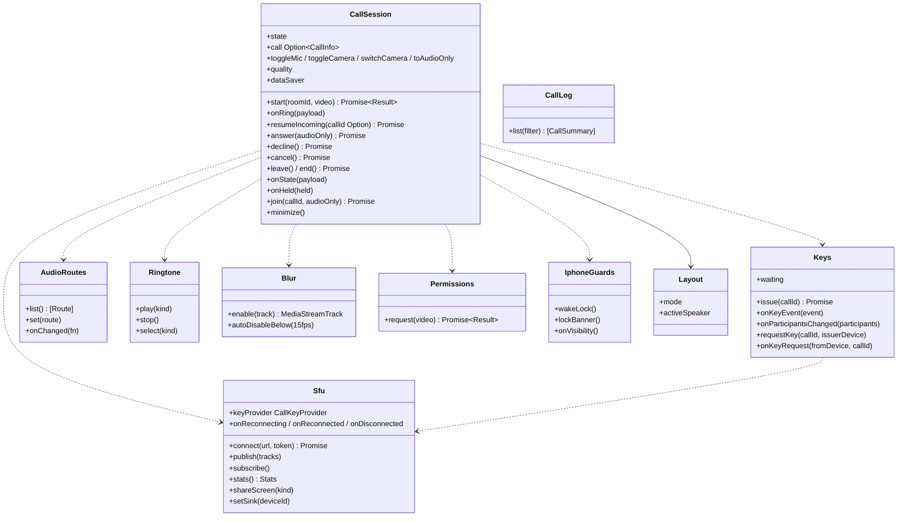

# web-calls（ウェブ・業務。通話の画面の裏側：SFU の SDK、鍵、音声の経路、ぼかし、再接続）

## 受ける節

- [第6章 3.2 人数と帯域](../../../../docs/jp/design/06_基本設計書_通話.md#32-人数と帯域) の端末の側（映像の上限に当たった時の音声のみ、画質の既定）
- [第6章 4.1 1 対 1](../../../../docs/jp/design/06_基本設計書_通話.md#41-1-対-1)（1 対 1 の端末の側：発信、呼び出し画面、着信の表示、応答・拒否・取消）
- [第6章 4.2 グループ](../../../../docs/jp/design/06_基本設計書_通話.md#42-グループ)（グループ：バナー、参加、離脱）
- [第6章 4.3 着信音](../../../../docs/jp/design/06_基本設計書_通話.md#43-着信音)（着信音：Web Audio の 3 種、OS の通知の音）
- [第6章 5.1 操作](../../../../docs/jp/design/06_基本設計書_通話.md#51-操作)（操作：マイク、出口、カメラ、最小化、画質、節約、音声のみ、画面共有、ぼかし、文字のチャット、参加者の表示）
- [第6章 5.2 iPhone の制約（DD-6-6）](../../../../docs/jp/design/06_基本設計書_通話.md#52-iphone-の制約dd-6-6)（iPhone の制約：Wake Lock、無音の映像、ロックの案内、`getUserMedia` のたびの許可）
- [第6章 5.3 再接続（DD-6-7）](../../../../docs/jp/design/06_基本設計書_通話.md#53-再接続dd-6-7)（再接続、相手の表示、品質の表示）
- [第6章 7 暗号化の運用（DD-6-9）](../../../../docs/jp/design/06_基本設計書_通話.md#7-暗号化の運用dd-6-9)（鍵の運用：SDK の設定、10 フレーム、1 層）
- [第6章 8 数値の一覧（config.yaml の「通話」）](../../../../docs/jp/design/06_基本設計書_通話.md#8-数値の一覧configyaml-の通話)（数値）
- [第6章 9 失敗の扱い](../../../../docs/jp/design/06_基本設計書_通話.md#9-失敗の扱い)（失敗の端末の行）
- [第2章 5.7 通話（第6章）](../../../../docs/jp/design/02_基本設計書_境界.md#57-通話第6章)（通話の経路の呼び出し）
- [第2章 6.2 イベントの一覧（asyncapi.yaml の `channels`）](../../../../docs/jp/design/02_基本設計書_境界.md#62-イベントの一覧asyncapiyaml-の-channels) の `call.ring`、`call.state`
- [第2章 13 失敗の扱い](../../../../docs/jp/design/02_基本設計書_境界.md#13-失敗の扱い) の SFU のトークンの期限
- [第12章 5.11 通話（DD-12-11。第6章と往復）](../../../../docs/jp/design/12_基本設計書_データと暗号化.md#511-通話dd-12-11第6章と往復)（通話の鍵の配布と keyring の設定。鍵の生成は web-crypto `CallKeys`）
- [第7章 7 着信の通知（DD-7-7）](../../../../docs/jp/design/07_基本設計書_通知.md#7-着信の通知dd-7-7) の端末の側（前面なら呼び出し画面、通知の tag）
- [第8章 3.5 権限（DD-8-5）](../../../../docs/jp/design/08_基本設計書_iPhoneとPCのシェル.md#35-権限dd-8-5)（カメラとマイクの許可）
- [第8章 7 PC のブラウザ（DD-8-7）](../../../../docs/jp/design/08_基本設計書_iPhoneとPCのシェル.md#7-pc-のブラウザdd-8-7)（PC の差：画面共有、`setSinkId`、ぼかし）
- [第9章 6 着信と通話（DD-9-6）](../../../../docs/jp/design/09_基本設計書_Androidのシェル.md#6-着信と通話dd-9-6) の WebView の側
  - JS ブリッジの命令：`callStarted`、`callEnded`、`callState`、`getAudioRoutes`／`setAudioRoute`、`enterPip`、`keepAwake`
  - イベント：`callAnswered`、`callDeclined`、`callEndedByOs`、`callHeld`、`audioRouteChanged`、`pipChanged`
- 全体実装設計書 3.2（通話の画面、通話の鍵）

## 依存

- 下：
  - [web-core](web-core.md)（`Api`、`Settings`、`Clock`）
  - [web-crypto](web-crypto.md)（`CallKeys`、`ToDevice`）
  - [web-sync](web-sync.md)（`CallSignal` の実装、`SendQueue.enqueue`（`ft.content.call_key/1` の配布）、`Events`（鍵のイベントの受信）、`Users`）
  - [web-media](web-media.md)（`MediaRuntime`（分割の推論）、`Network.type`）
  - [web-shell](web-shell.md)（`Platform`：JS ブリッジ、Wake Lock、PiP）
- 部品：SFU のクライアント SDK（第14章 6.1）、人物の分割のモデル（Apache-2.0。WASM と WebGL）。
- 依存の逆転：web-sync の `CallSignal` を実装。

## クラス図

図の元の文（mermaid）

クラス図の注記（図の各メンバーの説明。仕様の節と番号を含む）

|クラス|メンバー|注記|
|---|---|---|
|CallSession|`+state`|idle、outgoing、incoming、connecting、active、reconnecting、ended のいずれか|
|CallSession|`+call Option~CallInfo~`|call_id、room_id、kind、video、participants、started_at|
|CallSession|`+start(roomId, video) Promise~Result~`|POST /rooms/{id}/calls（CALL-002 合流、CALL-003、CALL-005、CALL-004、CALL-006）の後、Sfu.connect(token)。dm は鍵 0 を配り（Keys.issue）、outgoing にする（呼び出し画面。60 秒は相手の側）。シェル：Platform.callStarted(outgoing)|
|CallSession|`+onRing(payload)`|web-sync CallSignal：call_id で重複を除く（通知と二重）。前面なら incoming の画面 + Ringtone。シェル：シェルが CallStyle（WebView には callAnswered が来る）|
|CallSession|`+resumeIncoming(callId Option) Promise`|閉じている間の着信（第6章 4.1）：起動、前面化（Platform の visibilitychange）、`/call/<call_id>` の 3 つの入口から web-ui が呼ぶ。callId が無ければ web-sync の `call.ring` のコピーのうち後に `call.state` が無い物を候補にする。GET /calls/{id} が ringing かつ expires_at が未来（web-core Clock のサーバーとのずれを含む）なら onRing と同じ incoming の画面 + Ringtone。そうでなければ Rooms の不在の記録へ。シェルでは呼ばない（着信は CallStyle）|
|CallSession|`+answer(audioOnly) Promise`|POST /calls/{id}/join の後、Sfu.connect で active にする。シェル：callAnswered から|
|CallSession|`+decline() Promise`|POST /calls/{id}/decline|
|CallSession|`+cancel() Promise`|POST /calls/{id}/end（outgoing のまま）|
|CallSession|`+onState(payload)`|call.state：active（自分の他の端末が応答したら止める）。ended、missed、declined、cancelled なら ended の記録を示す|
|CallSession|`+onHeld(held)`|シェルのイベント callHeld（第9章 6）。true ならマイクとカメラを止め「電話のため保留中」を示す。false で元に戻す|
|CallSession|`+join(callId, audioOnly) Promise`|グループのバナーから|
|CallSession|`+quality`|high、wifi_high、standard の 3 択|
|CallSession|`+dataSaver`|off、mobile_only、always のいずれか（iPhone は 2 択）|
|CallSession|`+minimize()`|アプリ内の小窓（PC/iPhone）/ シェルの PiP|
|Sfu|`+connect(url, token) Promise`|wss://<サーバー>/rtc。SDK の Room。トークンは 5 分（参加の前に取り直す）|
|Sfu|`+publish(tracks)`|サイマルキャスト 180p/360p/720p（E2EE と iOS 17.2 未満は 1 層 360p）。コーデック H.264/VP8、Opus（DTX、RED なし）|
|Sfu|`+subscribe()`|受信の層の選択（節約）|
|Sfu|`+keyProvider CallKeyProvider`|SDK の BaseKeyProvider の継承。setKey(key, index) は保護された onSetEncryptionKey(key, undefined, index)。設定は keySize 128、keyringSize 256、ratchetWindowSize 0、sharedKey true（1 つの鍵を番号で切り替える）、failureTolerance -1。SDK の ExternalE2EEKeyProvider は番号を持たないので使わない。E2EE の worker は SDK の別バンドル（livekit-client/e2ee-worker）。変換の経路は SDK が選ぶ（WebKit 系は RTCRtpScriptTransform、Chromium 系は createEncodedStreams。第6章 7）|
|Sfu|`+onReconnecting / onReconnected / onDisconnected`|SDK の自動再接続 30 秒。超えたら「接続が切れました」+ 再参加|
|Sfu|`+stats() Stats`|接続の種類（直接／TURN）、往復、損失|
|Sfu|`+shareScreen(kind)`|PC：画面／ウィンドウ／タブ（音声は対応ブラウザ）|
|Sfu|`+setSink(deviceId)`|PC の出口（setSinkId）|
|Keys|`+issue(callId) Promise`|web-crypto CallKeys.newKey(index) で鍵を作り、ft.content.call_key/1 を SendQueue.enqueue（トークの MLS）で配る。1 秒待って keyProvider に設定する|
|Keys|`+onKeyEvent(event)`|受信した ft.content.call_key/1 を keyProvider.setKey(key, index) に渡す|
|Keys|`+onParticipantsChanged(participants)`|離脱：自分が識別子が最小なら issue(index+1)。参加：前回の配布から 10 秒以内なら既存、超えていれば issue|
|Keys|`+requestKey(callId, issuerDevice)`|鍵のイベント（`ft.room_event/1`）を復号できない時：その `sender_device_id` へ ToDevice kind=call_key_request（第12章 5.11）|
|Keys|`+onKeyRequest(fromDevice, callId)`|自分が配った鍵の時だけ：相手が通話の参加者なら ToDevice kind=call_key で現在の鍵と番号を返す|
|Keys|`+waiting`|鍵が届く前：10 フレームの後は無音と黒。「相手の鍵を待っています」。鍵のイベントを復号できなければ直ちに requestKey。30 秒で再参加の案内|
|AudioRoutes|`+list() [Route]`|PC：enumerateDevices（出力）。シェル：Platform.getAudioRoutes。iPhone：出さない（OS に委ねる）|
|AudioRoutes|`+set(route)`|PC：setSinkId。シェル：Platform.setAudioRoute|
|AudioRoutes|`+onChanged(fn)`|シェル：audioRouteChanged|
|Ringtone|`+play(kind)`|同梱の 3 種（Web Audio）。前面の呼び出し画面だけ。Android はシェル（チャネル）|
|Ringtone|`+select(kind)`|設定「通話」|
|Blur|`+enable(track) MediaStreamTrack`|分割のモデル（MediaRuntime）、canvas の合成、MediaStreamTrackProcessor または canvas.captureStream の順|
|Blur|`+autoDisableBelow(15fps)`|「この端末では使えません」|
|Permissions|`+request(video) Promise~Result~`|getUserMedia を通話の開始・応答のたび。拒否されたら OS の設定への案内。音声のみ／受けるだけで参加|
|IphoneGuards|`+wakeLock()`|navigator.wakeLock（iOS 18.4 以上）。18.0〜18.3 は無音の小さな映像のループ（効かなければ「自動ロックを切ってください」）|
|IphoneGuards|`+lockBanner()`|「画面をロックするかアプリを閉じると通話が切れます」（開始時 5 秒）|
|IphoneGuards|`+onVisibility()`|背景に回ったら相手に「離れました（再接続を待っています）」。復帰したら再接続|
|Layout|`+mode`|grid（2×2、5 人以上はページ。PC は 3×3）、focus（話者の自動または固定）、list（音声のみ）のいずれか|
|CallLog|`+list(filter) [CallSummary]`|GET /me/calls（発信・着信・不在）。タップで発信|

## 公開操作（このブロックが所有する操作。番号は B-300〜）

|番号|操作（上の図）|使う側|由来|
|---|---|---|---|
|B-300|`CallSession`（`start`、`answer`、`decline`、`cancel`、`leave`、`end`、`join`、操作、`quality`、`dataSaver`、`minimize`、`state`）。web-sync の `CallSignal` の実装|web-ui（呼び出し・着信・通話中の画面）、web-shell（シェルのイベント `callAnswered`／`callDeclined`／`callEndedByOs` の配線）|[第6章 4 開始と着信（DD-6-3、DD-6-4）](../../../../docs/jp/design/06_基本設計書_通話.md#4-開始と着信dd-6-3dd-6-4)、[第6章 5.1 操作](../../../../docs/jp/design/06_基本設計書_通話.md#51-操作)|
|B-301|`Keys`（`issue`、`onKeyEvent`、`onParticipantsChanged`）|本ブロック、web-sync（`ft.content.call_key/1` の受信を渡す）|[第12章 5.11 通話（DD-12-11。第6章と往復）](../../../../docs/jp/design/12_基本設計書_データと暗号化.md#511-通話dd-12-11第6章と往復)、[第6章 7 暗号化の運用（DD-6-9）](../../../../docs/jp/design/06_基本設計書_通話.md#7-暗号化の運用dd-6-9)|
|B-302|`AudioRoutes`、`Ringtone`、`Blur`、`Permissions`、`IphoneGuards`、`Layout`|web-ui|[第6章 5 通話中（DD-6-5、DD-6-6、DD-6-7）](../../../../docs/jp/design/06_基本設計書_通話.md#5-通話中dd-6-5dd-6-6dd-6-7)、[第6章 4.3 着信音](../../../../docs/jp/design/06_基本設計書_通話.md#43-着信音)、[第8章 7 PC のブラウザ（DD-8-7）](../../../../docs/jp/design/08_基本設計書_iPhoneとPCのシェル.md#7-pc-のブラウザdd-8-7)|
|B-303|`CallLog`|web-ui（通話の一覧）|[第6章 6 記録（DD-6-8）](../../../../docs/jp/design/06_基本設計書_通話.md#6-記録dd-6-8)|
|B-304|`Sfu::stats`（品質の表示）|web-ui|[第6章 5.3 再接続（DD-6-7）](../../../../docs/jp/design/06_基本設計書_通話.md#53-再接続dd-6-7)|

## アルゴリズム（差し替え点）

|事項|実装|切り替え|由来|
|---|---|---|---|
|サイマルキャスト|3 層。E2EE かつ iOS 17.2 未満は 1 層（360p）|端末の判定で自動|[第6章 3.1 SFU の設定（deploy/livekit.yaml。初期値）](../../../../docs/jp/design/06_基本設計書_通話.md#31-sfu-の設定deploylivekityaml初期値)、[第12章 5.11 通話（DD-12-11。第6章と往復）](../../../../docs/jp/design/12_基本設計書_データと暗号化.md#511-通話dd-12-11第6章と往復)|
|ぼかし|分割のモデル（WASM/WebGL）。15 fps 未満で自動で無効|端末の性能で自動|[第6章 5.1 操作](../../../../docs/jp/design/06_基本設計書_通話.md#51-操作)|
|画質の 3 択|高画質 = 1080p（2 人・Wi-Fi）、Wi-Fi のときのみ高画質、標準 = 720p。節約 = 360p 送信・180p 受信・カメラ既定 OFF|設定|[第6章 5.1 操作](../../../../docs/jp/design/06_基本設計書_通話.md#51-操作)|
|再接続|SDK の自動（30 秒）。超えたら再参加の案内|固定（設定「再接続」）|[第6章 5.3 再接続（DD-6-7）](../../../../docs/jp/design/06_基本設計書_通話.md#53-再接続dd-6-7)|
|鍵の配り直し|識別子が最小の端末。参加は 10 秒の猶予|固定|[第12章 5.11 通話（DD-12-11。第6章と往復）](../../../../docs/jp/design/12_基本設計書_データと暗号化.md#511-通話dd-12-11第6章と往復)|

## データ設計（このブロックが形を持つ記録）

- 記録を持たない（通話の記録はサーバーのイベント。keyring は記憶の上）。設定「通話」（画質、節約、着信音、着信を受けない）は web-core `Settings`（`/me/settings` と端末の設定）。
- `ft.content.call_key/1`：`{v: 1, call_id, index, key, issued_at}`（api/schemas。第12章 12）。
