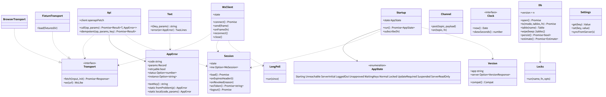

# web-core（ウェブ・基盤）

## 受ける節
- [第2章 3 やり取りの分類と規則](../../../../docs/jp/design/02_基本設計書_境界.md#3-やり取りの分類と規則)（API の呼び方：Cookie、`X-Requested-With`、`Idempotency-Key`、`X-Family-Talk-App`、カーソル、圧縮）、[第2章 4.1 セッション](../../../../docs/jp/design/02_基本設計書_境界.md#41-セッション)（セッションの端末の側：`X-Session-Expires`、`session.revoked`）、[第2章 4.2 CSRF と cross-site](../../../../docs/jp/design/02_基本設計書_境界.md#42-csrf-と-cross-site)（same-origin の要求）、[第2章 4.4 WebSocket と通知と SFU](../../../../docs/jp/design/02_基本設計書_境界.md#44-websocket-と通知と-sfu)（`ws-token`）、[第2章 6.1 共通の形](../../../../docs/jp/design/02_基本設計書_境界.md#61-共通の形)、[第2章 6.3 接続の規則](../../../../docs/jp/design/02_基本設計書_境界.md#63-接続の規則)（接続の規則、再接続、`ready`、`bye`）、[第2章 9.1 形](../../../../docs/jp/design/02_基本設計書_境界.md#91-形)（problem → `AppError`）、[第2章 13 失敗の扱い](../../../../docs/jp/design/02_基本設計書_境界.md#13-失敗の扱い)（WebSocket が使えない時、410、`NET-006`、レート制限）
- [第1章 7.11 回線の切断と再接続（端末）](../../../../docs/jp/design/01_基本設計書_全体構成.md#711-回線の切断と再接続端末)（回線の切断と再接続）、[第1章 7.12 サーバーの停止中](../../../../docs/jp/design/01_基本設計書_全体構成.md#712-サーバーの停止中)（サーバーの停止中）、[第1章 10.3 エラー](../../../../docs/jp/design/01_基本設計書_全体構成.md#103-エラー)（端末の中のエラーも同じエラーコード表）、[第1章 10.7 時刻](../../../../docs/jp/design/01_基本設計書_全体構成.md#107-時刻)（端末の時刻のずれ 5 分）、[第1章 10.9 版の互換性](../../../../docs/jp/design/01_基本設計書_全体構成.md#109-版の互換性)（アプリが古い・サーバーが古い）
- [第8章 3.4 保存（DD-8-4）](../../../../docs/jp/design/08_基本設計書_iPhoneとPCのシェル.md#34-保存dd-8-4)（保存の置き場と Web Locks。IndexedDB の表の定義）、[第8章 5 更新とオフライン（DD-8-9）](../../../../docs/jp/design/08_基本設計書_iPhoneとPCのシェル.md#5-更新とオフラインdd-8-9) の `/version` の確認、[第8章 8 失敗の扱い](../../../../docs/jp/design/08_基本設計書_iPhoneとPCのシェル.md#8-失敗の扱い) の保存が消えた時
- [第3章 4.3 セッション（DD-3-5）](../../../../docs/jp/design/03_基本設計書_認証_構成員_端末.md#43-セッションdd-3-5)（セッションの端末の側：7 日前の静かな作り直し）、[第10章 9.3 言語](../../../../docs/jp/design/10_基本設計書_画面.md#93-言語)（文言の鍵の形）、[第10章 9.1 規則](../../../../docs/jp/design/10_基本設計書_画面.md#91-規則) の 5（エラーの 2 文 + 番号）
- 全体実装設計書 2.2（画面と SW のバンドル）、2.5（錠）、2.7（`AppError`）、2.8（`Transport`、`Clock`）、3.2（`AppState`、セッション、同期）、4.2 の端末の行、4.5（IndexedDB の版）、I-13

- [第1章 9.2 端末](../../../../docs/jp/design/01_基本設計書_全体構成.md#92-端末) の iPhone と PC の行（ブラウザの保存領域。オリジンごと）、[第14章 6.1 言語とビルド](../../../../docs/jp/design/14_基本設計書_開発基盤.md#61-言語とビルド)（言語とビルドの部品の採用）
## 依存
- 下：[api](api.md)（生成ファイル `web/src/gen/`）。部品：openapi-fetch、Dexie、React は持たない（画面は web-ui）。
- 依存の逆転：`Transport`（fetch と WebSocket）を本ブロックが定義し、本物（`BrowserTransport`）と試験の偽物（fixtures を返す）が実装する。`Db` の表の中身の意味は持ち主（web-sync、web-crypto、web-media、web-shell）が持ち、本ブロックは器と錠。
- 上：全ウェブのブロック。

## クラス図

```mermaid
classDiagram
  class Api {
    +client openapiFetch
    +call(op, params) Promise~Result~T, AppError~~
    +idempotent(op, params, key) Promise~Result~
  }
  class Transport {
    <<interface>>
    +fetch(input, init) Promise~Response~
    +ws(url) WsLike
  }
  class BrowserTransport
  class FixtureTransport {
    +load(fixturesDir)
  }
  class AppError {
    +code string
    +params Record
    +retryable bool
    +status Option~number~
    +instance Option~string~
    +textKey() string
    +static fromProblem(p) AppError
    +static local(code, params) AppError
  }
  class Session {
    +state
    +me Option~MeSession~
    +load() Promise
    +onExpiresHeader(t)
    +onRevoked(reason)
    +wsToken() Promise~string~
    +logout() Promise
  }
  class Startup {
    +run() Promise~AppState~
    +state AppState
    +subscribe(fn)
  }
  class AppState {
    <<enumeration>>
    Starting Unreachable ServerInitial LoggedOut Unapproved WaitingKeys Normal Locked UpdateRequired Suspended ServerReadOnly
  }
  class WsClient {
    +connect() Promise
    +send(frame)
    +onFrame(fn)
    +state
    +reconnect()
    +close()
  }
  class LongPoll {
    +run(since)
  }
  class Db {
    +version = n
    +open() Promise
    +tx(mode, tables, fn) Promise
    +table(name) Table
    +wipe(keep: [tables])
    +persist() Promise~bool~
    +estimate() Promise~Estimate~
  }
  class Locks {
    +run(name, fn, opts)
  }
  class Channel {
    +post(topic, payload)
    +on(topic, fn)
  }
  class Clock {
    <<interface>>
    +now() Date
    +skewSeconds() number
  }
  class Text {
    +t(key, params) string
    +error(err AppError) TwoLines
  }
  class Version {
    +app string
    +server Option~VersionResponse~
    +compat() Compat
  }
  class Settings {
    +get(key) Value
    +set(key, value)
    +syncFromServer(s)
  }
  Api ..> Transport
  Api --> AppError
  Api ..> Session
  Startup --> AppState
  Startup ..> Session
  Startup ..> Version
  WsClient ..> Transport
  WsClient ..> Session
  WsClient ..> LongPoll
  Db ..> Locks
  BrowserTransport ..|> Transport
  FixtureTransport ..|> Transport
  Text ..> AppError
```

図の元の文（mermaid）

クラス図の注記（図の各メンバーの説明。仕様の節と番号を含む）

|クラス|メンバー|注記|
|---|---|---|
|Api|`+client openapiFetch`|baseUrl /api/v1、credentials: include、X-Requested-With: family-talk、X-Family-Talk-App: web/<版>|
|Api|`+call(op, params) Promise~Result~T, AppError~~`|生成した型。problem+json → AppError。429 は Retry-After の後に 1 回だけ再試行。X-Session-Expires を Session に渡す|
|Api|`+idempotent(op, params, key) Promise~Result~`|Idempotency-Key を付ける|
|FixtureTransport|`+load(fixturesDir)`|dev/generated/fixtures（L3）|
|AppError|`+code string`|エラーコード表の番号。端末の中の失敗も同じエラーコード表（例：SHELL-*、NET-*）|
|AppError|`+textKey() string`|err.<code>（無ければ err.unknown）|
|Session|`+state`|valid \| expiring \| revoked \| none|
|Session|`+me Option~MeSession~`|/me/session：user、device、role、期限、承認の状態|
|Session|`+load() Promise`|起動時|
|Session|`+onExpiresHeader(t)`|7 日前 → expiring（静かな作り直しは web-ui が WebAuthn を呼ぶ：web-core は状態だけ）|
|Session|`+onRevoked(reason)`|session.revoked → revoked。Db の消去は持ち主（web-sync、web-crypto）に通知|
|Session|`+wsToken() Promise~string~`|POST /auth/ws-token|
|Startup|`+run() Promise~AppState~`|/health → /version（NET-006 の判定、サーバーが古い）→ Session.load → Keys の有無（web-crypto）→ leaf の有無（web-sync）→ AppState。失敗は「サーバーに届かない」（読める範囲）|
|WsClient|`+connect() Promise`|wss://<origin>/api/v1/ws → auth{token}（5 秒以内）→ ready{pos} → Sync.onReady(pos)|
|WsClient|`+send(frame)`|typing、ping|
|WsClient|`+onFrame(fn)`|pos つきは Sync.ingest、room.typing は Rooms、bye は再接続の待ち（retry_after）|
|WsClient|`+state`|connecting \| open \| closed \| fallback_longpoll|
|WsClient|`+reconnect()`|1,2,4,…,60 秒（乱数のゆらぎ）。1 時間ごとに WebSocket を試す（ロングポールの間）|
|LongPoll|`+run(since)`|GET /sync?since=&timeout=30（WebSocket が使えない時）|
|Db|`+version = n`|Dexie。表：events、rooms、users、devices、receipts、queue、mls_state、keys、settings、sync、media_index、notices|
|Db|`+tx(mode, tables, fn) Promise`|Web Locks "db" で書き込みを直列化（第8章 3.4）|
|Db|`+wipe(keep: [tables])`|取り消し・ロックの失敗の消去。queue と keys の扱いは持ち主が決める|
|Db|`+persist() Promise~bool~`|navigator.storage.persist()。結果を settings に|
|Locks|`+run(name, fn, opts)`|navigator.locks.request。名前：db、mls:<group_id>、sync、queue:<family>|
|Channel|`+post(topic, payload)`|BroadcastChannel ft-<topic>（mls、sw、session）。SW と画面の間|
|Clock|`+skewSeconds() number`|サーバーの Date ヘッダとの差（5 分で「端末の時計がずれている」）|
|Text|`+t(key, params) string`|文言の表（web-ui の ja.json を本ブロックが読む口。鍵が無ければ鍵をそのまま + 記録）|
|Text|`+error(err AppError) TwoLines`|what と next と番号|
|Version|`+app string`|ビルド時に埋める|
|Version|`+compat() Compat`|ok \| app_old (NET-006) \| server_old（機能を落とす）|
|Settings|`+get(key) Value`|端末だけの設定（ロック、文字の大きさ、外観、キャッシュの上限）と /me/settings のコピー|

## 公開操作（このブロックが所有する操作。番号は B-200〜）
|番号|操作（上の図）|使う側|由来|
|---|---|---|---|
|B-200|`Api`（`call`、`idempotent`）|全ウェブのブロック（境界の呼び出しは必ずここ）|[第2章 3 やり取りの分類と規則](../../../../docs/jp/design/02_基本設計書_境界.md#3-やり取りの分類と規則)、[第2章 9.1 形](../../../../docs/jp/design/02_基本設計書_境界.md#91-形)|
|B-201|`Transport`（定義）、`BrowserTransport`、`FixtureTransport`|本ブロック、試験|全体実装設計書 2.8、5.4|
|B-202|`AppError`|全ウェブのブロック、web-ui（文言）|[第1章 10.3 エラー](../../../../docs/jp/design/01_基本設計書_全体構成.md#103-エラー)、全体実装設計書 2.7|
|B-203|`Session`|web-ui（ログイン、再認証）、web-sync、web-crypto、web-push（SW の 401）|[第2章 4.1 セッション](../../../../docs/jp/design/02_基本設計書_境界.md#41-セッション)、[第3章 4.3 セッション（DD-3-5）](../../../../docs/jp/design/03_基本設計書_認証_構成員_端末.md#43-セッションdd-3-5)|
|B-204|`Startup`、`AppState`|web-ui（画面の分岐）、web-shell|全体実装設計書 3.2|
|B-205|`WsClient`、`LongPoll`|web-sync（取り込み）、web-ui（入力中の送信）、web-calls（`call.ring`、`call.state` はイベントとして web-sync 経由）|[第2章 6.3 接続の規則](../../../../docs/jp/design/02_基本設計書_境界.md#63-接続の規則)、[第2章 13 失敗の扱い](../../../../docs/jp/design/02_基本設計書_境界.md#13-失敗の扱い)|
|B-206|`Db`（表の器、`tx`、`wipe`、`persist`、`estimate`）|web-sync、web-crypto、web-media、web-search、web-shell、web-push（SW も同じ Db）|[第8章 3.4 保存（DD-8-4）](../../../../docs/jp/design/08_基本設計書_iPhoneとPCのシェル.md#34-保存dd-8-4)|
|B-207|`Locks`、`Channel`|web-crypto（`mls:*`）、web-sync（`sync`、`queue:*`）、web-push（SW と画面）|全体実装設計書 2.5|
|B-208|`Clock`|全ウェブのブロック|[第1章 10.7 時刻](../../../../docs/jp/design/01_基本設計書_全体構成.md#107-時刻)|
|B-209|`Text`（文言の口）|web-ui、web-push（通知の文）、web-shell|[第10章 9 文言（DD-10-8）](../../../../docs/jp/design/10_基本設計書_画面.md#9-文言dd-10-8)|
|B-210|`Version`、`Settings`|web-ui、web-push（更新の促し）、web-shell|[第1章 10.9 版の互換性](../../../../docs/jp/design/01_基本設計書_全体構成.md#109-版の互換性)、[第10章 8 設定の分類と項目（DD-10-4）](../../../../docs/jp/design/10_基本設計書_画面.md#8-設定の分類と項目dd-10-4)|

## アルゴリズム（差し替え点）
|事項|実装|切り替え|由来|
|---|---|---|---|
|再接続の待ち|1、2、4、…、60 秒 + 乱数のゆらぎ（±20%）|固定|[第2章 6.3 接続の規則](../../../../docs/jp/design/02_基本設計書_境界.md#63-接続の規則)|
|ロングポールへの切り替え|WebSocket の接続が 3 回続けて失敗（またはブラウザが WebSocket を持たない）→ ロングポール。1 時間ごとに WebSocket を試す|固定|[第2章 13 失敗の扱い](../../../../docs/jp/design/02_基本設計書_境界.md#13-失敗の扱い)|
|429 の再試行|`Retry-After` の後に 1 回|固定|[第2章 13 失敗の扱い](../../../../docs/jp/design/02_基本設計書_境界.md#13-失敗の扱い)|
|時計のずれ|応答の `Date` ヘッダとの差（5 分）|固定|[第1章 10.7 時刻](../../../../docs/jp/design/01_基本設計書_全体構成.md#107-時刻)|

## データ設計（このブロックが形を持つ記録）
- 表の中身の意味は持ち主のページ。本ブロックが形を持つのは次の 2 つ。

|記録|形|欄|由来|
|---|---|---|---|
|IndexedDB `settings`|key-value|`persist_granted bool`、`persist_asked_at`、`app_lock {mode, timeout, pin_hash?, failures}`（web-shell が意味を持つ）、`font_scale`、`theme`、`reduce_motion`、`cache_limit_pct`、`maps_cache_mb`、`me_settings`（`/me/settings` のコピー）、`tz`、`last_version_seen`|[第10章 8 設定の分類と項目（DD-10-4）](../../../../docs/jp/design/10_基本設計書_画面.md#8-設定の分類と項目dd-10-4)、[第8章 3.4 保存（DD-8-4）](../../../../docs/jp/design/08_基本設計書_iPhoneとPCのシェル.md#34-保存dd-8-4)|
|IndexedDB `sync`|key-value|`pos int64`、`last_ready_at`、`full_resync_needed bool`、`server_version`|[第8章 3.4 保存（DD-8-4）](../../../../docs/jp/design/08_基本設計書_iPhoneとPCのシェル.md#34-保存dd-8-4)、[第2章 6.3 接続の規則](../../../../docs/jp/design/02_基本設計書_境界.md#63-接続の規則)|
|`AppError` の文言|`err.<code>.what`、`err.<code>.next`、`err.unknown.*`|web-ui の `ja.json`（P-8）|[第10章 9.2 エラーの文言のエラーコード表（第2章 9.2 の `code` → 文。例）](../../../../docs/jp/design/10_基本設計書_画面.md#92-エラーの文言のエラーコード表第2章-92-の-code--文例)|
