# web-crypto（ウェブ・基盤。MLS、端末の鍵、鍵バンドルと回復、鍵のバックアップ、添付と通話の鍵）

## 受ける節

- [第12章 5.2 群の暗号（MLS）](../../../../docs/jp/design/12_基本設計書_データと暗号化.md#52-群の暗号mls) の群の暗号
  - グループ、leaf、スイート、部品の 2 系統、KeyPackage の補充
  - Commit、Welcome、端末宛メールボックス、送信者の認証
  - TOFU と警告、安全番号、追加と退出
- [第12章 5.3 端末の鍵（DD-12-3）](../../../../docs/jp/design/12_基本設計書_データと暗号化.md#53-端末の鍵dd-12-3)（端末の鍵、端末鍵、端末の保存の鍵）
- [第12章 5.4 鍵バンドルと回復（DD-12-4、DD-12-5）](../../../../docs/jp/design/12_基本設計書_データと暗号化.md#54-鍵バンドルと回復dd-12-4dd-12-5)（鍵バンドル `S`、導出、コピー (a)〜(e)、回復の順序、`S` の交代）
- [第12章 5.5 新しい端末の参加（第3章と往復）](../../../../docs/jp/design/12_基本設計書_データと暗号化.md#55-新しい端末の参加第3章と往復)（新しい端末の参加の鍵の側）
- [第12章 5.6 鍵のバックアップ（履歴）（DD-12-6）](../../../../docs/jp/design/12_基本設計書_データと暗号化.md#56-鍵のバックアップ履歴dd-12-6)（鍵のバックアップ）
- [第12章 5.7 メッセージと添付（第4章・第5章と往復）](../../../../docs/jp/design/12_基本設計書_データと暗号化.md#57-メッセージと添付第4章第5章と往復) の暗号化の手順（ファイルの鍵、チャンク、AAD、ハッシュ）
- [第12章 5.11 通話（DD-12-11。第6章と往復）](../../../../docs/jp/design/12_基本設計書_データと暗号化.md#511-通話dd-12-11第6章と往復) の鍵の生成と配布の規則（SDK への渡しは web-calls）
- [第12章 12 データの形式（本章が定めるもの）](../../../../docs/jp/design/12_基本設計書_データと暗号化.md#12-データの形式本章が定めるもの)（形式）
- [第12章 13 失敗の扱い](../../../../docs/jp/design/12_基本設計書_データと暗号化.md#13-失敗の扱い) の鍵に関する行
- [第3章 4.1 パスキーの登録（DD-3-4）](../../../../docs/jp/design/03_基本設計書_認証_構成員_端末.md#41-パスキーの登録dd-3-4) の PRF の扱い（コピー (e)）
- [第3章 4.4 新しい端末の追加（DD-3-7）](../../../../docs/jp/design/03_基本設計書_認証_構成員_端末.md#44-新しい端末の追加dd-3-7)（承認の鍵の側）
- [第3章 4.6 回復（パスキーを失った）](../../../../docs/jp/design/03_基本設計書_認証_構成員_端末.md#46-回復パスキーを失った)（回復）
- [第3章 4.7 アプリのロック（DD-3-8）](../../../../docs/jp/design/03_基本設計書_認証_構成員_端末.md#47-アプリのロックdd-3-8) の暗証番号のハッシュ（Argon2id。WASM）
- [第10章 10 語表（DD-10-9）](../../../../docs/jp/design/10_基本設計書_画面.md#10-語表dd-10-9)（語表の規則と符号化：25 語、検査語）
- [第7章 5.1 表示の流れ](../../../../docs/jp/design/07_基本設計書_通知.md#51-表示の流れ) の「MLS の状態で復号（Web Locks）」
- [第8章 3.4 保存（DD-8-4）](../../../../docs/jp/design/08_基本設計書_iPhoneとPCのシェル.md#34-保存dd-8-4) の `mls_state`、`keys` の表
- 全体実装設計書 2.2（MLS は画面と SW の両方のバンドル）、2.5（錠）、4.6（鍵のバックアップの中身と `importHistoricEpoch`）、I-14

- [第12章 6.4 端末の保存](../../../../docs/jp/design/12_基本設計書_データと暗号化.md#64-端末の保存)（端末の保存の暗号化の鍵。取り消された端末の保存の消去は web-sync）

## 依存

- 下：[web-core](web-core.md)（`Db`、`Locks`、`Channel`、`Api`、`AppError`）。
- 部品：
  - MLS：TypeScript の実装（一次。vendoring の可能性）、Rust の実装の WASM（二次）
  - WebCrypto：P-256、AES-GCM、HKDF。AES-KW は使わず、鍵の包みは AES-GCM
  - hash-wasm（Argon2id）。秘密分散は部品を使わず本ブロックが持つ（GF(256) のしきい値 2。第12章 5.4 (c)、第14章 5.2）
  - HPKE（RFC 9180）：一次の MLS の実装が持つものを使う。無ければ自前の最小（DHKEM P-256 + HKDF-SHA256 + AES-128-GCM）
- 依存の逆転：`MlsEngine` を本ブロックが定義し、2 つの実装を持つ（`CryptoProvider` で切り替え。全体実装設計書 2.8）。
- 上：web-sync（暗号化と復号）、web-push（SW の復号）、web-media（添付の鍵）、web-calls（通話の鍵）、web-ui（回復の画面、安全番号）。

## クラス図

```mermaid
classDiagram
  class MlsEngine {
    <<interface>>
    +capabilities() Caps
    +createGroup(roomId, credential, sigKey) GroupState
    +generateKeyPackage(credential, sigKey) KeyPackage
    +joinFromWelcome(welcome, keyPackagePriv) GroupState
    +addMembers(state, keyPackages[]) CommitResult
    +removeMembers(state, leafIndices[]) CommitResult
    +commit(state, keyPackages[], leafIndices[]) CommitResult
    +processCommit(state, commit) Result~GroupState, MlsFailure~
    +encrypt(state, plaintext) (state', PrivateMessage)
    +decrypt(state, privateMessage) (state', plaintext, senderLeaf)
    +historySecrets(state) HistoricEpoch
    +importHistoricEpoch(groupId, secrets) HistoricState
    +decryptHistoric(historic, privateMessage) plaintext
    +serialize(state) bytes
    +deserialize(bytes) GroupState
    +leafIndexOf(state, sigPub) Option~number~
    +members(state) [LeafInfo]
  }
  class TsMlsEngine {
    +cs CiphersuiteImpl
    +signHandle bytes
  }
  class WasmMlsEngine {
    +provider CipherSuiteProvider
    +signHandle bytes
  }
  class CryptoProvider {
    +primary MlsEngine
    +secondary Option~MlsEngine~
    +engine() MlsEngine
    +historicEngine() MlsEngine
  }
  class DeviceKeys {
    +sig CryptoKeyPair
    +kem CryptoKeyPair
    +deviceKey CryptoKey
    +credential bytes
    +static create() Promise~DeviceKeys~
    +static load(db) Promise~Option~DeviceKeys~~
    +publicFdev() Fdev
    +fingerprint() string
    +static fingerprintOf(sigPub, kemPub) string
    +proveLogin(challenge) Promise~bytes~
  }
  class Passkey {
    +static prfInput() PrfInput
    +static splitExtensions(cred, ceremony) PrfSplit
  }
  class KeyBundle {
    +S bytes
    +userSigningKey CryptoKeyPair
    +keyBackupKey CryptoKey
    +version int
    +shareCoef bytes
    +static generate() KeyBundle
    +static fromS(S, version) KeyBundle
    +signDevice(fdev) bytes
    +rotate(devices [Fdev]) Promise~KeyBundle~
  }
  class Copies {
    +putDevice(bundle, deviceKey) Promise
    +putRecoveryCode(bundle) Promise~RecoveryCode~
    +putShares(bundle, holders [UserDevices]) Promise
    +addShareFor(bundle, holderDevice Fdev) Promise
    +putFamily(bundle, familyPub) Promise
    +putPrf(bundle, prfOutput) Promise
    +rebuildAll(bundle) Promise
  }
  class Recovery {
    +order() [Step]
    +fromInbox(items) Option~KeyBundle~
    +fromPrf(prfOutput) Promise~Option~KeyBundle~~
    +requestFamily() Promise~RequestId~
    +fromShares(items) Option~KeyBundle~
    +fromRecoveryCode(code) Promise~Result~KeyBundle, AppError~~
    +fromFamilyCards(cards [Card]) Promise~Result~KeyBundle, AppError~~
    +approveShare(requestId, requesterFdev) Promise
    +approveDevice(newDeviceFdev) Promise
  }
  class FamilyRecoveryKey {
    +static generate() F
    +publicPart(F) JWK
    +split(F) [Card]
    +combine(cards [Card]) Result~F~
    +cardPdf(cards, familyName) Blob
  }
  class Wordlist {
    +words [string] = 2048
    +encode(bits) [string]
    +decode(words) Result~bits~
    +suggest(prefix) [string]
  }
  class KeyBackup {
    +onEpochAdvanced(groupId, state)
    +fetchAll(since) Promise~[FkbHistory]~
    +decryptAll(items) [HistoricEpoch]
    +transferTo(fdev) Promise
    +missing(groupId, epochs) [epoch]
    +answerRequest(fromFdev, groupId, epochs) Promise
    +rewrapAll(oldBundle, newBundle) Promise
  }
  class GroupStore {
    +withGroup(groupId, fn)
    +load(groupId) Option~GroupState~
    +historic(groupId, epoch) Option~HistoricState~
  }
  class Sender {
    +encryptContent(groupId, content ftContent) Promise~EventMls~
    +decryptEvent(groupId, event) Promise~Result~Decrypted, AppError~~
    +verifySender(leafInfo) Result
  }
  class ToDevice {
    +seal(kind, toFdev, payload) InboxPutBody
    +open(item, fromFdev) Result~payload~
  }
  class Attachments {
    +newKeys() (K_f, K_t)
    +encryptStream(file, K) AsyncIterable~Chunk~
    +decryptStream(cipher, K, expectedHash) AsyncIterable~bytes~
    +decryptRange(cipher, K, chunkRange)
  }
  class CallKeys {
    +newKey(callId, index) CallKey
    +shouldRotate(lastIssuedAt, now) bool
    +chooser(participants) DeviceId
  }
  class SafetyNumber {
    +compute(myUserSigPub, theirUserSigPub) string
  }
  class LocalStorageKey {
    +create() CryptoKey
    +wrapWithDeviceKey(key, deviceKey) bytes
    +unwrap(wrapped, deviceKey) CryptoKey
  }
  class Shamir {
    +share(S, coef, x) bytes
    +combine(x1, s1, x2, s2) bytes
  }
  class AppLockHash {
    +hash(pin) Promise~string~
    +verify(pin, hash) Promise~bool~
  }
  TsMlsEngine ..|> MlsEngine
  WasmMlsEngine ..|> MlsEngine
  CryptoProvider --> MlsEngine
  KeyBundle ..> DeviceKeys
  Copies ..> KeyBundle
  Copies ..> Wordlist
  Recovery ..> Copies
  Recovery ..> KeyBackup
  Recovery ..> ToDevice
  FamilyRecoveryKey ..> Wordlist
  KeyBackup ..> MlsEngine
  GroupStore ..> MlsEngine
  Sender ..> GroupStore
  Sender ..> KeyBackup
  Copies ..> Shamir
  Recovery ..> Shamir
```

図の元の文（mermaid）

クラス図の注記（図の各メンバーの説明。仕様の節と番号を含む）

|クラス|メンバー|注記|
|---|---|---|
|MlsEngine|`+capabilities() Caps`|{historic: bool}|
|TsMlsEngine|`+cs CiphersuiteImpl`|一次の実装に渡す暗号の実装。署名鍵は端末の署名鍵（DeviceKeys.sig。WebCrypto の抽出不可の CryptoKey。DD-12-3）で、一次の実装に秘密鍵のバイト列は渡さない。一次の実装の署名は公開の型 CiphersuiteImpl.signature（`sign(signKey, message)`）に集約されているので、既定の実装を包んで `sign` だけを差し替える。差し替えた `sign` は WebCrypto の ECDSA（P-256、SHA-256）で署名し、r と s の 64 バイトを RFC 9420 5.1.2 の DER（ECDSA-Sig-Value）に直して返す（一次の実装の既定の P-256 は DER を出し、`verify` も DER を受ける）。`verify` と `keygen` は既定のまま（公開鍵だけ。署名鍵の生成は呼ばない）。HPKE の鍵（init_key、encryption_key、path の秘密）は一次の実装が自分で作って状態に持つ（端末の鍵合意鍵 DeviceKeys.kem はメールボックスの HPKE にだけ使う）。2026-10-15 に Node の WebCrypto の抽出不可の鍵で、KeyPackage・Add の Commit・Welcome・path の Commit・本文の往復と、サーバーの確かめ（srv-keys の試験）を通ることを確かめた|
|TsMlsEngine|`+signHandle bytes`|一次の実装に `signKey` として渡すバイト列。鍵ではなく「どの CryptoKey か」を指す札で、値は署名鍵の公開部（SEC 1 非圧縮の 65 バイト）の SHA-256。状態の保存と復元で同じ値になり、復元の後に札から DeviceKeys.sig を引ける。札は状態（`serialize`）に入るが秘密ではない|
|WasmMlsEngine|`+provider CipherSuiteProvider`|二次の実装に渡す暗号の提供者。二次の実装の WebCrypto の提供者は、署名の秘密鍵のバイト列を署名のたびに pkcs8 で import する作りで、抽出不可の CryptoKey をそのまま渡せない。暗号の提供者は公開の trait なので、WASM の包み（Rust）で WebCrypto の提供者を包み、`sign` と `signature_key_derive_public` だけを JS の呼び出し（CryptoKey を持つ）に差し替える。確かめは本ブロックの内側の設計の時に、包みを組んで T-L3-01 を通す|
|WasmMlsEngine|`+signHandle bytes`|TsMlsEngine と同じ札|
|MlsEngine|`+createGroup(roomId, credential, sigKey) GroupState`|group_id はトークの識別子の 16 バイトと世代の 4 バイト（第12章 5.2。トークの作成は世代 0。再初期化は `POST /rooms/{id}/mls/reinit` の応答の group_id）。作成者は leaf 0|
|MlsEngine|`+addMembers(state, keyPackages[]) CommitResult`|{state', commit, welcome}。commit は PublicMessage の MLSMessage（一次の実装は `wireAsPublicMessage`。第12章 5.2。サーバーが Add と Remove を読む）。welcome は `ratchet_tree` の拡張を含む Welcome の MLSMessage（一次の実装は `ratchetTreeExtension`）。Add と Remove は Commit の中に値で入れる（提案を別に送らない）|
|MlsEngine|`+removeMembers(state, leafIndices[]) CommitResult`|同上。leaf の番号は `leafIndexOf` か `members` で端末から求める|
|MlsEngine|`+commit(state, keyPackages[], leafIndices[]) CommitResult`|Add と Remove を 1 つの Commit に値で入れる（addMembers と removeMembers はこの特別な場合）。再参加（第12章 5.2 の復旧の 1）は、その端末の leaf の Remove と新しい KeyPackage の Add を同時に入れる（RFC 9420 12.2）。Remove があれば path を付ける（RFC 9420 12.4。一次の実装は既定で付ける）。Add に使う KeyPackage は、使う前に今の時刻が leaf の有効期間の中で、全長が 120 日以下であることを確かめる（第12章 5.2）|
|MlsEngine|`+processCommit(state, commit) Result~GroupState, MlsFailure~`|失敗は種類（signature、membership_tag、confirmation_tag、proposals、path、tree、lifetime、other）を持つ MlsFailure で返す（web-sync Mls.reportFailure の reason）。受け取った leaf の有効期間は全長（120 日以下）だけを確かめ、今の時刻は確かめない（第12章 5.2。二次の実装の受信時の確かめは切る）。Add の leaf の全長が超えていれば lifetime|
|MlsEngine|`+generateKeyPackage(credential, sigKey) KeyPackage`|leaf の有効期間は not_before = 今 − 1 日、not_after = 今 + 100 日（第12章 5.2）。capabilities は mls10、0x0002、basic。signature_key は端末の署名鍵の公開部の SEC 1 の非圧縮の形（65 バイト。RFC 9420 5.1.1 の UncompressedPointRepresentation）。一次の実装 1.6.4 の `generateKeyPackage` は鍵を自分で作り、P-256 の公開部を圧縮の形（33 バイト）で入れる（RFC に反する）。そのため使わず、`generateKeyPackageWithKey` に端末の署名鍵を渡す。圧縮の形の KeyPackage はサーバーの確かめ（第12章 5.2「KeyPackage の保管」の 3）で KEY-009 になる。非圧縮の形なら一次の実装の参加と Commit の処理は通る（2026-10-15 に確かめた）|
|MlsEngine|`+joinFromWelcome(welcome, keyPackagePriv) GroupState`|失敗は MlsFailure（reason welcome）。ratchet_tree の leaf の有効期間は全長だけを確かめる|
|MlsEngine|`+historySecrets(state) HistoricEpoch`|{epoch, group_context, sender_data_secret, leaves[{leaf_index, application_secret, signature_public_key, device_id}]}（全体実装設計書 4.6）。epoch が切り替わった直後の状態（Commit の作成・取り込み、Welcome の直後。メッセージを処理する前）から取る。一次だけ（二次は capabilities.historic = false で呼べない）|
|MlsEngine|`+importHistoricEpoch(groupId, secrets) HistoricState`|受信専用の状態（一次だけ）。一次では公開の型 EpochReceiverData を、leaf の根だけの秘密木と leaf の署名鍵だけの ratchet tree で組む|
|MlsEngine|`+decryptHistoric(historic, privateMessage) plaintext`|live の状態のコピーにその epoch の HistoricState を historicalReceiverData として入れた一時の状態で、公開の processPrivateMessage を呼ぶ。進んだ ratchet を HistoricState に持ち帰る。鍵の保持は maximumForwardRatchetSteps 10,000、retainKeysForGenerations 100。同じ暗号文の 2 度目の復号は失敗する（復号は 1 回。平文はコピーに置く）|
|MlsEngine|`+members(state) [LeafInfo]`|leaf index、credential（device_id、user_id）、sig pub|
|CryptoProvider|`+engine() MlsEngine`|設定 or 試験で切り替え|
|CryptoProvider|`+historicEngine() MlsEngine`|capabilities.historic を持つ方|
|DeviceKeys|`+static create() Promise~DeviceKeys~`|端末の初回。3 つの CryptoKey を作り IndexedDB `keys` に置く。保存が `DataCloneError` で失敗したら（Apple 版 WebKit のキーチェーンのマスター鍵が無い。第12章 5.3）、作った物を捨てて `AppError`（`SHELL-006`）で失敗する。サーバーへの登録（web-sync の `PUT /me/devices/{id}/keys`）は保存が通った後に呼ぶ|
|DeviceKeys|`+static load(db) Promise~Option~DeviceKeys~~`|IndexedDB `keys` から 3 つの CryptoKey を読む。行が無ければ None（新しい端末）。行があるのに CryptoKey が得られない、得られても使えない（`sign`・`deriveBits`・`unwrapKey` が失敗する）、端末鍵で `S_wrapped` か `local_storage_key_wrapped` を開けない時は、`AppError`（`SHELL-004`）で失敗する。受けた web-shell `Persist.onStorageLost` が購読を解除し保存を全部消して新しい端末として入り直す（第12章 5.3、DD-12-19）。読み戻した鍵が使えるかは、起動のたびに `sign` と `deriveBits` を 1 回ずつ呼んで確かめる（読めても使えない時が Apple 版 WebKit の失敗の形）|
|DeviceKeys|`+sig CryptoKeyPair`|P-256 ECDSA、抽出不可（IndexedDB keys）|
|DeviceKeys|`+kem CryptoKeyPair`|P-256 ECDH、抽出不可|
|DeviceKeys|`+deviceKey CryptoKey`|AES-256-GCM、抽出不可。Android はシェルが包んだ物を JS ブリッジから（web-shell Platform.unwrapDeviceKey）|
|DeviceKeys|`+credential bytes`|MLS の basic credential。第12章 5.3 の 35 バイト（identity は user_id と device_id の 16 バイトずつ）。KeyPackage の leaf に入れる。試験は第12章 5.3 のベクトル|
|DeviceKeys|`+publicFdev() Fdev`|fdev/1（user_sig は KeyBundle が付ける）|
|DeviceKeys|`+fingerprint() string`|自分の鍵の指紋（第12章 5.3 の定義：`ft.device_fingerprint/1`、0、sig の SEC1 非圧縮 65 バイト、kem の 65 バイトの連結の SHA-256 の先頭 8 バイトを 10 進 20 桁、5 桁ずつ）。新しい端末の QR の画面、一覧の自分の行（サーバーの記録の keys と違えば警告）|
|DeviceKeys|`+static fingerprintOf(sigPub, kemPub) string`|他の端末の指紋。承認の画面（`GET /auth/qr/{user_code}` の公開部）、署名の前の突き合わせと一覧（`GET /me/devices` の keys）。試験は第12章 5.3 のベクトル|
|Passkey|`+static prfInput() PrfInput`|`{eval: {first: salt}}`。salt は第12章 5.4 (e) の固定の値（`family-talk/v1/prf-salt` の SHA-256）。web-ui が `create()` と `get()` の options の extensions.prf に足す|
|Passkey|`+static splitExtensions(cred, ceremony) PrfSplit`|`getClientExtensionResults()` から `prf.results.first`（あれば 32 バイト）を取り出し、サーバーに送る応答（toJSON）を返す。ceremony が create（登録）なら `prf.results` だけを除き `prf.enabled` を残す。get（ログイン）なら `prf` を丸ごと除く（`get()` の出力に `enabled` は無く、空の `prf` が残るとサーバーが求めていない拡張の出力として拒む。第3章 4.2）。出力はサーバーに渡さない（第12章 5.4 (e)）|
|DeviceKeys|`+proveLogin(challenge) Promise~bytes~`|既知の端末の証 `device_sig`（第12章 5.3）。`ft.device_proof/1`、0、challenge の連結を sig で署名（ECDSA P-256、SHA-256。WebCrypto の r と s の 64 バイト）|
|KeyBundle|`+S bytes`|256 ビット（記憶の上。IndexedDB には端末鍵で包んで）|
|KeyBundle|`+userSigningKey CryptoKeyPair`|HKDF(S, "family-talk/v1/user-signing") から P-256 の秘密鍵を導く（RFC 6979 の手順で決定的）|
|KeyBundle|`+keyBackupKey CryptoKey`|HKDF(S, "family-talk/v1/key-backup")|
|KeyBundle|`+version int`|`S` の版（第12章 5.4。fusr/1 の version。コピーとバックアップの key_version に書く）|
|KeyBundle|`+shareCoef bytes`|HKDF(S, "family-talk/v1/share-coef")。32 バイト。(c) の片を決定的に作る|
|KeyBundle|`+signDevice(fdev) bytes`|user_sig。対象は第12章 5.3（`ft.device_cert/1`、0、user_id、device_id、sig_pub と kem_pub の SEC 1 の非圧縮の形）。ECDSA P-256、SHA-256、r と s の 64 バイト。試験は第12章 5.3 のベクトル|
|KeyBundle|`+rotate(devices [Fdev]) Promise~KeyBundle~`|鍵を作り直す（S'。第12章 5.4 の順）。1. S' を作り、承認済みと休眠の全端末（devices）の user_sig を新しい鍵で作り、`PUT /me/signing-key {user_sig_pub, device_sigs}`（再認証。KEY-003 なら中止）。2. 本人の他の端末へ ToDevice（kind keybundle。S' と新しい version）。3. Copies.rebuildAll。4. KeyBackup.rewrapAll。進み具合を IndexedDB keys.rotation に持ち、途中で切れても次に開いた時に続きから行う|
|Copies|`+putDevice(bundle, deviceKey) Promise`|(a) fkb/1 kind=device。AES-256-GCM|
|Copies|`+putRecoveryCode(bundle) Promise~RecoveryCode~`|(b) 128 ビットを base32 の 26 文字と検査 2 文字（CRC-16）にし、4 文字 × 7 に区切る。Argon2id(m=64MiB,t=3,p=4, salt=user_id) の 32 バイト A から HKDF（info `family-talk/v1/recovery-wrap`）で包む鍵、HKDF（info `family-talk/v1/recovery-verify`）で照合の値を導く（第12章 5.4 (b)、ベクトル）。照合の値と params を `PUT /me/recovery-code`。A は送らない|
|Copies|`+putShares(bundle, holders [UserDevices]) Promise`|(c) 片を持つ構成員（本人以外。`GET /users` と `GET /users/{id}` の承認済みの端末）ごとに片の番号 x（既にある片の番号を `GET /me/keybundle` と各コピーから読み、新しい構成員には使っていない最小の番号）を定め、Shamir.share(S, shareCoef, x) をその構成員の全端末の kem へ HPKE（端末ごとに `PUT /me/keybundle/share/{device_id}`。fkb/1 の share.index = x）。片を持つ構成員が 2 人に満たなければ作らず、(b)(d) 必須|
|Copies|`+addShareFor(bundle, holderDevice Fdev) Promise`|片を持つ構成員が新しい端末を承認した時（`device.changed` の approved。web-sync Devices.onChanged）：その構成員の片の番号で同じ片を作り、新しい端末へ 1 つ足す|
|Copies|`+putFamily(bundle, familyPub) Promise`|(d) F の公開部（HPKE）へ|
|Copies|`+putPrf(bundle, prfOutput, credId) Promise`|(e) PRF の出力（Passkey.splitExtensions の 32 バイト）から HKDF-SHA256（salt なし、info `family-talk/v1/prf-wrap`）で 256 ビットの鍵を導き、AES-256-GCM で包む。`PUT /me/keybundle/prf/{cred_id}`（target_id は資格情報の識別子）。登録の `create()` で出力があれば直ちに、無ければ次のログインで（第12章 5.4 (e)）|
|Copies|`+rebuildAll(bundle) Promise`|`S` の交代（KeyBundle.rotate の 3）と家族回復鍵の作り直し（kinds に family の keybundle.changed）：(a)〜(e) を新しい version で作り直す|
|Recovery|`+order() [Step]`|1 既存の端末、(e) PRF、2 家族に頼む、3 回復コード、4 家族回復鍵|
|Recovery|`+fromInbox(items) Option~KeyBundle~`|既存の端末からの HPKE の転送（kind=keybundle）|
|Recovery|`+requestFamily() Promise~RequestId~`|POST /me/recovery/request|
|Recovery|`+fromShares(items) Option~KeyBundle~`|番号の違う 2 片で Shamir.combine（同じ番号の 2 片は数えない）。key_version が揃っていること|
|Recovery|`+fromPrf(prfOutput, credId) Promise~Option~KeyBundle~~`|コピー (e)：`GET /me/keybundle/prf/{cred_id}`（未承認の端末でも取れる。規則 prf_or_approved。credId はログインで選ばれた資格情報の id）を、ログインの `get()` と同じ 1 回の評価で得た PRF の出力から putPrf と同じ鍵を導いて復号する。無ければ（KEY-005）次の段へ。サーバーは未承認の端末へ渡した時に `recovery.used`（method prf）を本人の全端末と管理者へ書く（第12章 5.4 (e)。端末は何もしない）|
|Recovery|`+fromRecoveryCode(code) Promise~Result~KeyBundle, AppError~~`|検査文字、Argon2id、照合の値を `POST /me/keybundle/recovery-code/verify`（10 回/日 KEY-008）、包む鍵で復号の順|
|Recovery|`+fromFamilyCards(cards [Card]) Promise~Result~KeyBundle, AppError~~`|2 枚の語から F を復元してから `POST /family/recovery-key/use`（本文なし。コピー (d) が返る。サーバーが記録と知らせ）、復号の順。F が組めない（検査語の誤り）間は呼ばない|
|Recovery|`+approveShare(requestId, requesterFdev) Promise`|片を持つ構成員のどの端末でも（再認証）。`GET /recovery/{id}/share` で自分の端末宛ての片のコピー（求めた本人の kind share、target_id は自分の端末）を取り、自分の kem で開いて片を得る（KEY-005 なら「この端末では承認できません」。AUTH-007 なら求めは終わっている）。片を相手の kem へ ToDevice.seal（kind share）し、`POST /recovery/{id}/approve {ciphertext, sig}`。端末は片を保存しない（毎回サーバーから取る）|
|Recovery|`+approveDevice(newDeviceFdev) Promise`|承認：user_sig（`POST /me/devices/{id}/approve`。子ども区分で保護者の承認が要れば MEM-006 で待ち、`device.changed` の guardian_approved でやり直す。第3章 4.4）、S と鍵のバックアップの中身を HPKE で inbox へ、各グループに Add|
|FamilyRecoveryKey|`+static generate() F`|256 ビット|
|FamilyRecoveryKey|`+publicPart(F) JWK`|HKDF(F) で導いた HPKE の鍵対の公開部|
|FamilyRecoveryKey|`+split(F) [Card]`|2-of-3。各片 256 ビット + 番号 2 ビット + しきい値 2 ビットを、11 ビット × 24 語と検査語 1 語にする（25 語。5 語 × 5 行）|
|FamilyRecoveryKey|`+combine(cards [Card]) Result~F~`|検査語で誤りの行を示す|
|FamilyRecoveryKey|`+cardPdf(cards, familyName) Blob`|印刷（web-ui が出す）|
|Wordlist|`+words [string] = 2048`|api/schemas/wordlist.json（NRSD）。先頭 2 文字で一意|
|KeyBackup|`+onEpochAdvanced(groupId, state)`|epoch が切り替わった直後の state（GroupStore.withGroup の中で、Commit の作成・取り込みと Welcome の参加の直後。その epoch のメッセージを処理する前）から engine.historySecrets を取り、keyBackupKey で AES-256-GCM にし、PUT /me/keybackup/{group_id}/{epoch} で置く（key_version を添える。既にあれば 204。KEY-011 なら inbox の keybundle を先に受ける）|
|KeyBackup|`+rewrapAll(oldBundle, newBundle) Promise`|鍵バンドルの作り直しの後：fetchAll と decryptAll（旧の鍵）、新しい keyBackupKey で暗号化し直し、行ごとに `PUT /me/keybackup/{group_id}/{epoch}?rewrap=true` で置き換える（再認証。G-19）|
|KeyBackup|`+transferTo(fdev) Promise`|承認の時：復号済みの中身を HPKE で inbox へ（分割）|
|KeyBackup|`+missing(groupId, epochs) [epoch]`|復元の後の欠けの検出|
|KeyBackup|`+answerRequest(fromFdev, groupId, epochs) Promise`|`key_request` への応答：自分が持つ epoch の秘密だけを `key_backup` で返す（第12章 5.2 の表）。依頼した端末が、そのグループの構成員の承認済みの端末である時だけ応える|
|GroupStore|`+withGroup(groupId, fn)`|Locks "mls:&lt;group_id&gt;" の中で、load（IndexedDB mls_state、端末の保存の鍵で復号）、fn(state)、store、Channel.post(mls, groupId) の順。画面のコピーの無効化|
|GroupStore|`+historic(groupId, epoch) Option~HistoricState~`|鍵のバックアップから作った受信専用の状態（記憶の上のキャッシュ。進んだ ratchet を持つ）|
|Sender|`+encryptContent(groupId, content ftContent) Promise~EventMls~`|ft.event.mls/1：ciphertext + 平文の欄（mentions、relates_to、attachments、schema_inner）。silent は要求の欄（web-sync SendQueue が付ける。第2章 5.5）|
|Sender|`+decryptEvent(groupId, event) Promise~Result~Decrypted, AppError~~`|現在の状態で復号。epoch が過去なら historic。無ければ「鍵を待つ」|
|Sender|`+verifySender(leafInfo) Result`|leaf の sig pub が本人の署名鍵で署名されているか（fusr/1 を TOFU で固定。変化は警告）|
|ToDevice|`+seal(kind, toFdev, payload) InboxPutBody`|HPKE（base、DHKEM P-256、HKDF-SHA256、AES-128-GCM。info と追加データは第12章 5.2）で相手の kem へ。暗号文は KEM の出力と AEAD の暗号文の連結。端末の署名鍵で第12章 5.2 の対象（`ft.inbox/1`、0、kind、0、from、to、暗号文）に署名|
|ToDevice|`+open(item, fromFdev) Result~payload~`|署名を送り手の fdev/1 の署名鍵で確かめてから復号。kind welcome は対象外（包まれていない。web-sync が Welcome の MLSMessage をそのまま Mls へ渡す）|
|Attachments|`+encryptStream(file, K) AsyncIterable~Chunk~`|64 KiB、AES-256-GCM、nonce = 番号 11 バイト + 最終フラグ 1 バイト、AAD = 番号。先頭に版。暗号文全体の SHA-256|
|Attachments|`+decryptStream(cipher, K, expectedHash) AsyncIterable~bytes~`|ハッシュを確かめてから（または流しながら最後に）|
|Attachments|`+decryptRange(cipher, K, chunkRange)`|動画の Range 再生（web-media）|
|CallKeys|`+newKey(callId, index) CallKey`|ft.content.call_key/1 の形（第12章 12）：256 ビット、index 0〜255（巡回）|
|CallKeys|`+shouldRotate(lastIssuedAt, now) bool`|参加が増えた時：10 秒以内なら既存|
|CallKeys|`+chooser(participants) DeviceId`|識別子が最小の端末が配る|
|SafetyNumber|`+compute(myUserSigPub, theirUserSigPub) string`|60 桁（2 人の公開鍵から）|
|LocalStorageKey|`+create() CryptoKey`|端末の初回に乱数 256 ビット（AES-256-GCM）。端末鍵で包んで IndexedDB keys に置く。`S` から導かない（第12章 5.3）|
|Shamir|`+share(S, coef, x) bytes`|バイトごとに S[i] XOR gfmul(coef[i], x)。GF(256) は x^8 + x^4 + x^3 + x + 1。x は 1〜255|
|Shamir|`+combine(x1, s1, x2, s2) bytes`|バイトごとに (x2·s1 XOR x1·s2) / (x1 XOR x2)。試験は第12章 5.4 のベクトル|
|AppLockHash|`+hash(pin) Promise~string~`|Argon2id（hash-wasm。m=64MiB,t=3,p=4）|

## 公開操作（このブロックが所有する操作。番号は B-220〜）

|番号|操作（上の図）|使う側|由来|
|---|---|---|---|
|B-220|`MlsEngine`（定義）、`CryptoProvider`|本ブロック、試験（T-L3-01 の 2 系統）|[第12章 5.2 群の暗号（MLS）](../../../../docs/jp/design/12_基本設計書_データと暗号化.md#52-群の暗号mls)、全体実装設計書 2.8|
|B-221|`DeviceKeys`（作成、読み、`publicFdev`、`fingerprint`、`fingerprintOf`、`proveLogin`）、`Passkey`（`prfInput`、`splitExtensions`）|web-ui（参加、ログイン、端末の追加と承認、一覧の指紋）、web-shell（Android の端末鍵の包み）、web-sync（登録 `PUT /me/devices/{id}/keys`）|[第12章 5.3 端末の鍵（DD-12-3）](../../../../docs/jp/design/12_基本設計書_データと暗号化.md#53-端末の鍵dd-12-3)、[第3章 4.4 新しい端末の追加（DD-3-7）](../../../../docs/jp/design/03_基本設計書_認証_構成員_端末.md#44-新しい端末の追加dd-3-7)|
|B-222|`KeyBundle`、`Copies`、`Recovery`、`FamilyRecoveryKey`、`Wordlist`|web-ui（参加 3、回復の 4 段、承認、カードの印刷、「鍵を作り直す」）、web-sync（承認の後の Add）|[第12章 5.4 鍵バンドルと回復（DD-12-4、DD-12-5）](../../../../docs/jp/design/12_基本設計書_データと暗号化.md#54-鍵バンドルと回復dd-12-4dd-12-5)、[第12章 5.5 新しい端末の参加（第3章と往復）](../../../../docs/jp/design/12_基本設計書_データと暗号化.md#55-新しい端末の参加第3章と往復)、[第3章 4.6 回復（パスキーを失った）](../../../../docs/jp/design/03_基本設計書_認証_構成員_端末.md#46-回復パスキーを失った)、[第10章 10 語表（DD-10-9）](../../../../docs/jp/design/10_基本設計書_画面.md#10-語表dd-10-9)|
|B-223|`KeyBackup`（`onEpochAdvanced`、`fetchAll`、`decryptAll`、`transferTo`、`missing`、`rewrapAll`）|web-sync（epoch が進んだ時、新しい端末の履歴の同期）|[第12章 5.6 鍵のバックアップ（履歴）（DD-12-6）](../../../../docs/jp/design/12_基本設計書_データと暗号化.md#56-鍵のバックアップ履歴dd-12-6)、全体実装設計書 4.6|
|B-224|`GroupStore::withGroup`、`load`、`historic`|web-sync、web-push（SW の復号）|全体実装設計書 2.5|
|B-225|`Sender`（`encryptContent`、`decryptEvent`、`verifySender`）|web-sync、web-push（SW）、web-ui（安全番号の警告の表示）|[第12章 5.7 メッセージと添付（第4章・第5章と往復）](../../../../docs/jp/design/12_基本設計書_データと暗号化.md#57-メッセージと添付第4章第5章と往復)、[第12章 5.2 群の暗号（MLS）](../../../../docs/jp/design/12_基本設計書_データと暗号化.md#52-群の暗号mls)|
|B-226|`ToDevice`（`seal`、`open`）|web-sync（inbox の処理、スタンプの削除の求め）、web-crypto（回復）、web-calls（鍵の補助）|[第12章 5.2 群の暗号（MLS）](../../../../docs/jp/design/12_基本設計書_データと暗号化.md#52-群の暗号mls)|
|B-227|`Attachments`（鍵、ストリームの暗号化と復号、Range）|web-media|[第12章 5.7 メッセージと添付（第4章・第5章と往復）](../../../../docs/jp/design/12_基本設計書_データと暗号化.md#57-メッセージと添付第4章第5章と往復)|
|B-228|`CallKeys`|web-calls|[第12章 5.11 通話（DD-12-11。第6章と往復）](../../../../docs/jp/design/12_基本設計書_データと暗号化.md#511-通話dd-12-11第6章と往復)|
|B-229|`SafetyNumber`|web-ui（設定 > プライバシー）|[第12章 5.2 群の暗号（MLS）](../../../../docs/jp/design/12_基本設計書_データと暗号化.md#52-群の暗号mls)|
|B-230|`LocalStorageKey`、`AppLockHash`、`Shamir`|web-core `Db` の暗号化の鍵（web-sync・web-media が値を暗号化する時）、web-shell（ロック）|[第12章 5.3 端末の鍵（DD-12-3）](../../../../docs/jp/design/12_基本設計書_データと暗号化.md#53-端末の鍵dd-12-3)、[第3章 4.7 アプリのロック（DD-3-8）](../../../../docs/jp/design/03_基本設計書_認証_構成員_端末.md#47-アプリのロックdd-3-8)|

## アルゴリズム（差し替え点）

|interface|実装|切り替え|由来|
|---|---|---|---|
|`MlsEngine`|一次：TypeScript の実装（MIT）。二次：Rust の実装の WASM（Apache-2.0 OR MIT）|`CryptoProvider`（設定・試験）。履歴の秘密の取り出しと復号は一次だけ（第12章 H-12-14）|[第12章 5.2 群の暗号（MLS）](../../../../docs/jp/design/12_基本設計書_データと暗号化.md#52-群の暗号mls)、[第14章 13.1 代替の表](../../../../docs/jp/design/14_基本設計書_開発基盤.md#131-代替の表)|
|HPKE|一次の MLS の実装の HPKE（無ければ自前の最小）|固定|[第12章 5.2 群の暗号（MLS）](../../../../docs/jp/design/12_基本設計書_データと暗号化.md#52-群の暗号mls)|
|Argon2id|hash-wasm（m=64 MiB、t=3、p=4）|固定（RFC 9106 第 2 推奨）|[第12章 5.4 鍵バンドルと回復（DD-12-4、DD-12-5）](../../../../docs/jp/design/12_基本設計書_データと暗号化.md#54-鍵バンドルと回復dd-12-4dd-12-5)、[第3章 4.7 アプリのロック（DD-3-8）](../../../../docs/jp/design/03_基本設計書_認証_構成員_端末.md#47-アプリのロックdd-3-8)|
|Shamir|自前（GF(256) のしきい値 2。係数は `S` から決定的に導く）|固定|[第12章 5.4 鍵バンドルと回復（DD-12-4、DD-12-5）](../../../../docs/jp/design/12_基本設計書_データと暗号化.md#54-鍵バンドルと回復dd-12-4dd-12-5)|
|添付の暗号|AES-256-GCM、64 KiB のチャンク|固定（先頭の版で将来の切り替え）|[第12章 5.7 メッセージと添付（第4章・第5章と往復）](../../../../docs/jp/design/12_基本設計書_データと暗号化.md#57-メッセージと添付第4章第5章と往復)|

## データ設計（このブロックが形を持つ記録）

|記録|形|欄|由来|
|---|---|---|---|
|IndexedDB `keys`|key-value|`device_sig CryptoKeyPair`、`device_kem CryptoKeyPair`、`device_key CryptoKey`（Android は無し：シェルが持つ）、`S_wrapped bytes`（端末鍵で AES-256-GCM）、`key_version int`、`local_storage_key_wrapped`（端末ごとの乱数。端末鍵で包む）、`user_sig_pub JWK`、`known_user_sig_pubs`（user_id と JWK の対応。TOFU）、`recovery_code_shown_at`、`rotation`（`S` の交代の進み具合。無ければ交代中でない）|[第12章 5.3 端末の鍵（DD-12-3）](../../../../docs/jp/design/12_基本設計書_データと暗号化.md#53-端末の鍵dd-12-3)、[第8章 3.4 保存（DD-8-4）](../../../../docs/jp/design/08_基本設計書_iPhoneとPCのシェル.md#34-保存dd-8-4)|
|IndexedDB `mls_state`|group_id と bytes の対応|`engine.serialize` の出力を端末の保存の鍵で AES-256-GCM。`epoch`、`updated_at` を平文の欄に|[第8章 3.4 保存（DD-8-4）](../../../../docs/jp/design/08_基本設計書_iPhoneとPCのシェル.md#34-保存dd-8-4)|
|記憶の上 `historic`|(group_id, epoch) と HistoricState の対応|鍵のバックアップから作る。再起動で作り直す（復号した暗号文は再び復号しないので、作り直した状態の generation 0 から進める）|全体実装設計書 4.6|
|回復コード|文字列|base32（RFC 4648、小文字なし）26 文字 + 検査 2 文字（CRC-16 の上位）を 4 文字 × 7 に区切る|[第12章 12 データの形式（本章が定めるもの）](../../../../docs/jp/design/12_基本設計書_データと暗号化.md#12-データの形式本章が定めるもの)|
|カード|`fcard/1`|片の番号（1〜3）、しきい値 2、25 語（5 語 × 5 行）、検査語|[第12章 12 データの形式（本章が定めるもの）](../../../../docs/jp/design/12_基本設計書_データと暗号化.md#12-データの形式本章が定めるもの)、[第10章 10 語表（DD-10-9）](../../../../docs/jp/design/10_基本設計書_画面.md#10-語表dd-10-9)|
|`fkb/1`、`fkb-history/1`、`fdev/1`、`fusr/1`、`ft.content.attachment_item/1`、`ft.content.call_key/1`|api/schemas|第12章 12（本ブロックは生成した型を使う）|[第12章 12 データの形式（本章が定めるもの）](../../../../docs/jp/design/12_基本設計書_データと暗号化.md#12-データの形式本章が定めるもの)|
|`web/probe/`（iPhone の Safari の確かめのページ）|静的な HTML と JS（ビルドしない 1 枚。本ブロックの手順 9 からは本ブロックの鍵の操作のバンドルも読む）|結果は JSON（項目ごとに ok、ng と理由、所要 ms。`tools/ios_probe` が読む）。項目は試験設計書 T-L3-12 の (1)〜(4)。WP-3 の前は WebCrypto・IndexedDB・パスキーの OS の挙動だけ。手順 9 からは `DeviceKeys`、`KeyBundle`、`Copies`、`Shamir` の第12章 5.3・5.4 のベクトルを同じページで走らせる|[第14章 11.6 iPhone の Safari の確かめ（DD-14-16）](../../../../docs/jp/design/14_基本設計書_開発基盤.md#116-iphone-の-safari-の確かめdd-14-16)、[第12章 5.3 端末の鍵（DD-12-3）](../../../../docs/jp/design/12_基本設計書_データと暗号化.md#53-端末の鍵dd-12-3)|
